# Outlex data model (Phase 0–1 web MVP)

Status: **Draft for owner review, 2026-11-07.** Code name Outlet NK. Not legal advice. Items marked ⚠ are VERIFY BEFORE LAUNCH and map to rows in `docs/compliance/verify-register.md` (V-numbers).

Sources, highest precedence first: `docs/BUILD-PROMPT.md` → `docs/outlet-nk-vision-addendum.md` → `docs/haul-master-prompt-v3.md` (HAUL = Outlex). Also applied: ADR-0006 (global-ready), `docs/specs/price-watch.md`, `docs/specs/shipping-domestic-international.md`, `docs/design/ui-reference-spec.md`, `docs/open-questions.md`, and the scale and security research notes. Reference only: the older iOS-first model in the `OUTLET` repo (good parts reused and adapted).

This document is a **design, not a deployed schema**. No migrations exist yet. Companion files: `data_inventory.yaml` (repo root, every column tagged) and `docs/privacy/ropa.md` (records of processing). The column tables in §7, the inventory and the RoPA are produced from **one schema source**, so the three never disagree on table or column names, PII class or residency. That source also runs these checks: no personal data in a global table, every P3 column encrypted, every money column is `bigint` with a currency, every store-tenant table has `store_id`, every cell table has `market_id` (or a written reason), and every foreign key points at a known table.

**Size:** 209 tables, 2142 columns (271 P0, 1643 P1, 207 P2, 21 P3). 99 tables hold personal data. Residency: 150 `cell`, 26 `cell_publishable`, 33 `global`. 57 tables are store-tenant (RLS), 49 are user-owned (RLS). 29 tables are partitioned. By phase: 45 Phase 0, 163 Phase 1, 1 Phase 2 (designed now because a spec names it). Other Phase 2/3 entities are sketched in §8.

## 1. How to read this

- §2 conventions apply to every table. Module sections repeat only what differs.
- §3 lists the modelling decisions I defaulted, each with the options compared. Each should become an ADR line or be folded into ADR-0001/0005/0006.
- §4 is the cross-module spine. §5 is capacity and partitioning. §7 has one section per module: intro, state machines, a mermaid ER diagram (keys, tenant and status columns only), then every table.
- In the table header line: *residency* (§2.4), *tenant* (§2.5), *basis* (lawful basis, proposed), *retention* (rule key in `data_inventory.yaml`).
- In index lines, `-> text` names the query the index supports.

## 2. Conventions

### 2.1 Identifiers, types, time
| Topic | Rule |
|---|---|
| Primary keys | `uuid`, **UUIDv7** generated by the server (time-ordered, good B-tree locality). Not a security control: authorization is policy + RLS (BUILD-PROMPT §4). Natural keys only for reference data (`markets.id = 'EG'`, `currencies.code`, `roles.code`). |
| Share tokens, passport codes, voucher codes | 128-bit CSPRNG, never UUIDv7 (it leaks time). Secret tokens are stored only as a hash; public passport codes are stored plain because the page is public. |
| Money | `*_minor bigint` in the currency's minor unit plus `currency char(3)` on the row (ADR-0006 #2). No floats, no `numeric` for money. No mixed-currency sums. One documented banker's-rounding point. Rates and percentages are basis points (`*_bp int`, 1400 = 14%). |
| Weights and sizes | Integer grams (`*_g`) and millimetres (`*_mm`), so chargeable-weight maths stays integer. |
| Time | `timestamptz` in UTC. Business windows (Drop Hour, quiet hours, return windows) are computed in the market time zone from `markets.timezone` with an injected clock. Calendar-only facts use `date`. |
| Text | Arabic columns (`*_ar`) are mandatory for customer-facing content; `*_en` is optional (CPL 181/2018, master prompt A2.15). |
| Enumerations | `text` + CHECK generated from the Zod enum in `packages/domain`. |
| JSONB | Only for documents validated by a named Zod schema (attributes, rules, quotes, config values). Never for references. Bounded arrays (`text[]`, `uuid[]` up to 20) only for immutable lists. |
| Soft delete | `deleted_at` only where stated. Financial and tax rows are never deleted; they are pseudonymised (V77). |
| Versions | Config, plans, rate cards, agreements, defect cards and templates are immutable per version. |

### 2.2 `market_id` everywhere (ADR-0006)
Every market-scoped row carries `market_id text` referencing `markets(id)` (ISO 3166-1 alpha-2, `EG` at launch). Child rows that are always read through their parent (for example `postings`, `order_lines`) inherit the market and are marked *nomarket* with the reason in the inventory. Country rules are `config_entries` rows, never code branches. Money accounts are per market and currency.

### 2.3 PII classes
| Class | Meaning | Storage |
|---|---|---|
| P0 | Public | Clear. May be cached on the CDN and projected to the global plane. |
| P1 | Internal, not personal on its own | Clear. |
| P2 | Personal | Clear or encrypted as tagged. Access logged; in DSAR export and erasure scope. A column holding a user, device or staff id is P2. |
| P3 | Sensitive | KMS envelope encryption per field (`*_ct bytea`, key id in the header), HMAC blind index (`*_bidx`) for equality lookup, cell only, never sent to an external LLM, never shown to sellers unless a rule says so. P3 here is an engineering class; which fields are "sensitive data" under PDPL is ⚠ V73. |

A table is personal data as a whole when it has any P2/P3 column or a data subject. The class of a column describes its own content; the table's lawful basis and retention apply to all of its columns.

### 2.4 Residency classes (hybrid residency, ADR-0002 draft, ADR-0006 #6)
| Class | Where it lives | Rule |
|---|---|---|
| `cell` | Only in the market's cell (EG cell in Egypt) | All personal, money and stock data. Leaves only through a licensed transfer (V2, V30, V39). |
| `cell_publishable` | Source of truth in the cell | Only **P0 columns** may be projected to the global public plane, and only through `outbox_events` with `visibility = 'public'`. A CI contract test checks public event schemas against this inventory. |
| `global` | Global control plane | Config, taxonomies, public reference data. **Must hold no personal data** (generator check). Actor trails for global config go to the cell `audit_log`. |

The global plane (Next.js rendering, search engine, CDN images, sitemaps) is fed only by public events. Price and stock on public pages are dynamic holes read from the cell (TTL ≤ 5 s), never from the global plane.

### 2.5 Tenancy and row-level security
| Tenant column | Applies to | Mechanism |
|---|---|---|
| `store_id` | Every seller-owned row | `ALTER TABLE … FORCE ROW LEVEL SECURITY`; policy `store_id = current_setting('app.current_store_id')::uuid`. The API connects as a **non-owner role without BYPASSRLS** and sets the store with `SET LOCAL` inside each transaction (PgBouncer transaction mode leaks session settings). One active store per request; the Seller Center switcher changes it. |
| `user_id` | Shopper-owned rows | Policy `user_id = current_setting('app.current_user_id')::uuid`. |
| both | Rows a shopper and a seller both see (`seller_orders`, `order_lines`, `return_requests`, `shipments`, `disputes`, `see_it_first_requests`) | Two permissive policies. Shopper delivery PII reaches sellers only through a view gated by `delivery_snapshots.seller_access_until`. |
| none | Config, ledger, kernel | No tenant policy; access by database role and module port. Seller finance views come through payouts and orders, never direct ledger reads. |

Staff use a separate `app_admin` role whose policies require a reason code; every P2/P3 reveal writes `pii_access_log`. Background workers use `app_worker` with narrow policies per job, never BYPASSRLS. **CI:** an automatic RLS test for every tenant table and a negative authorization test for every endpoint (other tenant → 404, wrong role → 403). A missing object and a foreign object both return 404.

### 2.6 Indexes, pagination, query rules
- Every WHERE, JOIN and ORDER BY in application code has a supporting index, proven with `EXPLAIN (ANALYZE, BUFFERS)` in the PR; indexes are created `CONCURRENTLY` in expand/contract migrations.
- **Keyset pagination only**, max page size 50, deterministic tie-breaker: `ORDER BY created_at DESC, id DESC` with cursor `(created_at, id)`. Because ids are UUIDv7, lists ordered purely by time may use `id DESC` alone.
- Partial indexes for queues and sweepers (`WHERE status = …`), so the hot part stays small. Their write cost is noted where a table is hot (`inventory_units` uses fillfactor 70 for HOT updates).
- No `SELECT *`. Money and stock reads go to the primary; catalog reads may use replicas (lag alert at 1 s).

### 2.7 Partitioning
- Spec-mandated monthly partitions: events (outbox, inbox, notifications, analytics), snapshots, webhooks and audit. `channel_snapshots` is daily (spec).
- **UUIDv7 range partitioning on the key** (decision DM-05) where a key must be globally unique: the same key always maps to the same partition, so a plain primary key still guarantees uniqueness and old partitions are dropped for retention.
- Provider-supplied ids (not UUIDv7) are deduplicated in the small unpartitioned `dedup_keys`.
- Order and money aggregates are not partitioned in Phase 1 (DM-12); `journal_entries` and `postings` are (aligned bounds).

### 2.8 Idempotency, events, state machines
- Every mutating route takes an `Idempotency-Key` (UUIDv7) stored for 24 h in `idempotency_keys` (same key + different body hash → 422). **Permanent** uniqueness for money and orders lives in business keys: `journal_entry_keys`, `order_groups.checkout_session_id`, `payment_intents.order_group_id`, `refunds.idempotency_key`, `payouts.idempotency_key`, `reservations.idempotency_key`, `shipments.idempotency_key`.
- Domain events are `outbox_events` rows in the same transaction as the state change; consumers record `inbox_processed` in the same transaction as their effect (at-least-once, never "exactly once").
- Every state machine has one owning table and column, a table-driven definition in `packages/domain`, and a typed error on an invalid transition. Machines are listed in each module intro.

## 3. Modelling decisions I defaulted

Each compares at least two options. None is irreversible in the A4 sense (money, legal, hosting and provider choices stay open owner decisions); each is reversible by an expand/contract migration.

| ID | Decision (default) | Options compared | Why (2–3 lines) |
|---|---|---|---|
| DM-01 | `market_id` is `text` ISO code (`'EG'`) referencing `markets` | (a) UUID surrogate (b) ISO code | ISO codes are stable, readable in logs and RLS, and two bytes smaller in every composite index. A future sub-national market can use a suffix (`AE-DXB`) without a type change. |
| DM-02 | Shopper accounts live **per market cell**; no global user directory | (a) global identity table (b) per-cell accounts | A global directory, even of blind indexes, puts personal data outside Egypt and needs a transfer licence (V2, V39). Per-cell accounts keep the hybrid boundary clean; cross-market login can be a later federated feature (V30). |
| DM-03 | Physical, serialised units for defect passports (`item_units`) are **separate** from the reservation pool (`inventory_units`) | (a) one table (b) two tables | The reservation pool is a capped, replenished abstraction (Shopify pattern) whose claimed rows are archived or deleted (ADR-0005). Passports need a stable physical identity and a public QR code. Graded units link pool rows through `item_unit_id`. |
| DM-04 | Product attributes = **JSONB validated by the category attribute set** + GIN index + generated columns for hot facets | (a) EAV rows (b) typed column per attribute (c) JSONB | Multi-category catalogs change attribute sets often. EAV makes every listing read an N-row join; typed columns need migrations per category. JSONB plus a Zod set keeps reads to one row; search does faceting, Postgres is the fallback. |
| DM-05 | Partition by **UUIDv7 range on the key** where uniqueness must hold; ledger entries and postings share bounds | (a) partition by `created_at` + separate unique tables (b) UUIDv7 range on id | (a) breaks global uniqueness and forces lookups across all partitions. (b) keeps PK uniqueness, prunes `WHERE id = $1` to one partition, and lets entries and postings co-locate. Caveat: ids must be server-generated at insert; client keys outside ±24 h are rejected. |
| DM-06 | **Both funds-flow models** are modelled; each order group snapshots `funds_flow` | (a) pick PSP split now (b) pick merchant-collect now (c) support both | Q2 is open and depends on Paymob/Kashier answers and counsel (V3, V4). The ledger chart is identical; only settlement differs (`payment_split_instructions` vs `payouts.mode = transfer`). Cost: two small tables and one column. |
| DM-07 | **Seller** = KYC'd legal entity; **store** = storefront per market and the tenant key | (a) tenant = seller (b) tenant = store | Stores carry market, slug, display mode and plan; a seller may run several markets later (ADR-0006 #11). Staff permissions and RLS are per store, which matches the Seller Center store switcher. |
| DM-08 | Condition grade and **defect card on the listing**, immutable versions, acknowledgement stored with the version on cart and order lines | (a) per SKU (b) per listing (c) per unit only | The UI spec says a different condition is a separate listing. Versioning makes "I have seen the N defects" provable in a dispute (V19). Per-unit passports point at the version the unit was graded with. |
| DM-09 | Shoppers and seller staff share `users`; **admins are a separate `staff_accounts` principal** | (a) one table for all (b) three tables (c) users + staff | Brand owners also shop, so one identity avoids duplicate phones. Admin access has different auth (SSO + passkey, IP allow-list) and different retention, and must never inherit shopper sessions. |
| DM-10 | Discount display mode is a **store setting** (`public` default, `member_only`, `hidden`); the effective result is precomputed in `sku_price_state` | (a) per listing (b) per store (c) per store with listing override | Addendum C4 and D3 describe a brand option. Per store is simple to explain and audit; a listing override can be added later. Precomputing keeps PDP and shelf reads to one row, and an unverified claim never shows in any mode. |
| DM-11 | Commission resolved by rule priority and **snapshotted per seller order**; plan fees **netted from payouts** by default | (a) live lookup (b) snapshot; (c) card on file (d) netting | Snapshots keep past orders stable when D1 prices change. Netting needs no stored card for sellers and fits both funds-flow models; a bank-transfer invoice is the fallback (ADR-0008). |
| DM-12 | Order tables **not partitioned** in Phase 1; switch at about 100M rows | (a) partition now (b) later by expand/contract | About 12–30M seller orders per year at 4M users (estimate). Partitioning now complicates global uniques and FKs for little gain; id-range partitioning can be introduced with dual writes when measurements require it. |
| DM-13 | `channel_snapshots` partitioned **daily** | (a) monthly default (b) daily (spec) | Watched SKUs re-check hourly; daily partitions keep each partition small and make the 13-month drop cheap. Evidence used by a claim is copied into `price_evidence`, so snapshots can expire. |
| DM-14 | Promotion budgets in **16 shards** | (a) one counter row (b) sharded counters | A single counter row becomes a lock hotspot at Drop Hour. Shards spread writes; the cap is checked per shard with borrowing under an advisory lock. |
| DM-15 | Audit and ledger hash chains are **sealed asynchronously** (Merkle seals every minute or batch) | (a) prev-hash on every row in the write path (b) async seals | (a) serialises every writer on one chain head. (b) keeps rows append-only and writers parallel, and still detects any deleted or changed row on verification. |
| DM-16 | Public reviews show "Verified buyer", no name by default | (a) show nickname (b) anonymous by default with opt-in | Showing names would send personal data to the global plane and needs a transfer basis (V2). Rating, fit and size bought carry the value. |
| DM-18 | `ledger_accounts.id` is a UUID; the chart's text id is a UNIQUE `code` | (a) text id as PK (chart doc) (b) UUID PK + unique code | `postings` is the biggest money table; a 16-byte key instead of a ~60-byte string keeps its indexes small. The chart's readable id is still enforced and used in logs and reports. The chart doc needs a one-line note to match. |
| DM-17 | One schema source generates the ERD tables, the inventory and the RoPA | (a) hand-written files (b) generated from one source | The older repo needed an inconsistency register for model–inventory drift. Generation removes that class of error; Phase 0b turns the source into the migration-side CI check. |

## 4. Cross-module spine

The diagram shows the main relationships only. Module diagrams in §7 show each area.

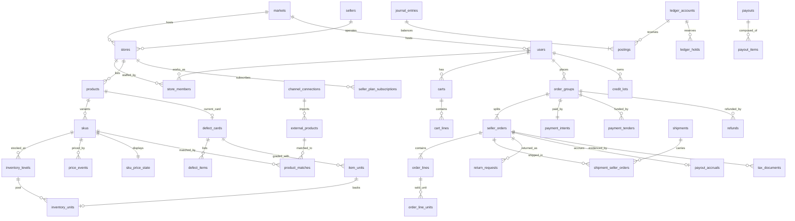

**Module dependency direction** (acyclic, enforced by dependency-cruiser): kernel/markets/flags/admin/auth/privacy/ledger → sellers, catalog, price_watch, search, seo, tax rates → inventory, cart, promotions, risk, orders → payments, store_credit, payouts → shipping, returns → notifications, analytics, engagement. `promotions`, `risk` ranking and seller modules may not read budget or measurement data. `ledger` is written only through `LedgerPort`.

## 5. Capacity and partition plan (estimates)

Assumptions (BUILD-PROMPT §3, unverified, replace with k6 and production numbers): 4M registered users, about 400k daily users, about 10% ordering per month, 1.4 stores per order, 2.5 lines per seller order, about 2M live SKUs at maturity.

| Table | Rows per month (estimate) | Plan |
|---|---|---|
| `order_groups` / `seller_orders` / `order_lines` | 0.4M / 0.56M / 1.4M | Unpartitioned in Phase 1 (DM-12) |
| `journal_entries` / `postings` | about 1.5M / 6M | Monthly by UUIDv7 range, aligned |
| `outbox_events` / `inbox_processed` | about 30M / 60–90M | Monthly by UUIDv7 range; drop after 60 days |
| `audit_log` | about 10M | Monthly; 7-year retention, sealed |
| `price_events` | about 5M | Monthly by `valid_from` |
| `channel_snapshots` | 5–20M per **day** at maturity | Daily; drop after 13 months |
| `search_queries` | about 60M | Monthly; 25 months |
| `analytics_events` | 300M+ | ClickHouse monthly partitions, TTL 25 months |
| `inventory_units` | bounded: ≤ 1,000 per SKU-location pool | Not partitioned; kept small by compaction |
| `notification_requests` / `deliveries` | 20M / 30M | Monthly; 12 months |

Connection pools (BUILD-PROMPT §3): separate PgBouncer pools for `checkout.reserve`, `catalog.read` and `analytics`; pools × size × instances < 0.8 × `max_connections`.

## 6. Module index

| # | Module | Phase | Tables | Personal tables | Partitioned |
|---|---|---|---|---|---|
| 1 | [Markets, cells and configuration](#m-markets) | 0 | 6 | 0 | 0 |
| 2 | [Platform kernel: outbox, inbox, idempotency, dedup, sagas, audit, media, keys](#m-kernel) | 0 | 10 | 6 | 4 |
| 3 | [Feature flags and kill switches](#m-flags) | 0 | 2 | 0 | 0 |
| 4 | [Admin staff, RBAC and dual approval](#m-admin) | 0 | 8 | 5 | 0 |
| 5 | [Identity, sessions and devices](#m-auth) | 0 | 13 | 13 | 1 |
| 6 | [Consent and privacy (PDPL)](#m-privacy) | 0 | 8 | 4 | 1 |
| 7 | [Sellers, KYC, stores and staff](#m-sellers) | 1 | 15 | 11 | 0 |
| 8 | [Seller plans and commission (SaaS)](#m-seller-plans) | 1 | 5 | 0 | 0 |
| 9 | [Catalog: categories, brands, listings, variants, condition and defects](#m-catalog) | 1 | 18 | 1 | 1 |
| 10 | [Size profiles, reviews and see-it-first requests](#m-engagement) | 1 | 4 | 4 | 0 |
| 11 | [Price integrity and Price Watch](#m-price-watch) | 1 | 15 | 6 | 5 |
| 12 | [Inventory: levels, row-per-unit pool, reservations](#m-inventory) | 1 | 6 | 2 | 1 |
| 13 | [Bag and wishlists](#m-cart) | 1 | 6 | 6 | 0 |
| 14 | [Checkout and orders](#m-orders) | 1 | 9 | 7 | 2 |
| 15 | [Payments, webhooks and settlement](#m-payments) | 1 | 9 | 4 | 2 |
| 16 | [Ledger (double-entry)](#m-ledger) | 0 | 10 | 1 | 2 |
| 17 | [Payouts](#m-payouts) | 1 | 4 | 1 | 0 |
| 18 | [Closed-loop store credit](#m-store-credit) | 1 | 2 | 2 | 0 |
| 19 | [Returns, disputes and refunds](#m-returns) | 1 | 8 | 5 | 0 |
| 20 | [Shipping: domestic and international](#m-shipping) | 1 | 17 | 4 | 3 |
| 21 | [Tax engine and ETA](#m-tax) | 1 | 6 | 2 | 1 |
| 22 | [Promotions, vouchers, Drop Hour and Outlet Parties](#m-promotions) | 1 | 8 | 3 | 0 |
| 23 | [Fraud and COD risk](#m-risk) | 1 | 5 | 5 | 1 |
| 24 | [Notifications](#m-notifications) | 1 | 5 | 4 | 3 |
| 25 | [Search sync and saved searches](#m-search) | 1 | 4 | 2 | 1 |
| 26 | [SEO: slugs, redirects, sitemaps, facets, feeds](#m-seo) | 1 | 5 | 0 | 0 |
| 27 | [Analytics events (warehouse)](#m-analytics) | 1 | 1 | 1 | 1 |
| | **Total** | | **209** | **99** | **29** |

## 7. Modules

<a id="m-markets"></a>
### 7.1 Markets, cells and configuration

Every market-scoped row carries `market_id` (ADR-0006). A **market** is a country storefront with its own currency, languages, time zone, tax rules and legal windows. A **cell** is the physical home of a market's personal, money and stock data (EG cell in Egypt, hybrid residency per the ADR-0002 draft). Country rules are configuration rows, never `if (EG)` code. Config is versioned and immutable per version; the actor trail of every config change goes to the cell `audit_log`, so global tables hold no personal data.

**Config keys used by Phase 1** (namespace.key, Zod-validated per key in `packages/config`): `returns.no_reason_days` (14), `returns.defect_days` (30, V19), `cancel.distance_selling_days` (7, V7), `age.shop_min` (18), `age.contract_min` (21, V8), `quiet_hours.start/end` (23:00-09:00 local), `cod.first_order_cap_minor`, `cod.confirm_within_minutes` (120), `delivery.free_threshold_minor` (200000 = 2,000 EGP), `price.reference_window_days` (30), `price.min_claim_bp` (500), `price.match_tau_bp` (9200, V13), `price.evidence_stale_hours` (72), `drop.hour_local` ("21:00", after iftar in Ramadan from the calendar), `payments.funds_flow` (`psp_split` or `collect_payout`, Q2), `reservation.ttl.card_s` (600), `reservation.ttl.wallet_s` (1800), `reservation.ttl.fawry_s` (86400), `discount.display_default` (`public`, D3).

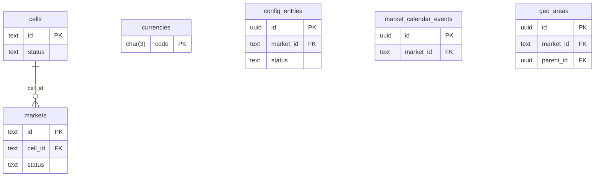

#### `cells`
Phase 0 · residency `global` · tenant none · no personal data · basis `not_personal_data` · retention `config_versions` · not partitioned

Physical data homes. Routing layer maps market -> cell.

| Column | Type | Null | PII | Notes |
|---|---|---|---|---|
| `id` | text PK | no | P0 | e.g. 'eg-1' |
| `provider` | text | no | P1 | e.g. huawei_cairo (V37) |
| `region_code` | text | no | P1 | provider region id |
| `country_code` | char(2) | no | P0 | ISO 3166-1 where the data physically lives |
| `status` | text | no | P1 | planned, live, draining |
| `created_at` | timestamptz | no | P1 | UTC |
- ⚠ VERIFY: V37

#### `markets`
Phase 0 · residency `global` · tenant none · no personal data · basis `not_personal_data` · retention `config_versions` · not partitioned

One row per country storefront.

| Column | Type | Null | PII | Notes |
|---|---|---|---|---|
| `id` | text PK | no | P0 | ISO 3166-1 alpha-2, 'EG' at launch; natural key (decision DM-01) |
| `cell_id` | text | no | P1 | -> `cells`. where this market's personal and money data lives |
| `name_ar` | text | no | P0 |  |
| `name_en` | text | no | P0 |  |
| `default_locale` | text | no | P0 | 'ar-EG' |
| `locales` | text[] | no | P0 | bounded list, e.g. {ar-EG,en-EG} |
| `currency` | char(3) | no | P0 | settlement currency, 'EGP' |
| `timezone` | text | no | P0 | IANA, 'Africa/Cairo' |
| `url_prefix` | text | no | P0 | '/eg-ar/' style path segment root (ADR-0006 #12) |
| `status` | text | no | P1 | planned, invite_only, live, paused |
| `launched_at` | timestamptz | yes | P1 |  |
| `created_at` | timestamptz | no | P1 | UTC |

- Key: `UNIQUE (url_prefix)`

#### `currencies`
Phase 0 · residency `global` · tenant none · no personal data · basis `not_personal_data` · retention `config_versions` · not partitioned

Reference data for money formatting and rounding.

| Column | Type | Null | PII | Notes |
|---|---|---|---|---|
| `code` | char(3) PK | no | P0 | ISO 4217 |
| `minor_unit` | smallint | no | P0 | 2 for EGP; amounts are bigint in these units |
| `symbol_ar` | text | no | P0 | 'ج.م' |
| `symbol_en` | text | no | P0 | 'EGP' |

#### `config_entries`
Phase 0 · residency `global` · tenant none · no personal data · basis `not_personal_data` · retention `config_versions` · not partitioned

Versioned, admin-editable parameters. Per-market rows override platform defaults.

| Column | Type | Null | PII | Notes |
|---|---|---|---|---|
| `id` | uuid PK | no | P1 | UUIDv7 |
| `namespace` | text | no | P1 | e.g. returns, cod, price, drop |
| `key` | text | no | P1 |  |
| `market_id` | text | yes | P1 | -> `markets`. NULL = platform-wide default |
| `version` | int | no | P1 | immutable per version |
| `value` | jsonb | no | P1 | validated by the Zod schema registered for namespace.key |
| `status` | text | no | P1 | draft, active, retired |
| `valid_from` | timestamptz | no | P1 |  |
| `approval_ref` | uuid | yes | P1 | approval_requests.id in the cell (dual approval for money/legal keys); logical reference |
| `created_at` | timestamptz | no | P1 | UTC |

- Key: `UNIQUE (namespace, key, market_id, version)`
- Key: `UNIQUE (namespace, key, market_id) WHERE status = 'active'` -> one live value
- Index: `(market_id, namespace) WHERE status = 'active'` -> config load at boot and on change event

#### `market_calendar_events`
Phase 1 · residency `global` · tenant none · no personal data · basis `not_personal_data` · retention `config_versions` · not partitioned

Ramadan-Eid calendar engine (feature 47). Drop Hour moves after iftar in Ramadan.

| Column | Type | Null | PII | Notes |
|---|---|---|---|---|
| `id` | uuid PK | no | P1 | UUIDv7, server-generated |
| `market_id` | text | no | P1 | -> `markets`. market scope (ADR-0006) |
| `kind` | text | no | P0 | ramadan, eid_al_fitr, eid_al_adha, white_friday, mothers_day, back_to_school, payday, custom |
| `name_ar` | text | no | P0 |  |
| `name_en` | text | yes | P0 |  |
| `starts_at` | timestamptz | no | P0 | UTC; derived from local date + market timezone |
| `ends_at` | timestamptz | no | P0 |  |
| `local_date_from` | date | no | P0 | as announced locally (Hijri dates confirmed by source) |
| `local_date_to` | date | no | P0 |  |
| `source` | text | no | P1 | official announcement reference |
| `confirmed` | boolean | no | P1 | false until the official date is announced |
| `created_at` | timestamptz | no | P1 | UTC |

- Index: `(market_id, starts_at)` -> upcoming events for scheduling
- ⚠ VERIFY: V51

#### `geo_areas`
Phase 1 · residency `global` · tenant none · no personal data · basis `not_personal_data` · retention `config_versions` · not partitioned

Market address taxonomy (ADR-0006 #8). Address forms validate against it.

| Column | Type | Null | PII | Notes |
|---|---|---|---|---|
| `id` | uuid PK | no | P1 | UUIDv7, server-generated |
| `market_id` | text | no | P1 | -> `markets`. market scope (ADR-0006) |
| `parent_id` | uuid | yes | P0 | -> `geo_areas`. NULL for governorate |
| `level` | text | no | P0 | governorate, city, district |
| `code` | text | no | P0 | stable code (Bosta geo taxonomy as canonical source) |
| `name_ar` | text | no | P0 |  |
| `name_en` | text | yes | P0 |  |
| `courier_codes` | jsonb | no | P1 | map courier -> area code |
| `shipping_zone_code` | text | yes | P1 | domestic zone (Cairo/Giza, Delta, Canal, Upper, Remote) |
| `active` | boolean | no | P1 |  |
| `created_at` | timestamptz | no | P1 | UTC |

- Key: `UNIQUE (market_id, code)`
- Index: `(market_id, parent_id, level)` -> cascading address pickers

<a id="m-kernel"></a>
### 7.2 Platform kernel: outbox, inbox, idempotency, dedup, sagas, audit, media, keys

Shared plumbing every module uses. Delivery is **at-least-once**; every consumer is idempotent through `inbox_processed` (master prompt A2.7). Uniqueness that must hold across partitions uses **UUIDv7 range partitioning on the key itself** (decision DM-05): the same key always lands in the same partition, so a plain primary key stays globally unique and old partitions can be dropped.

**Outbox visibility rule (residency boundary).** `outbox_events.visibility = 'public'` events carry only P0 columns and are the *only* thing the relay may send to the global plane (catalog read models, search, CDN revalidation, sitemaps). A CI contract test asserts that public event schemas contain only P0 fields from `data_inventory.yaml`.

**Audit hash chain at scale.** Writers append to `audit_log` with a `row_hash` and never update. A single sealer job (not the write path, so writers are never serialised on one hash head) writes `audit_seals` every minute: `seal_hash = H(prev_seal_hash || merkle_root(row_hashes in id order))`, signs it with the audit key, and ships it to WORM storage. Verification recomputes row hashes and seals.

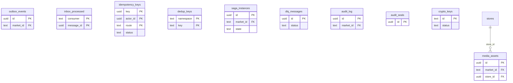

#### `outbox_events`
Phase 0 · residency `cell` · tenant none · personal data · basis `contract` · retention `outbox_60d` · partition: RANGE (id) monthly on UUIDv7 bounds; drop after 60 days

| Column | Type | Null | PII | Notes |
|---|---|---|---|---|
| `id` | uuid PK | no | P1 | UUIDv7; partition key (range by id, monthly) |
| `market_id` | text | no | P1 | -> `markets`. market scope (ADR-0006) |
| `aggregate_type` | text | no | P1 | e.g. seller_order |
| `aggregate_id` | uuid | no | P1 |  |
| `event_type` | text | no | P1 | 'aggregate.action', registry in packages/events |
| `visibility` | text | no | P1 | internal or public (public = P0 payload only, may leave the cell) |
| `payload` | jsonb | no | P2 | Zod-typed; may contain user ids; never P3 |
| `trace_id` | text | yes | P1 | OpenTelemetry trace |
| `occurred_at` | timestamptz | no | P1 | business time |
| `published_at` | timestamptz | yes | P1 | NULL until relayed |
| `attempts` | smallint | no | P1 |  |

- Index: `(id) WHERE published_at IS NULL` -> relay scan in commit order
- Index: `(aggregate_type, aggregate_id, id)` -> replay one aggregate
- Written in the same transaction as the state change (master prompt A2.7).

#### `inbox_processed`
Phase 0 · residency `cell` · tenant none · no personal data · basis `not_personal_data` · retention `dedup_30d` · partition: RANGE (message_id) monthly; drop after 60 days (redelivery window is 30 days)

| Column | Type | Null | PII | Notes |
|---|---|---|---|---|
| `consumer` | text PK | no | P1 | consumer name |
| `message_id` | uuid PK | no | P1 | outbox id or provider event UUIDv7; partition key |
| `processed_at` | timestamptz | no | P1 |  |

- Key: `PRIMARY KEY (consumer, message_id)`
- Inserted in the same transaction as the consumer's side effect.

#### `idempotency_keys`
Phase 0 · residency `cell` · tenant none · personal data · basis `contract` · retention `idempotency_24h` · partition: RANGE (key) daily; drop partitions older than 48 h

| Column | Type | Null | PII | Notes |
|---|---|---|---|---|
| `key` | uuid PK | no | P1 | client Idempotency-Key, must be UUIDv7 within +/-24 h of now (else 400); partition key |
| `actor_id` | uuid PK | no | P2 | user, staff or store principal |
| `route` | text PK | no | P1 | method + route template |
| `request_hash` | bytea | no | P1 | SHA-256 of canonical body; same key + different hash -> 422 |
| `status` | text | no | P1 | in_progress, completed |
| `response_status` | smallint | yes | P1 |  |
| `response_body` | jsonb | yes | P2 | minimal response (ids, status); never P3 |
| `locked_until` | timestamptz | yes | P1 | in-flight lock |
| `created_at` | timestamptz | no | P1 | UTC |

- Key: `PRIMARY KEY (key, actor_id, route)`
- Permanent money uniqueness lives in business keys (journal_entry_keys, payment_intents.order_group_id, refunds.idempotency_key), not here (master prompt A2.5).

#### `dedup_keys`
Phase 0 · residency `cell` · tenant none · no personal data · basis `not_personal_data` · retention `dedup_90d` · not partitioned

| Column | Type | Null | PII | Notes |
|---|---|---|---|---|
| `namespace` | text PK | no | P1 | e.g. webhook:paymob, webhook:bosta, notification |
| `key` | text PK | no | P1 | provider event id or dedupe key |
| `first_seen_at` | timestamptz | no | P1 |  |
| `ref_id` | uuid | yes | P1 | raw row id |

- Key: `PRIMARY KEY (namespace, key)`
- Index: `(first_seen_at)` -> purge job
- Small unpartitioned table so provider-supplied ids (not UUIDv7) dedupe globally.

#### `saga_instances`
Phase 0 · residency `cell` · tenant none · personal data · basis `contract` · retention `checkout_90d` · not partitioned

| Column | Type | Null | PII | Notes |
|---|---|---|---|---|
| `id` | uuid PK | no | P1 | UUIDv7, server-generated |
| `market_id` | text | no | P1 | -> `markets`. market scope (ADR-0006) |
| `saga_type` | text | no | P1 | checkout, refund, payout, cancellation_cascade |
| `ref_type` | text | no | P1 |  |
| `ref_id` | uuid | no | P1 |  |
| `state` | text | no | P1 | current step |
| `compensating` | boolean | no | P1 |  |
| `context` | jsonb | no | P2 | step inputs; ids only, never P3 |
| `attempts` | smallint | no | P1 |  |
| `next_run_at` | timestamptz | yes | P1 | timer for timeouts |
| `version` | int | no | P1 | optimistic lock / config version |
| `created_at` | timestamptz | no | P1 | UTC |
| `updated_at` | timestamptz | no | P1 | UTC |

- Key: `UNIQUE (saga_type, ref_id)`
- Index: `(next_run_at) WHERE state NOT IN ('done','failed')` -> timer sweep

#### `dlq_messages`
Phase 0 · residency `cell` · tenant none · personal data · basis `contract` · retention `dedup_90d` · not partitioned

| Column | Type | Null | PII | Notes |
|---|---|---|---|---|
| `id` | uuid PK | no | P1 | UUIDv7, server-generated |
| `consumer` | text | no | P1 |  |
| `message_id` | uuid | no | P1 |  |
| `payload` | jsonb | no | P2 |  |
| `error` | text | no | P1 |  |
| `attempts` | smallint | no | P1 |  |
| `status` | text | no | P1 | open, replayed, discarded |
| `created_at` | timestamptz | no | P1 | UTC |
| `resolved_at` | timestamptz | yes | P1 |  |

- Index: `(status, created_at)` -> DLQ console

#### `audit_log`
Phase 0 · residency `cell` · tenant none · personal data · basis `legal_obligation` · retention `audit_7y` · partition: RANGE (id) monthly

| Column | Type | Null | PII | Notes |
|---|---|---|---|---|
| `id` | uuid PK | no | P1 | UUIDv7; partition key |
| `market_id` | text | no | P1 | -> `markets`. market scope (ADR-0006) |
| `actor_type` | text | no | P1 | user, staff, store_member, system |
| `actor_id` | uuid | yes | P2 |  |
| `action` | text | no | P1 | e.g. config.changed, refund.approved, pii.viewed |
| `target_type` | text | no | P1 |  |
| `target_id` | text | no | P1 |  |
| `diff` | jsonb | yes | P2 | before/after, PII-redacted at the logger |
| `reason_code` | text | yes | P1 | required for staff actions on personal data |
| `ip_hmac` | bytea | yes | P2 (hmac) | keyed hash of IP; raw IP never stored |
| `device_id` | uuid | yes | P2 |  |
| `request_id` | text | yes | P1 |  |
| `row_hash` | bytea | no | P1 | H(canonical row) computed by the writer |
| `occurred_at` | timestamptz | no | P1 |  |

- Index: `(target_type, target_id, id)` -> history of one object
- Index: `(actor_id, id)` -> what did this actor do
- INSERT only for the app role; UPDATE/DELETE revoked and blocked by trigger.
- ⚠ VERIFY: V70

#### `audit_seals`
Phase 0 · residency `cell` · tenant none · no personal data · basis `not_personal_data` · retention `audit_7y` · not partitioned

| Column | Type | Null | PII | Notes |
|---|---|---|---|---|
| `id` | uuid PK | no | P1 | UUIDv7, server-generated |
| `chain_id` | text | no | P1 | one chain per cell |
| `from_id` | uuid | no | P1 | first audit_log id in the seal |
| `to_id` | uuid | no | P1 | last audit_log id |
| `row_count` | int | no | P1 |  |
| `merkle_root` | bytea | no | P1 |  |
| `prev_seal_hash` | bytea | no | P1 |  |
| `seal_hash` | bytea | no | P1 |  |
| `signature` | bytea | no | P1 | signed with the audit key (separate from encryption keys) |
| `sealed_at` | timestamptz | no | P1 |  |

- Key: `UNIQUE (chain_id, to_id)`

#### `media_assets`
Phase 0 · residency `cell_publishable` · tenant store_id (RLS) · personal data · basis `contract` · retention `catalog_life` · not partitioned

| Column | Type | Null | PII | Notes |
|---|---|---|---|---|
| `id` | uuid PK | no | P1 | UUIDv7, server-generated |
| `market_id` | text | no | P1 | -> `markets`. market scope (ADR-0006) |
| `owner_type` | text | no | P1 | product, defect_item, kyc_document, review, return, evidence, storefront, label |
| `owner_id` | uuid | yes | P1 |  |
| `store_id` | uuid | yes | P1 | -> `stores`. set for seller-owned media; RLS |
| `visibility` | text | no | P1 | public (may go to CDN) or private (signed URL <= 15 min) |
| `media_pii_class` | text | no | P1 | P0..P3 of the content; P3 never public |
| `bucket` | text | no | P1 | cell bucket; public copies are derived renditions |
| `object_key` | text | no | P1 |  |
| `mime` | text | no | P1 | sniffed, not trusted from client |
| `bytes` | bigint | no | P1 |  |
| `width` | int | yes | P1 |  |
| `height` | int | yes | P1 |  |
| `sha256` | bytea | no | P1 | dedup and tamper evidence |
| `phash` | bytea | yes | P1 | perceptual hash for relist and counterfeit detection |
| `blurhash` | text | yes | P0 |  |
| `scan_status` | text | no | P1 | pending, clean, infected, rejected |
| `exif_stripped` | boolean | no | P1 | GPS and EXIF removed before any use |
| `uploaded_by` | uuid | yes | P2 |  |
| `created_at` | timestamptz | no | P1 | UTC |
| `deleted_at` | timestamptz | yes | P1 |  |

- Index: `(owner_type, owner_id)` -> media of an object
- Index: `(sha256)` -> dedup
- Index: `(scan_status) WHERE scan_status = 'pending'` -> AV queue
- RLS: Policy: store_id = app.current_store_id OR store_id IS NULL AND owner is the current user (via owning table).
- Only visibility = public AND media_pii_class = 'P0' renditions are copied to the global CDN. KYC documents and return photos never leave the cell.

#### `crypto_keys`
Phase 0 · residency `cell` · tenant none · no personal data · basis `not_personal_data` · retention `config_versions` · not partitioned

| Column | Type | Null | PII | Notes |
|---|---|---|---|---|
| `id` | text PK | no | P1 | key id stored in every ciphertext header |
| `purpose` | text | no | P1 | field_encryption, blind_index, audit_signing, token_hmac |
| `kms_ref` | text | no | P1 | KMS key reference in the cell |
| `version` | int | no | P1 |  |
| `status` | text | no | P1 | active, decrypt_only, retired |
| `created_at` | timestamptz | no | P1 | UTC |
| `rotated_at` | timestamptz | yes | P1 |  |
- Separate keys for encryption, blind index and audit chain (security research note). Yearly rotation with lazy re-encryption.

<a id="m-flags"></a>
### 7.3 Feature flags and kill switches

OpenFeature with a self-hosted provider. Flags and rules are global configuration. **Targeting never stores user ids** in global tables: rules target markets, stores (business ids), segments or a percentage hash. Every toggle is written to the cell `audit_log`. Kill switches exist for each payment method, COD, BNPL, drops, crawler, LLM features and international shipping (BUILD-PROMPT §8).

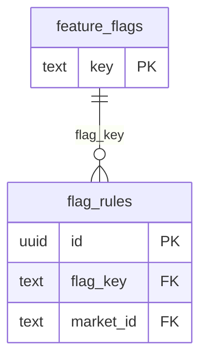

#### `feature_flags`
Phase 0 · residency `global` · tenant none · no personal data · basis `not_personal_data` · retention `config_versions` · not partitioned

| Column | Type | Null | PII | Notes |
|---|---|---|---|---|
| `key` | text PK | no | P1 | e.g. payments.cod.enabled |
| `kind` | text | no | P1 | release, experiment, kill_switch, ops |
| `description` | text | no | P1 |  |
| `owner_team` | text | no | P1 |  |
| `default_variant` | jsonb | no | P1 | safe value; kill switches default to blocked |
| `fail_mode` | text | no | P1 | closed or open when the provider is unreachable |
| `created_at` | timestamptz | no | P1 | UTC |
| `archived_at` | timestamptz | yes | P1 |  |

#### `flag_rules`
Phase 0 · residency `global` · tenant none · no personal data · basis `not_personal_data` · retention `config_versions` · not partitioned

| Column | Type | Null | PII | Notes |
|---|---|---|---|---|
| `id` | uuid PK | no | P1 | UUIDv7, server-generated |
| `flag_key` | text | no | P1 | -> `feature_flags`. |
| `market_id` | text | yes | P1 | -> `markets`. |
| `priority` | int | no | P1 |  |
| `condition` | jsonb | no | P1 | targeting (market, store id, segment, percentage); no user ids |
| `variant` | jsonb | no | P1 |  |
| `enabled` | boolean | no | P1 |  |
| `version` | int | no | P1 | optimistic lock / config version |
| `created_at` | timestamptz | no | P1 | UTC |
| `updated_at` | timestamptz | no | P1 | UTC |

- Index: `(flag_key, market_id, priority) WHERE enabled` -> evaluation order

<a id="m-admin"></a>
### 7.4 Admin staff, RBAC and dual approval

Admin staff are a **separate principal** from shoppers and seller staff (decision DM-09): own accounts, SSO plus mandatory passkey, IP allow-list for Finance and Super-admin. Roles and permissions are global definitions; assignments, approvals and sessions are personal data and live in the cell. Dual approval covers payouts and refunds above a threshold, plan price changes, role grants, data exports, money/legal config keys and ledger adjustments. `requested_by <> decided_by` is a CHECK constraint.

**State machines.** **ApprovalRequest**: `PENDING -> APPROVED -> EXECUTED`, `PENDING -> REJECTED | EXPIRED`.

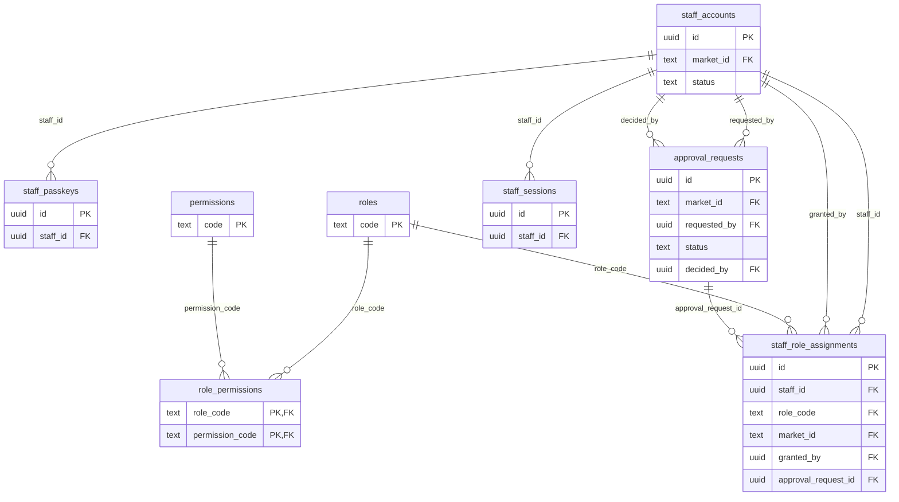

#### `staff_accounts`
Phase 0 · residency `cell` · tenant none · personal data · basis `contract` · retention `staff_access` · not partitioned

| Column | Type | Null | PII | Notes |
|---|---|---|---|---|
| `id` | uuid PK | no | P2 | staff principal id |
| `market_id` | text | no | P1 | -> `markets`. market scope (ADR-0006) |
| `email_ct` | bytea | no | P2 (enc) | corporate email |
| `email_bidx` | bytea | no | P2 (hmac) | lookup |
| `display_name` | text | no | P2 |  |
| `sso_subject_hash` | bytea | no | P2 (hash) | IdP subject |
| `status` | text | no | P1 | invited, active, suspended, deactivated |
| `created_at` | timestamptz | no | P1 | UTC |
| `updated_at` | timestamptz | no | P1 | UTC |
| `deactivated_at` | timestamptz | yes | P1 |  |

- Key: `UNIQUE (email_bidx)`
- Key: `UNIQUE (sso_subject_hash)`

#### `staff_passkeys`
Phase 0 · residency `cell` · tenant none · personal data · basis `contract` · retention `staff_access` · not partitioned

| Column | Type | Null | PII | Notes |
|---|---|---|---|---|
| `id` | uuid PK | no | P1 | UUIDv7, server-generated |
| `staff_id` | uuid | no | P2 | -> `staff_accounts`. |
| `credential_id` | bytea | no | P2 | WebAuthn credential id |
| `public_key` | bytea | no | P1 |  |
| `sign_count` | bigint | no | P1 |  |
| `aaguid` | uuid | yes | P1 |  |
| `created_at` | timestamptz | no | P1 | UTC |
| `last_used_at` | timestamptz | yes | P1 |  |
| `revoked_at` | timestamptz | yes | P1 |  |

- Key: `UNIQUE (credential_id)`

#### `roles`
Phase 0 · residency `global` · tenant none · no personal data · basis `not_personal_data` · retention `config_versions` · not partitioned

| Column | Type | Null | PII | Notes |
|---|---|---|---|---|
| `code` | text PK | no | P1 | e.g. ops, finance, trust_safety, support, marketing, dpo, security, super_admin; seller roles owner, manager, catalog, warehouse, finance, support |
| `scope` | text | no | P1 | admin or seller |
| `description` | text | no | P1 |  |
| `is_system` | boolean | no | P1 |  |

#### `permissions`
Phase 0 · residency `global` · tenant none · no personal data · basis `not_personal_data` · retention `config_versions` · not partitioned

| Column | Type | Null | PII | Notes |
|---|---|---|---|---|
| `code` | text PK | no | P1 | e.g. refunds.approve, payouts.release, pii.view |
| `description` | text | no | P1 |  |
| `risk` | text | no | P1 | low, high, dual_approval |

#### `role_permissions`
Phase 0 · residency `global` · tenant none · no personal data · basis `not_personal_data` · retention `config_versions` · not partitioned

| Column | Type | Null | PII | Notes |
|---|---|---|---|---|
| `role_code` | text PK | no | P1 | -> `roles`. |
| `permission_code` | text PK | no | P1 | -> `permissions`. |

- Key: `PRIMARY KEY (role_code, permission_code)`

#### `staff_role_assignments`
Phase 0 · residency `cell` · tenant none · personal data · basis `contract` · retention `staff_access` · not partitioned

| Column | Type | Null | PII | Notes |
|---|---|---|---|---|
| `id` | uuid PK | no | P1 | UUIDv7, server-generated |
| `staff_id` | uuid | no | P2 | -> `staff_accounts`. |
| `role_code` | text | no | P1 | -> `roles`. |
| `market_id` | text | no | P1 | -> `markets`. market scope (ADR-0006) |
| `granted_by` | uuid | no | P2 | -> `staff_accounts`. |
| `approval_request_id` | uuid | yes | P1 | -> `approval_requests`. dual approval for role grants |
| `reason` | text | no | P1 |  |
| `starts_at` | timestamptz | no | P1 |  |
| `expires_at` | timestamptz | yes | P1 | just-in-time elevation ends here |
| `revoked_at` | timestamptz | yes | P1 |  |
| `created_at` | timestamptz | no | P1 | UTC |

- Index: `(staff_id) WHERE revoked_at IS NULL` -> permission load at login

#### `staff_sessions`
Phase 0 · residency `cell` · tenant none · personal data · basis `contract` · retention `staff_access` · not partitioned

| Column | Type | Null | PII | Notes |
|---|---|---|---|---|
| `id` | uuid PK | no | P1 | UUIDv7, server-generated |
| `staff_id` | uuid | no | P2 | -> `staff_accounts`. |
| `amr` | text[] | no | P1 | must contain a passkey method |
| `ip_hmac` | bytea | no | P2 (hmac) |  |
| `user_agent_hash` | bytea | yes | P2 (hash) |  |
| `created_at` | timestamptz | no | P1 | UTC |
| `expires_at` | timestamptz | no | P1 | short (8 h max) |
| `revoked_at` | timestamptz | yes | P1 |  |

- Index: `(staff_id, created_at DESC)`

#### `approval_requests`
Phase 0 · residency `cell` · tenant none · personal data · basis `legal_obligation` · retention `audit_7y` · not partitioned

| Column | Type | Null | PII | Notes |
|---|---|---|---|---|
| `id` | uuid PK | no | P1 | UUIDv7, server-generated |
| `market_id` | text | no | P1 | -> `markets`. market scope (ADR-0006) |
| `action` | text | no | P1 | payout_release, refund_over_threshold, role_grant, data_export, plan_price_change, config_change, ledger_adjustment, store_suspension |
| `target_type` | text | no | P1 |  |
| `target_id` | text | no | P1 |  |
| `payload_hash` | bytea | no | P1 | approver signs exactly what will execute |
| `requested_by` | uuid | no | P2 | -> `staff_accounts`. |
| `status` | text | no | P1 | see ApprovalRequest machine |
| `decided_by` | uuid | yes | P2 | -> `staff_accounts`. CHECK decided_by <> requested_by |
| `decided_at` | timestamptz | yes | P1 |  |
| `reason` | text | yes | P1 |  |
| `expires_at` | timestamptz | no | P1 |  |
| `created_at` | timestamptz | no | P1 | UTC |

- Index: `(market_id, status, created_at) WHERE status = 'PENDING'` -> approver queue
- State machine: ApprovalRequest (see module intro).

<a id="m-auth"></a>
### 7.5 Identity, sessions and devices

One identity table for **shoppers and seller staff** (a brand owner can also shop); seller capabilities need an active `store_members` row and a passkey in the session `amr` (decision DM-09). Accounts are **per market cell**: there is no global user directory, so no personal data sits in the global plane (decision DM-02). Phone is the account key: E.164, envelope-encrypted, with an HMAC blind index for the unique lookup. Access JWT 10 min; refresh tokens are opaque, device-bound, rotated on every use, and reuse revokes the whole family (BUILD-PROMPT §4).

**State machines.** **User status**: `active -> suspended -> active`, `active -> deletion_pending (14-day cooling) -> deleted` (PII erased, financial rows pseudonymised, V77).

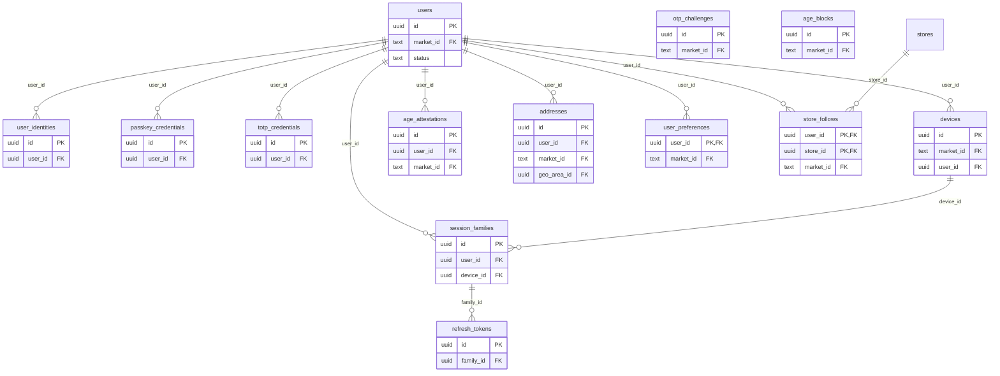

#### `users`
Phase 0 · residency `cell` · tenant user_id (RLS) · personal data · basis `contract` · retention `account_active` · not partitioned

| Column | Type | Null | PII | Notes |
|---|---|---|---|---|
| `id` | uuid PK | no | P2 | pseudonymous account id (UUIDv7) |
| `market_id` | text | no | P1 | -> `markets`. market scope (ADR-0006) |
| `status` | text | no | P1 | active, suspended, deletion_pending, deleted |
| `phone_ct` | bytea | yes | P3 (enc) | E.164 phone |
| `phone_bidx` | bytea | yes | P2 (hmac) | blind index; unique per market |
| `email_ct` | bytea | yes | P2 (enc) | may be an Apple private-relay address |
| `email_bidx` | bytea | yes | P2 (hmac) |  |
| `dob_ct` | bytea | yes | P3 (enc) | date of birth |
| `age_band` | text | yes | P2 | under_18_blocked, 18_20, 21_plus |
| `limited_capacity` | boolean | no | P2 | true for 18-20 (V8) |
| `display_name` | text | yes | P2 | nickname shown on reviews only if the user opts in |
| `locale` | text | no | P2 | ar-EG default |
| `phone_verified_at` | timestamptz | yes | P2 |  |
| `created_at` | timestamptz | no | P1 | UTC |
| `updated_at` | timestamptz | no | P1 | UTC |
| `deleted_at` | timestamptz | yes | P1 |  |

- Key: `UNIQUE (market_id, phone_bidx) WHERE phone_bidx IS NOT NULL` -> one account per phone
- Key: `UNIQUE (market_id, email_bidx) WHERE email_bidx IS NOT NULL`
- RLS: Policy: id = app.current_user_id.
- ⚠ VERIFY: V8, V73

#### `user_identities`
Phase 0 · residency `cell` · tenant user_id (RLS) · personal data · basis `contract` · retention `account_active` · not partitioned

| Column | Type | Null | PII | Notes |
|---|---|---|---|---|
| `id` | uuid PK | no | P1 | UUIDv7, server-generated |
| `user_id` | uuid | no | P2 | -> `users`. owner; RLS app.current_user_id |
| `provider` | text | no | P1 | apple, google, phone |
| `subject_ct` | bytea | no | P2 (enc) | provider subject |
| `subject_bidx` | bytea | no | P2 (hmac) |  |
| `verified_at` | timestamptz | yes | P2 |  |
| `last_auth_at` | timestamptz | yes | P2 |  |
| `created_at` | timestamptz | no | P1 | UTC |

- Key: `UNIQUE (provider, subject_bidx)`
- Index: `(user_id)`
- RLS: `user_id = current_setting('app.current_user_id')::uuid`, FORCE RLS.

#### `passkey_credentials`
Phase 0 · residency `cell` · tenant user_id (RLS) · personal data · basis `contract` · retention `account_active` · not partitioned

| Column | Type | Null | PII | Notes |
|---|---|---|---|---|
| `id` | uuid PK | no | P1 | UUIDv7, server-generated |
| `user_id` | uuid | no | P2 | -> `users`. owner; RLS app.current_user_id |
| `credential_id` | bytea | no | P2 |  |
| `public_key` | bytea | no | P1 |  |
| `sign_count` | bigint | no | P1 |  |
| `aaguid` | uuid | yes | P1 |  |
| `transports` | text[] | yes | P1 |  |
| `backup_eligible` | boolean | no | P1 |  |
| `created_at` | timestamptz | no | P1 | UTC |
| `last_used_at` | timestamptz | yes | P2 |  |
| `revoked_at` | timestamptz | yes | P1 |  |

- Key: `UNIQUE (credential_id)`
- Index: `(user_id) WHERE revoked_at IS NULL`
- RLS: `user_id = current_setting('app.current_user_id')::uuid`, FORCE RLS.

#### `totp_credentials`
Phase 0 · residency `cell` · tenant user_id (RLS) · personal data · basis `contract` · retention `account_active` · not partitioned

| Column | Type | Null | PII | Notes |
|---|---|---|---|---|
| `id` | uuid PK | no | P1 | UUIDv7, server-generated |
| `user_id` | uuid | no | P2 | -> `users`. owner; RLS app.current_user_id |
| `secret_ct` | bytea | no | P3 (enc) | TOTP seed |
| `confirmed_at` | timestamptz | yes | P1 |  |
| `created_at` | timestamptz | no | P1 | UTC |
| `revoked_at` | timestamptz | yes | P1 |  |

- Index: `(user_id) WHERE revoked_at IS NULL`
- RLS: `user_id = current_setting('app.current_user_id')::uuid`, FORCE RLS.
- Fallback second factor for seller staff only.

#### `otp_challenges`
Phase 0 · residency `cell` · tenant none · personal data · basis `contract` · retention `otp_30d` · partition: RANGE (id) monthly; drop after 2 months

| Column | Type | Null | PII | Notes |
|---|---|---|---|---|
| `id` | uuid PK | no | P1 | partition key |
| `market_id` | text | no | P1 | -> `markets`. market scope (ADR-0006) |
| `phone_bidx` | bytea | no | P2 (hmac) |  |
| `purpose` | text | no | P1 | login, verify_phone, step_up |
| `code_hash` | bytea | no | P2 (hash) | 6-digit code, salted hash |
| `channel` | text | no | P1 | sms or whatsapp |
| `provider` | text | no | P1 |  |
| `attempts` | smallint | no | P1 | max 5 per code |
| `expires_at` | timestamptz | no | P1 | 5 minutes |
| `verified_at` | timestamptz | yes | P1 |  |
| `device_id` | uuid | yes | P2 |  |
| `ip_hmac` | bytea | yes | P2 (hmac) |  |
| `created_at` | timestamptz | no | P1 | UTC |

- Index: `(phone_bidx, created_at DESC)` -> 3 sends / 15 min per phone
- Index: `(device_id, created_at DESC)` -> 10 / day per device
- SMS-pumping controls: EG prefixes only at launch, per-prefix caps, spend circuit breaker (BUILD-PROMPT §4).

#### `devices`
Phase 0 · residency `cell` · tenant user_id (RLS) · personal data · basis `contract` · retention `device_13m` · not partitioned

| Column | Type | Null | PII | Notes |
|---|---|---|---|---|
| `id` | uuid PK | no | P2 | device identifier |
| `market_id` | text | no | P1 | -> `markets`. market scope (ADR-0006) |
| `user_id` | uuid | yes | P2 | -> `users`. NULL before sign-in |
| `platform` | text | no | P1 | web, ios, android |
| `install_id_hash` | bytea | no | P2 (hash) | random first-party id (web) or install id (apps) |
| `ua_family` | text | yes | P1 | coarse browser family |
| `attest_status` | text | yes | P1 | turnstile_ok, app_attest_ok, unknown |
| `web_push_ct` | bytea | yes | P2 (enc) | push subscription endpoint + keys |
| `first_seen_at` | timestamptz | no | P1 |  |
| `last_seen_at` | timestamptz | no | P1 |  |
| `revoked_at` | timestamptz | yes | P1 |  |

- Key: `UNIQUE (install_id_hash)`
- Index: `(user_id, last_seen_at DESC)` -> active devices list
- RLS: `user_id = current_setting('app.current_user_id')::uuid`, FORCE RLS.
- ⚠ VERIFY: V76

#### `session_families`
Phase 0 · residency `cell` · tenant user_id (RLS) · personal data · basis `contract` · retention `auth_30d` · not partitioned

| Column | Type | Null | PII | Notes |
|---|---|---|---|---|
| `id` | uuid PK | no | P1 | UUIDv7, server-generated |
| `user_id` | uuid | no | P2 | -> `users`. owner; RLS app.current_user_id |
| `device_id` | uuid | no | P2 | -> `devices`. |
| `amr` | text[] | no | P1 | otp, apple, google, passkey |
| `created_at` | timestamptz | no | P1 | UTC |
| `revoked_at` | timestamptz | yes | P1 |  |
| `revoke_reason` | text | yes | P1 | logout, reuse_detected, admin, password_change |

- Index: `(user_id) WHERE revoked_at IS NULL` -> active sessions
- RLS: `user_id = current_setting('app.current_user_id')::uuid`, FORCE RLS.

#### `refresh_tokens`
Phase 0 · residency `cell` · tenant none · personal data · basis `contract` · retention `auth_30d` · not partitioned

| Column | Type | Null | PII | Notes |
|---|---|---|---|---|
| `id` | uuid PK | no | P1 | UUIDv7, server-generated |
| `family_id` | uuid | no | P1 | -> `session_families`. |
| `token_hash` | bytea | no | P2 (hash) | opaque token, SHA-256 only |
| `rotation_no` | int | no | P1 |  |
| `issued_at` | timestamptz | no | P1 |  |
| `used_at` | timestamptz | yes | P1 | set once; a second use = reuse -> revoke family |
| `expires_at` | timestamptz | no | P1 | 30 days |

- Key: `UNIQUE (token_hash)`
- Index: `(family_id, rotation_no DESC)`
- Index: `(expires_at)` -> purge

#### `age_attestations`
Phase 1 · residency `cell` · tenant user_id (RLS) · personal data · basis `legal_obligation` · retention `consent_evidence` · not partitioned

| Column | Type | Null | PII | Notes |
|---|---|---|---|---|
| `id` | uuid PK | no | P1 | UUIDv7, server-generated |
| `user_id` | uuid | no | P2 | -> `users`. owner; RLS app.current_user_id |
| `market_id` | text | no | P1 | -> `markets`. market scope (ADR-0006) |
| `attested_18_at` | timestamptz | no | P2 |  |
| `policy_version` | int | no | P1 | config_entries age.* version shown |
| `method` | text | no | P1 | self_attest, provider_kyc |
| `created_at` | timestamptz | no | P1 | UTC |

- Index: `(user_id)`
- RLS: `user_id = current_setting('app.current_user_id')::uuid`, FORCE RLS.
- ⚠ VERIFY: V8

#### `age_blocks`
Phase 1 · residency `cell` · tenant none · personal data · basis `legal_obligation` · retention `underage_block_30d` · not partitioned

| Column | Type | Null | PII | Notes |
|---|---|---|---|---|
| `id` | uuid PK | no | P1 | UUIDv7, server-generated |
| `market_id` | text | no | P1 | -> `markets`. market scope (ADR-0006) |
| `device_hash` | bytea | no | P2 (hash) |  |
| `dob_hash` | bytea | no | P2 (hash) |  |
| `blocked_until` | timestamptz | no | P1 | 30 days |
| `created_at` | timestamptz | no | P1 | UTC |

- Index: `(device_hash) WHERE blocked_until > now()` -> retry block
- Under-18: no PII beyond the device hash is stored (master prompt §1 acceptance).

#### `addresses`
Phase 1 · residency `cell` · tenant user_id (RLS) · personal data · basis `contract` · retention `account_active` · not partitioned

| Column | Type | Null | PII | Notes |
|---|---|---|---|---|
| `id` | uuid PK | no | P1 | UUIDv7, server-generated |
| `user_id` | uuid | no | P2 | -> `users`. owner; RLS app.current_user_id |
| `market_id` | text | no | P1 | -> `markets`. market scope (ADR-0006) |
| `country_code` | char(2) | no | P1 | address schema per country (ADR-0006 #8) |
| `label` | text | yes | P2 | home, work |
| `recipient_name_ct` | bytea | no | P3 (enc) |  |
| `phone_ct` | bytea | no | P3 (enc) |  |
| `address_ct` | bytea | no | P3 (enc) | Zod country document: street, building, floor, apartment, landmark |
| `pin_ct` | bytea | yes | P3 (enc) | map pin (precise location) |
| `geo_area_id` | uuid | no | P2 | -> `geo_areas`. district, kept clear for zoning and quotes |
| `is_default` | boolean | no | P1 |  |
| `validated_at` | timestamptz | yes | P1 | courier coverage check |
| `created_at` | timestamptz | no | P1 | UTC |
| `updated_at` | timestamptz | no | P1 | UTC |
| `deleted_at` | timestamptz | yes | P1 |  |

- Index: `(user_id) WHERE deleted_at IS NULL` -> address book
- RLS: `user_id = current_setting('app.current_user_id')::uuid`, FORCE RLS.

#### `user_preferences`
Phase 1 · residency `cell` · tenant user_id (RLS) · personal data · basis `contract` · retention `account_active` · not partitioned

| Column | Type | Null | PII | Notes |
|---|---|---|---|---|
| `user_id` | uuid PK | no | P2 | -> `users`. |
| `market_id` | text | no | P1 | -> `markets`. market scope (ADR-0006) |
| `numeral_pref` | text | no | P2 | western or eastern Arabic digits |
| `world_filter` | text | no | P2 | local, global, both (default both) |
| `destination_country` | char(2) | no | P2 | shipping filter (Ship within Egypt / abroad) |
| `personalization_enabled` | boolean | no | P2 | off = non-personalised ranking |
| `updated_at` | timestamptz | no | P1 |  |
- RLS: `user_id = current_setting('app.current_user_id')::uuid`, FORCE RLS.

#### `store_follows`
Phase 1 · residency `cell` · tenant user_id (RLS) · personal data · basis `contract` · retention `account_active` · not partitioned

| Column | Type | Null | PII | Notes |
|---|---|---|---|---|
| `user_id` | uuid PK | no | P2 | -> `users`. owner; RLS app.current_user_id |
| `store_id` | uuid PK | no | P1 | -> `stores`. followed store (not a tenant key here) |
| `market_id` | text | no | P1 | -> `markets`. market scope (ADR-0006) |
| `followed_at` | timestamptz | no | P1 |  |
| `last_seen_at` | timestamptz | yes | P2 | for "new since last visit" counters |

- Key: `PRIMARY KEY (user_id, store_id)`
- Index: `(store_id, followed_at)` -> follower count job (sellers see counts only)
- RLS: `user_id = current_setting('app.current_user_id')::uuid`, FORCE RLS.

<a id="m-privacy"></a>
### 7.6 Consent and privacy (PDPL)

Consent is explicit, granular, never pre-ticked and withdrawable in one tap. SDKs and marketing channels start **only after** the matching purpose is granted; `consent_state` is the fast gate, `consent_records` the append-only proof. Purposes and texts are per market and versioned (ADR-0006 #3). DSAR export and deletion run as `privacy_requests`; financial and tax rows are pseudonymised, not deleted (V77). Breach handling tracks the PDPC 72-hour and subject 3-day clocks.

**State machines.** **PrivacyRequest**: `RECEIVED -> VERIFIED -> (BLOCKED | COOLING | IN_PROGRESS) -> COMPLETED`, `COOLING -> CANCELLED`, `RECEIVED -> REJECTED`. **Breach**: `DETECTED -> TRIAGED (<= 4 h) -> DPO_DECIDED -> PDPC_NOTIFIED (<= 72 h) -> SUBJECTS_NOTIFIED (<= 3 days) -> CLOSED`.

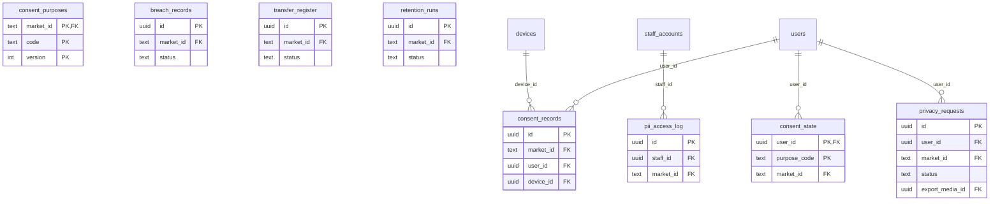

#### `consent_purposes`
Phase 0 · residency `global` · tenant none · no personal data · basis `not_personal_data` · retention `config_versions` · not partitioned

| Column | Type | Null | PII | Notes |
|---|---|---|---|---|
| `market_id` | text PK | no | P1 | -> `markets`. market scope (ADR-0006) |
| `code` | text PK | no | P1 | marketing_push, marketing_whatsapp, marketing_email, analytics, personalization, measurements, location_precise, cross_border_ml |
| `version` | int PK | no | P1 |  |
| `text_ar` | text | no | P0 | consent wording shown (AR authoritative) |
| `text_en` | text | yes | P0 |  |
| `effective_at` | timestamptz | no | P1 |  |

- Key: `PRIMARY KEY (market_id, code, version)`
- ⚠ VERIFY: V1

#### `consent_records`
Phase 0 · residency `cell` · tenant user_id (RLS) · personal data · basis `legal_obligation` · retention `consent_evidence` · not partitioned

| Column | Type | Null | PII | Notes |
|---|---|---|---|---|
| `id` | uuid PK | no | P1 | UUIDv7, server-generated |
| `market_id` | text | no | P1 | -> `markets`. market scope (ADR-0006) |
| `user_id` | uuid | yes | P2 | -> `users`. NULL for a visitor (banner) |
| `device_id` | uuid | yes | P2 | -> `devices`. |
| `purpose_code` | text | no | P1 |  |
| `purpose_version` | int | no | P1 |  |
| `granted` | boolean | no | P2 |  |
| `method` | text | no | P1 | banner, onboarding, settings, api |
| `ip_hmac` | bytea | yes | P2 (hmac) |  |
| `recorded_at` | timestamptz | no | P1 |  |

- Index: `(user_id, purpose_code, recorded_at DESC)` -> latest decision
- Index: `(device_id, purpose_code, recorded_at DESC)`
- RLS: `user_id = current_setting('app.current_user_id')::uuid`, FORCE RLS.
- Append-only. The app role has INSERT and SELECT only.
- ⚠ VERIFY: V1, V76

#### `consent_state`
Phase 0 · residency `cell` · tenant user_id (RLS) · personal data · basis `legal_obligation` · retention `account_active` · not partitioned

| Column | Type | Null | PII | Notes |
|---|---|---|---|---|
| `user_id` | uuid PK | no | P2 | -> `users`. owner; RLS app.current_user_id |
| `purpose_code` | text PK | no | P1 |  |
| `market_id` | text | no | P1 | -> `markets`. market scope (ADR-0006) |
| `granted` | boolean | no | P2 |  |
| `purpose_version` | int | no | P1 |  |
| `updated_at` | timestamptz | no | P1 |  |

- Key: `PRIMARY KEY (user_id, purpose_code)`
- Index: `(purpose_code, granted)` -> audience gating for campaigns
- RLS: `user_id = current_setting('app.current_user_id')::uuid`, FORCE RLS.
- Projection of consent_records, written in the same transaction.

#### `privacy_requests`
Phase 0 · residency `cell` · tenant user_id (RLS) · personal data · basis `legal_obligation` · retention `consent_evidence` · not partitioned

| Column | Type | Null | PII | Notes |
|---|---|---|---|---|
| `id` | uuid PK | no | P1 | UUIDv7, server-generated |
| `user_id` | uuid | no | P2 | -> `users`. owner; RLS app.current_user_id |
| `market_id` | text | no | P1 | -> `markets`. market scope (ADR-0006) |
| `kind` | text | no | P1 | export, delete, rectify, restrict, object |
| `status` | text | no | P1 | see PrivacyRequest machine |
| `blocked_reason` | text | yes | P1 | open orders, returns or disputes (shown to the user) |
| `due_at` | timestamptz | no | P1 | 30 days default (statutory deadline V1) |
| `cooling_until` | timestamptz | yes | P1 | deletion: 14 days |
| `export_media_id` | uuid | yes | P1 | -> `media_assets`. AR/EN ZIP, signed URL 24 h |
| `export_expires_at` | timestamptz | yes | P1 |  |
| `completed_at` | timestamptz | yes | P1 |  |
| `idempotency_key` | uuid | no | P1 |  |
| `created_at` | timestamptz | no | P1 | UTC |
| `updated_at` | timestamptz | no | P1 | UTC |

- Key: `UNIQUE (user_id, idempotency_key)`
- Index: `(status, due_at)` -> DPO queue and SLA alert
- RLS: `user_id = current_setting('app.current_user_id')::uuid`, FORCE RLS.
- State machine: PrivacyRequest (see module intro).
- ⚠ VERIFY: V1, V77

#### `breach_records`
Phase 0 · residency `cell` · tenant none · no personal data · basis `not_personal_data` · retention `audit_7y` · not partitioned

| Column | Type | Null | PII | Notes |
|---|---|---|---|---|
| `id` | uuid PK | no | P1 | UUIDv7, server-generated |
| `market_id` | text | no | P1 | -> `markets`. market scope (ADR-0006) |
| `detected_at` | timestamptz | no | P1 |  |
| `triaged_at` | timestamptz | yes | P1 |  |
| `severity` | text | no | P1 |  |
| `summary` | text | no | P1 | no personal data in the text |
| `data_categories` | text[] | no | P1 |  |
| `subjects_estimate` | int | yes | P1 |  |
| `dpo_decision` | text | yes | P1 | notify or no_notify with reason |
| `pdpc_deadline_at` | timestamptz | no | P1 | detected_at + 72 h |
| `pdpc_notified_at` | timestamptz | yes | P1 |  |
| `subjects_notified_at` | timestamptz | yes | P1 |  |
| `status` | text | no | P1 |  |
| `postmortem_ref` | text | yes | P1 |  |
| `created_at` | timestamptz | no | P1 | UTC |

- Index: `(status, pdpc_deadline_at)` -> clock alerts
- ⚠ VERIFY: V1

#### `transfer_register`
Phase 0 · residency `cell` · tenant none · no personal data · basis `not_personal_data` · retention `audit_7y` · not partitioned

| Column | Type | Null | PII | Notes |
|---|---|---|---|---|
| `id` | uuid PK | no | P1 | UUIDv7, server-generated |
| `market_id` | text | no | P1 | -> `markets`. market scope (ADR-0006) |
| `processor_code` | text | no | P1 | key in data_inventory.yaml processors |
| `destination_country` | char(2) | no | P1 |  |
| `data_categories` | text[] | no | P1 |  |
| `mechanism` | text | no | P1 | pdpc_licence, consent, none_pending |
| `licence_ref` | text | yes | P1 |  |
| `tia_ref` | text | yes | P1 |  |
| `status` | text | no | P1 | pending, approved, refused, expired |
| `valid_until` | date | yes | P1 |  |
| `created_at` | timestamptz | no | P1 | UTC |
- ⚠ VERIFY: V2, V39

#### `pii_access_log`
Phase 0 · residency `cell` · tenant none · personal data · basis `legal_obligation` · retention `pii_access_2y` · partition: RANGE (id) monthly

| Column | Type | Null | PII | Notes |
|---|---|---|---|---|
| `id` | uuid PK | no | P1 | partition key |
| `staff_id` | uuid | no | P2 | -> `staff_accounts`. |
| `subject_user_id` | uuid | yes | P2 |  |
| `market_id` | text | no | P1 | -> `markets`. market scope (ADR-0006) |
| `resource_type` | text | no | P1 |  |
| `resource_id` | text | no | P1 |  |
| `fields` | text[] | no | P1 | which P2/P3 fields were revealed |
| `reason_code` | text | no | P1 | required |
| `ticket_ref` | text | yes | P1 |  |
| `accessed_at` | timestamptz | no | P1 |  |

- Index: `(subject_user_id, id)` -> who looked at my data (DSAR)
- Index: `(staff_id, id)`

#### `retention_runs`
Phase 1 · residency `cell` · tenant none · no personal data · basis `not_personal_data` · retention `audit_7y` · not partitioned

| Column | Type | Null | PII | Notes |
|---|---|---|---|---|
| `id` | uuid PK | no | P1 | UUIDv7, server-generated |
| `market_id` | text | no | P1 | -> `markets`. market scope (ADR-0006) |
| `rule_code` | text | no | P1 | retention key from data_inventory.yaml |
| `table_name` | text | no | P1 |  |
| `started_at` | timestamptz | no | P1 |  |
| `finished_at` | timestamptz | yes | P1 |  |
| `rows_affected` | bigint | yes | P1 |  |
| `status` | text | no | P1 |  |
| `error` | text | yes | P1 |  |

- Index: `(rule_code, started_at DESC)` -> purge metric per rule

<a id="m-sellers"></a>
### 7.7 Sellers, KYC, stores and staff

A **seller** is the legal entity (company or sole trader) that passes KYC and signs the Seller Agreement. A **store** is its storefront in one market; `store_id` is the tenant key for every seller-owned row (decision DM-07). One seller may run stores in several markets later (ADR-0006 #11). Staff are `users` linked by `store_members`; the Seller Center has a store switcher and the API sets **one** active store per transaction with `SET LOCAL app.current_store_id` (never per session, because PgBouncer runs in transaction mode).

Seller legal identity (legal name, commercial register number, tax card, governorate) is shown on every listing (CPL 181/2018, master prompt B5). For a sole trader those fields are personal data published by legal duty (V75).

**State machines.** **KYC case** (master prompt §19): `DRAFT -> SUBMITTED -> AUTO_CHECKS -> (APPROVED | NEEDS_INFO | REJECTED)`, `NEEDS_INFO -> SUBMITTED`, `APPROVED -> SUSPENDED -> APPROVED`.
**Store**: `DRAFT -> PENDING_REVIEW -> ACTIVE <-> VACATION`, `ACTIVE -> SUSPENDED -> ACTIVE` (human review within 5 business days, V15), `* -> CLOSED`.

```mermaid
erDiagram
    sellers {
        uuid id PK
        text home_market_id FK
        text market_id FK
        uuid governorate_id FK
        text status
    }
    seller_signatories {
        uuid id PK
        uuid seller_id FK
        text market_id FK
        uuid user_id FK
    }
    seller_kyc_cases {
        uuid id PK
        uuid seller_id FK
        text market_id FK
        text status
        uuid decided_by FK
    }
    kyc_documents {
        uuid id PK
        uuid case_id FK
        uuid seller_id FK
        text market_id FK
        uuid media_id FK
    }
    kyc_checks {
        uuid id PK
        uuid case_id FK
        text market_id FK
    }
    stores {
        uuid id PK
        uuid seller_id FK
        text market_id FK
        uuid primary_category_id FK
        text status
    }
    store_settings {
        uuid store_id PK,FK
        text market_id FK
    }
    store_storefronts {
        uuid store_id PK,FK
        text market_id FK
        uuid logo_media_id FK
        uuid cover_media_id FK
        uuid custom_render_media_id FK
    }
    store_members {
        uuid id PK
        uuid store_id FK
        uuid user_id FK
        text role_code FK
        text status
        uuid invited_by FK
    }
    store_invites {
        uuid id PK
        uuid store_id FK
        text role_code FK
        uuid created_by FK
    }
    store_locations {
        uuid id PK
        uuid store_id FK
        text market_id FK
        uuid geo_area_id FK
    }
    payout_instruments {
        uuid id PK
        uuid seller_id FK
        text market_id FK
        text status
    }
    agreement_versions {
        uuid id PK
        text market_id FK
    }
    agreement_acceptances {
        uuid id PK
        uuid agreement_version_id FK
        text market_id FK
        uuid accepted_by_user_id FK
    }
    brand_authorizations {
        uuid id PK
        uuid brand_id FK
        uuid seller_id FK
        text market_id FK
        uuid document_media_id FK
        text status
        uuid reviewed_by FK
    }
    agreement_versions ||--o{ agreement_acceptances : "agreement_version_id"
    brands ||--o{ brand_authorizations : "brand_id"
    categories ||--o{ stores : "primary_category_id"
    roles ||--o{ store_invites : "role_code"
    roles ||--o{ store_members : "role_code"
    seller_kyc_cases ||--o{ kyc_checks : "case_id"
    seller_kyc_cases ||--o{ kyc_documents : "case_id"
    sellers ||--o{ brand_authorizations : "seller_id"
    sellers ||--o{ kyc_documents : "seller_id"
    sellers ||--o{ payout_instruments : "seller_id"
    sellers ||--o{ seller_kyc_cases : "seller_id"
    sellers ||--o{ seller_signatories : "seller_id"
    sellers ||--o{ stores : "seller_id"
    staff_accounts ||--o{ brand_authorizations : "reviewed_by"
    staff_accounts ||--o{ seller_kyc_cases : "decided_by"
    stores ||--o{ store_invites : "store_id"
    stores ||--o{ store_locations : "store_id"
    stores ||--o{ store_members : "store_id"
    stores ||--o{ store_settings : "store_id"
    stores ||--o{ store_storefronts : "store_id"
    users ||--o{ agreement_acceptances : "accepted_by_user_id"
    users ||--o{ seller_signatories : "user_id"
    users ||--o{ store_invites : "created_by"
    users ||--o{ store_members : "invited_by"
    users ||--o{ store_members : "user_id"
```

#### `sellers`
Phase 1 · residency `cell_publishable` · tenant none · personal data · basis `legal_obligation` · retention `kyc_records` · not partitioned

| Column | Type | Null | PII | Notes |
|---|---|---|---|---|
| `id` | uuid PK | no | P1 | UUIDv7, server-generated |
| `home_market_id` | text | no | P1 | -> `markets`. home country (ADR-0006 #11) |
| `market_id` | text | no | P1 | -> `markets`. cell-owning market (equals home market today) |
| `legal_type` | text | no | P1 | company, sole_trader |
| `legal_name_ar` | text | no | P0 | shown on listings (CPL); personal data for sole traders (V75) |
| `legal_name_en` | text | yes | P0 |  |
| `commercial_register_no` | text | no | P0 | shown on listings |
| `tax_card_no` | text | no | P0 | shown on listings |
| `governorate_id` | uuid | no | P0 | -> `geo_areas`. |
| `status` | text | no | P1 | draft, kyc_pending, active, suspended, closed |
| `risk_tier` | text | no | P1 | low, normal, high |
| `created_at` | timestamptz | no | P1 | UTC |
| `updated_at` | timestamptz | no | P1 | UTC |

- Key: `UNIQUE (market_id, commercial_register_no)`
- P0 here means 'published by legal duty', so the columns may be projected to the public plane even for sole traders (V75).
- ⚠ VERIFY: V75, V72

#### `seller_signatories`
Phase 1 · residency `cell` · tenant none · personal data · basis `legal_obligation` · retention `kyc_records` · not partitioned

| Column | Type | Null | PII | Notes |
|---|---|---|---|---|
| `id` | uuid PK | no | P1 | UUIDv7, server-generated |
| `seller_id` | uuid | no | P1 | -> `sellers`. |
| `market_id` | text | no | P1 | -> `markets`. market scope (ADR-0006) |
| `user_id` | uuid | yes | P2 | -> `users`. linked login, if any |
| `full_name_ct` | bytea | no | P3 (enc) |  |
| `national_id_ct` | bytea | no | P3 (enc) |  |
| `national_id_bidx` | bytea | no | P2 (hmac) | duplicate-signatory detection |
| `dob_ct` | bytea | no | P3 (enc) | 21+ for contract signing (V8) |
| `phone_ct` | bytea | no | P3 (enc) |  |
| `role_title` | text | yes | P2 |  |
| `verified_at` | timestamptz | yes | P2 |  |
| `created_at` | timestamptz | no | P1 | UTC |

- Key: `UNIQUE (seller_id, national_id_bidx)`
- Index: `(national_id_bidx)` -> same person across sellers
- ⚠ VERIFY: V8, V72, V73

#### `seller_kyc_cases`
Phase 1 · residency `cell` · tenant none · personal data · basis `legal_obligation` · retention `kyc_records` · not partitioned

| Column | Type | Null | PII | Notes |
|---|---|---|---|---|
| `id` | uuid PK | no | P1 | UUIDv7, server-generated |
| `seller_id` | uuid | no | P1 | -> `sellers`. |
| `market_id` | text | no | P1 | -> `markets`. market scope (ADR-0006) |
| `kind` | text | no | P1 | onboarding, export (Phase 2), periodic_review |
| `status` | text | no | P1 | see KYC machine |
| `submitted_at` | timestamptz | yes | P1 |  |
| `decided_at` | timestamptz | yes | P1 |  |
| `decided_by` | uuid | yes | P2 | -> `staff_accounts`. |
| `decision_reason` | text | yes | P1 |  |
| `provider` | text | yes | P1 | valify |
| `provider_ref` | text | yes | P1 |  |
| `version` | int | no | P1 | optimistic lock / config version |
| `created_at` | timestamptz | no | P1 | UTC |
| `updated_at` | timestamptz | no | P1 | UTC |

- Index: `(status, submitted_at) WHERE status IN ('SUBMITTED','AUTO_CHECKS','NEEDS_INFO')` -> Ops queue
- Index: `(seller_id, created_at DESC)`
- State machine: KYC (see module intro).

#### `kyc_documents`
Phase 1 · residency `cell` · tenant none · personal data · basis `legal_obligation` · retention `kyc_records` · not partitioned

| Column | Type | Null | PII | Notes |
|---|---|---|---|---|
| `id` | uuid PK | no | P1 | UUIDv7, server-generated |
| `case_id` | uuid | no | P1 | -> `seller_kyc_cases`. |
| `seller_id` | uuid | no | P1 | -> `sellers`. |
| `market_id` | text | no | P1 | -> `markets`. market scope (ADR-0006) |
| `doc_type` | text | no | P1 | commercial_register, tax_card, signatory_national_id, brand_authorization, proof_of_purchase, iban_letter, exporters_register |
| `media_id` | uuid | no | P1 | -> `media_assets`. points to a P3 object in a private bucket (media_pii_class P3) |
| `extracted_ct` | bytea | yes | P3 (enc) | OCR fields |
| `verified` | boolean | no | P1 |  |
| `expires_on` | date | yes | P1 |  |
| `created_at` | timestamptz | no | P1 | UTC |

- Index: `(case_id)`
- Index: `(expires_on) WHERE expires_on IS NOT NULL` -> renewal reminders
- The document itself is P3 and is classed on media_assets.media_pii_class; DSAR export follows the pointer.

#### `kyc_checks`
Phase 1 · residency `cell` · tenant none · personal data · basis `legal_obligation` · retention `kyc_records` · not partitioned

| Column | Type | Null | PII | Notes |
|---|---|---|---|---|
| `id` | uuid PK | no | P1 | UUIDv7, server-generated |
| `case_id` | uuid | no | P1 | -> `seller_kyc_cases`. |
| `market_id` | text | no | P1 | -> `markets`. market scope (ADR-0006) |
| `check_type` | text | no | P1 | id_ocr, liveness, face_match, sanctions, iban_name_match, cr_manual |
| `result` | text | no | P1 | pass, fail, review |
| `score_bp` | int | yes | P1 |  |
| `provider` | text | yes | P1 |  |
| `provider_ref` | text | yes | P1 |  |
| `raw_ct` | bytea | yes | P3 (enc) | provider response; biometric results (V73) |
| `checked_at` | timestamptz | no | P1 |  |

- Index: `(case_id, check_type)`
- ⚠ VERIFY: V73

#### `stores`
Phase 1 · residency `cell_publishable` · tenant store_id (RLS) · no personal data · basis `not_personal_data` · retention `catalog_life` · not partitioned

| Column | Type | Null | PII | Notes |
|---|---|---|---|---|
| `id` | uuid PK | no | P0 | tenant key (RLS on id for this table) |
| `seller_id` | uuid | no | P1 | -> `sellers`. |
| `market_id` | text | no | P1 | -> `markets`. market scope (ADR-0006) |
| `slug` | text | no | P0 | canonical slug; aliases in slugs table |
| `display_name_ar` | text | no | P0 |  |
| `display_name_en` | text | yes | P0 |  |
| `tagline_ar` | text | yes | P0 |  |
| `tagline_en` | text | yes | P0 |  |
| `kind` | text | no | P0 | local, global (Local/Global/Both filter) |
| `ships_from_country` | char(2) | no | P0 |  |
| `primary_category_id` | uuid | yes | P0 | -> `categories`. |
| `status` | text | no | P0 | see Store machine |
| `verified_badge` | boolean | no | P0 | Price Watch "Verified" badge |
| `health_score` | smallint | yes | P1 | 0-100, drives visibility |
| `price_trust_score` | smallint | yes | P0 | 0-100 shown with reasons |
| `discount_display_mode` | text | no | P0 | public (default, D3), member_only, hidden (ADR-0008); never shows unverified claims |
| `followers_count` | int | no | P0 | projection from store_follows |
| `launched_at` | timestamptz | yes | P0 |  |
| `created_at` | timestamptz | no | P1 | UTC |
| `updated_at` | timestamptz | no | P1 | UTC |

- Key: `UNIQUE (market_id, slug)`
- Index: `(market_id, status, kind, health_score DESC, id)` -> store directory and village carousel
- Index: `(seller_id)`
- Index: `(market_id, primary_category_id, status)` -> category chips
- RLS: Policy: id = app.current_store_id for seller roles; public reads go through the published read model.
- State machine: Store (see module intro).

#### `store_settings`
Phase 1 · residency `cell_publishable` · tenant store_id (RLS) · no personal data · basis `not_personal_data` · retention `catalog_life` · not partitioned

| Column | Type | Null | PII | Notes |
|---|---|---|---|---|
| `store_id` | uuid PK | no | P1 | -> `stores`. |
| `market_id` | text | no | P1 | -> `markets`. market scope (ADR-0006) |
| `free_delivery_threshold_minor` | bigint | yes | P1 | NULL = market default (2,000 EGP) |
| `currency` | char(3) | no | P1 | ISO 4217, must match market or account |
| `vacation_until` | timestamptz | yes | P0 | adjusts delivery ETA |
| `accept_sla_hours` | smallint | no | P1 | 24 |
| `dispatch_sla_hours` | smallint | no | P1 | 48 |
| `preferred_courier` | text | yes | P1 |  |
| `offers_enabled` | boolean | no | P1 | Make an Offer (Phase 2) |
| `version` | int | no | P1 | optimistic lock / config version |
| `updated_at` | timestamptz | no | P1 |  |
- RLS: `store_id = current_setting('app.current_store_id')::uuid`, FORCE RLS.
- ⚠ VERIFY: V53

#### `store_storefronts`
Phase 1 · residency `cell_publishable` · tenant store_id (RLS) · no personal data · basis `not_personal_data` · retention `catalog_life` · not partitioned

| Column | Type | Null | PII | Notes |
|---|---|---|---|---|
| `store_id` | uuid PK | no | P0 | -> `stores`. |
| `market_id` | text | no | P1 | -> `markets`. market scope (ADR-0006) |
| `template_code` | text | no | P0 | 3D storefront template by category (UI spec §2) |
| `palette` | jsonb | no | P0 | brand colours |
| `logo_media_id` | uuid | yes | P0 | -> `media_assets`. |
| `cover_media_id` | uuid | yes | P0 | -> `media_assets`. |
| `sign_text` | text | yes | P0 |  |
| `custom_render_media_id` | uuid | yes | P0 | -> `media_assets`. Pro/Enterprise custom render |
| `published_version` | int | no | P0 |  |
| `updated_at` | timestamptz | no | P1 |  |
- RLS: `store_id = current_setting('app.current_store_id')::uuid`, FORCE RLS.
- Brand Street storefront builder (feature 31).

#### `store_members`
Phase 1 · residency `cell` · tenant store_id (RLS) · personal data · basis `contract` · retention `staff_access` · not partitioned

| Column | Type | Null | PII | Notes |
|---|---|---|---|---|
| `id` | uuid PK | no | P1 | UUIDv7, server-generated |
| `store_id` | uuid | no | P1 | -> `stores`. tenant key; RLS app.current_store_id |
| `user_id` | uuid | no | P2 | -> `users`. owner; RLS app.current_user_id |
| `role_code` | text | no | P1 | -> `roles`. owner, manager, catalog, warehouse, finance, support |
| `status` | text | no | P1 | invited, active, removed |
| `invited_by` | uuid | yes | P2 | -> `users`. |
| `joined_at` | timestamptz | yes | P2 |  |
| `removed_at` | timestamptz | yes | P2 |  |
| `created_at` | timestamptz | no | P1 | UTC |

- Key: `UNIQUE (store_id, user_id)`
- Index: `(user_id) WHERE status = 'active'` -> store switcher
- RLS: `store_id = current_setting('app.current_store_id')::uuid`, FORCE RLS.

#### `store_invites`
Phase 1 · residency `cell` · tenant store_id (RLS) · personal data · basis `contract` · retention `auth_30d` · not partitioned

| Column | Type | Null | PII | Notes |
|---|---|---|---|---|
| `id` | uuid PK | no | P1 | UUIDv7, server-generated |
| `store_id` | uuid | no | P1 | -> `stores`. tenant key; RLS app.current_store_id |
| `contact_bidx` | bytea | no | P2 (hmac) | phone or email of invitee |
| `role_code` | text | no | P1 | -> `roles`. |
| `token_hash` | bytea | no | P2 (hash) | 128-bit random token |
| `expires_at` | timestamptz | no | P1 |  |
| `accepted_at` | timestamptz | yes | P1 |  |
| `created_by` | uuid | no | P2 | -> `users`. |
| `created_at` | timestamptz | no | P1 | UTC |

- Key: `UNIQUE (token_hash)`
- RLS: `store_id = current_setting('app.current_store_id')::uuid`, FORCE RLS.

#### `store_locations`
Phase 1 · residency `cell` · tenant store_id (RLS) · personal data · basis `contract` · retention `catalog_life` · not partitioned

| Column | Type | Null | PII | Notes |
|---|---|---|---|---|
| `id` | uuid PK | no | P1 | UUIDv7, server-generated |
| `store_id` | uuid | no | P1 | -> `stores`. tenant key; RLS app.current_store_id |
| `market_id` | text | no | P1 | -> `markets`. market scope (ADR-0006) |
| `kind` | text | no | P1 | warehouse, return_address, pickup |
| `address_ct` | bytea | no | P2 (enc) | business address; may be a home address for sole traders |
| `geo_area_id` | uuid | no | P1 | -> `geo_areas`. |
| `contact_phone_ct` | bytea | yes | P2 (enc) |  |
| `is_default` | boolean | no | P1 |  |
| `created_at` | timestamptz | no | P1 | UTC |

- Index: `(store_id, kind)`
- RLS: `store_id = current_setting('app.current_store_id')::uuid`, FORCE RLS.

#### `payout_instruments`
Phase 1 · residency `cell` · tenant none · personal data · basis `contract` · retention `kyc_records` · not partitioned

| Column | Type | Null | PII | Notes |
|---|---|---|---|---|
| `id` | uuid PK | no | P1 | UUIDv7, server-generated |
| `seller_id` | uuid | no | P1 | -> `sellers`. |
| `market_id` | text | no | P1 | -> `markets`. market scope (ADR-0006) |
| `currency` | char(3) | no | P1 | ISO 4217, must match market or account |
| `kind` | text | no | P1 | iban, mobile_wallet |
| `iban_ct` | bytea | no | P3 (enc) |  |
| `iban_bidx` | bytea | no | P2 (hmac) | duplicate IBAN across sellers = fraud signal |
| `account_name_ct` | bytea | no | P3 (enc) |  |
| `bank_code` | text | yes | P1 |  |
| `name_match_status` | text | no | P1 | pending, matched, mismatch, manual |
| `verified_at` | timestamptz | yes | P1 |  |
| `status` | text | no | P1 | active, disabled |
| `created_at` | timestamptz | no | P1 | UTC |

- Index: `(seller_id) WHERE status = 'active'`
- Index: `(iban_bidx)`

#### `agreement_versions`
Phase 1 · residency `global` · tenant none · no personal data · basis `not_personal_data` · retention `config_versions` · not partitioned

| Column | Type | Null | PII | Notes |
|---|---|---|---|---|
| `id` | uuid PK | no | P1 | UUIDv7, server-generated |
| `market_id` | text | no | P1 | -> `markets`. market scope (ADR-0006) |
| `kind` | text | no | P0 | seller_agreement, seller_dpa, price_watch_monitoring, shopper_terms, privacy_policy, returns_policy |
| `version` | int | no | P0 |  |
| `doc_ar_url` | text | no | P0 | AR is authoritative |
| `doc_en_url` | text | yes | P0 |  |
| `effective_at` | timestamptz | no | P0 |  |
| `created_at` | timestamptz | no | P1 | UTC |

- Key: `UNIQUE (market_id, kind, version)`

#### `agreement_acceptances`
Phase 1 · residency `cell` · tenant none · personal data · basis `contract` · retention `consent_evidence` · not partitioned

| Column | Type | Null | PII | Notes |
|---|---|---|---|---|
| `id` | uuid PK | no | P1 | UUIDv7, server-generated |
| `agreement_version_id` | uuid | no | P1 | -> `agreement_versions`. |
| `market_id` | text | no | P1 | -> `markets`. market scope (ADR-0006) |
| `party_type` | text | no | P1 | seller, user |
| `party_id` | uuid | no | P2 |  |
| `accepted_by_user_id` | uuid | no | P2 | -> `users`. |
| `accepted_at` | timestamptz | no | P2 |  |
| `ip_hmac` | bytea | yes | P2 (hmac) |  |

- Key: `UNIQUE (agreement_version_id, party_type, party_id)`
- Index: `(party_type, party_id)`
- Price Watch monitoring consent is an acceptance of kind price_watch_monitoring (V27).

#### `brand_authorizations`
Phase 1 · residency `cell` · tenant none · personal data · basis `contract` · retention `kyc_records` · not partitioned

| Column | Type | Null | PII | Notes |
|---|---|---|---|---|
| `id` | uuid PK | no | P1 | UUIDv7, server-generated |
| `brand_id` | uuid | no | P1 | -> `brands`. |
| `seller_id` | uuid | no | P1 | -> `sellers`. |
| `market_id` | text | no | P1 | -> `markets`. market scope (ADR-0006) |
| `kind` | text | no | P1 | owner, authorized_reseller, proof_of_purchase |
| `document_media_id` | uuid | yes | P1 | -> `media_assets`. |
| `status` | text | no | P1 | pending, approved, rejected, expired |
| `valid_until` | date | yes | P1 |  |
| `reviewed_by` | uuid | yes | P2 | -> `staff_accounts`. |
| `created_at` | timestamptz | no | P1 | UTC |

- Key: `UNIQUE (brand_id, seller_id, market_id) WHERE status = 'approved'`
- Index: `(seller_id, status)`
- Anti-counterfeit gate: a listing with brand_id needs an approved row (master prompt B5).

<a id="m-seller-plans"></a>
### 7.8 Seller plans and commission (SaaS)

Plans and commission are **configuration, not code** (owner decision D1 / Q3 is open). Commission resolution order, most specific wins: store contract override -> plan x category -> plan -> market default. The resolved rate is **snapshotted** on each seller order (`commission_bp_snapshot`) so later rate changes never touch past orders. Plan fees are netted from the seller balance when one exists, otherwise invoiced for bank transfer (ADR-0008). Entitlements are rows in `plan_entitlements`, checked by the policy package, never `if (plan === ...)`. A `max_commission_bp` config guard per market needs dual approval to exceed. ADR-0008 calls `seller_plan_subscriptions` `seller_subscriptions`.

**State machines.** **SellerPlanSubscription**: `TRIAL -> ACTIVE -> PAST_DUE -> (ACTIVE | ENDED)`, `ACTIVE -> CANCELLED_AT_PERIOD_END -> ENDED`. **PlanInvoice**: `OPEN -> (PAID | NETTED | VOID | UNCOLLECTIBLE)`.

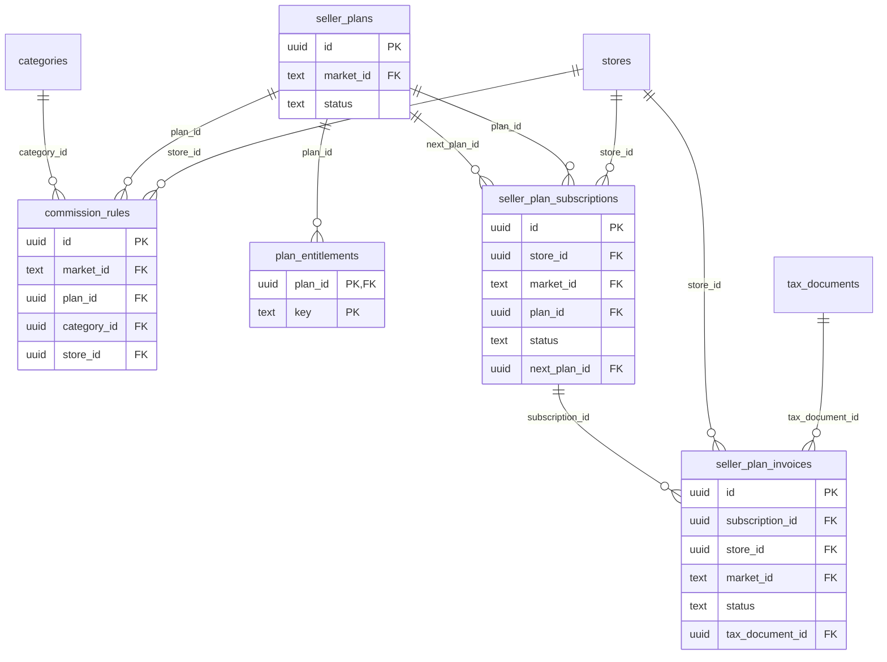

#### `seller_plans`
Phase 1 · residency `global` · tenant none · no personal data · basis `not_personal_data` · retention `config_versions` · not partitioned

| Column | Type | Null | PII | Notes |
|---|---|---|---|---|
| `id` | uuid PK | no | P1 | UUIDv7, server-generated |
| `market_id` | text | no | P1 | -> `markets`. market scope (ADR-0006) |
| `code` | text | no | P0 | free, growth, pro (names are placeholders, D1) |
| `version` | int | no | P0 |  |
| `name_ar` | text | no | P0 |  |
| `name_en` | text | yes | P0 |  |
| `monthly_fee_minor` | bigint | no | P0 | 0 for the free plan |
| `currency` | char(3) | no | P1 | ISO 4217, must match market or account |
| `commission_bp` | int | no | P0 | basis points; ceiling about 1500 per evidence (D1) |
| `features` | jsonb | no | P0 | limits: price-watch connectors, custom storefront, analytics tier |
| `status` | text | no | P1 | draft, active, retired |
| `valid_from` | timestamptz | no | P1 |  |
| `created_at` | timestamptz | no | P1 | UTC |

- Key: `UNIQUE (market_id, code, version)`
- ⚠ VERIFY: V24

#### `commission_rules`
Phase 1 · residency `cell` · tenant none · no personal data · basis `not_personal_data` · retention `tax_records` · not partitioned

| Column | Type | Null | PII | Notes |
|---|---|---|---|---|
| `id` | uuid PK | no | P1 | UUIDv7, server-generated |
| `market_id` | text | no | P1 | -> `markets`. market scope (ADR-0006) |
| `plan_id` | uuid | yes | P1 | -> `seller_plans`. |
| `category_id` | uuid | yes | P1 | -> `categories`. |
| `store_id` | uuid | yes | P1 | -> `stores`. contract override (confidential) |
| `commission_bp` | int | no | P1 |  |
| `min_fee_minor` | bigint | yes | P1 | optional minimum per line |
| `currency` | char(3) | no | P1 | ISO 4217, must match market or account |
| `reason` | text | yes | P1 | e.g. price_watch_surcharge (time-boxed penalty, V28) |
| `priority` | int | no | P1 |  |
| `valid_from` | timestamptz | no | P1 |  |
| `valid_to` | timestamptz | yes | P1 |  |
| `created_at` | timestamptz | no | P1 | UTC |

- Index: `(market_id, store_id, category_id, plan_id, valid_from DESC)` -> resolver lookup

#### `plan_entitlements`
Phase 1 · residency `global` · tenant none · no personal data · basis `not_personal_data` · retention `config_versions` · not partitioned

| Column | Type | Null | PII | Notes |
|---|---|---|---|---|
| `plan_id` | uuid PK | no | P0 | -> `seller_plans`. |
| `key` | text PK | no | P0 | channel_sync, ai_listing_credits_per_month, team_seats, analytics_level, payout_speed, display_modes_allowed |
| `value` | jsonb | no | P0 |  |

- Key: `PRIMARY KEY (plan_id, key)`

#### `seller_plan_subscriptions`
Phase 1 · residency `cell` · tenant store_id (RLS) · no personal data · basis `not_personal_data` · retention `tax_records` · not partitioned

| Column | Type | Null | PII | Notes |
|---|---|---|---|---|
| `id` | uuid PK | no | P1 | UUIDv7, server-generated |
| `store_id` | uuid | no | P1 | -> `stores`. tenant key; RLS app.current_store_id |
| `market_id` | text | no | P1 | -> `markets`. market scope (ADR-0006) |
| `plan_id` | uuid | no | P1 | -> `seller_plans`. |
| `status` | text | no | P1 |  |
| `period_start` | timestamptz | no | P1 |  |
| `period_end` | timestamptz | no | P1 |  |
| `next_plan_id` | uuid | yes | P1 | -> `seller_plans`. scheduled change at period end |
| `cancel_at` | timestamptz | yes | P1 |  |
| `version` | int | no | P1 | optimistic lock / config version |
| `created_at` | timestamptz | no | P1 | UTC |
| `updated_at` | timestamptz | no | P1 | UTC |

- Key: `UNIQUE (store_id) WHERE status IN ('TRIAL','ACTIVE','PAST_DUE','CANCELLED_AT_PERIOD_END')` -> one live plan
- Index: `(period_end) WHERE status IN ('ACTIVE','TRIAL')` -> renewal job
- RLS: `store_id = current_setting('app.current_store_id')::uuid`, FORCE RLS.
- State machine: SellerPlanSubscription (see module intro).

#### `seller_plan_invoices`
Phase 1 · residency `cell` · tenant store_id (RLS) · no personal data · basis `not_personal_data` · retention `tax_records` · not partitioned

| Column | Type | Null | PII | Notes |
|---|---|---|---|---|
| `id` | uuid PK | no | P1 | UUIDv7, server-generated |
| `subscription_id` | uuid | no | P1 | -> `seller_plan_subscriptions`. |
| `store_id` | uuid | no | P1 | -> `stores`. tenant key; RLS app.current_store_id |
| `market_id` | text | no | P1 | -> `markets`. market scope (ADR-0006) |
| `period_start` | timestamptz | no | P1 |  |
| `period_end` | timestamptz | no | P1 |  |
| `net_minor` | bigint | no | P1 |  |
| `vat_minor` | bigint | no | P1 | VAT treatment V24 |
| `gross_minor` | bigint | no | P1 |  |
| `currency` | char(3) | no | P1 | ISO 4217, must match market or account |
| `status` | text | no | P1 |  |
| `collection_method` | text | no | P1 | netted_from_payout, bank_transfer_invoice (ADR-0008; no seller card recurring in Phase 1) |
| `journal_entry_id` | uuid | yes | P1 | logical ref to journal_entries |
| `tax_document_id` | uuid | yes | P1 | -> `tax_documents`. ETA B2B e-invoice |
| `created_at` | timestamptz | no | P1 | UTC |

- Key: `UNIQUE (subscription_id, period_start)`
- Index: `(store_id, created_at DESC, id DESC)`
- Index: `(status) WHERE status = 'OPEN'`
- RLS: `store_id = current_setting('app.current_store_id')::uuid`, FORCE RLS.
- ⚠ VERIFY: V24, V6

<a id="m-catalog"></a>
### 7.9 Catalog: categories, brands, listings, variants, condition and defects

**Multi-category** taxonomy (fashion, electronics, home, kitchen, toys, beauty, pantry); launch categories are women's, modest and kids (Q7 default) but the model does not assume fashion. A product can sit in several categories (`product_categories`). Attributes are **JSONB validated against the category's attribute set** with a GIN index, plus promoted generated columns for the few hot facets (decision DM-04).

**Condition and defects (vision addendum §3).** Condition grade and the **defect card** live on the listing (`products`); every variant shares them. A different condition means a separate listing (UI spec §5). Defect cards are **immutable versions**: an edit creates a new version, and cart and order lines keep the version the shopper acknowledged. Critical (safety) defect types cannot be listed. Every non-new grade needs a real defect or condition photo before publish.

**Defect passport (feature 26).** Physical units of graded listings are serialised in `item_units`, each with a random 128-bit `passport_code` printed as a QR. The public passport page shows grade, defect card, photos and inspection date, never buyer data. This is separate from the reservation pool in `inventory_units` (decision DM-03); a one-off unit links pool row to passport through `inventory_units.item_unit_id` (ADR-0005 calls it `passport_id`).

**Names vs ADR-0009 (its data section is indicative; this ERD is authoritative):** `condition_reports` = `defect_cards` (versioned, per listing, and a listing never mixes conditions), `defects` = `defect_items`, `defect_passports` = `item_units` (passport status `active/sold/withdrawn` maps to `IN_STOCK|RESERVED`, `SOLD`, `WRITTEN_OFF|DONATED`), `defect_acknowledgements` = the `defect_ack_*` columns on `cart_lines` and `order_lines` (card version + time + count). Grade list and `stock_reason` follow ADR-0009.

**State machines.** **Product (listing)**: `DRAFT -> IN_REVIEW -> PUBLISHED <-> PAUSED`, `PUBLISHED -> SOLD_OUT -> PUBLISHED`, `* -> ARCHIVED`, `* -> BLOCKED` (T&S or enforcement). A price-check (Price Watch moment A) runs inside `IN_REVIEW -> PUBLISHED`.
**ItemUnit (passport)**: `IN_STOCK -> RESERVED -> SOLD -> (RETURNED -> RELISTED | WRITTEN_OFF | DONATED)`, `RESERVED -> IN_STOCK`.

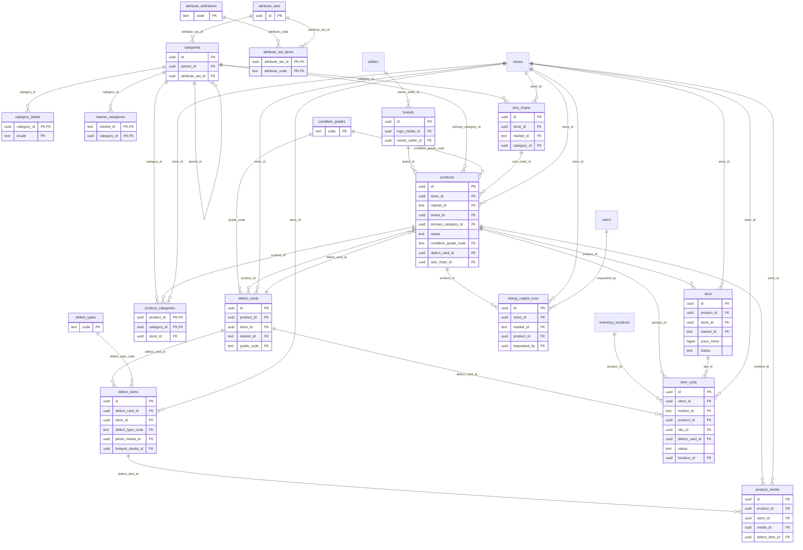

#### `categories`
Phase 1 · residency `global` · tenant none · no personal data · basis `not_personal_data` · retention `config_versions` · not partitioned

| Column | Type | Null | PII | Notes |
|---|---|---|---|---|
| `id` | uuid PK | no | P1 | UUIDv7, server-generated |
| `parent_id` | uuid | yes | P0 | -> `categories`. |
| `code` | text | no | P0 | stable code |
| `path` | text | no | P0 | materialised path of codes, e.g. fashion/women/dresses |
| `depth` | smallint | no | P0 |  |
| `vertical` | text | no | P0 | fashion, electronics, home, kitchen, toys, beauty, pantry |
| `attribute_set_id` | uuid | yes | P0 | -> `attribute_sets`. |
| `size_system` | text | yes | P0 | fashion only (fit features stay fashion-only) |
| `sort` | int | no | P0 |  |
| `active` | boolean | no | P0 |  |
| `created_at` | timestamptz | no | P1 | UTC |

- Key: `UNIQUE (code)`
- Index: `(parent_id, sort)`
- Index: `(path text_pattern_ops)` -> subtree queries

#### `category_labels`
Phase 1 · residency `global` · tenant none · no personal data · basis `not_personal_data` · retention `config_versions` · not partitioned

| Column | Type | Null | PII | Notes |
|---|---|---|---|---|
| `category_id` | uuid PK | no | P0 | -> `categories`. |
| `locale` | text PK | no | P0 |  |
| `name` | text | no | P0 |  |
| `slug` | text | no | P0 |  |

- Key: `PRIMARY KEY (category_id, locale)`

#### `market_categories`
Phase 1 · residency `global` · tenant none · no personal data · basis `not_personal_data` · retention `config_versions` · not partitioned

| Column | Type | Null | PII | Notes |
|---|---|---|---|---|
| `market_id` | text PK | no | P0 | -> `markets`. |
| `category_id` | uuid PK | no | P0 | -> `categories`. |
| `active` | boolean | no | P0 |  |
| `restriction` | jsonb | yes | P1 | e.g. pantry near-expiry rules, cosmetics rules (UI spec §7) |

- Key: `PRIMARY KEY (market_id, category_id)`
- ⚠ VERIFY: V56

#### `attribute_definitions`
Phase 1 · residency `global` · tenant none · no personal data · basis `not_personal_data` · retention `config_versions` · not partitioned

| Column | Type | Null | PII | Notes |
|---|---|---|---|---|
| `code` | text PK | no | P0 | e.g. colour, material, fit, sleeve_length, screen_size |
| `data_type` | text | no | P0 | enum, text, number, boolean, measure |
| `unit` | text | yes | P0 |  |
| `enum_values` | jsonb | yes | P0 | values with AR/EN labels |
| `facetable` | boolean | no | P0 |  |
| `created_at` | timestamptz | no | P1 | UTC |

#### `attribute_sets`
Phase 1 · residency `global` · tenant none · no personal data · basis `not_personal_data` · retention `config_versions` · not partitioned

| Column | Type | Null | PII | Notes |
|---|---|---|---|---|
| `id` | uuid PK | no | P1 | UUIDv7, server-generated |
| `code` | text | no | P0 |  |
| `version` | int | no | P0 |  |
| `created_at` | timestamptz | no | P1 | UTC |

- Key: `UNIQUE (code, version)`

#### `attribute_set_items`
Phase 1 · residency `global` · tenant none · no personal data · basis `not_personal_data` · retention `config_versions` · not partitioned

| Column | Type | Null | PII | Notes |
|---|---|---|---|---|
| `attribute_set_id` | uuid PK | no | P0 | -> `attribute_sets`. |
| `attribute_code` | text PK | no | P0 | -> `attribute_definitions`. |
| `required` | boolean | no | P0 |  |
| `facet_rank` | smallint | yes | P0 |  |

- Key: `PRIMARY KEY (attribute_set_id, attribute_code)`

#### `brands`
Phase 1 · residency `cell_publishable` · tenant none · no personal data · basis `not_personal_data` · retention `catalog_life` · not partitioned

| Column | Type | Null | PII | Notes |
|---|---|---|---|---|
| `id` | uuid PK | no | P1 | UUIDv7, server-generated |
| `name` | text | no | P0 |  |
| `normalized_name` | text | no | P0 | AR/EN folded for matching |
| `slug` | text | no | P0 |  |
| `logo_media_id` | uuid | yes | P0 | -> `media_assets`. |
| `is_verified` | boolean | no | P0 |  |
| `owner_seller_id` | uuid | yes | P1 | -> `sellers`. brand owner, if on the platform |
| `created_at` | timestamptz | no | P1 | UTC |

- Key: `UNIQUE (slug)`
- Key: `UNIQUE (normalized_name)`
- Brand names appear in ads only with written permission (addendum §5).
- ⚠ VERIFY: V57

#### `condition_grades`
Phase 1 · residency `global` · tenant none · no personal data · basis `not_personal_data` · retention `config_versions` · not partitioned

| Column | Type | Null | PII | Notes |
|---|---|---|---|---|
| `code` | text PK | no | P0 | ADR-0009 closed list: new_with_tags, new_with_imperfections, sample, open_box, refurbished (disabled at launch), pre_owned (later) |
| `vertical` | text | yes | P0 | NULL = all verticals |
| `label_ar` | text | no | P0 |  |
| `label_en` | text | no | P0 |  |
| `schema_org_condition` | text | no | P0 | NewCondition, DamagedCondition, RefurbishedCondition, UsedCondition |
| `requires_defect_card` | boolean | no | P0 |  |
| `requires_condition_photo` | boolean | no | P0 |  |
| `sort` | smallint | no | P0 |  |
| `active` | boolean | no | P0 |  |
- Grade list per ADR-0009. UI labels map to grade + stock reason: 'New clearance'/'Previous season' = new_with_tags + stock_reason; 'Cosmetic defect' = new_with_imperfections. Mapping to schema.org itemCondition feeds JSON-LD (BUILD-PROMPT §5).
- ⚠ VERIFY: V56

#### `defect_types`
Phase 1 · residency `global` · tenant none · no personal data · basis `not_personal_data` · retention `config_versions` · not partitioned

| Column | Type | Null | PII | Notes |
|---|---|---|---|---|
| `code` | text PK | no | P0 | e.g. minor_scratch, missing_button, stain, dent, packaging_damaged |
| `vertical` | text | yes | P0 |  |
| `label_ar` | text | no | P0 |  |
| `label_en` | text | no | P0 |  |
| `default_severity` | text | no | P0 | minor, major |
| `is_critical` | boolean | no | P0 | safety defect: listing blocked (V69) |
| `active` | boolean | no | P0 |  |
- ⚠ VERIFY: V69

#### `products`
Phase 1 · residency `cell_publishable` · tenant store_id (RLS) · no personal data · basis `not_personal_data` · retention `catalog_life` · not partitioned

| Column | Type | Null | PII | Notes |
|---|---|---|---|---|
| `id` | uuid PK | no | P1 | UUIDv7, server-generated |
| `store_id` | uuid | no | P1 | -> `stores`. tenant key; RLS app.current_store_id |
| `market_id` | text | no | P1 | -> `markets`. market scope (ADR-0006) |
| `brand_id` | uuid | yes | P0 | -> `brands`. |
| `primary_category_id` | uuid | no | P0 | -> `categories`. |
| `status` | text | no | P0 | see Product machine |
| `title_ar` | text | no | P0 | Arabic mandatory (CPL) |
| `title_en` | text | yes | P0 |  |
| `description_ar` | text | no | P0 |  |
| `description_en` | text | yes | P0 |  |
| `condition_grade_code` | text | no | P0 | -> `condition_grades`. |
| `stock_reason` | text | yes | P0 | previous_season, overstock, end_of_line, customer_return, near_expiry (pantry, disabled at launch, V56); display tag only, no effect on returns (ADR-0009) |
| `defect_card_id` | uuid | yes | P0 | -> `defect_cards`. current version; NULL only for grades without a card |
| `attributes` | jsonb | no | P0 | validated against the attribute set |
| `colour_code` | text | yes | P0 | generated column from attributes (hot facet) |
| `size_chart_id` | uuid | yes | P0 | -> `size_charts`. |
| `warranty_months` | smallint | yes | P0 |  |
| `warranty_kind` | text | yes | P0 | seller, brand, none |
| `included_accessories_ar` | text | yes | P0 |  |
| `origin_country` | char(2) | yes | P0 |  |
| `search_version` | bigint | no | P1 | bumped on every indexable change |
| `published_at` | timestamptz | yes | P0 |  |
| `created_at` | timestamptz | no | P1 | UTC |
| `updated_at` | timestamptz | no | P1 | UTC |
| `deleted_at` | timestamptz | yes | P1 |  |

- Index: `(store_id, status, updated_at DESC, id DESC)` -> Seller Center product list (keyset)
- Index: `(market_id, published_at DESC, id DESC) WHERE status = 'PUBLISHED'` -> new arrivals, sitemap
- Index: `(store_id, published_at DESC, id DESC) WHERE status = 'PUBLISHED'` -> store shelf
- Index: `(brand_id, status)`
- Index: `GIN (attributes jsonb_path_ops)` -> facet fallback when search is down (kill switch)
- RLS: `store_id = current_setting('app.current_store_id')::uuid`, FORCE RLS.
- State machine: Product (see module intro).
- Sold one-off listings return 410 or 301 (SEO lifecycle via redirects).

#### `product_categories`
Phase 1 · residency `cell_publishable` · tenant store_id (RLS) · no personal data · basis `not_personal_data` · retention `catalog_life` · not partitioned

| Column | Type | Null | PII | Notes |
|---|---|---|---|---|
| `product_id` | uuid PK | no | P0 | -> `products`. |
| `category_id` | uuid PK | no | P0 | -> `categories`. |
| `store_id` | uuid | no | P1 | -> `stores`. tenant key; RLS app.current_store_id |
| `is_primary` | boolean | no | P0 |  |

- Key: `PRIMARY KEY (product_id, category_id)`
- Index: `(category_id, product_id)` -> category browse fallback
- RLS: `store_id = current_setting('app.current_store_id')::uuid`, FORCE RLS.

#### `skus`
Phase 1 · residency `cell_publishable` · tenant store_id (RLS) · no personal data · basis `not_personal_data` · retention `catalog_life` · not partitioned

| Column | Type | Null | PII | Notes |
|---|---|---|---|---|
| `id` | uuid PK | no | P1 | UUIDv7, server-generated |
| `product_id` | uuid | no | P0 | -> `products`. |
| `store_id` | uuid | no | P1 | -> `stores`. tenant key; RLS app.current_store_id |
| `market_id` | text | no | P1 | -> `markets`. market scope (ADR-0006) |
| `seller_sku` | text | no | P1 |  |
| `gtin` | text | yes | P0 | GTIN/EAN; first rung of the match waterfall |
| `option_values` | jsonb | no | P0 | size, colour |
| `size_label` | text | yes | P0 | generated from option_values |
| `price_minor` | bigint | no | P0 | current VAT-inclusive price; every change writes price_events in the same tx |
| `currency` | char(3) | no | P1 | ISO 4217, must match market or account |
| `status` | text | no | P0 | active, paused, archived |
| `version` | int | no | P1 | optimistic lock / config version |
| `created_at` | timestamptz | no | P1 | UTC |
| `updated_at` | timestamptz | no | P1 | UTC |

- Key: `UNIQUE (store_id, seller_sku)`
- Index: `(product_id)`
- Index: `(gtin) WHERE gtin IS NOT NULL` -> matching
- Index: `(market_id, size_label, status)` -> My Size Only feed prefilter
- RLS: `store_id = current_setting('app.current_store_id')::uuid`, FORCE RLS.
- Shelf price and stock are never served from stale cache (TTL <= 5 s, rechecked in bag and checkout).

#### `product_media`
Phase 1 · residency `cell_publishable` · tenant store_id (RLS) · no personal data · basis `not_personal_data` · retention `catalog_life` · not partitioned

| Column | Type | Null | PII | Notes |
|---|---|---|---|---|
| `id` | uuid PK | no | P1 | UUIDv7, server-generated |
| `product_id` | uuid | no | P0 | -> `products`. |
| `store_id` | uuid | no | P1 | -> `stores`. tenant key; RLS app.current_store_id |
| `media_id` | uuid | no | P0 | -> `media_assets`. |
| `role` | text | no | P0 | main, gallery, defect_closeup, packaging, video |
| `position` | smallint | no | P0 |  |
| `alt_ar` | text | no | P0 |  |
| `alt_en` | text | yes | P0 |  |
| `defect_item_id` | uuid | yes | P0 | -> `defect_items`. |
| `created_at` | timestamptz | no | P1 | UTC |

- Key: `UNIQUE (product_id, position)`
- RLS: `store_id = current_setting('app.current_store_id')::uuid`, FORCE RLS.

#### `defect_cards`
Phase 1 · residency `cell_publishable` · tenant store_id (RLS) · no personal data · basis `not_personal_data` · retention `price_evidence_7y` · not partitioned

| Column | Type | Null | PII | Notes |
|---|---|---|---|---|
| `id` | uuid PK | no | P1 | UUIDv7, server-generated |
| `product_id` | uuid | no | P0 | -> `products`. |
| `store_id` | uuid | no | P1 | -> `stores`. tenant key; RLS app.current_store_id |
| `market_id` | text | no | P1 | -> `markets`. market scope (ADR-0006) |
| `version` | int | no | P0 | immutable per version |
| `grade_code` | text | no | P0 | -> `condition_grades`. |
| `stock_reason` | text | yes | P0 | snapshot for the passport page |
| `summary_ar` | text | no | P0 |  |
| `summary_en` | text | yes | P0 |  |
| `affects_function` | boolean | no | P0 | "does not affect operation" tick |
| `defect_count` | smallint | no | P0 | N in "I have seen the N defects" |
| `inspected_by` | text | no | P0 | seller, outlet_hub |
| `inspected_at` | timestamptz | no | P0 |  |
| `ai_flag_status` | text | no | P1 | none, flagged_undeclared, cleared (AI only flags, never upgrades) |
| `published_at` | timestamptz | yes | P0 |  |
| `created_at` | timestamptz | no | P1 | UTC |

- Key: `UNIQUE (product_id, version)`
- RLS: `store_id = current_setting('app.current_store_id')::uuid`, FORCE RLS.
- Kept as long as orders cite them: the acknowledged version is evidence in a return dispute (V19).
- ⚠ VERIFY: V19

#### `defect_items`
Phase 1 · residency `cell_publishable` · tenant store_id (RLS) · no personal data · basis `not_personal_data` · retention `price_evidence_7y` · not partitioned

| Column | Type | Null | PII | Notes |
|---|---|---|---|---|
| `id` | uuid PK | no | P1 | UUIDv7, server-generated |
| `defect_card_id` | uuid | no | P0 | -> `defect_cards`. |
| `store_id` | uuid | no | P1 | -> `stores`. tenant key; RLS app.current_store_id |
| `defect_type_code` | text | no | P0 | -> `defect_types`. CHECK not critical (trigger) |
| `location_ar` | text | no | P0 |  |
| `location_en` | text | yes | P0 |  |
| `size_mm` | int | yes | P0 | size in mm (integer) |
| `severity` | text | no | P0 | minor, major |
| `affects_function` | boolean | no | P0 | per defect (ADR-0009) |
| `photo_media_id` | uuid | no | P0 | -> `media_assets`. real close-up, required |
| `hotspot_media_id` | uuid | yes | P0 | -> `media_assets`. main image carrying the hotspot |
| `hotspot_x_bp` | int | yes | P0 | 0-10000 of image width |
| `hotspot_y_bp` | int | yes | P0 | 0-10000 of image height |
| `note_ar` | text | yes | P0 |  |
| `note_en` | text | yes | P0 |  |
| `position` | smallint | no | P0 |  |

- Key: `UNIQUE (defect_card_id, position)`
- RLS: `store_id = current_setting('app.current_store_id')::uuid`, FORCE RLS.

#### `item_units`
Phase 1 · residency `cell_publishable` · tenant store_id (RLS) · no personal data · basis `not_personal_data` · retention `price_evidence_7y` · not partitioned

| Column | Type | Null | PII | Notes |
|---|---|---|---|---|
| `id` | uuid PK | no | P1 | UUIDv7, server-generated |
| `store_id` | uuid | no | P1 | -> `stores`. tenant key; RLS app.current_store_id |
| `market_id` | text | no | P1 | -> `markets`. market scope (ADR-0006) |
| `product_id` | uuid | no | P0 | -> `products`. |
| `sku_id` | uuid | no | P0 | -> `skus`. |
| `defect_card_id` | uuid | no | P0 | -> `defect_cards`. version the unit was graded with |
| `passport_code` | text | no | P0 | 128-bit CSPRNG, Crockford base32; printed as QR (ADR-0009 public_code) |
| `content_hash` | bytea | no | P0 | hash of the card version shown; tamper evidence (ADR-0009) |
| `status` | text | no | P1 | see ItemUnit machine |
| `inspected_at` | timestamptz | no | P0 |  |
| `location_id` | uuid | yes | P1 | -> `inventory_locations`. |
| `created_at` | timestamptz | no | P1 | UTC |
| `updated_at` | timestamptz | no | P1 | UTC |

- Key: `UNIQUE (passport_code)`
- Index: `(sku_id, status)` -> assign a unit at claim
- Index: `(store_id, status, id)`
- RLS: `store_id = current_setting('app.current_store_id')::uuid`, FORCE RLS.
- State machine: ItemUnit (see module intro).
- Serialised only for grades with requires_defect_card = true (or when the seller opts in).
- No buyer link here: the sale link lives in order_line_units, so this publishable table holds no personal data.

#### `size_charts`
Phase 1 · residency `cell_publishable` · tenant store_id (RLS) · no personal data · basis `not_personal_data` · retention `catalog_life` · not partitioned

| Column | Type | Null | PII | Notes |
|---|---|---|---|---|
| `id` | uuid PK | no | P1 | UUIDv7, server-generated |
| `store_id` | uuid | no | P1 | -> `stores`. tenant key; RLS app.current_store_id |
| `market_id` | text | no | P1 | -> `markets`. market scope (ADR-0006) |
| `category_id` | uuid | no | P0 | -> `categories`. |
| `unit` | text | no | P0 | cm or in (normalised to mm on save) |
| `size_system` | text | no | P0 |  |
| `rows` | jsonb | no | P0 | garment measurements per size; validated monotonic |
| `validated_at` | timestamptz | yes | P1 |  |
| `created_at` | timestamptz | no | P1 | UTC |
| `updated_at` | timestamptz | no | P1 | UTC |

- Index: `(store_id, category_id)`
- RLS: `store_id = current_setting('app.current_store_id')::uuid`, FORCE RLS.

#### `listing_copilot_runs`
Phase 1 · residency `cell` · tenant store_id (RLS) · personal data · basis `contract` · retention `llm_meter_13m` · partition: RANGE (id) monthly

| Column | Type | Null | PII | Notes |
|---|---|---|---|---|
| `id` | uuid PK | no | P1 | UUIDv7, server-generated |
| `store_id` | uuid | no | P1 | -> `stores`. tenant key; RLS app.current_store_id |
| `market_id` | text | no | P1 | -> `markets`. market scope (ADR-0006) |
| `product_id` | uuid | yes | P1 | -> `products`. |
| `requested_by` | uuid | no | P2 | -> `users`. |
| `feature` | text | no | P1 | title_ar, description, attributes, defect_flag |
| `model` | text | no | P1 |  |
| `prompt_version` | text | no | P1 |  |
| `input_tokens` | int | no | P1 |  |
| `output_tokens` | int | no | P1 |  |
| `cost_micro_usd` | bigint | no | P1 | integer micro-units of the provider's billing currency |
| `currency` | char(3) | no | P1 | ISO 4217, must match market or account |
| `outcome` | text | no | P1 | accepted, edited, rejected |
| `latency_ms` | int | no | P1 |  |
| `created_at` | timestamptz | no | P1 | UTC |

- Index: `(store_id, id)` -> per-store budget check
- RLS: `store_id = current_setting('app.current_store_id')::uuid`, FORCE RLS.
- No prompt text stored; only listing data (P0) is sent to the model (master prompt T12).
- ⚠ VERIFY: V2

<a id="m-engagement"></a>
### 7.10 Size profiles, reviews and see-it-first requests

MVP shopper features from the addendum: **My Size Only** feed (4), **fit-photo reviews** (11) and **WhatsApp video see-it-first** (19). Measurements are P3, need the `measurements` consent and are never visible to sellers. Reviews are verified-purchase only; the public projection shows "Verified buyer" plus size bought and rating, never a name unless the user opts in (so personal data does not travel to the global plane by default, V2).

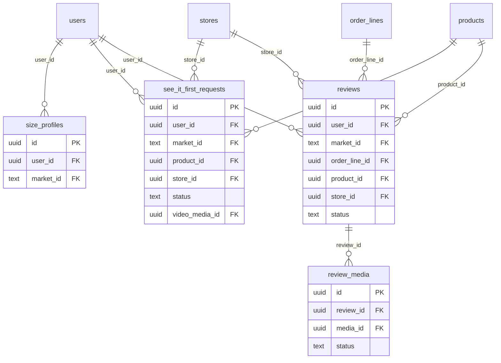

#### `size_profiles`
Phase 1 · residency `cell` · tenant user_id (RLS) · personal data · basis `consent` · retention `measurements` · not partitioned

| Column | Type | Null | PII | Notes |
|---|---|---|---|---|
| `id` | uuid PK | no | P1 | UUIDv7, server-generated |
| `user_id` | uuid | no | P2 | -> `users`. owner; RLS app.current_user_id |
| `market_id` | text | no | P1 | -> `markets`. market scope (ADR-0006) |
| `label` | text | no | P2 | me, partner, kid nickname |
| `is_child` | boolean | no | P2 | children: nickname and measurements only, no DOB or photo |
| `measurements_ct` | bytea | yes | P3 (enc) | height, chest, waist, hip, inseam, foot... |
| `usual_sizes` | jsonb | yes | P2 | brand -> size |
| `fit_pref` | text | yes | P2 | snug, regular, loose |
| `modest_fit` | boolean | no | P2 |  |
| `created_at` | timestamptz | no | P1 | UTC |
| `updated_at` | timestamptz | no | P1 | UTC |
| `deleted_at` | timestamptz | yes | P1 |  |

- Index: `(user_id) WHERE deleted_at IS NULL`
- RLS: `user_id = current_setting('app.current_user_id')::uuid`, FORCE RLS.
- ⚠ VERIFY: V73, V74

#### `reviews`
Phase 1 · residency `cell` · tenant user_id (RLS) · personal data · basis `consent` · retention `ugc_published` · not partitioned

| Column | Type | Null | PII | Notes |
|---|---|---|---|---|
| `id` | uuid PK | no | P1 | UUIDv7, server-generated |
| `user_id` | uuid | no | P2 | -> `users`. owner; RLS app.current_user_id |
| `market_id` | text | no | P1 | -> `markets`. market scope (ADR-0006) |
| `order_line_id` | uuid | no | P2 | -> `order_lines`. verified purchase |
| `product_id` | uuid | no | P1 | -> `products`. |
| `store_id` | uuid | no | P1 | -> `stores`. not a tenant key (sellers read published reviews only) |
| `rating` | smallint | no | P0 | 1-5 |
| `fit` | text | yes | P0 | small, true_to_size, large |
| `size_bought` | text | yes | P0 |  |
| `body` | text | yes | P2 | UGC; may contain personal data |
| `show_display_name` | boolean | no | P2 | default false |
| `status` | text | no | P1 | pending_moderation, published, rejected, removed |
| `published_at` | timestamptz | yes | P1 |  |
| `created_at` | timestamptz | no | P1 | UTC |

- Key: `UNIQUE (order_line_id)`
- Index: `(product_id, published_at DESC, id DESC) WHERE status = 'published'` -> PDP reviews
- Index: `(status, created_at) WHERE status = 'pending_moderation'`
- RLS: `user_id = current_setting('app.current_user_id')::uuid`, FORCE RLS.
- Coins or rewards for any honest review, never for positive ones (master prompt §27).

#### `review_media`
Phase 1 · residency `cell` · tenant none · personal data · basis `consent` · retention `ugc_published` · not partitioned

| Column | Type | Null | PII | Notes |
|---|---|---|---|---|
| `id` | uuid PK | no | P1 | UUIDv7, server-generated |
| `review_id` | uuid | no | P1 | -> `reviews`. |
| `media_id` | uuid | no | P2 | -> `media_assets`. fit photo may show a person |
| `status` | text | no | P1 | pending, approved, rejected |
| `created_at` | timestamptz | no | P1 | UTC |

#### `see_it_first_requests`
Phase 1 · residency `cell` · tenant store_id + user_id (two RLS policies) · personal data · basis `contract` · retention `delivery_24m` · not partitioned

| Column | Type | Null | PII | Notes |
|---|---|---|---|---|
| `id` | uuid PK | no | P1 | UUIDv7, server-generated |
| `user_id` | uuid | no | P2 | -> `users`. owner; RLS app.current_user_id |
| `market_id` | text | no | P1 | -> `markets`. market scope (ADR-0006) |
| `product_id` | uuid | no | P1 | -> `products`. |
| `store_id` | uuid | no | P1 | -> `stores`. seller fulfils the request |
| `channel` | text | no | P1 | whatsapp |
| `status` | text | no | P1 | requested, fulfilled, declined, expired |
| `video_media_id` | uuid | yes | P1 | -> `media_assets`. |
| `requested_at` | timestamptz | no | P1 |  |
| `expires_at` | timestamptz | no | P1 |  |

- Index: `(store_id, status, requested_at) WHERE status = 'requested'` -> seller queue
- The seller never receives the shopper's phone; the WhatsApp BSP relays through the platform number.

<a id="m-price-watch"></a>
### 7.11 Price integrity and Price Watch

Implements `docs/specs/price-watch.md` and master prompt §9. Sellers connect their own channel (Shopify, WooCommerce, feed URL; crawler in V2) after proving domain ownership and accepting the monitoring clause. Every internal or external price observation becomes a `price_events` row; `sku_price_state` keeps the 30-day lows and the **current display decision** for fast reads.

**VRP** = min(internal 30-day low, external 30-day low with match confidence >= tau). `discount_bp = floor((vrp - price) * 10000 / vrp)` in integer maths; a claim needs vrp present and discount >= 500 bp. Evidence older than 72 h fails closed to "no %". Brand display mode (public / members-only / hidden) only narrows what is shown; an unverified claim is never shown in any mode (addendum C4).

**State machines.** **PriceClaim**: `CURRENT -> SUPERSEDED` on every rescore, `CURRENT -> REVOKED` on stale evidence or enforcement. **ChannelConnection**: `PENDING_VERIFICATION -> CONNECTED <-> DEGRADED -> DISCONNECTED | REVOKED`. **Finding**: `OPEN -> (RESOLVED | APPEALED -> UPHELD | OVERTURNED)`.

```mermaid
erDiagram
    channel_connections {
        uuid id PK
        uuid store_id FK
        text market_id FK
        text status
        uuid consent_acceptance_id FK
    }
    external_products {
        uuid id PK
        uuid connection_id FK
        uuid store_id FK
        text market_id FK
    }
    channel_snapshots {
        uuid id PK
        timestamptz fetched_at PK
        uuid connection_id FK
        uuid external_product_id FK
        uuid store_id FK
        text market_id FK
        bigint price_minor
        uuid screenshot_media_id FK
    }
    product_matches {
        uuid id PK
        uuid sku_id FK
        uuid store_id FK
        uuid external_product_id FK
        text status
        uuid confirmed_by FK
    }
    price_events {
        uuid id PK
        timestamptz valid_from PK
        uuid sku_id FK
        uuid store_id FK
        text market_id FK
        uuid external_product_id FK
        bigint price_minor
    }
    sku_price_state {
        uuid sku_id PK,FK
        uuid store_id FK
        text market_id FK
    }
    price_claims {
        uuid id PK
        uuid sku_id FK
        uuid store_id FK
        text market_id FK
        bigint price_minor
        text status
    }
    price_evidence {
        uuid id PK
        uuid store_id FK
        text market_id FK
        uuid sku_id FK
        uuid screenshot_media_id FK
        uuid document_media_id FK
    }
    price_claim_evidence {
        uuid claim_id PK
        uuid evidence_id PK
        uuid store_id FK
    }
    price_findings {
        uuid id PK
        uuid store_id FK
        text market_id FK
        uuid sku_id FK
        text status
    }
    enforcement_actions {
        uuid id PK
        uuid store_id FK
        text market_id FK
        uuid finding_id FK
        uuid sku_id FK
        text status
        uuid reviewed_by FK
    }
    price_appeals {
        uuid id PK
        uuid finding_id FK
        uuid store_id FK
        text market_id FK
        uuid submitted_by FK
        uuid evidence_media_id FK
        uuid connection_id FK
        text status
    }
    price_check_runs {
        uuid id PK
        uuid store_id FK
        text market_id FK
        uuid sku_id FK
        uuid requested_by FK
    }
    store_price_trust {
        uuid store_id PK,FK
        text market_id FK
    }
    price_reports {
        uuid id PK
        uuid user_id FK
        text market_id FK
        uuid sku_id FK
        uuid store_id FK
        text status
    }
    agreement_acceptances ||--o{ channel_connections : "consent_acceptance_id"
    channel_connections ||--o{ channel_snapshots : "connection_id"
    channel_connections ||--o{ external_products : "connection_id"
    channel_connections ||--o{ price_appeals : "connection_id"
    external_products ||--o{ channel_snapshots : "external_product_id"
    external_products ||--o{ price_events : "external_product_id"
    external_products ||--o{ product_matches : "external_product_id"
    price_findings ||--o{ enforcement_actions : "finding_id"
    price_findings ||--o{ price_appeals : "finding_id"
    skus ||--o{ enforcement_actions : "sku_id"
    skus ||--o{ price_check_runs : "sku_id"
    skus ||--o{ price_claims : "sku_id"
    skus ||--o{ price_events : "sku_id"
    skus ||--o{ price_evidence : "sku_id"
    skus ||--o{ price_findings : "sku_id"
    skus ||--o{ price_reports : "sku_id"
    skus ||--o{ product_matches : "sku_id"
    skus ||--o{ sku_price_state : "sku_id"
    staff_accounts ||--o{ enforcement_actions : "reviewed_by"
    stores ||--o{ channel_connections : "store_id"
    stores ||--o{ channel_snapshots : "store_id"
    stores ||--o{ enforcement_actions : "store_id"
    stores ||--o{ external_products : "store_id"
    stores ||--o{ price_appeals : "store_id"
    stores ||--o{ price_check_runs : "store_id"
    stores ||--o{ price_claim_evidence : "store_id"
    stores ||--o{ price_claims : "store_id"
    stores ||--o{ price_events : "store_id"
    stores ||--o{ price_evidence : "store_id"
    stores ||--o{ price_findings : "store_id"
    stores ||--o{ price_reports : "store_id"
    stores ||--o{ product_matches : "store_id"
    stores ||--o{ sku_price_state : "store_id"
    stores ||--o{ store_price_trust : "store_id"
    users ||--o{ price_appeals : "submitted_by"
    users ||--o{ price_check_runs : "requested_by"
    users ||--o{ price_reports : "user_id"
    users ||--o{ product_matches : "confirmed_by"
```

#### `channel_connections`
Phase 1 · residency `cell` · tenant store_id (RLS) · no personal data · basis `not_personal_data` · retention `price_evidence_7y` · not partitioned

| Column | Type | Null | PII | Notes |
|---|---|---|---|---|
| `id` | uuid PK | no | P1 | UUIDv7, server-generated |
| `store_id` | uuid | no | P1 | -> `stores`. tenant key; RLS app.current_store_id |
| `market_id` | text | no | P1 | -> `markets`. market scope (ADR-0006) |
| `type` | text | no | P1 | shopify, woocommerce, feed_url, crawler (V2), odoo (V3), meta_commerce (V2) |
| `domain` | text | no | P1 | seller-verified domain only (SSRF guard) |
| `base_url` | text | no | P1 |  |
| `verify_method` | text | no | P1 | dns_txt, meta_tag, file, oauth |
| `verify_token_hash` | bytea | yes | P1 |  |
| `verified_at` | timestamptz | yes | P1 |  |
| `oauth_token_ref` | text | yes | P1 | secret reference in KMS, read-only scopes |
| `webhook_secret_ref` | text | yes | P1 |  |
| `scopes` | text[] | yes | P1 |  |
| `status` | text | no | P1 | see ChannelConnection machine |
| `risk_tier` | text | no | P1 | trusted (>= 80), normal, watched (< 50) |
| `next_check_at` | timestamptz | yes | P1 | scheduler |
| `last_sync_at` | timestamptz | yes | P1 |  |
| `last_webhook_at` | timestamptz | yes | P1 | gap > 2 h -> fall back to polling |
| `consent_acceptance_id` | uuid | no | P1 | -> `agreement_acceptances`. monitoring consent (V27) |
| `created_at` | timestamptz | no | P1 | UTC |
| `updated_at` | timestamptz | no | P1 | UTC |

- Key: `UNIQUE (store_id, type, domain)`
- Index: `(next_check_at) WHERE status IN ('CONNECTED','DEGRADED')` -> watcher scheduler
- RLS: `store_id = current_setting('app.current_store_id')::uuid`, FORCE RLS.
- ⚠ VERIFY: V27

#### `external_products`
Phase 1 · residency `cell` · tenant store_id (RLS) · no personal data · basis `not_personal_data` · retention `price_evidence_7y` · not partitioned

| Column | Type | Null | PII | Notes |
|---|---|---|---|---|
| `id` | uuid PK | no | P1 | UUIDv7, server-generated |
| `connection_id` | uuid | no | P1 | -> `channel_connections`. |
| `store_id` | uuid | no | P1 | -> `stores`. tenant key; RLS app.current_store_id |
| `market_id` | text | no | P1 | -> `markets`. market scope (ADR-0006) |
| `external_ref` | text | no | P1 |  |
| `external_variant_ref` | text | no | P1 | '' when none; never compare across variants |
| `url` | text | yes | P1 |  |
| `title` | text | yes | P1 |  |
| `gtin` | text | yes | P1 |  |
| `image_phash` | bytea | yes | P1 |  |
| `last_price_minor` | bigint | yes | P1 |  |
| `currency` | char(3) | no | P1 | ISO 4217, must match market or account |
| `last_seen_at` | timestamptz | yes | P1 |  |
| `created_at` | timestamptz | no | P1 | UTC |

- Key: `UNIQUE (connection_id, external_ref, external_variant_ref)`
- Index: `(gtin) WHERE gtin IS NOT NULL`
- RLS: `store_id = current_setting('app.current_store_id')::uuid`, FORCE RLS.

#### `channel_snapshots`
Phase 1 · residency `cell` · tenant store_id (RLS) · no personal data · basis `not_personal_data` · retention `snapshots_13m` · partition: RANGE (fetched_at) daily (spec); drop after 13 months

| Column | Type | Null | PII | Notes |
|---|---|---|---|---|
| `id` | uuid PK | no | P1 | UUIDv7 |
| `fetched_at` | timestamptz PK | no | P1 | partition key (daily) |
| `connection_id` | uuid | no | P1 | -> `channel_connections`. |
| `external_product_id` | uuid | no | P1 | -> `external_products`. |
| `store_id` | uuid | no | P1 | -> `stores`. tenant key; RLS app.current_store_id |
| `market_id` | text | no | P1 | -> `markets`. market scope (ADR-0006) |
| `price_minor` | bigint | no | P1 | normalised VAT-inclusive item price |
| `compare_at_minor` | bigint | yes | P1 | their "was" price |
| `currency` | char(3) | no | P1 | ISO 4217, must match market or account |
| `in_stock` | boolean | yes | P1 |  |
| `evidence_class` | text | no | P1 | public, coupon, member |
| `method` | text | no | P1 | webhook, api_poll, feed, crawler, live_check |
| `http_status` | smallint | yes | P1 |  |
| `dom_hash` | bytea | yes | P1 |  |
| `screenshot_media_id` | uuid | yes | P1 | -> `media_assets`. |
| `parser_version` | text | no | P1 |  |

- Key: `PRIMARY KEY (id, fetched_at)`
- Index: `(external_product_id, fetched_at DESC)` -> history of one external item
- RLS: `store_id = current_setting('app.current_store_id')::uuid`, FORCE RLS.
- Daily partitions because watched items re-check hourly (decision DM-13).

#### `product_matches`
Phase 1 · residency `cell` · tenant store_id (RLS) · personal data · basis `contract` · retention `price_evidence_7y` · not partitioned

| Column | Type | Null | PII | Notes |
|---|---|---|---|---|
| `id` | uuid PK | no | P1 | UUIDv7, server-generated |
| `sku_id` | uuid | no | P1 | -> `skus`. |
| `store_id` | uuid | no | P1 | -> `stores`. tenant key; RLS app.current_store_id |
| `external_product_id` | uuid | no | P1 | -> `external_products`. |
| `method` | text | no | P1 | gtin, seller_sku, phash, embedding, attributes, manual |
| `confidence_bp` | int | no | P1 | 0-10000; counts only if >= tau (V13) |
| `model_version` | text | yes | P1 |  |
| `status` | text | no | P1 | proposed, confirmed, rejected, superseded |
| `confirmed_by` | uuid | yes | P2 | -> `users`. seller one-tap confirm |
| `confirmed_at` | timestamptz | yes | P1 |  |
| `created_at` | timestamptz | no | P1 | UTC |

- Key: `UNIQUE (sku_id, external_product_id) WHERE status IN ('proposed','confirmed')`
- Index: `(external_product_id)`
- Index: `(store_id, status) WHERE status = 'proposed'` -> seller confirm queue
- RLS: `store_id = current_setting('app.current_store_id')::uuid`, FORCE RLS.
- ⚠ VERIFY: V13

#### `price_events`
Phase 1 · residency `cell_publishable` · tenant store_id (RLS) · personal data · basis `contract` · retention `price_evidence_7y` · partition: RANGE (valid_from) monthly

| Column | Type | Null | PII | Notes |
|---|---|---|---|---|
| `id` | uuid PK | no | P1 | UUIDv7 |
| `valid_from` | timestamptz PK | no | P1 | partition key (monthly) |
| `sku_id` | uuid | no | P0 | -> `skus`. |
| `store_id` | uuid | no | P1 | -> `stores`. tenant key; RLS app.current_store_id |
| `market_id` | text | no | P1 | -> `markets`. market scope (ADR-0006) |
| `source` | text | no | P0 | internal, external |
| `external_product_id` | uuid | yes | P1 | -> `external_products`. |
| `price_minor` | bigint | no | P0 |  |
| `compare_at_minor` | bigint | yes | P1 | seller-entered or channel "was" price, evidence only, never displayed directly |
| `currency` | char(3) | no | P1 | ISO 4217, must match market or account |
| `valid_to` | timestamptz | yes | P0 | NULL = current |
| `actor_type` | text | no | P1 | seller_user, channel_sync, system, admin |
| `actor_id` | uuid | yes | P2 |  |
| `created_at` | timestamptz | no | P1 | UTC |

- Key: `PRIMARY KEY (id, valid_from)`
- Index: `(sku_id, source, valid_from DESC)` -> 30-day low and history chart
- RLS: `store_id = current_setting('app.current_store_id')::uuid`, FORCE RLS.
- Immutable except closing valid_to. P0 columns feed the public price-history chart (feature 28).

#### `sku_price_state`
Phase 1 · residency `cell_publishable` · tenant store_id (RLS) · no personal data · basis `not_personal_data` · retention `catalog_life` · not partitioned

| Column | Type | Null | PII | Notes |
|---|---|---|---|---|
| `sku_id` | uuid PK | no | P0 | -> `skus`. |
| `store_id` | uuid | no | P1 | -> `stores`. tenant key; RLS app.current_store_id |
| `market_id` | text | no | P1 | -> `markets`. market scope (ADR-0006) |
| `current_price_minor` | bigint | no | P0 |  |
| `currency` | char(3) | no | P1 | ISO 4217, must match market or account |
| `internal_low_30d_minor` | bigint | yes | P1 |  |
| `internal_history_days` | int | no | P1 |  |
| `external_low_30d_minor` | bigint | yes | P1 |  |
| `external_history_days` | int | no | P1 |  |
| `last_increase_at` | timestamptz | yes | P1 | anti-inflation reset |
| `vrp_minor` | bigint | yes | P0 | NULL = no verified reference |
| `claim_type` | text | no | P0 | verified_discount, lowest_30d, launch_price, plain |
| `display_discount_bp` | int | yes | P0 | NULL unless claim allowed AND brand mode allows public |
| `member_discount_bp` | int | yes | P1 | shown only to members when mode = member_only |
| `current_claim_id` | uuid | yes | P1 | logical ref to price_claims |
| `evidence_valid_until` | timestamptz | yes | P1 | +72 h fail-closed |
| `version` | int | no | P1 | optimistic lock / config version |
| `computed_at` | timestamptz | no | P1 |  |

- Index: `(market_id, display_discount_bp DESC, sku_id) WHERE display_discount_bp IS NOT NULL` -> Discover deals bands
- Index: `(evidence_valid_until) WHERE vrp_minor IS NOT NULL` -> stale-evidence sweeper
- RLS: `store_id = current_setting('app.current_store_id')::uuid`, FORCE RLS.
- Single read row for PDP, shelves and JSON-LD; JSON-LD price = rendered price = feed price (CI test).

#### `price_claims`
Phase 1 · residency `cell_publishable` · tenant store_id (RLS) · no personal data · basis `not_personal_data` · retention `price_evidence_7y` · partition: RANGE (id) monthly

| Column | Type | Null | PII | Notes |
|---|---|---|---|---|
| `id` | uuid PK | no | P1 | UUIDv7; partition key |
| `sku_id` | uuid | no | P0 | -> `skus`. |
| `store_id` | uuid | no | P1 | -> `stores`. tenant key; RLS app.current_store_id |
| `market_id` | text | no | P1 | -> `markets`. market scope (ADR-0006) |
| `price_minor` | bigint | no | P0 |  |
| `vrp_minor` | bigint | yes | P0 |  |
| `currency` | char(3) | no | P1 | ISO 4217, must match market or account |
| `reference_class` | text | no | P0 | internal_30d, external_30d, brand_rrp, none |
| `discount_bp` | int | yes | P0 |  |
| `claim_type` | text | no | P0 |  |
| `display_allowed` | boolean | no | P0 |  |
| `trust_score` | smallint | yes | P1 |  |
| `status` | text | no | P1 | current, superseded, revoked |
| `rule_version` | text | no | P1 |  |
| `scored_at` | timestamptz | no | P1 |  |
| `valid_until` | timestamptz | no | P1 |  |

- Key: `PRIMARY KEY (id)`
- Index: `(sku_id, id DESC)` -> claim history of a SKU
- RLS: `store_id = current_setting('app.current_store_id')::uuid`, FORCE RLS.
- Order lines snapshot the claim id; the claim and its evidence are kept for 7 years (V20, V71).

#### `price_evidence`
Phase 1 · residency `cell` · tenant store_id (RLS) · no personal data · basis `not_personal_data` · retention `price_evidence_7y` · partition: RANGE (id) monthly

| Column | Type | Null | PII | Notes |
|---|---|---|---|---|
| `id` | uuid PK | no | P1 | UUIDv7; partition key |
| `store_id` | uuid | no | P1 | -> `stores`. tenant key; RLS app.current_store_id |
| `market_id` | text | no | P1 | -> `markets`. market scope (ADR-0006) |
| `sku_id` | uuid | no | P1 | -> `skus`. |
| `kind` | text | no | P1 | snapshot, internal_history, live_check, document, brand_rrp |
| `source_snapshot_id` | uuid | yes | P1 | logical ref; snapshot content copied here so snapshots can expire |
| `url` | text | yes | P1 |  |
| `observed_price_minor` | bigint | no | P1 |  |
| `observed_compare_at_minor` | bigint | yes | P1 |  |
| `currency` | char(3) | no | P1 | ISO 4217, must match market or account |
| `observed_at` | timestamptz | no | P1 |  |
| `dom_hash` | bytea | yes | P1 |  |
| `screenshot_media_id` | uuid | yes | P1 | -> `media_assets`. |
| `document_media_id` | uuid | yes | P1 | -> `media_assets`. invoice or tag photo (supports at most 30% off alone) |
| `extraction_conf_bp` | int | yes | P1 |  |
| `content_hash` | bytea | no | P1 | immutability check |
| `created_at` | timestamptz | no | P1 | UTC |

- Key: `PRIMARY KEY (id)`
- Index: `(sku_id, id DESC)`
- RLS: `store_id = current_setting('app.current_store_id')::uuid`, FORCE RLS.
- Immutable (INSERT only). Shown to the seller with alerts; public page shows a summary only.
- ⚠ VERIFY: V20

#### `price_claim_evidence`
Phase 1 · residency `cell` · tenant store_id (RLS) · no personal data · basis `not_personal_data` · retention `price_evidence_7y` · not partitioned

| Column | Type | Null | PII | Notes |
|---|---|---|---|---|
| `claim_id` | uuid PK | no | P1 | logical ref (partitioned parent) |
| `evidence_id` | uuid PK | no | P1 | logical ref |
| `role` | text | no | P1 | reference, parity, support |
| `store_id` | uuid | no | P1 | -> `stores`. tenant key; RLS app.current_store_id |

- Key: `PRIMARY KEY (claim_id, evidence_id)`
- RLS: `store_id = current_setting('app.current_store_id')::uuid`, FORCE RLS.

#### `price_findings`
Phase 1 · residency `cell` · tenant store_id (RLS) · no personal data · basis `not_personal_data` · retention `price_evidence_7y` · not partitioned

| Column | Type | Null | PII | Notes |
|---|---|---|---|---|
| `id` | uuid PK | no | P1 | UUIDv7, server-generated |
| `store_id` | uuid | no | P1 | -> `stores`. tenant key; RLS app.current_store_id |
| `market_id` | text | no | P1 | -> `markets`. market scope (ADR-0006) |
| `sku_id` | uuid | yes | P1 | -> `skus`. |
| `rule` | text | no | P1 | fake_reference, pre_discount_inflation, parity, ghost_discount, stock_mismatch, relist_reset |
| `severity` | text | no | P1 |  |
| `evidence_ids` | uuid[] | no | P1 | bounded (<= 20), immutable evidence list |
| `status` | text | no | P1 | see Finding machine |
| `action_taken` | text | yes | P1 |  |
| `detected_at` | timestamptz | no | P1 |  |
| `resolved_at` | timestamptz | yes | P1 |  |

- Index: `(store_id, status, detected_at DESC, id DESC)` -> Price Trust page
- Index: `(store_id, detected_at)` -> 3 violations in 90 days
- RLS: `store_id = current_setting('app.current_store_id')::uuid`, FORCE RLS.

#### `enforcement_actions`
Phase 1 · residency `cell` · tenant store_id (RLS) · personal data · basis `contract` · retention `price_evidence_7y` · not partitioned

| Column | Type | Null | PII | Notes |
|---|---|---|---|---|
| `id` | uuid PK | no | P1 | UUIDv7, server-generated |
| `store_id` | uuid | no | P1 | -> `stores`. tenant key; RLS app.current_store_id |
| `market_id` | text | no | P1 | -> `markets`. market scope (ADR-0006) |
| `finding_id` | uuid | yes | P1 | -> `price_findings`. |
| `sku_id` | uuid | yes | P1 | -> `skus`. |
| `action` | text | no | P1 | display_corrected, badge_removed, ranking_penalty, sku_paused, drops_blocked, commission_surcharge (V28), store_suspended, payout_hold |
| `starts_at` | timestamptz | no | P1 |  |
| `expires_at` | timestamptz | yes | P1 |  |
| `status` | text | no | P1 | active, expired, revoked |
| `human_review_required` | boolean | no | P1 | true for suspension (5 business days, V15) |
| `reviewed_by` | uuid | yes | P2 | -> `staff_accounts`. |
| `reviewed_at` | timestamptz | yes | P1 |  |
| `created_at` | timestamptz | no | P1 | UTC |

- Index: `(store_id, status, expires_at) WHERE status = 'active'` -> active penalties
- Index: `(expires_at) WHERE status = 'active'` -> expiry job
- RLS: `store_id = current_setting('app.current_store_id')::uuid`, FORCE RLS.
- ⚠ VERIFY: V15, V28

#### `price_appeals`
Phase 1 · residency `cell` · tenant store_id (RLS) · personal data · basis `contract` · retention `price_evidence_7y` · not partitioned

| Column | Type | Null | PII | Notes |
|---|---|---|---|---|
| `id` | uuid PK | no | P1 | UUIDv7, server-generated |
| `finding_id` | uuid | no | P1 | -> `price_findings`. |
| `store_id` | uuid | no | P1 | -> `stores`. tenant key; RLS app.current_store_id |
| `market_id` | text | no | P1 | -> `markets`. market scope (ADR-0006) |
| `submitted_by` | uuid | no | P2 | -> `users`. |
| `evidence_media_id` | uuid | yes | P1 | -> `media_assets`. |
| `connection_id` | uuid | yes | P1 | -> `channel_connections`. |
| `status` | text | no | P1 | submitted, rescoring, upheld, overturned, escalated |
| `idempotency_key` | uuid | no | P1 |  |
| `resolved_at` | timestamptz | yes | P1 |  |
| `created_at` | timestamptz | no | P1 | UTC |

- Key: `UNIQUE (store_id, idempotency_key)`
- Index: `(status, created_at) WHERE status IN ('submitted','escalated')`
- RLS: `store_id = current_setting('app.current_store_id')::uuid`, FORCE RLS.

#### `price_check_runs`
Phase 1 · residency `cell` · tenant store_id (RLS) · personal data · basis `contract` · retention `snapshots_13m` · partition: RANGE (id) monthly

| Column | Type | Null | PII | Notes |
|---|---|---|---|---|
| `id` | uuid PK | no | P1 | partition key |
| `store_id` | uuid | no | P1 | -> `stores`. tenant key; RLS app.current_store_id |
| `market_id` | text | no | P1 | -> `markets`. market scope (ADR-0006) |
| `sku_id` | uuid | no | P1 | -> `skus`. |
| `requested_by` | uuid | no | P2 | -> `users`. |
| `result` | text | no | P1 | verified, not_enough_history, parity_blocked, reference_ignored, error |
| `live_price_minor` | bigint | yes | P1 |  |
| `vrp_minor` | bigint | yes | P1 |  |
| `currency` | char(3) | no | P1 | ISO 4217, must match market or account |
| `duration_ms` | int | no | P1 | target < 10 s |
| `created_at` | timestamptz | no | P1 | UTC |

- Index: `(store_id, id)` -> 60 per min per store limit audit
- RLS: `store_id = current_setting('app.current_store_id')::uuid`, FORCE RLS.

#### `store_price_trust`
Phase 1 · residency `cell_publishable` · tenant store_id (RLS) · no personal data · basis `not_personal_data` · retention `catalog_life` · not partitioned

| Column | Type | Null | PII | Notes |
|---|---|---|---|---|
| `store_id` | uuid PK | no | P0 | -> `stores`. |
| `market_id` | text | no | P1 | -> `markets`. market scope (ADR-0006) |
| `score` | smallint | no | P0 |  |
| `violations_90d` | int | no | P1 |  |
| `components` | jsonb | no | P1 | reasons and how to improve |
| `computed_at` | timestamptz | no | P1 |  |
- RLS: `store_id = current_setting('app.current_store_id')::uuid`, FORCE RLS.

#### `price_reports`
Phase 1 · residency `cell` · tenant user_id (RLS) · personal data · basis `legitimate_interest` · retention `fraud_24m` · not partitioned

| Column | Type | Null | PII | Notes |
|---|---|---|---|---|
| `id` | uuid PK | no | P1 | UUIDv7, server-generated |
| `user_id` | uuid | no | P2 | -> `users`. owner; RLS app.current_user_id |
| `market_id` | text | no | P1 | -> `markets`. market scope (ADR-0006) |
| `sku_id` | uuid | no | P1 | -> `skus`. |
| `store_id` | uuid | no | P1 | -> `stores`. |
| `reason` | text | no | P1 | fake_was_price, cheaper_elsewhere, other |
| `note` | text | yes | P2 |  |
| `status` | text | no | P1 | open, used_as_signal, dismissed |
| `created_at` | timestamptz | no | P1 | UTC |

- Index: `(sku_id, created_at DESC)`
- Index: `(user_id, created_at DESC)` -> rate limit
- RLS: `user_id = current_setting('app.current_user_id')::uuid`, FORCE RLS.
- ⚠ VERIFY: V70

<a id="m-inventory"></a>
### 7.12 Inventory: levels, row-per-unit pool, reservations

Master prompt §20.2 and ADR-0005: one row per sellable unit in a capped pool, reserved with `SELECT ... FOR UPDATE SKIP LOCKED` in the **same Postgres** as the ledger, READ COMMITTED, SKUs locked in sorted order. A short pool (fewer than `qty` rows) rolls back the whole multi-SKU reservation. Claim on payment sets units `claimed`, increments `committed`, writes the outbox event and posts the ledger in one transaction. A sweeper (every 30 s, batches of 500, SKIP LOCKED) releases expired reservations. Redis holds only a "sold out" pre-filter. Reserve path: dedicated PgBouncer pool `checkout.reserve`, statement timeout 2 s, primary only.

**State machines.** **Reservation**: `ACTIVE -> CLAIMED | RELEASED | EXPIRED`. **InventoryUnit**: `available -> reserved -> (claimed | available)`.

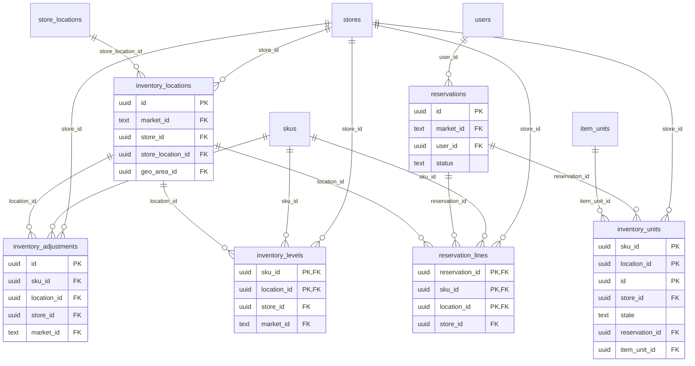

#### `inventory_locations`
Phase 1 · residency `cell` · tenant store_id (RLS) · no personal data · basis `not_personal_data` · retention `catalog_life` · not partitioned

| Column | Type | Null | PII | Notes |
|---|---|---|---|---|
| `id` | uuid PK | no | P1 | UUIDv7, server-generated |
| `market_id` | text | no | P1 | -> `markets`. market scope (ADR-0006) |
| `owner_type` | text | no | P1 | store, platform_hub |
| `store_id` | uuid | yes | P1 | -> `stores`. NULL for a platform hub |
| `store_location_id` | uuid | yes | P1 | -> `store_locations`. |
| `geo_area_id` | uuid | no | P1 | -> `geo_areas`. ships-from zone for quotes |
| `active` | boolean | no | P1 |  |
| `created_at` | timestamptz | no | P1 | UTC |

- Index: `(store_id) WHERE active`
- RLS: `store_id = current_setting('app.current_store_id')::uuid`, FORCE RLS.

#### `inventory_levels`
Phase 1 · residency `cell` · tenant store_id (RLS) · no personal data · basis `not_personal_data` · retention `catalog_life` · not partitioned

| Column | Type | Null | PII | Notes |
|---|---|---|---|---|
| `sku_id` | uuid PK | no | P1 | -> `skus`. |
| `location_id` | uuid PK | no | P1 | -> `inventory_locations`. |
| `store_id` | uuid | no | P1 | -> `stores`. tenant key; RLS app.current_store_id |
| `market_id` | text | no | P1 | -> `markets`. market scope (ADR-0006) |
| `on_hand` | int | no | P0 | CHECK >= 0; "2 left" shown only when <= 5 (real numbers) |
| `committed` | int | no | P1 | claimed, not yet shipped |
| `pool_target` | int | no | P1 | min(on_hand - committed, 1000) |
| `last_channel_version` | bigint | yes | P1 | idempotent versioned stock sync |
| `version` | int | no | P1 | optimistic lock / config version |
| `updated_at` | timestamptz | no | P1 |  |

- Key: `PRIMARY KEY (sku_id, location_id)`
- Index: `(store_id, updated_at DESC)` -> Seller Center inventory
- RLS: `store_id = current_setting('app.current_store_id')::uuid`, FORCE RLS.

#### `inventory_units`
Phase 1 · residency `cell` · tenant store_id (RLS) · no personal data · basis `not_personal_data` · retention `catalog_life` · not partitioned

| Column | Type | Null | PII | Notes |
|---|---|---|---|---|
| `sku_id` | uuid PK | no | P1 |  |
| `location_id` | uuid PK | no | P1 |  |
| `id` | uuid PK | no | P1 | UUIDv7 |
| `store_id` | uuid | no | P1 | -> `stores`. tenant key; RLS app.current_store_id |
| `state` | text | no | P1 | available, reserved, claimed |
| `reservation_id` | uuid | yes | P1 | -> `reservations`. |
| `expires_at` | timestamptz | yes | P1 |  |
| `item_unit_id` | uuid | yes | P1 | -> `item_units`. set for serialised graded units (passport) |

- Key: `PRIMARY KEY (sku_id, location_id, id)`
- Index: `(sku_id, location_id, id) WHERE state = 'available'` -> reserve scan (ORDER BY id LIMIT qty FOR UPDATE SKIP LOCKED)
- Index: `(expires_at) WHERE state = 'reserved'` -> sweeper
- Index: `(reservation_id) WHERE reservation_id IS NOT NULL` -> claim/release
- RLS: `store_id = current_setting('app.current_store_id')::uuid`, FORCE RLS.
- fillfactor 70 for HOT updates; claimed rows are archived or deleted by a compaction job (ADR-0005); the committed counter is the truth.

#### `reservations`
Phase 1 · residency `cell` · tenant user_id (RLS) · personal data · basis `contract` · retention `checkout_90d` · not partitioned

| Column | Type | Null | PII | Notes |
|---|---|---|---|---|
| `id` | uuid PK | no | P1 | UUIDv7, server-generated |
| `market_id` | text | no | P1 | -> `markets`. market scope (ADR-0006) |
| `user_id` | uuid | no | P2 | -> `users`. |
| `checkout_session_id` | uuid | no | P1 | logical ref (partitioned parent) |
| `status` | text | no | P1 | see Reservation machine |
| `ttl_policy` | text | no | P1 | card, wallet, fawry (separate non-drop pool), cod |
| `expires_at` | timestamptz | no | P1 |  |
| `idempotency_key` | text | no | P1 | order_group id |
| `claimed_at` | timestamptz | yes | P1 |  |
| `released_at` | timestamptz | yes | P1 |  |
| `created_at` | timestamptz | no | P1 | UTC |

- Key: `UNIQUE (idempotency_key)`
- Index: `(expires_at) WHERE status = 'ACTIVE'` -> sweeper
- RLS: `user_id = current_setting('app.current_user_id')::uuid`, FORCE RLS.
- State machine: Reservation (see module intro).

#### `reservation_lines`
Phase 1 · residency `cell` · tenant store_id (RLS) · no personal data · basis `not_personal_data` · retention `checkout_90d` · not partitioned

| Column | Type | Null | PII | Notes |
|---|---|---|---|---|
| `reservation_id` | uuid PK | no | P1 | -> `reservations`. |
| `sku_id` | uuid PK | no | P1 | -> `skus`. |
| `location_id` | uuid PK | no | P1 | -> `inventory_locations`. |
| `store_id` | uuid | no | P1 | -> `stores`. tenant key; RLS app.current_store_id |
| `qty` | smallint | no | P1 |  |

- Key: `PRIMARY KEY (reservation_id, sku_id, location_id)`
- RLS: `store_id = current_setting('app.current_store_id')::uuid`, FORCE RLS.

#### `inventory_adjustments`
Phase 1 · residency `cell` · tenant store_id (RLS) · personal data · basis `contract` · retention `tax_records` · partition: RANGE (id) monthly

| Column | Type | Null | PII | Notes |
|---|---|---|---|---|
| `id` | uuid PK | no | P1 | partition key |
| `sku_id` | uuid | no | P1 | -> `skus`. |
| `location_id` | uuid | no | P1 | -> `inventory_locations`. |
| `store_id` | uuid | no | P1 | -> `stores`. tenant key; RLS app.current_store_id |
| `market_id` | text | no | P1 | -> `markets`. market scope (ADR-0006) |
| `delta` | int | no | P1 |  |
| `reason` | text | no | P1 | seller_edit, channel_sync, return_restock, claim, write_off, count, donation |
| `source_ref` | text | yes | P1 |  |
| `external_version` | bigint | yes | P1 |  |
| `actor_type` | text | no | P1 |  |
| `actor_id` | uuid | yes | P2 |  |
| `created_at` | timestamptz | no | P1 | UTC |

- Index: `(sku_id, id DESC)` -> stock history
- RLS: `store_id = current_setting('app.current_store_id')::uuid`, FORCE RLS.
- Negative sync while units are reserved: orders are honoured and a seller oversell penalty applies.

<a id="m-cart"></a>
### 7.13 Bag and wishlists

One server-side bag per user per market, grouped by store in the UI, with a per-store free-delivery progress bar (threshold from `store_settings` or the market default). Max 50 lines, max 10 units per SKU. A line for a listing with a defect card cannot reach checkout until the shopper has ticked "I have seen the N defects" for **the current card version** (`defect_ack_*`). Wishlists support intents and **shared family wishlists** (feature 10) through members and an unguessable share token.

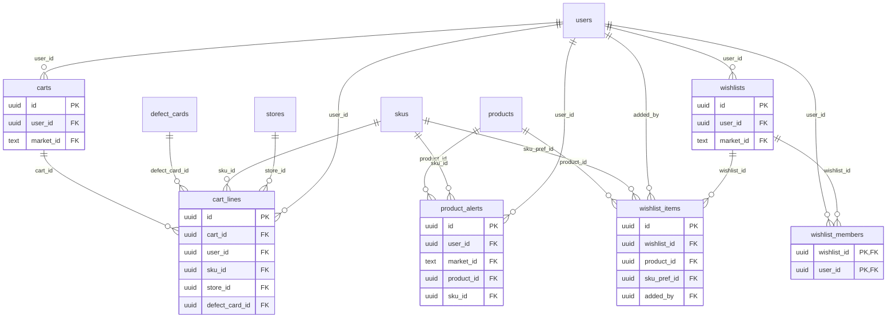

#### `carts`
Phase 1 · residency `cell` · tenant user_id (RLS) · personal data · basis `contract` · retention `cart_active` · not partitioned

| Column | Type | Null | PII | Notes |
|---|---|---|---|---|
| `id` | uuid PK | no | P1 | UUIDv7, server-generated |
| `user_id` | uuid | no | P2 | -> `users`. owner; RLS app.current_user_id |
| `market_id` | text | no | P1 | -> `markets`. market scope (ADR-0006) |
| `currency` | char(3) | no | P1 | ISO 4217, must match market or account |
| `version` | int | no | P1 | optimistic lock / config version |
| `created_at` | timestamptz | no | P1 | UTC |
| `updated_at` | timestamptz | no | P1 | UTC |

- Key: `UNIQUE (user_id, market_id)`
- RLS: `user_id = current_setting('app.current_user_id')::uuid`, FORCE RLS.

#### `cart_lines`
Phase 1 · residency `cell` · tenant user_id (RLS) · personal data · basis `contract` · retention `cart_active` · not partitioned

| Column | Type | Null | PII | Notes |
|---|---|---|---|---|
| `id` | uuid PK | no | P1 | UUIDv7, server-generated |
| `cart_id` | uuid | no | P1 | -> `carts`. |
| `user_id` | uuid | no | P2 | -> `users`. owner; RLS app.current_user_id |
| `sku_id` | uuid | no | P1 | -> `skus`. |
| `store_id` | uuid | no | P1 | -> `stores`. grouping only (not a tenant key) |
| `qty` | smallint | no | P1 | 1-10 |
| `price_at_add_minor` | bigint | no | P1 | for honest "price dropped / rose since you added" |
| `currency` | char(3) | no | P1 | ISO 4217, must match market or account |
| `defect_card_id` | uuid | yes | P1 | -> `defect_cards`. version acknowledged |
| `defect_ack_at` | timestamptz | yes | P2 | shopper ticked the defect box |
| `defect_ack_count` | smallint | yes | P1 | N defects acknowledged |
| `source` | text | no | P1 | pdp, quick_add, shelf, wishlist, drop |
| `saved_for_later` | boolean | no | P1 |  |
| `added_at` | timestamptz | no | P1 |  |
| `updated_at` | timestamptz | no | P1 |  |

- Key: `UNIQUE (cart_id, sku_id) WHERE saved_for_later = false`
- Index: `(cart_id, store_id, added_at)`
- Index: `(sku_id)` -> notify bag holders on price change (batched)
- RLS: `user_id = current_setting('app.current_user_id')::uuid`, FORCE RLS.
- ⚠ VERIFY: V19

#### `wishlists`
Phase 1 · residency `cell` · tenant user_id (RLS) · personal data · basis `contract` · retention `account_active` · not partitioned

| Column | Type | Null | PII | Notes |
|---|---|---|---|---|
| `id` | uuid PK | no | P1 | UUIDv7, server-generated |
| `user_id` | uuid | no | P2 | -> `users`. owner; RLS app.current_user_id |
| `market_id` | text | no | P1 | -> `markets`. market scope (ADR-0006) |
| `intent` | text | no | P2 | need, want, treat, later_this_month, birthday, eid_ramadan, gift, custom |
| `title` | text | yes | P2 |  |
| `target_date` | date | yes | P2 |  |
| `budget_minor` | bigint | yes | P2 |  |
| `currency` | char(3) | no | P1 | ISO 4217, must match market or account |
| `visibility` | text | no | P1 | private, family, shared_link |
| `share_token_hash` | bytea | yes | P2 (hash) | 128-bit random token, revocable |
| `share_expires_at` | timestamptz | yes | P1 |  |
| `created_at` | timestamptz | no | P1 | UTC |
| `updated_at` | timestamptz | no | P1 | UTC |

- Key: `UNIQUE (share_token_hash) WHERE share_token_hash IS NOT NULL`
- Index: `(user_id, updated_at DESC, id DESC)`
- RLS: `user_id = current_setting('app.current_user_id')::uuid`, FORCE RLS.

#### `wishlist_members`
Phase 1 · residency `cell` · tenant user_id (RLS) · personal data · basis `contract` · retention `account_active` · not partitioned

| Column | Type | Null | PII | Notes |
|---|---|---|---|---|
| `wishlist_id` | uuid PK | no | P1 | -> `wishlists`. |
| `user_id` | uuid PK | no | P2 | -> `users`. owner; RLS app.current_user_id |
| `role` | text | no | P1 | owner, editor, viewer |
| `added_at` | timestamptz | no | P1 |  |

- Key: `PRIMARY KEY (wishlist_id, user_id)`
- Index: `(user_id)` -> lists shared with me
- RLS: `user_id = current_setting('app.current_user_id')::uuid`, FORCE RLS.

#### `wishlist_items`
Phase 1 · residency `cell` · tenant none · personal data · basis `contract` · retention `account_active` · not partitioned

| Column | Type | Null | PII | Notes |
|---|---|---|---|---|
| `id` | uuid PK | no | P1 | UUIDv7, server-generated |
| `wishlist_id` | uuid | no | P1 | -> `wishlists`. |
| `product_id` | uuid | no | P1 | -> `products`. |
| `sku_pref_id` | uuid | yes | P1 | -> `skus`. |
| `added_price_minor` | bigint | no | P1 |  |
| `currency` | char(3) | no | P1 | ISO 4217, must match market or account |
| `note` | text | yes | P2 |  |
| `added_by` | uuid | no | P2 | -> `users`. |
| `created_at` | timestamptz | no | P1 | UTC |

- Key: `UNIQUE (wishlist_id, product_id, sku_pref_id)`

#### `product_alerts`
Phase 1 · residency `cell` · tenant user_id (RLS) · personal data · basis `consent` · retention `account_active` · not partitioned

| Column | Type | Null | PII | Notes |
|---|---|---|---|---|
| `id` | uuid PK | no | P1 | UUIDv7, server-generated |
| `user_id` | uuid | no | P2 | -> `users`. owner; RLS app.current_user_id |
| `market_id` | text | no | P1 | -> `markets`. market scope (ADR-0006) |
| `product_id` | uuid | no | P1 | -> `products`. |
| `sku_id` | uuid | yes | P1 | -> `skus`. |
| `kind` | text | no | P1 | price_drop_verified, back_in_size, restock |
| `active` | boolean | no | P1 |  |
| `last_sent_at` | timestamptz | yes | P1 |  |
| `created_at` | timestamptz | no | P1 | UTC |

- Key: `UNIQUE (user_id, product_id, sku_id, kind)`
- Index: `(sku_id, kind) WHERE active` -> fan-out on price or stock event
- RLS: `user_id = current_setting('app.current_user_id')::uuid`, FORCE RLS.

<a id="m-orders"></a>
### 7.14 Checkout and orders

One **OrderGroup** (one payment) -> many **SellerOrders** (one per store) -> **OrderLines**. Checkout is an orchestrated saga (master prompt §7): validate cart -> reserve -> hold credit -> create payment intent (`Idempotency-Key = order_group_id`) -> webhook -> claim + post ledger + outbox -> compensate on failure. Price-lock 10 min in `checkout_sessions`. Each line snapshots price, VAT, claim id, VRP and the acknowledged defect-card version (evidence trail for CPA inquiries). `funds_flow` is snapshotted per order group so both payment split models can coexist (decision DM-06, Q2).

Order tables are **not partitioned in Phase 1** (estimated 12-30M seller orders per year at 4M users). Trigger to partition by UUIDv7 id range: about 100M rows or vacuum lag, done by expand/contract (decision DM-12).

**State machines.** **OrderGroup**: `PENDING_PAYMENT -> (PAID | CONFIRMED_COD | PAYMENT_FAILED | EXPIRED)`, `PAID|CONFIRMED_COD -> (PARTIALLY_FULFILLED -> COMPLETED) | CANCELLED`.
**SellerOrder** (master prompt §20.1): `PENDING_PAYMENT -> PAID | CONFIRMED_COD -> ACCEPTED -> PACKED -> SHIPPED -> OUT_FOR_DELIVERY -> DELIVERED -> CLOSED` (after the return window); exceptions `CANCELLED`, `REJECTED_BY_SELLER`, `DELIVERY_FAILED -> RTO -> RETURNED_TO_SELLER`, `DISPUTED`. Return states live on `return_requests`.

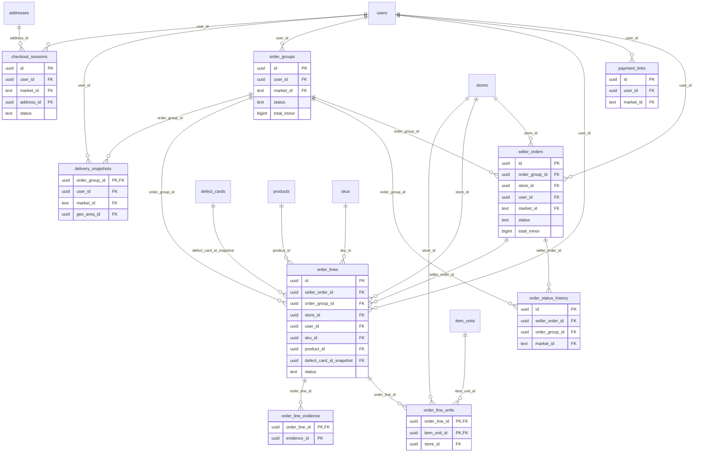

#### `checkout_sessions`
Phase 1 · residency `cell` · tenant user_id (RLS) · personal data · basis `contract` · retention `checkout_90d` · partition: RANGE (id) monthly; drop after 90 days

| Column | Type | Null | PII | Notes |
|---|---|---|---|---|
| `id` | uuid PK | no | P1 | partition key |
| `user_id` | uuid | no | P2 | -> `users`. owner; RLS app.current_user_id |
| `market_id` | text | no | P1 | -> `markets`. market scope (ADR-0006) |
| `cart_snapshot` | jsonb | no | P2 | lines, prices, claim ids, defect acks |
| `quote` | jsonb | no | P1 | totals, fees, vouchers, shipping; every fee on first render (no drip pricing) |
| `currency` | char(3) | no | P1 | ISO 4217, must match market or account |
| `address_id` | uuid | yes | P2 | -> `addresses`. |
| `shipping_quote_id` | uuid | yes | P1 | logical ref (partitioned) |
| `price_lock_expires_at` | timestamptz | no | P1 | 10 min |
| `status` | text | no | P1 | open, submitted, expired, abandoned |
| `order_group_id` | uuid | yes | P1 |  |
| `created_at` | timestamptz | no | P1 | UTC |
| `updated_at` | timestamptz | no | P1 | UTC |

- Index: `(user_id, id DESC)`
- RLS: `user_id = current_setting('app.current_user_id')::uuid`, FORCE RLS.

#### `order_groups`
Phase 1 · residency `cell` · tenant user_id (RLS) · personal data · basis `contract` · retention `tax_records` · not partitioned

| Column | Type | Null | PII | Notes |
|---|---|---|---|---|
| `id` | uuid PK | no | P1 | UUIDv7, server-generated |
| `user_id` | uuid | no | P2 | -> `users`. owner; RLS app.current_user_id |
| `market_id` | text | no | P1 | -> `markets`. market scope (ADR-0006) |
| `currency` | char(3) | no | P1 | ISO 4217, must match market or account |
| `status` | text | no | P1 | see OrderGroup machine |
| `funds_flow` | text | no | P1 | psp_split or collect_payout (snapshot of config at placement) |
| `checkout_session_id` | uuid | no | P1 | logical ref; one group per session |
| `items_subtotal_minor` | bigint | no | P1 |  |
| `discount_minor` | bigint | no | P1 |  |
| `shipping_minor` | bigint | no | P1 |  |
| `vat_minor` | bigint | no | P1 |  |
| `store_credit_minor` | bigint | no | P1 |  |
| `total_minor` | bigint | no | P1 | amount owed by the shopper in total |
| `risk_decision` | text | yes | P1 | allow, require_confirmation, prepaid_only... |
| `placed_at` | timestamptz | no | P2 |  |
| `paid_at` | timestamptz | yes | P1 |  |
| `version` | int | no | P1 | optimistic lock / config version |
| `created_at` | timestamptz | no | P1 | UTC |
| `updated_at` | timestamptz | no | P1 | UTC |

- Key: `UNIQUE (checkout_session_id)` -> permanent idempotency of placement
- Index: `(user_id, created_at DESC, id DESC)` -> My orders (keyset)
- Index: `(status, created_at) WHERE status = 'PENDING_PAYMENT'` -> expiry sweeper
- RLS: `user_id = current_setting('app.current_user_id')::uuid`, FORCE RLS.
- State machine: OrderGroup (see module intro).
- ⚠ VERIFY: V71, V77

#### `seller_orders`
Phase 1 · residency `cell` · tenant store_id + user_id (two RLS policies) · personal data · basis `contract` · retention `tax_records` · not partitioned

| Column | Type | Null | PII | Notes |
|---|---|---|---|---|
| `id` | uuid PK | no | P1 | UUIDv7, server-generated |
| `order_group_id` | uuid | no | P1 | -> `order_groups`. |
| `store_id` | uuid | no | P1 | -> `stores`. tenant key; RLS app.current_store_id |
| `user_id` | uuid | no | P2 | -> `users`. owner; RLS app.current_user_id |
| `market_id` | text | no | P1 | -> `markets`. market scope (ADR-0006) |
| `currency` | char(3) | no | P1 | ISO 4217, must match market or account |
| `status` | text | no | P1 | see SellerOrder machine |
| `funds_flow` | text | no | P1 |  |
| `items_subtotal_minor` | bigint | no | P1 |  |
| `platform_discount_minor` | bigint | no | P1 | platform-funded share (VAT base, ledger) |
| `seller_discount_minor` | bigint | no | P1 | seller-funded share |
| `shipping_minor` | bigint | no | P1 |  |
| `vat_minor` | bigint | no | P1 |  |
| `total_minor` | bigint | no | P1 |  |
| `commission_bp_snapshot` | int | no | P1 | resolved commission (seller plans) |
| `commission_minor` | bigint | no | P1 |  |
| `plan_id_snapshot` | uuid | yes | P1 |  |
| `shipping_quote_ref` | jsonb | yes | P1 | parcel quote copied from shipment_quotes |
| `accept_by` | timestamptz | yes | P1 | 24 h SLA, else auto-cancel |
| `dispatch_by` | timestamptz | yes | P1 |  |
| `delivered_at` | timestamptz | yes | P1 | courier-confirmed; all CPL windows count from here |
| `return_window_ends_at` | timestamptz | yes | P1 |  |
| `closed_at` | timestamptz | yes | P1 |  |
| `cancel_reason` | text | yes | P1 |  |
| `version` | int | no | P1 | optimistic lock / config version |
| `created_at` | timestamptz | no | P1 | UTC |
| `updated_at` | timestamptz | no | P1 | UTC |

- Index: `(store_id, status, created_at DESC, id DESC)` -> Seller Center orders (keyset)
- Index: `(user_id, created_at DESC, id DESC)`
- Index: `(order_group_id)`
- Index: `(accept_by) WHERE status = 'PAID'` -> auto-cancel sweeper
- Index: `(return_window_ends_at) WHERE status = 'DELIVERED'` -> close job
- RLS: Two policies: store_id = app.current_store_id (seller) OR user_id = app.current_user_id (shopper).
- State machine: SellerOrder (see module intro).
- ⚠ VERIFY: V7

#### `order_lines`
Phase 1 · residency `cell` · tenant store_id + user_id (two RLS policies) · personal data · basis `contract` · retention `tax_records` · not partitioned

| Column | Type | Null | PII | Notes |
|---|---|---|---|---|
| `id` | uuid PK | no | P1 | UUIDv7, server-generated |
| `seller_order_id` | uuid | no | P1 | -> `seller_orders`. |
| `order_group_id` | uuid | no | P1 | -> `order_groups`. |
| `store_id` | uuid | no | P1 | -> `stores`. tenant key; RLS app.current_store_id |
| `user_id` | uuid | no | P2 | -> `users`. owner; RLS app.current_user_id |
| `sku_id` | uuid | no | P1 | -> `skus`. |
| `product_id` | uuid | no | P1 | -> `products`. |
| `title_ar_snapshot` | text | no | P1 |  |
| `title_en_snapshot` | text | yes | P1 |  |
| `condition_grade_snapshot` | text | no | P1 |  |
| `defect_card_id_snapshot` | uuid | yes | P1 | -> `defect_cards`. version acknowledged |
| `defect_ack_at` | timestamptz | yes | P2 |  |
| `qty` | smallint | no | P1 |  |
| `unit_price_minor` | bigint | no | P1 |  |
| `currency` | char(3) | no | P1 | ISO 4217, must match market or account |
| `platform_discount_minor` | bigint | no | P1 |  |
| `seller_discount_minor` | bigint | no | P1 |  |
| `vat_rate_bp` | int | no | P1 |  |
| `vat_minor` | bigint | no | P1 |  |
| `tax_category` | text | no | P1 |  |
| `price_claim_id_snapshot` | uuid | yes | P1 | claim shown at purchase |
| `vrp_minor_snapshot` | bigint | yes | P1 |  |
| `claim_type_snapshot` | text | no | P1 |  |
| `status` | text | no | P1 | active, cancelled, return_requested, returned, refunded |
| `created_at` | timestamptz | no | P1 | UTC |

- Index: `(seller_order_id)`
- Index: `(sku_id, created_at)` -> sell-through

#### `order_line_units`
Phase 1 · residency `cell` · tenant store_id (RLS) · no personal data · basis `not_personal_data` · retention `tax_records` · not partitioned

| Column | Type | Null | PII | Notes |
|---|---|---|---|---|
| `order_line_id` | uuid PK | no | P1 | -> `order_lines`. |
| `item_unit_id` | uuid PK | no | P1 | -> `item_units`. |
| `store_id` | uuid | no | P1 | -> `stores`. tenant key; RLS app.current_store_id |
| `assigned_at` | timestamptz | no | P1 |  |

- Key: `PRIMARY KEY (order_line_id, item_unit_id)`
- Index: `(item_unit_id)`
- RLS: `store_id = current_setting('app.current_store_id')::uuid`, FORCE RLS.
- Links the sold physical unit (defect passport) to the line; private.

#### `delivery_snapshots`
Phase 1 · residency `cell` · tenant user_id (RLS) · personal data · basis `contract` · retention `delivery_24m` · not partitioned

| Column | Type | Null | PII | Notes |
|---|---|---|---|---|
| `order_group_id` | uuid PK | no | P1 | -> `order_groups`. |
| `user_id` | uuid | no | P2 | -> `users`. owner; RLS app.current_user_id |
| `market_id` | text | no | P1 | -> `markets`. market scope (ADR-0006) |
| `country_code` | char(2) | no | P2 |  |
| `geo_area_id` | uuid | no | P2 | -> `geo_areas`. |
| `recipient_name_ct` | bytea | no | P3 (enc) |  |
| `phone_ct` | bytea | no | P3 (enc) | masked relay number to sellers where the courier supports it |
| `address_ct` | bytea | no | P3 (enc) |  |
| `pin_ct` | bytea | yes | P3 (enc) |  |
| `seller_access_until` | timestamptz | yes | P1 | delivery + 30 days (master prompt B1) |
| `pseudonymised_at` | timestamptz | yes | P1 |  |
| `created_at` | timestamptz | no | P1 | UTC |
- RLS: Shopper policy on user_id; seller access only through a view joined to seller_orders while now() < seller_access_until.

#### `order_status_history`
Phase 1 · residency `cell` · tenant none · personal data · basis `contract` · retention `tax_records` · partition: RANGE (id) monthly

| Column | Type | Null | PII | Notes |
|---|---|---|---|---|
| `id` | uuid PK | no | P1 | partition key |
| `seller_order_id` | uuid | yes | P1 | -> `seller_orders`. |
| `order_group_id` | uuid | no | P1 | -> `order_groups`. |
| `market_id` | text | no | P1 | -> `markets`. market scope (ADR-0006) |
| `from_status` | text | yes | P1 |  |
| `to_status` | text | no | P1 |  |
| `actor_type` | text | no | P1 | shopper, store_member, staff, system, courier |
| `actor_id` | uuid | yes | P2 |  |
| `reason` | text | yes | P1 |  |
| `occurred_at` | timestamptz | no | P1 |  |

- Index: `(seller_order_id, id)`
- Index: `(order_group_id, id)`

#### `order_line_evidence`
Phase 1 · residency `cell` · tenant none · no personal data · basis `not_personal_data` · retention `tax_records` · not partitioned

| Column | Type | Null | PII | Notes |
|---|---|---|---|---|
| `order_line_id` | uuid PK | no | P1 | -> `order_lines`. |
| `evidence_id` | uuid PK | no | P1 | logical ref to price_evidence (partitioned) |

- Key: `PRIMARY KEY (order_line_id, evidence_id)`

#### `payment_links`
Phase 1 · residency `cell` · tenant user_id (RLS) · personal data · basis `contract` · retention `checkout_90d` · not partitioned

| Column | Type | Null | PII | Notes |
|---|---|---|---|---|
| `id` | uuid PK | no | P1 | UUIDv7, server-generated |
| `user_id` | uuid | no | P2 | -> `users`. owner; RLS app.current_user_id |
| `market_id` | text | no | P1 | -> `markets`. market scope (ADR-0006) |
| `checkout_session_id` | uuid | no | P1 | logical ref |
| `token_hash` | bytea | no | P2 (hash) | 128-bit token in the WhatsApp link |
| `channel` | text | no | P1 | whatsapp, sms |
| `expires_at` | timestamptz | no | P1 |  |
| `used_at` | timestamptz | yes | P1 |  |
| `created_at` | timestamptz | no | P1 | UTC |

- Key: `UNIQUE (token_hash)`
- RLS: `user_id = current_setting('app.current_user_id')::uuid`, FORCE RLS.
- WhatsApp pay links (feature 44); the link opens hosted checkout, never takes card data.

<a id="m-payments"></a>
### 7.15 Payments, webhooks and settlement

Card data never touches us (PCI SAQ A): hosted page, iframe or SDK only. One payment intent per order group. Split tender = store credit (ledger hold) + one external method. **Both funds-flow models are supported** (Q2 open): in `psp_split`, the PSP splits per seller using `psp_merchant_accounts` and `payment_split_instructions`; in `collect_payout`, the platform collects and pays sellers through `payouts`. The ledger chart is the same; only the settlement path differs. Webhooks: IP allow-list + HMAC + timestamp +/-5 min, raw body stored encrypted, dedup on provider event id (`dedup_keys`).

**State machines.** **PaymentIntent**: `CREATED -> REQUIRES_ACTION -> AUTHORIZED -> CAPTURED`, `* -> FAILED | CANCELLED | EXPIRED`, `CAPTURED -> PARTIALLY_REFUNDED -> REFUNDED`. **SplitInstruction**: `PENDING -> SUBMITTED -> CONFIRMED | FAILED`, `CONFIRMED -> REVERSED`.

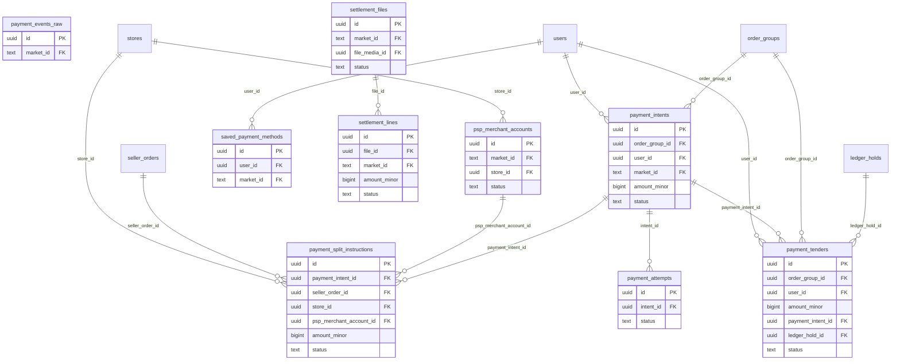

#### `psp_merchant_accounts`
Phase 1 · residency `cell` · tenant store_id (RLS) · no personal data · basis `not_personal_data` · retention `tax_records` · not partitioned

| Column | Type | Null | PII | Notes |
|---|---|---|---|---|
| `id` | uuid PK | no | P1 | UUIDv7, server-generated |
| `market_id` | text | no | P1 | -> `markets`. market scope (ADR-0006) |
| `provider` | text | no | P1 | paymob, kashier, fawry |
| `kind` | text | no | P1 | platform, sub_merchant |
| `store_id` | uuid | yes | P1 | -> `stores`. set for sub-merchant accounts (psp_split model) |
| `provider_account_ref` | text | no | P1 |  |
| `status` | text | no | P1 | pending, active, suspended |
| `created_at` | timestamptz | no | P1 | UTC |

- Key: `UNIQUE (provider, provider_account_ref)`
- Index: `(store_id, provider) WHERE status = 'active'`
- RLS: `store_id = current_setting('app.current_store_id')::uuid`, FORCE RLS.
- ⚠ VERIFY: V4, V41

#### `payment_intents`
Phase 1 · residency `cell` · tenant user_id (RLS) · personal data · basis `contract` · retention `tax_records` · not partitioned

| Column | Type | Null | PII | Notes |
|---|---|---|---|---|
| `id` | uuid PK | no | P1 | UUIDv7, server-generated |
| `order_group_id` | uuid | no | P1 | -> `order_groups`. |
| `user_id` | uuid | no | P2 | -> `users`. owner; RLS app.current_user_id |
| `market_id` | text | no | P1 | -> `markets`. market scope (ADR-0006) |
| `provider` | text | no | P1 |  |
| `provider_ref` | text | yes | P1 |  |
| `method` | text | no | P1 | card, apple_pay, meeza, wallet, instapay, fawry, bnpl, cod |
| `bnpl_provider` | text | yes | P1 | valU, Sympl... via the PSP |
| `amount_minor` | bigint | no | P1 |  |
| `currency` | char(3) | no | P1 | ISO 4217, must match market or account |
| `status` | text | no | P1 | see PaymentIntent machine |
| `client_action` | jsonb | yes | P1 | redirect URL, Fawry reference, 3-DS step |
| `three_ds` | boolean | yes | P1 |  |
| `failure_code` | text | yes | P1 |  |
| `expires_at` | timestamptz | yes | P1 |  |
| `version` | int | no | P1 | optimistic lock / config version |
| `created_at` | timestamptz | no | P1 | UTC |
| `updated_at` | timestamptz | no | P1 | UTC |

- Key: `UNIQUE (order_group_id)` -> one intent per group
- Key: `UNIQUE (provider, provider_ref) WHERE provider_ref IS NOT NULL`
- Index: `(status, expires_at) WHERE status IN ('CREATED','REQUIRES_ACTION')` -> expiry
- RLS: `user_id = current_setting('app.current_user_id')::uuid`, FORCE RLS.
- State machine: PaymentIntent (see module intro).
- ⚠ VERIFY: V5

#### `payment_attempts`
Phase 1 · residency `cell` · tenant none · no personal data · basis `not_personal_data` · retention `tax_records` · not partitioned

| Column | Type | Null | PII | Notes |
|---|---|---|---|---|
| `id` | uuid PK | no | P1 | UUIDv7, server-generated |
| `intent_id` | uuid | no | P1 | -> `payment_intents`. |
| `attempt_no` | smallint | no | P1 |  |
| `provider_request_id` | text | yes | P1 |  |
| `status` | text | no | P1 |  |
| `error_code` | text | yes | P1 |  |
| `created_at` | timestamptz | no | P1 | UTC |

- Key: `UNIQUE (intent_id, attempt_no)`

#### `payment_tenders`
Phase 1 · residency `cell` · tenant user_id (RLS) · personal data · basis `contract` · retention `tax_records` · not partitioned

| Column | Type | Null | PII | Notes |
|---|---|---|---|---|
| `id` | uuid PK | no | P1 | UUIDv7, server-generated |
| `order_group_id` | uuid | no | P1 | -> `order_groups`. |
| `user_id` | uuid | no | P2 | -> `users`. owner; RLS app.current_user_id |
| `kind` | text | no | P1 | external, store_credit |
| `amount_minor` | bigint | no | P1 |  |
| `currency` | char(3) | no | P1 | ISO 4217, must match market or account |
| `payment_intent_id` | uuid | yes | P1 | -> `payment_intents`. |
| `ledger_hold_id` | uuid | yes | P1 | -> `ledger_holds`. |
| `status` | text | no | P1 | held, captured, released, refunded |
| `created_at` | timestamptz | no | P1 | UTC |

- Index: `(order_group_id)`
- RLS: `user_id = current_setting('app.current_user_id')::uuid`, FORCE RLS.

#### `payment_split_instructions`
Phase 1 · residency `cell` · tenant store_id (RLS) · no personal data · basis `not_personal_data` · retention `tax_records` · not partitioned

| Column | Type | Null | PII | Notes |
|---|---|---|---|---|
| `id` | uuid PK | no | P1 | UUIDv7, server-generated |
| `payment_intent_id` | uuid | no | P1 | -> `payment_intents`. |
| `seller_order_id` | uuid | no | P1 | -> `seller_orders`. |
| `store_id` | uuid | no | P1 | -> `stores`. tenant key; RLS app.current_store_id |
| `psp_merchant_account_id` | uuid | no | P1 | -> `psp_merchant_accounts`. |
| `amount_minor` | bigint | no | P1 | seller share |
| `commission_minor` | bigint | no | P1 |  |
| `currency` | char(3) | no | P1 | ISO 4217, must match market or account |
| `status` | text | no | P1 | see SplitInstruction machine |
| `provider_ref` | text | yes | P1 |  |
| `created_at` | timestamptz | no | P1 | UTC |

- Key: `UNIQUE (payment_intent_id, seller_order_id)`
- RLS: `store_id = current_setting('app.current_store_id')::uuid`, FORCE RLS.
- Used only when order_groups.funds_flow = 'psp_split'.
- ⚠ VERIFY: V4, V41

#### `saved_payment_methods`
Phase 1 · residency `cell` · tenant user_id (RLS) · personal data · basis `contract` · retention `account_active` · not partitioned

| Column | Type | Null | PII | Notes |
|---|---|---|---|---|
| `id` | uuid PK | no | P1 | UUIDv7, server-generated |
| `user_id` | uuid | no | P2 | -> `users`. owner; RLS app.current_user_id |
| `market_id` | text | no | P1 | -> `markets`. market scope (ADR-0006) |
| `provider` | text | no | P1 |  |
| `psp_token_ct` | bytea | no | P3 (enc) | PSP token only, never a PAN |
| `brand` | text | no | P2 |  |
| `last4` | char(4) | no | P2 |  |
| `exp_month` | smallint | no | P2 |  |
| `exp_year` | smallint | no | P2 |  |
| `fingerprint_hash` | bytea | yes | P2 (hash) | trial and referral abuse checks |
| `created_at` | timestamptz | no | P1 | UTC |
| `revoked_at` | timestamptz | yes | P1 |  |

- Index: `(user_id) WHERE revoked_at IS NULL`
- Index: `(fingerprint_hash)`
- RLS: `user_id = current_setting('app.current_user_id')::uuid`, FORCE RLS.
- ⚠ VERIFY: V73

#### `payment_events_raw`
Phase 1 · residency `cell` · tenant none · personal data · basis `legal_obligation` · retention `raw_webhooks_financial` · partition: RANGE (id) monthly

| Column | Type | Null | PII | Notes |
|---|---|---|---|---|
| `id` | uuid PK | no | P1 | UUIDv7; partition key |
| `market_id` | text | no | P1 | -> `markets`. market scope (ADR-0006) |
| `provider` | text | no | P1 |  |
| `provider_event_id` | text | no | P1 | dedup through dedup_keys (namespace webhook:{provider}) |
| `event_type` | text | no | P1 |  |
| `signature_ok` | boolean | no | P1 |  |
| `body_ct` | bytea | no | P2 (enc) | raw body (may hold payer details); pseudonymised on erasure |
| `payment_intent_id` | uuid | yes | P1 |  |
| `processing_status` | text | no | P1 | received, processed, ignored, failed |
| `received_at` | timestamptz | no | P1 |  |
| `processed_at` | timestamptz | yes | P1 |  |

- Index: `(payment_intent_id, id)`
- Index: `(processing_status, id) WHERE processing_status = 'failed'`
- ⚠ VERIFY: V71

#### `settlement_files`
Phase 1 · residency `cell` · tenant none · no personal data · basis `not_personal_data` · retention `tax_records` · not partitioned

| Column | Type | Null | PII | Notes |
|---|---|---|---|---|
| `id` | uuid PK | no | P1 | UUIDv7, server-generated |
| `market_id` | text | no | P1 | -> `markets`. market scope (ADR-0006) |
| `provider` | text | no | P1 |  |
| `business_date` | date | no | P1 |  |
| `file_media_id` | uuid | no | P1 | -> `media_assets`. |
| `sha256` | bytea | no | P1 |  |
| `row_count` | int | no | P1 |  |
| `status` | text | no | P1 | received, parsed, reconciled, failed |
| `received_at` | timestamptz | no | P1 |  |

- Key: `UNIQUE (provider, business_date, sha256)`

#### `settlement_lines`
Phase 1 · residency `cell` · tenant none · no personal data · basis `not_personal_data` · retention `tax_records` · partition: RANGE (id) monthly

| Column | Type | Null | PII | Notes |
|---|---|---|---|---|
| `id` | uuid PK | no | P1 | partition key |
| `file_id` | uuid | no | P1 | -> `settlement_files`. |
| `market_id` | text | no | P1 | -> `markets`. market scope (ADR-0006) |
| `provider_ref` | text | no | P1 |  |
| `kind` | text | no | P1 | capture, refund, fee, chargeback, payout |
| `amount_minor` | bigint | no | P1 |  |
| `fee_minor` | bigint | no | P1 |  |
| `currency` | char(3) | no | P1 | ISO 4217, must match market or account |
| `value_date` | date | no | P1 |  |
| `matched_entry_id` | uuid | yes | P1 | journal entry |
| `status` | text | no | P1 | unmatched, matched, mismatch |

- Index: `(provider_ref)`
- Index: `(status, value_date) WHERE status <> 'matched'` -> 3-day aging alert

<a id="m-ledger"></a>
### 7.16 Ledger (double-entry)

Master prompt §T4 and BUILD-PROMPT §2. Every money movement is one `journal_entries` row plus >= 2 `postings` in one transaction. A **deferred constraint trigger** checks at COMMIT that postings sum to 0 per entry per currency. Postings and entries are **immutable** (UPDATE/DELETE/TRUNCATE revoked and blocked by trigger); corrections are reversing entries. Sign convention: positive = debit. Accounts are per currency and per market (ADR-0006 #2). Store-credit and gift-card value held during checkout is a `ledger_holds` row, not a pending posting, so postings stay immutable. Balances are projections reconciled nightly; postings are the truth.

**Partitioning (decision DM-05).** `journal_entries` is range-partitioned monthly on its UUIDv7 `id` (generated by the server at insert, so it equals booking time); `postings` uses the same bounds on `entry_id`, so an entry and its postings co-locate and the FK `postings(entry_id) -> journal_entries(id)` holds. The permanent business idempotency key lives in the small unpartitioned `journal_entry_keys`.

**Chart of accounts:** `docs/specs/ledger-chart-of-accounts.md` is authoritative for account types, worked examples and the id scheme `{type}:{market}:{currency}[:{owner}][:{sub}]` (for example `seller_pending:EG:EGP:<store>`, `seller_available:EG:EGP:<store>`, `store_credit:EG:EGP:<user>:refund_credit`). Here that string is `ledger_accounts.code` (UNIQUE, CHECK-built from the columns); postings reference the 16-byte UUID `id` to keep the largest table's keys small (decision DM-18).

**State machines.** **LedgerHold**: `HELD -> CAPTURED | RELEASED | EXPIRED`. **ReconciliationItem**: `UNMATCHED | AMOUNT_MISMATCH | MISSING_LEDGER | MISSING_SOURCE -> RESOLVED`; aging > 3 days escalates to Finance.

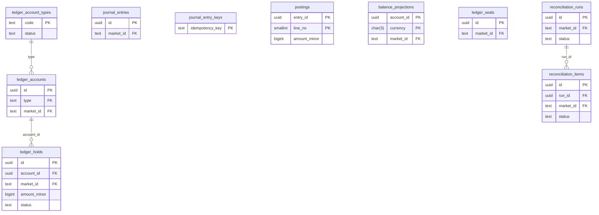

#### `ledger_account_types`
Phase 0 · residency `global` · tenant none · no personal data · basis `not_personal_data` · retention `config_versions` · not partitioned

| Column | Type | Null | PII | Notes |
|---|---|---|---|---|
| `code` | text PK | no | P1 | type list from the chart of accounts (psp_clearing, seller_pending, seller_available, ...) |
| `category` | text | no | P1 | asset, liability, revenue, expense |
| `normal_side` | text | no | P1 | debit, credit |
| `owner_type` | text | no | P1 | platform, store, user, psp, courier, bnpl_provider, bank |
| `allows_negative` | boolean | no | P1 | seller_available may go negative (refund after payout) |
| `status` | text | no | P1 | active, reserved |

#### `ledger_accounts`
Phase 0 · residency `cell` · tenant none · personal data · basis `legal_obligation` · retention `tax_records` · not partitioned

| Column | Type | Null | PII | Notes |
|---|---|---|---|---|
| `id` | uuid PK | no | P1 | UUIDv7, server-generated |
| `code` | text | no | P2 | chart id {type}:{market}:{currency}[:{owner}][:{sub}]; holds a user id for store_credit accounts |
| `type` | text | no | P1 | -> `ledger_account_types`. |
| `market_id` | text | no | P1 | -> `markets`. market scope (ADR-0006) |
| `owner_type` | text | no | P1 |  |
| `owner_id` | text | no | P2 | store id, user id, provider code; '' for platform; tombstoned on erasure |
| `sub` | text | no | P1 | '' or a sub-balance, e.g. refund_credit, goodwill |
| `currency` | char(3) | no | P1 | ISO 4217, must match market or account |
| `created_at` | timestamptz | no | P1 | UTC |
| `closed_at` | timestamptz | yes | P1 |  |

- Key: `UNIQUE (code)`
- Key: `UNIQUE (market_id, type, owner_type, owner_id, sub, currency)`
- Key: `UNIQUE (id, currency)` -> composite FK target for postings
- Index: `(owner_type, owner_id)`
- ⚠ VERIFY: V77

#### `journal_entries`
Phase 0 · residency `cell` · tenant none · no personal data · basis `not_personal_data` · retention `tax_records` · partition: RANGE (id) monthly

| Column | Type | Null | PII | Notes |
|---|---|---|---|---|
| `id` | uuid PK | no | P1 | UUIDv7 from the server at insert; partition key |
| `market_id` | text | no | P1 | -> `markets`. market scope (ADR-0006) |
| `kind` | text | no | P1 | order_recognised, refund_issued, clearing_settled, seller_payout, plan_fee_netted, store_credit_granted, store_credit_expired, reversal... |
| `idempotency_key` | text | no | P1 | permanent; mirrored in journal_entry_keys |
| `ref_type` | text | no | P1 |  |
| `ref_id` | text | no | P1 |  |
| `reverses_entry_id` | uuid | yes | P1 | at most one reversal per entry |
| `occurred_at` | timestamptz | no | P1 | business time |
| `txid` | xid8 | no | P1 | postings only from the creating transaction |
| `created_at` | timestamptz | no | P1 | UTC |

- Index: `(ref_type, ref_id)`
- Index: `(occurred_at)` -> reports
- No user data on the row; personal linkage is through accounts.
- ⚠ VERIFY: V71

#### `journal_entry_keys`
Phase 0 · residency `cell` · tenant none · no personal data · basis `not_personal_data` · retention `tax_records` · not partitioned

| Column | Type | Null | PII | Notes |
|---|---|---|---|---|
| `idempotency_key` | text PK | no | P1 |  |
| `entry_id` | uuid | no | P1 |  |
| `reverses_entry_id` | uuid | yes | P1 | UNIQUE: a second reversal fails |
| `created_at` | timestamptz | no | P1 | UTC |

- Key: `UNIQUE (reverses_entry_id) WHERE reverses_entry_id IS NOT NULL`

#### `postings`
Phase 0 · residency `cell` · tenant none · no personal data · basis `not_personal_data` · retention `tax_records` · partition: RANGE (entry_id) monthly, aligned with journal_entries

| Column | Type | Null | PII | Notes |
|---|---|---|---|---|
| `entry_id` | uuid PK | no | P1 | partition key (same bounds as journal_entries) |
| `line_no` | smallint PK | no | P1 |  |
| `account_id` | uuid | no | P1 | composite FK (account_id, currency) -> ledger_accounts |
| `amount_minor` | bigint | no | P1 | signed, never zero |
| `currency` | char(3) | no | P1 | ISO 4217, must match market or account |

- Key: `PRIMARY KEY (entry_id, line_no)`
- Index: `(account_id, entry_id)` -> account statement (keyset on entry_id)
- Deferred constraint trigger: SUM(amount_minor) per (entry_id, currency) = 0 at COMMIT. App role: INSERT, SELECT only.

#### `ledger_holds`
Phase 1 · residency `cell` · tenant none · no personal data · basis `not_personal_data` · retention `checkout_90d` · not partitioned

| Column | Type | Null | PII | Notes |
|---|---|---|---|---|
| `id` | uuid PK | no | P1 | UUIDv7, server-generated |
| `account_id` | uuid | no | P1 | -> `ledger_accounts`. |
| `market_id` | text | no | P1 | -> `markets`. market scope (ADR-0006) |
| `amount_minor` | bigint | no | P1 |  |
| `currency` | char(3) | no | P1 | ISO 4217, must match market or account |
| `ref_type` | text | no | P1 | order_group |
| `ref_id` | uuid | no | P1 |  |
| `status` | text | no | P1 | see LedgerHold machine |
| `captured_entry_id` | uuid | yes | P1 |  |
| `idempotency_key` | text | no | P1 |  |
| `expires_at` | timestamptz | no | P1 |  |
| `created_at` | timestamptz | no | P1 | UTC |
| `settled_at` | timestamptz | yes | P1 |  |

- Key: `UNIQUE (idempotency_key)`
- Index: `(expires_at) WHERE status = 'HELD'` -> sweeper
- Index: `(account_id) WHERE status = 'HELD'` -> spendable balance

#### `balance_projections`
Phase 0 · residency `cell` · tenant none · no personal data · basis `not_personal_data` · retention `tax_records` · not partitioned

| Column | Type | Null | PII | Notes |
|---|---|---|---|---|
| `account_id` | uuid PK | no | P1 |  |
| `currency` | char(3) PK | no | P1 | ISO 4217, must match market or account |
| `market_id` | text | no | P1 | -> `markets`. market scope (ADR-0006) |
| `balance_minor` | bigint | no | P1 |  |
| `held_minor` | bigint | no | P1 |  |
| `last_entry_id` | uuid | no | P1 |  |
| `refreshed_at` | timestamptz | no | P1 |  |

- Key: `PRIMARY KEY (account_id, currency)`
- Cache only; rebuilt from postings and compared nightly (drift alert).

#### `ledger_seals`
Phase 1 · residency `cell` · tenant none · no personal data · basis `not_personal_data` · retention `tax_records` · not partitioned

| Column | Type | Null | PII | Notes |
|---|---|---|---|---|
| `id` | uuid PK | no | P1 | UUIDv7, server-generated |
| `market_id` | text | no | P1 | -> `markets`. market scope (ADR-0006) |
| `from_entry_id` | uuid | no | P1 |  |
| `to_entry_id` | uuid | no | P1 |  |
| `entry_count` | int | no | P1 |  |
| `merkle_root` | bytea | no | P1 |  |
| `prev_seal_hash` | bytea | no | P1 |  |
| `seal_hash` | bytea | no | P1 |  |
| `trial_balance` | jsonb | no | P1 | per-currency totals (must be 0) |
| `signature` | bytea | no | P1 |  |
| `sealed_at` | timestamptz | no | P1 |  |

- Key: `UNIQUE (market_id, to_entry_id)`
- Hash chain over entries, written by the integrity job outside the write path; daily signed snapshot (master prompt §T4).

#### `reconciliation_runs`
Phase 1 · residency `cell` · tenant none · no personal data · basis `not_personal_data` · retention `tax_records` · not partitioned

| Column | Type | Null | PII | Notes |
|---|---|---|---|---|
| `id` | uuid PK | no | P1 | UUIDv7, server-generated |
| `market_id` | text | no | P1 | -> `markets`. market scope (ADR-0006) |
| `source` | text | no | P1 | psp_settlement, cod_remittance, bnpl_settlement, eta_submission, store_credit_projection |
| `counterparty` | text | no | P1 |  |
| `business_date` | date | no | P1 |  |
| `mode` | text | no | P1 | nightly, intraday |
| `status` | text | no | P1 | running, completed, failed |
| `matched_count` | int | yes | P1 |  |
| `unmatched_count` | int | yes | P1 |  |
| `started_at` | timestamptz | no | P1 |  |
| `finished_at` | timestamptz | yes | P1 |  |

- Key: `UNIQUE (source, counterparty, business_date, mode)`

#### `reconciliation_items`
Phase 1 · residency `cell` · tenant none · no personal data · basis `not_personal_data` · retention `tax_records` · not partitioned

| Column | Type | Null | PII | Notes |
|---|---|---|---|---|
| `id` | uuid PK | no | P1 | UUIDv7, server-generated |
| `run_id` | uuid | no | P1 | -> `reconciliation_runs`. |
| `market_id` | text | no | P1 | -> `markets`. market scope (ADR-0006) |
| `source_ref_type` | text | no | P1 |  |
| `source_ref_id` | uuid | no | P1 |  |
| `entry_id` | uuid | yes | P1 |  |
| `expected_minor` | bigint | yes | P1 |  |
| `actual_minor` | bigint | yes | P1 |  |
| `currency` | char(3) | no | P1 | ISO 4217, must match market or account |
| `status` | text | no | P1 | see ReconciliationItem machine |
| `ticket_ref` | text | yes | P1 |  |
| `first_seen_at` | timestamptz | no | P1 |  |
| `resolved_at` | timestamptz | yes | P1 |  |

- Index: `(status, first_seen_at) WHERE status <> 'RESOLVED'` -> 3-day aging SLO
- Index: `(run_id)`

<a id="m-payouts"></a>
### 7.17 Payouts

Seller earnings accrue per seller order and become eligible when the order is `CLOSED` (return window + 3 days) with no open dispute. Weekly cycle, dual approval above a threshold, IBAN name-match, idempotent provider call. Earnings move from `seller_pending` to `seller_available` at `CLOSED` (chart of accounts). A refund after payout makes `seller_available` negative and is netted from the next payout; plan fees (`seller_plan_invoices`) and penalties are netted too. In the `psp_split` model the PSP pays sellers directly and the payout row is a **statement** (`mode = statement`) that records the settlement instead of sending money.

**State machines.** **Payout** (master prompt §T4): `SCHEDULED -> ON_HOLD -> APPROVED -> SENT -> SETTLED | FAILED`, `SCHEDULED -> CANCELLED`. **Accrual**: `ACCRUING -> ELIGIBLE -> INCLUDED -> PAID`, `* -> ON_HOLD`, `PAID -> CLAWED_BACK`.

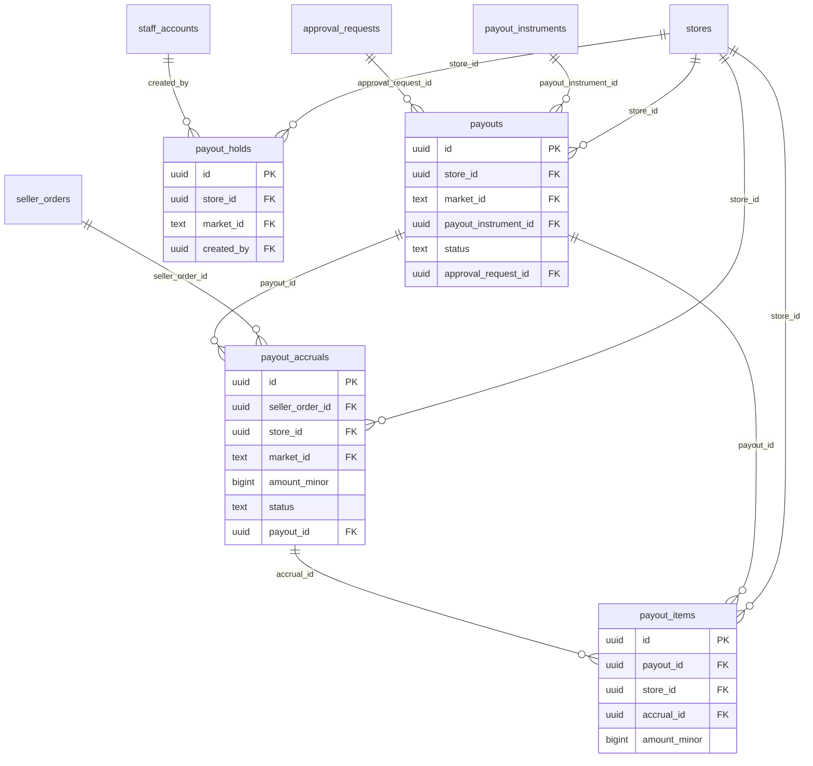

#### `payout_accruals`
Phase 1 · residency `cell` · tenant store_id (RLS) · no personal data · basis `not_personal_data` · retention `tax_records` · not partitioned

| Column | Type | Null | PII | Notes |
|---|---|---|---|---|
| `id` | uuid PK | no | P1 | UUIDv7, server-generated |
| `seller_order_id` | uuid | no | P1 | -> `seller_orders`. |
| `store_id` | uuid | no | P1 | -> `stores`. tenant key; RLS app.current_store_id |
| `market_id` | text | no | P1 | -> `markets`. market scope (ADR-0006) |
| `amount_minor` | bigint | no | P1 | net payable after commission, fees, seller-funded promos |
| `currency` | char(3) | no | P1 | ISO 4217, must match market or account |
| `eligible_at` | timestamptz | yes | P1 | closed_at + 3 days |
| `status` | text | no | P1 | see Accrual machine |
| `payout_id` | uuid | yes | P1 | -> `payouts`. |
| `created_at` | timestamptz | no | P1 | UTC |
| `updated_at` | timestamptz | no | P1 | UTC |

- Key: `UNIQUE (seller_order_id)`
- Index: `(store_id, eligible_at) WHERE status = 'ELIGIBLE'` -> payout build
- RLS: `store_id = current_setting('app.current_store_id')::uuid`, FORCE RLS.

#### `payouts`
Phase 1 · residency `cell` · tenant store_id (RLS) · no personal data · basis `not_personal_data` · retention `tax_records` · not partitioned

| Column | Type | Null | PII | Notes |
|---|---|---|---|---|
| `id` | uuid PK | no | P1 | UUIDv7, server-generated |
| `store_id` | uuid | no | P1 | -> `stores`. tenant key; RLS app.current_store_id |
| `market_id` | text | no | P1 | -> `markets`. market scope (ADR-0006) |
| `mode` | text | no | P1 | transfer (collect_payout) or statement (psp_split) |
| `payout_instrument_id` | uuid | yes | P1 | -> `payout_instruments`. |
| `cycle_start` | date | no | P1 |  |
| `cycle_end` | date | no | P1 |  |
| `gross_minor` | bigint | no | P1 |  |
| `adjustments_minor` | bigint | no | P1 | refunds after payout, plan fees, penalties, weight discrepancies |
| `net_minor` | bigint | no | P1 |  |
| `currency` | char(3) | no | P1 | ISO 4217, must match market or account |
| `status` | text | no | P1 | see Payout machine |
| `approval_request_id` | uuid | yes | P1 | -> `approval_requests`. |
| `provider` | text | yes | P1 |  |
| `provider_ref` | text | yes | P1 |  |
| `journal_entry_id` | uuid | yes | P1 |  |
| `idempotency_key` | text | no | P1 |  |
| `sent_at` | timestamptz | yes | P1 |  |
| `settled_at` | timestamptz | yes | P1 |  |
| `failure_code` | text | yes | P1 |  |
| `created_at` | timestamptz | no | P1 | UTC |
| `updated_at` | timestamptz | no | P1 | UTC |

- Key: `UNIQUE (store_id, cycle_start, cycle_end)`
- Key: `UNIQUE (idempotency_key)`
- Key: `UNIQUE (provider, provider_ref) WHERE provider_ref IS NOT NULL`
- Index: `(store_id, created_at DESC, id DESC)` -> seller finance page
- Index: `(status) WHERE status IN ('SCHEDULED','ON_HOLD','APPROVED','SENT')`
- RLS: `store_id = current_setting('app.current_store_id')::uuid`, FORCE RLS.
- State machine: Payout (see module intro).
- ⚠ VERIFY: V3, V4

#### `payout_items`
Phase 1 · residency `cell` · tenant store_id (RLS) · no personal data · basis `not_personal_data` · retention `tax_records` · not partitioned

| Column | Type | Null | PII | Notes |
|---|---|---|---|---|
| `id` | uuid PK | no | P1 | UUIDv7, server-generated |
| `payout_id` | uuid | no | P1 | -> `payouts`. |
| `store_id` | uuid | no | P1 | -> `stores`. tenant key; RLS app.current_store_id |
| `kind` | text | no | P1 | order, refund_clawback, plan_fee, penalty, weight_discrepancy, adjustment |
| `accrual_id` | uuid | yes | P1 | -> `payout_accruals`. |
| `ref_type` | text | yes | P1 |  |
| `ref_id` | uuid | yes | P1 |  |
| `amount_minor` | bigint | no | P1 | signed |
| `currency` | char(3) | no | P1 | ISO 4217, must match market or account |

- Index: `(payout_id)`
- RLS: `store_id = current_setting('app.current_store_id')::uuid`, FORCE RLS.

#### `payout_holds`
Phase 1 · residency `cell` · tenant store_id (RLS) · personal data · basis `contract` · retention `tax_records` · not partitioned

| Column | Type | Null | PII | Notes |
|---|---|---|---|---|
| `id` | uuid PK | no | P1 | UUIDv7, server-generated |
| `store_id` | uuid | no | P1 | -> `stores`. tenant key; RLS app.current_store_id |
| `market_id` | text | no | P1 | -> `markets`. market scope (ADR-0006) |
| `reason` | text | no | P1 | risk, enforcement, kyc, dispute |
| `source_ref` | text | yes | P1 |  |
| `starts_at` | timestamptz | no | P1 |  |
| `released_at` | timestamptz | yes | P1 |  |
| `created_by` | uuid | yes | P2 | -> `staff_accounts`. |

- Index: `(store_id) WHERE released_at IS NULL`
- RLS: `store_id = current_setting('app.current_store_id')::uuid`, FORCE RLS.

<a id="m-store-credit"></a>
### 7.18 Closed-loop store credit

ADR-0003 and master prompt §15.2: no top-up, no withdrawal, no P2P transfer; usable only on the platform; the UI says "credit", never "cash". Value enters only from refunds the shopper chose to take as credit and goodwill in Phase 1 (gift cards, cashback and referral credit are Phase 2). The **ledger is the balance truth**; `credit_lots` tracks expiry and spend order (soonest-expiring first, refund credit last) and is reconciled with postings nightly (V3).

**State machines.** **CreditLot**: `ACTIVE -> DEPLETED | EXPIRED | REVERSED`.

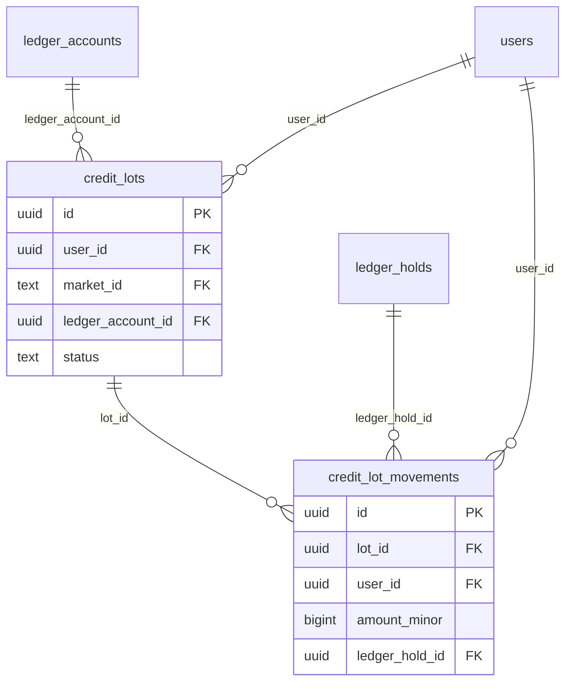

#### `credit_lots`
Phase 1 · residency `cell` · tenant user_id (RLS) · personal data · basis `contract` · retention `tax_records` · not partitioned

| Column | Type | Null | PII | Notes |
|---|---|---|---|---|
| `id` | uuid PK | no | P1 | UUIDv7, server-generated |
| `user_id` | uuid | no | P2 | -> `users`. owner; RLS app.current_user_id |
| `market_id` | text | no | P1 | -> `markets`. market scope (ADR-0006) |
| `sub_balance` | text | no | P1 | refund_credit, goodwill (Phase 2: gift_card, cashback, referral) |
| `source_type` | text | no | P1 | refund, goodwill |
| `source_id` | uuid | no | P1 |  |
| `original_minor` | bigint | no | P1 |  |
| `remaining_minor` | bigint | no | P1 | CHECK 0 <= remaining <= original |
| `currency` | char(3) | no | P1 | ISO 4217, must match market or account |
| `expires_at` | timestamptz | yes | P1 | NULL for refund credit |
| `ledger_account_id` | uuid | no | P1 | -> `ledger_accounts`. |
| `grant_entry_id` | uuid | no | P1 | journal entry |
| `status` | text | no | P1 | see CreditLot machine |
| `version` | int | no | P1 | optimistic lock / config version |
| `created_at` | timestamptz | no | P1 | UTC |
| `updated_at` | timestamptz | no | P1 | UTC |

- Key: `UNIQUE (source_type, source_id)`
- Index: `(user_id, status, expires_at NULLS LAST, id) WHERE status = 'ACTIVE'` -> spend order
- Index: `(expires_at) WHERE status = 'ACTIVE' AND expires_at IS NOT NULL` -> expiry job
- RLS: `user_id = current_setting('app.current_user_id')::uuid`, FORCE RLS.
- ⚠ VERIFY: V3

#### `credit_lot_movements`
Phase 1 · residency `cell` · tenant user_id (RLS) · personal data · basis `contract` · retention `tax_records` · not partitioned

| Column | Type | Null | PII | Notes |
|---|---|---|---|---|
| `id` | uuid PK | no | P1 | UUIDv7, server-generated |
| `lot_id` | uuid | no | P1 | -> `credit_lots`. |
| `user_id` | uuid | no | P2 | -> `users`. owner; RLS app.current_user_id |
| `kind` | text | no | P1 | grant, hold, capture, release, expire, reverse |
| `amount_minor` | bigint | no | P1 |  |
| `currency` | char(3) | no | P1 | ISO 4217, must match market or account |
| `ref_type` | text | no | P1 |  |
| `ref_id` | uuid | no | P1 |  |
| `journal_entry_id` | uuid | yes | P1 |  |
| `ledger_hold_id` | uuid | yes | P1 | -> `ledger_holds`. |
| `created_at` | timestamptz | no | P1 | UTC |

- Index: `(lot_id, id)`
- Index: `(user_id, id DESC)` -> credit history (keyset)
- RLS: `user_id = current_setting('app.current_user_id')::uuid`, FORCE RLS.

<a id="m-returns"></a>
### 7.19 Returns, disputes and refunds

CPL 181/2018 baseline: windows count from courier-confirmed `delivered_at`; 14-day no-reason return also applies to defect items; a **disclosed and acknowledged** defect is not a defect reason; an undisclosed or worse-than-shown defect is a seller-fault return (30 days, seller pays) (addendum §3, V19). Inspection within 48 h of receipt, silence = auto-approve. The RefundRouter picks the route: card/wallet -> PSP to original; BNPL -> provider cancellation only; COD -> store credit instantly (shopper's choice) or bank transfer; store-credit portion -> same sub-balance. All refunds are ledger-first.

**State machines.** **Return**: `REQUESTED -> APPROVED -> PICKUP_SCHEDULED -> IN_TRANSIT -> RECEIVED -> INSPECTED -> (ACCEPTED | REJECTED -> DISPUTED) -> CLOSED`, `REQUESTED -> CANCELLED | REJECTED`.
**Dispute**: `OPEN -> UNDER_REVIEW -> (RESOLVED_SHOPPER | RESOLVED_SELLER) | WITHDRAWN` (human review, 5 business days).
**Refund** (master prompt §15.6): `REQUESTED -> APPROVED -> PROCESSING -> COMPLETED | FAILED (retry) | MANUAL_REVIEW`.

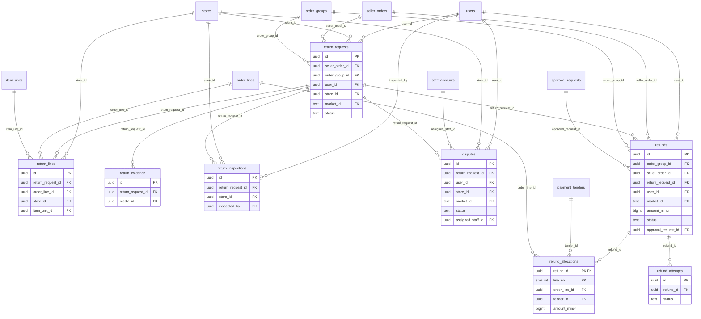

#### `return_requests`
Phase 1 · residency `cell` · tenant store_id + user_id (two RLS policies) · personal data · basis `legal_obligation` · retention `tax_records` · not partitioned

| Column | Type | Null | PII | Notes |
|---|---|---|---|---|
| `id` | uuid PK | no | P1 | UUIDv7, server-generated |
| `seller_order_id` | uuid | no | P1 | -> `seller_orders`. |
| `order_group_id` | uuid | no | P1 | -> `order_groups`. |
| `user_id` | uuid | no | P2 | -> `users`. owner; RLS app.current_user_id |
| `store_id` | uuid | no | P1 | -> `stores`. tenant key; RLS app.current_store_id |
| `market_id` | text | no | P1 | -> `markets`. market scope (ADR-0006) |
| `status` | text | no | P1 | see Return machine |
| `reason_code` | text | no | P1 | too_small, too_large, not_as_described, defect_undisclosed, defect_worse_than_shown, changed_mind, late, wrong_item |
| `fault` | text | no | P1 | shopper, seller, courier, none |
| `window_basis` | text | no | P1 | no_reason_14d, defect_30d |
| `delivered_at_snapshot` | timestamptz | no | P1 |  |
| `window_ends_at` | timestamptz | no | P1 |  |
| `method` | text | no | P1 | pickup, dropoff |
| `resolution` | text | no | P1 | refund, exchange, store_credit |
| `received_at` | timestamptz | yes | P1 |  |
| `inspection_due_at` | timestamptz | yes | P1 | received + 48 h, then auto-approve |
| `refund_due_at` | timestamptz | yes | P1 | legal deadline (V7) |
| `idempotency_key` | uuid | no | P1 |  |
| `created_at` | timestamptz | no | P1 | UTC |
| `updated_at` | timestamptz | no | P1 | UTC |

- Key: `UNIQUE (user_id, idempotency_key)`
- Index: `(store_id, status, created_at DESC, id DESC)` -> seller returns queue
- Index: `(user_id, created_at DESC, id DESC)`
- Index: `(inspection_due_at) WHERE status = 'RECEIVED'` -> auto-approve job
- State machine: Return (see module intro).
- ⚠ VERIFY: V7, V19

#### `return_lines`
Phase 1 · residency `cell` · tenant store_id (RLS) · no personal data · basis `not_personal_data` · retention `tax_records` · not partitioned

| Column | Type | Null | PII | Notes |
|---|---|---|---|---|
| `id` | uuid PK | no | P1 | UUIDv7, server-generated |
| `return_request_id` | uuid | no | P1 | -> `return_requests`. |
| `order_line_id` | uuid | no | P1 | -> `order_lines`. |
| `store_id` | uuid | no | P1 | -> `stores`. tenant key; RLS app.current_store_id |
| `qty` | smallint | no | P1 |  |
| `item_unit_id` | uuid | yes | P1 | -> `item_units`. |
| `condition_received` | text | yes | P1 |  |
| `restock_decision` | text | yes | P1 | restock, relist_open_box (Phase 2 lane), write_off, donate |

- Key: `UNIQUE (return_request_id, order_line_id)`
- RLS: `store_id = current_setting('app.current_store_id')::uuid`, FORCE RLS.

#### `return_evidence`
Phase 1 · residency `cell` · tenant none · personal data · basis `contract` · retention `returns_evidence_24m` · not partitioned

| Column | Type | Null | PII | Notes |
|---|---|---|---|---|
| `id` | uuid PK | no | P1 | UUIDv7, server-generated |
| `return_request_id` | uuid | no | P1 | -> `return_requests`. |
| `uploaded_by_type` | text | no | P1 | shopper, seller, courier, hub |
| `media_id` | uuid | no | P2 | -> `media_assets`. private; may show a person or a home |
| `kind` | text | no | P1 | defect_photo, packaging, inspection |
| `created_at` | timestamptz | no | P1 | UTC |

#### `return_inspections`
Phase 1 · residency `cell` · tenant store_id (RLS) · personal data · basis `contract` · retention `returns_evidence_24m` · not partitioned

| Column | Type | Null | PII | Notes |
|---|---|---|---|---|
| `id` | uuid PK | no | P1 | UUIDv7, server-generated |
| `return_request_id` | uuid | no | P1 | -> `return_requests`. |
| `store_id` | uuid | no | P1 | -> `stores`. tenant key; RLS app.current_store_id |
| `inspector_type` | text | no | P1 | seller, hub |
| `result` | text | no | P1 | accepted, rejected |
| `notes` | text | yes | P1 |  |
| `inspected_by` | uuid | yes | P2 | -> `users`. |
| `inspected_at` | timestamptz | no | P1 |  |
- RLS: `store_id = current_setting('app.current_store_id')::uuid`, FORCE RLS.
- A rejection requires photos in return_evidence.

#### `disputes`
Phase 1 · residency `cell` · tenant store_id + user_id (two RLS policies) · personal data · basis `contract` · retention `returns_evidence_24m` · not partitioned

| Column | Type | Null | PII | Notes |
|---|---|---|---|---|
| `id` | uuid PK | no | P1 | UUIDv7, server-generated |
| `return_request_id` | uuid | no | P1 | -> `return_requests`. |
| `user_id` | uuid | no | P2 | -> `users`. owner; RLS app.current_user_id |
| `store_id` | uuid | no | P1 | -> `stores`. tenant key; RLS app.current_store_id |
| `market_id` | text | no | P1 | -> `markets`. market scope (ADR-0006) |
| `status` | text | no | P1 | see Dispute machine |
| `assigned_staff_id` | uuid | yes | P2 | -> `staff_accounts`. |
| `sla_due_at` | timestamptz | no | P1 | 5 business days |
| `resolution_note` | text | yes | P1 |  |
| `created_at` | timestamptz | no | P1 | UTC |
| `resolved_at` | timestamptz | yes | P1 |  |

- Key: `UNIQUE (return_request_id)`
- Index: `(status, sla_due_at) WHERE status IN ('OPEN','UNDER_REVIEW')` -> T&S queue
- State machine: Dispute (see module intro).

#### `refunds`
Phase 1 · residency `cell` · tenant user_id (RLS) · personal data · basis `legal_obligation` · retention `tax_records` · not partitioned

| Column | Type | Null | PII | Notes |
|---|---|---|---|---|
| `id` | uuid PK | no | P1 | UUIDv7, server-generated |
| `order_group_id` | uuid | no | P1 | -> `order_groups`. |
| `seller_order_id` | uuid | yes | P1 | -> `seller_orders`. |
| `return_request_id` | uuid | yes | P1 | -> `return_requests`. |
| `user_id` | uuid | no | P2 | -> `users`. owner; RLS app.current_user_id |
| `market_id` | text | no | P1 | -> `markets`. market scope (ADR-0006) |
| `reason` | text | no | P1 | cancellation, return, seller_rejected, reservation_expired, goodwill, delivery_failed |
| `route` | text | no | P1 | original_method, store_credit, bnpl_cancel, bank_transfer, fawry_voucher |
| `shopper_choice` | text | yes | P1 | original or instant_credit (where both are legal) |
| `amount_minor` | bigint | no | P1 |  |
| `currency` | char(3) | no | P1 | ISO 4217, must match market or account |
| `status` | text | no | P1 | see Refund machine |
| `provider_ref` | text | yes | P1 |  |
| `journal_entry_id` | uuid | yes | P1 |  |
| `idempotency_key` | text | no | P1 | permanent |
| `due_at` | timestamptz | no | P1 | legal deadline (V7) |
| `completed_at` | timestamptz | yes | P1 |  |
| `approval_request_id` | uuid | yes | P1 | -> `approval_requests`. above threshold |
| `version` | int | no | P1 | optimistic lock / config version |
| `created_at` | timestamptz | no | P1 | UTC |
| `updated_at` | timestamptz | no | P1 | UTC |

- Key: `UNIQUE (idempotency_key)`
- Index: `(order_group_id)`
- Index: `(status, due_at) WHERE status NOT IN ('COMPLETED')` -> SLO and deadline alerts
- RLS: `user_id = current_setting('app.current_user_id')::uuid`, FORCE RLS.
- State machine: Refund (see module intro).
- ⚠ VERIFY: V5, V7

#### `refund_allocations`
Phase 1 · residency `cell` · tenant none · no personal data · basis `not_personal_data` · retention `tax_records` · not partitioned

| Column | Type | Null | PII | Notes |
|---|---|---|---|---|
| `refund_id` | uuid PK | no | P1 | -> `refunds`. |
| `line_no` | smallint PK | no | P1 |  |
| `order_line_id` | uuid | yes | P1 | -> `order_lines`. |
| `tender_id` | uuid | yes | P1 | -> `payment_tenders`. |
| `component` | text | no | P1 | item, shipping, voucher_share, vat |
| `amount_minor` | bigint | no | P1 |  |
| `currency` | char(3) | no | P1 | ISO 4217, must match market or account |

- Key: `PRIMARY KEY (refund_id, line_no)`

#### `refund_attempts`
Phase 1 · residency `cell` · tenant none · no personal data · basis `not_personal_data` · retention `tax_records` · not partitioned

| Column | Type | Null | PII | Notes |
|---|---|---|---|---|
| `id` | uuid PK | no | P1 | UUIDv7, server-generated |
| `refund_id` | uuid | no | P1 | -> `refunds`. |
| `attempt_no` | smallint | no | P1 |  |
| `provider_request_id` | text | yes | P1 |  |
| `status` | text | no | P1 |  |
| `error_code` | text | yes | P1 |  |
| `created_at` | timestamptz | no | P1 | UTC |

- Key: `UNIQUE (refund_id, attempt_no)`

<a id="m-shipping"></a>
### 7.20 Shipping: domestic and international

Implements `docs/specs/shipping-domestic-international.md`. Weight is required for every SKU; size and HS code are required before publish if international is ticked. Chargeable weight per item = `max(actual_g, ceil(L*W*H mm^3 / divisor))` rounded **up** to the courier step; parcel weight = sum x qty + packaging allowance. All arithmetic is integer grams and integer minor units (volumetric divisor and step come from `courier_services`, V33). One parcel per store unless hub consolidation (Phase 2). Quotes are pure, locked 10 min with the price lock, and copied onto the seller order when used. Phase 1 = Egypt by zone and weight (Bosta, then Aramex). International export (DAP) is Phase 2; DDP and cross-border import are Phase 3.

**State machines.** **Shipment**: `LABEL_PENDING -> LABEL_CREATED -> PICKUP_SCHEDULED -> PICKED_UP -> IN_TRANSIT -> OUT_FOR_DELIVERY -> DELIVERED`, `OUT_FOR_DELIVERY -> DELIVERY_FAILED (3 attempts) -> RTO_IN_TRANSIT -> RETURNED_TO_SELLER`, `* -> LOST | CANCELLED`. Courier statuses are normalised to these.

```mermaid
erDiagram
    couriers {
        text code PK
    }
    courier_services {
        uuid id PK
        text courier_code FK
        text market_id FK
    }
    shipping_zones {
        uuid id PK
        text market_id FK
        text courier_code FK
    }
    shipping_zone_members {
        uuid zone_id PK,FK
        text member_id PK
        text member_kind PK
    }
    rate_cards {
        uuid id PK
        text market_id FK
        uuid courier_service_id FK
        uuid origin_zone_id FK
        uuid dest_zone_id FK
        text status
    }
    rate_card_bands {
        uuid rate_card_id PK,FK
        int weight_from_g PK
        bigint price_minor
    }
    surcharge_rules {
        uuid id PK
        text market_id FK
        uuid courier_service_id FK
        uuid geo_area_id FK
    }
    sku_shipping_profiles {
        uuid sku_id PK,FK
        uuid store_id FK
        text market_id FK
    }
    shipment_quotes {
        uuid id PK
        uuid user_id FK
        text market_id FK
        uuid dest_geo_area_id FK
    }
    shipments {
        uuid id PK
        uuid store_id FK
        uuid user_id FK
        text market_id FK
        uuid courier_service_id FK
        text status
        uuid label_media_id FK
        uuid proof_media_id FK
    }
    shipment_seller_orders {
        uuid shipment_id PK,FK
        uuid seller_order_id PK,FK
        uuid store_id FK
    }
    shipment_events {
        uuid id PK
        uuid shipment_id FK
        text market_id FK
    }
    courier_events_raw {
        uuid id PK
        text market_id FK
    }
    cod_remittances {
        uuid id PK
        text market_id FK
        text courier_code FK
        bigint total_minor
        uuid file_media_id FK
        text status
    }
    cod_remittance_lines {
        uuid id PK
        uuid remittance_id FK
        uuid shipment_id FK
        bigint amount_minor
        text status
    }
    weight_discrepancies {
        uuid id PK
        uuid shipment_id FK
        uuid store_id FK
        text market_id FK
        text status
    }
    duty_rules {
        uuid id PK
    }
    cod_remittances ||--o{ cod_remittance_lines : "remittance_id"
    courier_services ||--o{ rate_cards : "courier_service_id"
    courier_services ||--o{ shipments : "courier_service_id"
    courier_services ||--o{ surcharge_rules : "courier_service_id"
    couriers ||--o{ cod_remittances : "courier_code"
    couriers ||--o{ courier_services : "courier_code"
    couriers ||--o{ shipping_zones : "courier_code"
    rate_cards ||--o{ rate_card_bands : "rate_card_id"
    seller_orders ||--o{ shipment_seller_orders : "seller_order_id"
    shipments ||--o{ cod_remittance_lines : "shipment_id"
    shipments ||--o{ shipment_events : "shipment_id"
    shipments ||--o{ shipment_seller_orders : "shipment_id"
    shipments ||--o{ weight_discrepancies : "shipment_id"
    shipping_zones ||--o{ rate_cards : "dest_zone_id"
    shipping_zones ||--o{ rate_cards : "origin_zone_id"
    shipping_zones ||--o{ shipping_zone_members : "zone_id"
    skus ||--o{ sku_shipping_profiles : "sku_id"
    stores ||--o{ shipment_seller_orders : "store_id"
    stores ||--o{ shipments : "store_id"
    stores ||--o{ sku_shipping_profiles : "store_id"
    stores ||--o{ weight_discrepancies : "store_id"
    users ||--o{ shipment_quotes : "user_id"
    users ||--o{ shipments : "user_id"
```

#### `couriers`
Phase 1 · residency `global` · tenant none · no personal data · basis `not_personal_data` · retention `config_versions` · not partitioned

| Column | Type | Null | PII | Notes |
|---|---|---|---|---|
| `code` | text PK | no | P1 | bosta, aramex, dhl_express, egypt_post |
| `name` | text | no | P0 |  |
| `kind` | text | no | P1 | domestic, international, both |
| `active` | boolean | no | P1 |  |

#### `courier_services`
Phase 1 · residency `global` · tenant none · no personal data · basis `not_personal_data` · retention `config_versions` · not partitioned

| Column | Type | Null | PII | Notes |
|---|---|---|---|---|
| `id` | uuid PK | no | P1 | UUIDv7, server-generated |
| `courier_code` | text | no | P1 | -> `couriers`. |
| `market_id` | text | no | P1 | -> `markets`. |
| `service_code` | text | no | P1 | next_day, standard, express_intl |
| `kind` | text | no | P1 | domestic, international |
| `volumetric_divisor` | int | no | P1 | e.g. 5000 cm3/kg, stored as mm3 per gram equivalent (V33) |
| `weight_step_g` | int | no | P1 | e.g. 500 |
| `max_piece_g` | int | no | P1 | 30000 |
| `supports_cod` | boolean | no | P1 |  |
| `supports_open_box` | boolean | no | P1 | V26 |
| `active` | boolean | no | P1 |  |

- Key: `UNIQUE (courier_code, market_id, service_code)`
- ⚠ VERIFY: V33

#### `shipping_zones`
Phase 1 · residency `global` · tenant none · no personal data · basis `not_personal_data` · retention `config_versions` · not partitioned

| Column | Type | Null | PII | Notes |
|---|---|---|---|---|
| `id` | uuid PK | no | P1 | UUIDv7, server-generated |
| `market_id` | text | no | P1 | -> `markets`. |
| `courier_code` | text | no | P1 | -> `couriers`. |
| `zone_code` | text | no | P1 | cairo_giza, delta, canal, upper, remote, intl_gcc... |
| `kind` | text | no | P1 | domestic, international |
| `name_ar` | text | no | P0 |  |
| `name_en` | text | yes | P0 |  |

- Key: `UNIQUE (market_id, courier_code, zone_code)`

#### `shipping_zone_members`
Phase 1 · residency `global` · tenant none · no personal data · basis `not_personal_data` · retention `config_versions` · not partitioned

| Column | Type | Null | PII | Notes |
|---|---|---|---|---|
| `zone_id` | uuid PK | no | P1 | -> `shipping_zones`. |
| `member_id` | text PK | no | P1 | geo_areas.id (domestic) or ISO country code (international) |
| `member_kind` | text PK | no | P1 | geo_area, country |

- Key: `PRIMARY KEY (zone_id, member_kind, member_id)`
- Index: `(member_kind, member_id)` -> zone lookup for an address

#### `rate_cards`
Phase 1 · residency `cell` · tenant none · no personal data · basis `not_personal_data` · retention `tax_records` · not partitioned

| Column | Type | Null | PII | Notes |
|---|---|---|---|---|
| `id` | uuid PK | no | P1 | UUIDv7, server-generated |
| `market_id` | text | no | P1 | -> `markets`. market scope (ADR-0006) |
| `courier_service_id` | uuid | no | P1 | -> `courier_services`. |
| `version` | int | no | P1 |  |
| `origin_zone_id` | uuid | no | P1 | -> `shipping_zones`. |
| `dest_zone_id` | uuid | no | P1 | -> `shipping_zones`. |
| `currency` | char(3) | no | P1 | ISO 4217, must match market or account |
| `valid_from` | timestamptz | no | P1 |  |
| `valid_to` | timestamptz | yes | P1 |  |
| `status` | text | no | P1 | draft, active, retired |

- Key: `UNIQUE (courier_service_id, origin_zone_id, dest_zone_id, version)`
- Index: `(courier_service_id, origin_zone_id, dest_zone_id) WHERE status = 'active'` -> quote
- Contract prices are confidential business data, so they stay in the cell.
- ⚠ VERIFY: V33

#### `rate_card_bands`
Phase 1 · residency `cell` · tenant none · no personal data · basis `not_personal_data` · retention `tax_records` · not partitioned

| Column | Type | Null | PII | Notes |
|---|---|---|---|---|
| `rate_card_id` | uuid PK | no | P1 | -> `rate_cards`. |
| `weight_from_g` | int PK | no | P1 |  |
| `weight_to_g` | int | no | P1 |  |
| `price_minor` | bigint | no | P1 |  |
| `per_extra_step_minor` | bigint | yes | P1 | above the last band |
| `currency` | char(3) | no | P1 | ISO 4217, must match market or account |

- Key: `PRIMARY KEY (rate_card_id, weight_from_g)`
- EXCLUDE constraint prevents overlapping weight ranges.

#### `surcharge_rules`
Phase 1 · residency `cell` · tenant none · no personal data · basis `not_personal_data` · retention `tax_records` · not partitioned

| Column | Type | Null | PII | Notes |
|---|---|---|---|---|
| `id` | uuid PK | no | P1 | UUIDv7, server-generated |
| `market_id` | text | no | P1 | -> `markets`. market scope (ADR-0006) |
| `courier_service_id` | uuid | no | P1 | -> `courier_services`. |
| `kind` | text | no | P1 | fuel, remote_area, cod_fee, oversize |
| `basis` | text | no | P1 | percent_bp, fixed |
| `value_bp` | int | yes | P1 |  |
| `value_minor` | bigint | yes | P1 |  |
| `currency` | char(3) | no | P1 | ISO 4217, must match market or account |
| `geo_area_id` | uuid | yes | P1 | -> `geo_areas`. |
| `valid_from` | timestamptz | no | P1 |  |
| `valid_to` | timestamptz | yes | P1 |  |

- Index: `(courier_service_id, kind, valid_from DESC)`

#### `sku_shipping_profiles`
Phase 1 · residency `cell_publishable` · tenant store_id (RLS) · no personal data · basis `not_personal_data` · retention `catalog_life` · not partitioned

| Column | Type | Null | PII | Notes |
|---|---|---|---|---|
| `sku_id` | uuid PK | no | P0 | -> `skus`. |
| `store_id` | uuid | no | P1 | -> `stores`. tenant key; RLS app.current_store_id |
| `market_id` | text | no | P1 | -> `markets`. market scope (ADR-0006) |
| `actual_weight_g` | int | no | P0 | packed weight; CHECK 0 < g <= 30000 |
| `length_mm` | int | yes | P0 | required if ships_international |
| `width_mm` | int | yes | P0 |  |
| `height_mm` | int | yes | P0 |  |
| `ships_domestic` | boolean | no | P0 |  |
| `ships_international` | boolean | no | P0 | needs export KYC (Phase 2) |
| `allowed_countries` | text[] | yes | P0 | bounded list of ISO codes |
| `hs_code` | text | yes | P1 | AI suggests, seller confirms (V33) |
| `hs_confirmed` | boolean | no | P1 |  |
| `origin_country` | char(2) | yes | P0 |  |
| `material_ar` | text | yes | P0 |  |
| `material_en` | text | yes | P0 |  |
| `declared_value_minor` | bigint | yes | P1 | customs value per unit |
| `currency` | char(3) | no | P1 | ISO 4217, must match market or account |
| `restricted_flags` | text[] | yes | P1 | battery, liquid, aerosol, perfume, food, cosmetic |
| `updated_at` | timestamptz | no | P1 |  |

- Index: `(market_id, ships_international) WHERE ships_international` -> 'Ship abroad' filter source
- RLS: `store_id = current_setting('app.current_store_id')::uuid`, FORCE RLS.
- ⚠ VERIFY: V32, V33, V58

#### `shipment_quotes`
Phase 1 · residency `cell` · tenant user_id (RLS) · personal data · basis `contract` · retention `quotes_30d` · partition: RANGE (id) monthly; drop after 2 months

| Column | Type | Null | PII | Notes |
|---|---|---|---|---|
| `id` | uuid PK | no | P1 | partition key |
| `user_id` | uuid | no | P2 | -> `users`. owner; RLS app.current_user_id |
| `market_id` | text | no | P1 | -> `markets`. market scope (ADR-0006) |
| `checkout_session_id` | uuid | yes | P1 |  |
| `destination_country` | char(2) | no | P2 |  |
| `dest_geo_area_id` | uuid | yes | P2 | -> `geo_areas`. |
| `incoterm` | text | no | P1 | domestic, DAP (Phase 2), DDP (Phase 3) |
| `parcels` | jsonb | no | P1 | per parcel: store, chargeable_g, service, fee, days, rate card version |
| `fee_total_minor` | bigint | no | P1 |  |
| `duties_estimate_minor` | bigint | yes | P1 | international only, shown before payment |
| `currency` | char(3) | no | P1 | ISO 4217, must match market or account |
| `expires_at` | timestamptz | no | P1 | 10-minute lock |
| `created_at` | timestamptz | no | P1 | UTC |

- Index: `(checkout_session_id)`
- RLS: `user_id = current_setting('app.current_user_id')::uuid`, FORCE RLS.
- ⚠ VERIFY: V34

#### `shipments`
Phase 1 · residency `cell` · tenant store_id + user_id (two RLS policies) · personal data · basis `contract` · retention `delivery_24m` · not partitioned

| Column | Type | Null | PII | Notes |
|---|---|---|---|---|
| `id` | uuid PK | no | P1 | UUIDv7, server-generated |
| `store_id` | uuid | no | P1 | -> `stores`. tenant key; RLS app.current_store_id |
| `user_id` | uuid | no | P2 | -> `users`. owner; RLS app.current_user_id |
| `market_id` | text | no | P1 | -> `markets`. market scope (ADR-0006) |
| `courier_service_id` | uuid | no | P1 | -> `courier_services`. |
| `direction` | text | no | P1 | outbound, return |
| `awb` | text | yes | P1 |  |
| `status` | text | no | P1 | see Shipment machine |
| `declared_weight_g` | int | no | P1 |  |
| `chargeable_weight_g` | int | no | P1 |  |
| `measured_weight_g` | int | yes | P1 | courier-measured; excess charged to seller |
| `length_mm` | int | yes | P1 |  |
| `width_mm` | int | yes | P1 |  |
| `height_mm` | int | yes | P1 |  |
| `cod_amount_minor` | bigint | yes | P1 |  |
| `fee_minor` | bigint | no | P1 |  |
| `currency` | char(3) | no | P1 | ISO 4217, must match market or account |
| `label_media_id` | uuid | yes | P2 | -> `media_assets`. label shows recipient data |
| `attempts` | smallint | no | P1 | 3, then RTO |
| `proof_kind` | text | yes | P1 | otp, photo, signature |
| `proof_media_id` | uuid | yes | P2 | -> `media_assets`. |
| `delivered_at` | timestamptz | yes | P1 |  |
| `idempotency_key` | text | no | P1 | shipment id sent to courier for AWB creation |
| `version` | int | no | P1 | optimistic lock / config version |
| `created_at` | timestamptz | no | P1 | UTC |
| `updated_at` | timestamptz | no | P1 | UTC |

- Key: `UNIQUE (courier_service_id, awb) WHERE awb IS NOT NULL`
- Key: `UNIQUE (idempotency_key)`
- Index: `(store_id, status, created_at DESC, id DESC)` -> seller shipments
- Index: `(status, updated_at) WHERE status IN ('IN_TRANSIT','OUT_FOR_DELIVERY')` -> 48 h tracking-gap poller
- State machine: Shipment (see module intro).
- ⚠ VERIFY: V11, V43

#### `shipment_seller_orders`
Phase 1 · residency `cell` · tenant store_id (RLS) · no personal data · basis `not_personal_data` · retention `delivery_24m` · not partitioned

| Column | Type | Null | PII | Notes |
|---|---|---|---|---|
| `shipment_id` | uuid PK | no | P1 | -> `shipments`. |
| `seller_order_id` | uuid PK | no | P1 | -> `seller_orders`. |
| `store_id` | uuid | no | P1 | -> `stores`. tenant key; RLS app.current_store_id |

- Key: `PRIMARY KEY (shipment_id, seller_order_id)`
- Index: `(seller_order_id)`
- RLS: `store_id = current_setting('app.current_store_id')::uuid`, FORCE RLS.
- Many-to-many so Phase 2 hub consolidation (one parcel, several seller orders) needs no migration.

#### `shipment_events`
Phase 1 · residency `cell` · tenant none · personal data · basis `contract` · retention `delivery_24m` · partition: RANGE (id) monthly

| Column | Type | Null | PII | Notes |
|---|---|---|---|---|
| `id` | uuid PK | no | P1 | partition key |
| `shipment_id` | uuid | no | P1 | -> `shipments`. |
| `market_id` | text | no | P1 | -> `markets`. market scope (ADR-0006) |
| `normalized_status` | text | no | P1 |  |
| `courier_status` | text | no | P1 |  |
| `location_text` | text | yes | P2 | courier hub or city |
| `occurred_at` | timestamptz | no | P1 |  |
| `raw_event_id` | uuid | yes | P1 |  |

- Index: `(shipment_id, occurred_at)`
- Replaying all webhooks twice yields identical shipment state (master prompt §21 acceptance).

#### `courier_events_raw`
Phase 1 · residency `cell` · tenant none · personal data · basis `legal_obligation` · retention `raw_webhooks_financial` · partition: RANGE (id) monthly

| Column | Type | Null | PII | Notes |
|---|---|---|---|---|
| `id` | uuid PK | no | P1 | partition key |
| `market_id` | text | no | P1 | -> `markets`. market scope (ADR-0006) |
| `courier_code` | text | no | P1 |  |
| `courier_event_id` | text | no | P1 | dedup via dedup_keys (webhook:{courier}) |
| `signature_ok` | boolean | no | P1 |  |
| `body_ct` | bytea | no | P2 (enc) | raw body |
| `processing_status` | text | no | P1 |  |
| `received_at` | timestamptz | no | P1 |  |
| `processed_at` | timestamptz | yes | P1 |  |

- Index: `(processing_status, id) WHERE processing_status = 'failed'`

#### `cod_remittances`
Phase 1 · residency `cell` · tenant none · no personal data · basis `not_personal_data` · retention `tax_records` · not partitioned

| Column | Type | Null | PII | Notes |
|---|---|---|---|---|
| `id` | uuid PK | no | P1 | UUIDv7, server-generated |
| `market_id` | text | no | P1 | -> `markets`. market scope (ADR-0006) |
| `courier_code` | text | no | P1 | -> `couriers`. |
| `remittance_ref` | text | no | P1 |  |
| `business_date` | date | no | P1 |  |
| `total_minor` | bigint | no | P1 |  |
| `currency` | char(3) | no | P1 | ISO 4217, must match market or account |
| `file_media_id` | uuid | yes | P1 | -> `media_assets`. |
| `status` | text | no | P1 |  |
| `received_at` | timestamptz | no | P1 |  |

- Key: `UNIQUE (courier_code, remittance_ref)`
- ⚠ VERIFY: V11

#### `cod_remittance_lines`
Phase 1 · residency `cell` · tenant none · no personal data · basis `not_personal_data` · retention `tax_records` · not partitioned

| Column | Type | Null | PII | Notes |
|---|---|---|---|---|
| `id` | uuid PK | no | P1 | UUIDv7, server-generated |
| `remittance_id` | uuid | no | P1 | -> `cod_remittances`. |
| `shipment_id` | uuid | yes | P1 | -> `shipments`. |
| `awb` | text | no | P1 |  |
| `amount_minor` | bigint | no | P1 |  |
| `fee_minor` | bigint | no | P1 |  |
| `currency` | char(3) | no | P1 | ISO 4217, must match market or account |
| `matched_entry_id` | uuid | yes | P1 |  |
| `status` | text | no | P1 |  |

- Index: `(remittance_id)`
- Index: `(awb)`

#### `weight_discrepancies`
Phase 1 · residency `cell` · tenant store_id (RLS) · no personal data · basis `not_personal_data` · retention `tax_records` · not partitioned

| Column | Type | Null | PII | Notes |
|---|---|---|---|---|
| `id` | uuid PK | no | P1 | UUIDv7, server-generated |
| `shipment_id` | uuid | no | P1 | -> `shipments`. |
| `store_id` | uuid | no | P1 | -> `stores`. tenant key; RLS app.current_store_id |
| `market_id` | text | no | P1 | -> `markets`. market scope (ADR-0006) |
| `declared_g` | int | no | P1 |  |
| `measured_g` | int | no | P1 |  |
| `extra_fee_minor` | bigint | no | P1 | charged to the seller (ledger) |
| `currency` | char(3) | no | P1 | ISO 4217, must match market or account |
| `journal_entry_id` | uuid | yes | P1 |  |
| `status` | text | no | P1 | open, charged, waived |
| `created_at` | timestamptz | no | P1 | UTC |

- Key: `UNIQUE (shipment_id)`
- Index: `(store_id, created_at DESC)` -> seller accuracy score
- RLS: `store_id = current_setting('app.current_store_id')::uuid`, FORCE RLS.

#### `duty_rules`
Phase 2 · residency `global` · tenant none · no personal data · basis `not_personal_data` · retention `config_versions` · not partitioned

| Column | Type | Null | PII | Notes |
|---|---|---|---|---|
| `id` | uuid PK | no | P1 | UUIDv7, server-generated |
| `dest_country` | char(2) | no | P1 |  |
| `hs_prefix` | text | no | P1 |  |
| `duty_rate_bp` | int | no | P1 |  |
| `vat_rate_bp` | int | no | P1 |  |
| `de_minimis_minor` | bigint | yes | P1 |  |
| `currency` | char(3) | no | P1 |  |
| `source` | text | no | P1 |  |
| `valid_from` | date | no | P1 |  |

- Key: `UNIQUE (dest_country, hs_prefix, valid_from)`
- ⚠ VERIFY: V34

<a id="m-tax"></a>
### 7.21 Tax engine and ETA

Tax engine per jurisdiction (ADR-0006 #5): rates per market and category in basis points, VAT-inclusive shelf prices, line-level net/VAT/gross in minor units, one banker's-rounding point. ETA is the first plug-in. The platform issues **B2B e-invoices to sellers** (commission, fees, plan fees) and **B2C e-receipts** for its own supplies (delivery fees it charges). Seller goods: the seller is the supplier; delegated e-receipt signing is optional and VERIFY (V6). Submission is a queue with idempotent internal numbers, status polling and a daily reconciliation.

**State machines.** **TaxDocument**: `DRAFT -> QUEUED -> SUBMITTED -> VALID | INVALID | REJECTED`, `VALID -> CANCELLED` (via credit note).

```mermaid
erDiagram
    tax_categories {
        text code PK
    }
    tax_rates {
        uuid id PK
        text market_id FK
        text tax_category_code FK
    }
    seller_tax_profiles {
        uuid seller_id PK,FK
        text market_id FK
    }
    tax_documents {
        uuid id PK
        text market_id FK
        uuid issuer_seller_id FK
        text status
        uuid signed_doc_media_id FK
    }
    tax_document_lines {
        uuid tax_document_id PK,FK
        smallint line_no PK
    }
    eta_submissions {
        uuid id PK
        uuid tax_document_id FK
        text market_id FK
        text status
    }
    sellers ||--o{ seller_tax_profiles : "seller_id"
    sellers ||--o{ tax_documents : "issuer_seller_id"
    tax_categories ||--o{ tax_rates : "tax_category_code"
    tax_documents ||--o{ eta_submissions : "tax_document_id"
    tax_documents ||--o{ tax_document_lines : "tax_document_id"
```

#### `tax_categories`
Phase 1 · residency `global` · tenant none · no personal data · basis `not_personal_data` · retention `config_versions` · not partitioned

| Column | Type | Null | PII | Notes |
|---|---|---|---|---|
| `code` | text PK | no | P1 | standard, exempt, zero_rated_export... |
| `description` | text | no | P1 |  |

#### `tax_rates`
Phase 1 · residency `global` · tenant none · no personal data · basis `not_personal_data` · retention `config_versions` · not partitioned

| Column | Type | Null | PII | Notes |
|---|---|---|---|---|
| `id` | uuid PK | no | P1 | UUIDv7, server-generated |
| `market_id` | text | no | P1 | -> `markets`. |
| `tax_category_code` | text | no | P1 | -> `tax_categories`. |
| `rate_bp` | int | no | P1 | 1400 = 14% VAT (EG) |
| `inclusive` | boolean | no | P1 |  |
| `valid_from` | date | no | P1 |  |
| `valid_to` | date | yes | P1 |  |
| `source` | text | no | P1 |  |

- Key: `UNIQUE (market_id, tax_category_code, valid_from)`
- ⚠ VERIFY: V6

#### `seller_tax_profiles`
Phase 1 · residency `cell` · tenant none · no personal data · basis `not_personal_data` · retention `tax_records` · not partitioned

| Column | Type | Null | PII | Notes |
|---|---|---|---|---|
| `seller_id` | uuid PK | no | P1 | -> `sellers`. |
| `market_id` | text | no | P1 | -> `markets`. market scope (ADR-0006) |
| `vat_registered` | boolean | no | P1 |  |
| `eta_status` | text | no | P1 | not_registered, registered, e_receipt_live |
| `e_receipt_delegation` | text | no | P1 | none, requested, active (V6) |
| `signing_credential_ref` | text | yes | P1 | KMS/HSM reference, never the key |
| `updated_at` | timestamptz | no | P1 |  |
- ⚠ VERIFY: V6

#### `tax_documents`
Phase 1 · residency `cell` · tenant none · personal data · basis `legal_obligation` · retention `tax_records` · not partitioned

| Column | Type | Null | PII | Notes |
|---|---|---|---|---|
| `id` | uuid PK | no | P1 | UUIDv7, server-generated |
| `market_id` | text | no | P1 | -> `markets`. market scope (ADR-0006) |
| `kind` | text | no | P1 | b2b_invoice, b2c_receipt, credit_note, debit_note |
| `issuer` | text | no | P1 | platform, seller |
| `issuer_seller_id` | uuid | yes | P1 | -> `sellers`. |
| `recipient_type` | text | no | P1 | seller, shopper, business |
| `recipient_id` | uuid | yes | P2 | store or user id |
| `ref_type` | text | no | P1 | seller_order, order_group, seller_plan_invoice, refund |
| `ref_id` | uuid | no | P1 |  |
| `internal_number` | text | no | P1 | gap-free per market and series |
| `currency` | char(3) | no | P1 | ISO 4217, must match market or account |
| `net_minor` | bigint | no | P1 |  |
| `vat_minor` | bigint | no | P1 |  |
| `gross_minor` | bigint | no | P1 |  |
| `status` | text | no | P1 | see TaxDocument machine |
| `eta_uuid` | text | yes | P1 |  |
| `eta_long_id` | text | yes | P1 |  |
| `signed_doc_media_id` | uuid | yes | P2 | -> `media_assets`. |
| `qr_payload` | text | yes | P1 |  |
| `issued_at` | timestamptz | yes | P1 |  |
| `created_at` | timestamptz | no | P1 | UTC |

- Key: `UNIQUE (market_id, internal_number)`
- Key: `UNIQUE (eta_uuid) WHERE eta_uuid IS NOT NULL`
- Index: `(status, created_at) WHERE status IN ('QUEUED','SUBMITTED')` -> submission and polling queue
- Index: `(ref_type, ref_id)`
- State machine: TaxDocument (see module intro).
- ⚠ VERIFY: V6, V71

#### `tax_document_lines`
Phase 1 · residency `cell` · tenant none · no personal data · basis `not_personal_data` · retention `tax_records` · not partitioned

| Column | Type | Null | PII | Notes |
|---|---|---|---|---|
| `tax_document_id` | uuid PK | no | P1 | -> `tax_documents`. |
| `line_no` | smallint PK | no | P1 |  |
| `description_ar` | text | no | P1 | Arabic mandatory (CPL) |
| `item_code` | text | no | P1 | EGS/GS1 code (V6) |
| `qty` | int | no | P1 |  |
| `unit_price_minor` | bigint | no | P1 |  |
| `net_minor` | bigint | no | P1 |  |
| `vat_rate_bp` | int | no | P1 |  |
| `vat_minor` | bigint | no | P1 |  |
| `gross_minor` | bigint | no | P1 |  |
| `currency` | char(3) | no | P1 | ISO 4217, must match market or account |

- Key: `PRIMARY KEY (tax_document_id, line_no)`

#### `eta_submissions`
Phase 1 · residency `cell` · tenant none · personal data · basis `legal_obligation` · retention `tax_records` · partition: RANGE (id) monthly

| Column | Type | Null | PII | Notes |
|---|---|---|---|---|
| `id` | uuid PK | no | P1 | partition key |
| `tax_document_id` | uuid | no | P1 | -> `tax_documents`. |
| `market_id` | text | no | P1 | -> `markets`. market scope (ADR-0006) |
| `attempt_no` | smallint | no | P1 |  |
| `submission_uuid` | text | yes | P1 |  |
| `status` | text | no | P1 |  |
| `response_ct` | bytea | yes | P2 (enc) | portal response (may echo the receiver) |
| `submitted_at` | timestamptz | no | P1 |  |
| `polled_at` | timestamptz | yes | P1 |  |

- Index: `(tax_document_id, attempt_no)`

<a id="m-promotions"></a>
### 7.22 Promotions, vouchers, Drop Hour and Outlet Parties

Deterministic promotions engine (master prompt §17): evaluation order item -> store -> order -> shipping -> payment-partner; at most one platform code plus one store voucher per store plus auto promos. Funding (platform, seller, co-funded) is recorded per line for the ledger and the VAT base. A voucher never creates a "% off" reference claim. **Budget data is never used for targeting** (lint rule). Hot budgets are spread over `promotion_budget_shards` so Drop Hour does not serialise on one counter row.

**Drop Hour and Outlet Parties** (features 2, 3, 32): a fixed daily drop per market time zone, themed parties and hidden-brand events from the market calendar. A seller cannot change price or stock after `SCHEDULED` except to increase stock. Per-user limits are enforced transactionally in `drop_purchase_counters`.

**State machines.** **Promotion**: `DRAFT -> SCHEDULED -> ACTIVE -> (PAUSED <-> ACTIVE) -> ENDED | EXHAUSTED`.
**Drop** (master prompt §16): `DRAFT -> SCHEDULED -> EARLY_ACCESS -> LIVE -> SOLD_OUT | ENDED -> ARCHIVED`.

```mermaid
erDiagram
    promotions {
        uuid id PK
        text market_id FK
        uuid store_id FK
        text status
    }
    promotion_targets {
        uuid promotion_id PK,FK
        text target_type PK
        text target_id PK
    }
    promotion_budget_shards {
        uuid promotion_id PK,FK
        smallint shard PK
    }
    vouchers {
        uuid id PK
        text market_id FK
        uuid promotion_id FK
        uuid assigned_user_id FK
        text status
    }
    voucher_redemptions {
        uuid id PK
        uuid voucher_id FK
        uuid promotion_id FK
        uuid user_id FK
        text market_id FK
        uuid order_group_id FK
        uuid seller_order_id FK
        bigint amount_minor
        text status
    }
    drops {
        uuid id PK
        text market_id FK
        uuid calendar_event_id FK
        text state
    }
    drop_items {
        uuid drop_id PK,FK
        uuid sku_id PK,FK
        uuid store_id FK
        text status
    }
    drop_purchase_counters {
        uuid drop_id PK,FK
        uuid sku_id PK,FK
        uuid user_id PK,FK
    }
    drops ||--o{ drop_items : "drop_id"
    drops ||--o{ drop_purchase_counters : "drop_id"
    market_calendar_events ||--o{ drops : "calendar_event_id"
    order_groups ||--o{ voucher_redemptions : "order_group_id"
    promotions ||--o{ promotion_budget_shards : "promotion_id"
    promotions ||--o{ promotion_targets : "promotion_id"
    promotions ||--o{ voucher_redemptions : "promotion_id"
    promotions ||--o{ vouchers : "promotion_id"
    seller_orders ||--o{ voucher_redemptions : "seller_order_id"
    skus ||--o{ drop_items : "sku_id"
    skus ||--o{ drop_purchase_counters : "sku_id"
    stores ||--o{ drop_items : "store_id"
    stores ||--o{ promotions : "store_id"
    users ||--o{ drop_purchase_counters : "user_id"
    users ||--o{ voucher_redemptions : "user_id"
    users ||--o{ vouchers : "assigned_user_id"
    vouchers ||--o{ voucher_redemptions : "voucher_id"
```

#### `promotions`
Phase 1 · residency `cell` · tenant store_id (RLS) · no personal data · basis `not_personal_data` · retention `tax_records` · not partitioned

| Column | Type | Null | PII | Notes |
|---|---|---|---|---|
| `id` | uuid PK | no | P1 | UUIDv7, server-generated |
| `market_id` | text | no | P1 | -> `markets`. market scope (ADR-0006) |
| `owner_type` | text | no | P1 | platform, store, co_funded |
| `store_id` | uuid | yes | P1 | -> `stores`. set when a store owns or co-funds it (RLS) |
| `type` | text | no | P1 | percent, fixed, free_shipping, bogo, tiered, bundle, first_order, birthday, win_back, payment_partner, store_follower |
| `name_ar` | text | no | P0 |  |
| `name_en` | text | yes | P0 |  |
| `rules` | jsonb | no | P1 | Zod-validated rule document |
| `stacking_class` | text | no | P1 | platform_code, store_voucher, auto, payment_partner |
| `funding_platform_bp` | int | no | P1 |  |
| `funding_seller_bp` | int | no | P1 | CHECK sum = 10000 |
| `per_user_limit` | int | yes | P1 |  |
| `total_limit` | int | yes | P1 |  |
| `min_order_minor` | bigint | yes | P1 |  |
| `max_discount_minor` | bigint | yes | P1 |  |
| `budget_minor` | bigint | yes | P1 |  |
| `currency` | char(3) | no | P1 | ISO 4217, must match market or account |
| `starts_at` | timestamptz | no | P1 |  |
| `ends_at` | timestamptz | no | P1 |  |
| `status` | text | no | P1 | see Promotion machine |
| `version` | int | no | P1 | optimistic lock / config version |
| `created_at` | timestamptz | no | P1 | UTC |
| `updated_at` | timestamptz | no | P1 | UTC |

- Index: `(market_id, status, starts_at) WHERE status IN ('SCHEDULED','ACTIVE')` -> evaluator load
- Index: `(store_id, status)`
- RLS: Store policy applies when store_id IS NOT NULL; platform rows are admin-only.
- State machine: Promotion (see module intro).

#### `promotion_targets`
Phase 1 · residency `cell` · tenant none · no personal data · basis `not_personal_data` · retention `tax_records` · not partitioned

| Column | Type | Null | PII | Notes |
|---|---|---|---|---|
| `promotion_id` | uuid PK | no | P1 | -> `promotions`. |
| `target_type` | text PK | no | P1 | category, product, store, geo_area, segment, tier |
| `target_id` | text PK | no | P1 |  |

- Key: `PRIMARY KEY (promotion_id, target_type, target_id)`
- Index: `(target_type, target_id)` -> promos for a product or store

#### `promotion_budget_shards`
Phase 1 · residency `cell` · tenant none · no personal data · basis `not_personal_data` · retention `tax_records` · not partitioned

| Column | Type | Null | PII | Notes |
|---|---|---|---|---|
| `promotion_id` | uuid PK | no | P1 | -> `promotions`. |
| `shard` | smallint PK | no | P1 | 0..15; writer picks a random shard |
| `used_minor` | bigint | no | P1 |  |
| `used_count` | int | no | P1 |  |
| `currency` | char(3) | no | P1 | ISO 4217, must match market or account |

- Key: `PRIMARY KEY (promotion_id, shard)`
- Spent = SUM over shards. Cap check: each shard owns budget/16; a near-empty shard borrows under an advisory lock.

#### `vouchers`
Phase 1 · residency `cell` · tenant none · personal data · basis `contract` · retention `tax_records` · not partitioned

| Column | Type | Null | PII | Notes |
|---|---|---|---|---|
| `id` | uuid PK | no | P1 | UUIDv7, server-generated |
| `market_id` | text | no | P1 | -> `markets`. market scope (ADR-0006) |
| `promotion_id` | uuid | no | P1 | -> `promotions`. |
| `kind` | text | no | P1 | public_code, unique_code, auto |
| `code_display` | text | yes | P0 | public codes only, e.g. EID50 |
| `code_hash` | bytea | yes | P1 | HMAC of unique codes (CSPRNG, >= 16 chars) |
| `last4` | text | yes | P1 |  |
| `assigned_user_id` | uuid | yes | P2 | -> `users`. for personal codes (birthday, win-back) |
| `max_uses` | int | yes | P1 |  |
| `uses` | int | no | P1 |  |
| `status` | text | no | P1 | active, redeemed, void, expired |
| `created_at` | timestamptz | no | P1 | UTC |

- Key: `UNIQUE (market_id, code_hash) WHERE code_hash IS NOT NULL`
- Key: `UNIQUE (market_id, code_display) WHERE code_display IS NOT NULL`
- Index: `(assigned_user_id) WHERE assigned_user_id IS NOT NULL`

#### `voucher_redemptions`
Phase 1 · residency `cell` · tenant user_id (RLS) · personal data · basis `contract` · retention `tax_records` · not partitioned

| Column | Type | Null | PII | Notes |
|---|---|---|---|---|
| `id` | uuid PK | no | P1 | UUIDv7, server-generated |
| `voucher_id` | uuid | yes | P1 | -> `vouchers`. |
| `promotion_id` | uuid | no | P1 | -> `promotions`. |
| `user_id` | uuid | no | P2 | -> `users`. owner; RLS app.current_user_id |
| `market_id` | text | no | P1 | -> `markets`. market scope (ADR-0006) |
| `order_group_id` | uuid | no | P1 | -> `order_groups`. |
| `seller_order_id` | uuid | yes | P1 | -> `seller_orders`. |
| `amount_minor` | bigint | no | P1 |  |
| `platform_funded_minor` | bigint | no | P1 |  |
| `seller_funded_minor` | bigint | no | P1 |  |
| `currency` | char(3) | no | P1 | ISO 4217, must match market or account |
| `status` | text | no | P1 | applied, reversed (reinstated only if the whole order is cancelled before shipping) |
| `created_at` | timestamptz | no | P1 | UTC |

- Key: `UNIQUE (promotion_id, order_group_id, seller_order_id)`
- Index: `(promotion_id, user_id)` -> per-user limit
- Index: `(order_group_id)`
- RLS: `user_id = current_setting('app.current_user_id')::uuid`, FORCE RLS.

#### `drops`
Phase 1 · residency `cell_publishable` · tenant none · no personal data · basis `not_personal_data` · retention `catalog_life` · not partitioned

| Column | Type | Null | PII | Notes |
|---|---|---|---|---|
| `id` | uuid PK | no | P1 | UUIDv7, server-generated |
| `market_id` | text | no | P1 | -> `markets`. market scope (ADR-0006) |
| `kind` | text | no | P0 | drop_hour, outlet_party, hidden_brand, members_early, flash, last_chance |
| `title_ar` | text | no | P0 |  |
| `title_en` | text | yes | P0 |  |
| `theme` | text | yes | P0 |  |
| `calendar_event_id` | uuid | yes | P0 | -> `market_calendar_events`. |
| `starts_at` | timestamptz | no | P0 | real clock time; never a fake countdown |
| `ends_at` | timestamptz | no | P0 |  |
| `early_access_starts_at` | timestamptz | yes | P0 |  |
| `state` | text | no | P0 | see Drop machine |
| `waiting_room_enabled` | boolean | no | P1 |  |
| `per_user_limit` | smallint | yes | P0 |  |
| `hidden_brand` | boolean | no | P0 |  |
| `reveal_at` | timestamptz | yes | P0 |  |
| `version` | int | no | P1 | optimistic lock / config version |
| `created_at` | timestamptz | no | P1 | UTC |
| `updated_at` | timestamptz | no | P1 | UTC |

- Index: `(market_id, starts_at) WHERE state IN ('SCHEDULED','EARLY_ACCESS','LIVE')` -> upcoming drops
- State machine: Drop (see module intro).
- ⚠ VERIFY: V16

#### `drop_items`
Phase 1 · residency `cell_publishable` · tenant store_id (RLS) · no personal data · basis `not_personal_data` · retention `catalog_life` · not partitioned

| Column | Type | Null | PII | Notes |
|---|---|---|---|---|
| `drop_id` | uuid PK | no | P0 | -> `drops`. |
| `sku_id` | uuid PK | no | P0 | -> `skus`. |
| `store_id` | uuid | no | P1 | -> `stores`. tenant key; RLS app.current_store_id |
| `allocated_qty` | int | no | P0 | real stock only |
| `per_user_limit` | smallint | yes | P0 |  |
| `status` | text | no | P1 | pending_seller, confirmed, withdrawn |

- Key: `PRIMARY KEY (drop_id, sku_id)`
- Index: `(store_id, drop_id)`
- RLS: `store_id = current_setting('app.current_store_id')::uuid`, FORCE RLS.

#### `drop_purchase_counters`
Phase 1 · residency `cell` · tenant user_id (RLS) · personal data · basis `contract` · retention `fraud_24m` · not partitioned

| Column | Type | Null | PII | Notes |
|---|---|---|---|---|
| `drop_id` | uuid PK | no | P1 | -> `drops`. |
| `sku_id` | uuid PK | no | P1 | -> `skus`. |
| `user_id` | uuid PK | no | P2 | -> `users`. owner; RLS app.current_user_id |
| `qty` | smallint | no | P1 | CHECK qty <= limit, enforced in the claim transaction |
| `updated_at` | timestamptz | no | P1 |  |

- Key: `PRIMARY KEY (drop_id, sku_id, user_id)`
- RLS: `user_id = current_setting('app.current_user_id')::uuid`, FORCE RLS.

<a id="m-risk"></a>
### 7.23 Fraud and COD risk

Rules plus (later) a GBDT score over the device/IP/instrument/address graph, COD refusal history, velocity and order value (master prompt §20.7). Decisions: allow, confirm by WhatsApp/IVR within 2 h, prepay the delivery fee, prepaid only, limit value, block. Identifiers in the graph are **keyed hashes only**. Automated restrictions need notice and a way to contest (V78).

**State machines.** **CodConfirmation**: `PENDING -> CONFIRMED | DECLINED | EXPIRED` (expired -> order auto-cancelled).

```mermaid
erDiagram
    risk_assessments {
        uuid id PK
        uuid user_id FK
        text market_id FK
    }
    user_risk_profiles {
        uuid user_id PK,FK
        text market_id FK
    }
    cod_refusals {
        uuid id PK
        uuid user_id FK
        text market_id FK
        uuid shipment_id FK
        uuid seller_order_id FK
    }
    cod_confirmations {
        uuid id PK
        uuid order_group_id FK
        uuid user_id FK
        text market_id FK
        text status
    }
    risk_links {
        uuid id PK
        text market_id FK
        uuid user_id FK
        uuid store_id FK
    }
    order_groups ||--o{ cod_confirmations : "order_group_id"
    seller_orders ||--o{ cod_refusals : "seller_order_id"
    shipments ||--o{ cod_refusals : "shipment_id"
    stores ||--o{ risk_links : "store_id"
    users ||--o{ cod_confirmations : "user_id"
    users ||--o{ cod_refusals : "user_id"
    users ||--o{ risk_assessments : "user_id"
    users ||--o{ risk_links : "user_id"
    users ||--o{ user_risk_profiles : "user_id"
```

#### `risk_assessments`
Phase 1 · residency `cell` · tenant user_id (RLS) · personal data · basis `legitimate_interest` · retention `fraud_24m` · partition: RANGE (id) monthly

| Column | Type | Null | PII | Notes |
|---|---|---|---|---|
| `id` | uuid PK | no | P1 | partition key |
| `user_id` | uuid | no | P2 | -> `users`. owner; RLS app.current_user_id |
| `market_id` | text | no | P1 | -> `markets`. market scope (ADR-0006) |
| `order_group_id` | uuid | yes | P1 |  |
| `model_version` | text | no | P1 |  |
| `score` | smallint | no | P2 | 0-1000 |
| `decision` | text | no | P2 |  |
| `reasons` | text[] | no | P2 | reason codes shown to support |
| `features_hash` | bytea | yes | P1 |  |
| `created_at` | timestamptz | no | P1 | UTC |

- Index: `(user_id, id DESC)`
- Index: `(order_group_id)`
- RLS: `user_id = current_setting('app.current_user_id')::uuid`, FORCE RLS.
- ⚠ VERIFY: V70, V78

#### `user_risk_profiles`
Phase 1 · residency `cell` · tenant user_id (RLS) · personal data · basis `legitimate_interest` · retention `fraud_24m` · not partitioned

| Column | Type | Null | PII | Notes |
|---|---|---|---|---|
| `user_id` | uuid PK | no | P2 | -> `users`. |
| `market_id` | text | no | P1 | -> `markets`. market scope (ADR-0006) |
| `cod_status` | text | no | P2 | normal, warned, fee_prepay, prepaid_only |
| `cod_restricted_until` | timestamptz | yes | P2 |  |
| `refusals_90d` | smallint | no | P2 |  |
| `delivered_orders` | int | no | P2 |  |
| `updated_at` | timestamptz | no | P1 |  |
- RLS: `user_id = current_setting('app.current_user_id')::uuid`, FORCE RLS.
- ⚠ VERIFY: V78

#### `cod_refusals`
Phase 1 · residency `cell` · tenant user_id (RLS) · personal data · basis `legitimate_interest` · retention `fraud_24m` · not partitioned

| Column | Type | Null | PII | Notes |
|---|---|---|---|---|
| `id` | uuid PK | no | P1 | UUIDv7, server-generated |
| `user_id` | uuid | no | P2 | -> `users`. owner; RLS app.current_user_id |
| `market_id` | text | no | P1 | -> `markets`. market scope (ADR-0006) |
| `shipment_id` | uuid | no | P1 | -> `shipments`. |
| `seller_order_id` | uuid | no | P1 | -> `seller_orders`. |
| `reason` | text | yes | P2 | captured by the courier app |
| `refused_at` | timestamptz | no | P2 |  |
| `created_at` | timestamptz | no | P1 | UTC |

- Index: `(user_id, refused_at DESC)` -> 2 refusals in 90 days
- RLS: `user_id = current_setting('app.current_user_id')::uuid`, FORCE RLS.
- ⚠ VERIFY: V26, V78

#### `cod_confirmations`
Phase 1 · residency `cell` · tenant user_id (RLS) · personal data · basis `contract` · retention `delivery_24m` · not partitioned

| Column | Type | Null | PII | Notes |
|---|---|---|---|---|
| `id` | uuid PK | no | P1 | UUIDv7, server-generated |
| `order_group_id` | uuid | no | P1 | -> `order_groups`. |
| `user_id` | uuid | no | P2 | -> `users`. owner; RLS app.current_user_id |
| `market_id` | text | no | P1 | -> `markets`. market scope (ADR-0006) |
| `channel` | text | no | P1 | whatsapp, ivr, otp |
| `status` | text | no | P1 | see CodConfirmation machine |
| `due_at` | timestamptz | no | P1 | placement + 2 h |
| `confirmed_at` | timestamptz | yes | P1 |  |
| `created_at` | timestamptz | no | P1 | UTC |

- Key: `UNIQUE (order_group_id)`
- Index: `(due_at) WHERE status = 'PENDING'` -> auto-cancel
- RLS: `user_id = current_setting('app.current_user_id')::uuid`, FORCE RLS.

#### `risk_links`
Phase 1 · residency `cell` · tenant none · personal data · basis `legitimate_interest` · retention `fraud_24m` · not partitioned

| Column | Type | Null | PII | Notes |
|---|---|---|---|---|
| `id` | uuid PK | no | P1 | UUIDv7, server-generated |
| `market_id` | text | no | P1 | -> `markets`. market scope (ADR-0006) |
| `kind` | text | no | P1 | device, ip, instrument, address, phone, iban |
| `value_hash` | bytea | no | P2 (hmac) | keyed hash; key rotated with overlap |
| `user_id` | uuid | yes | P2 | -> `users`. |
| `store_id` | uuid | yes | P1 | -> `stores`. seller-side links (IBAN, device) |
| `first_seen_at` | timestamptz | no | P1 |  |
| `last_seen_at` | timestamptz | no | P1 |  |

- Key: `UNIQUE (kind, value_hash, user_id)`
- Index: `(kind, value_hash)` -> accounts sharing a device or card (multi-account graph)
- Index: `(user_id)`
- ⚠ VERIFY: V78

<a id="m-notifications"></a>
### 7.24 Notifications

Channels: web push (Phase 1), in-app inbox, WhatsApp Business (template-approved), SMS, email; native push arrives with the apps in Phase 2. Marketing needs consent per channel; transactional does not. Frequency caps (marketing <= 1 push/day, <= 3/week) and quiet hours 23:00-09:00 market local time (transactional exempt) come from market config. Arabic first with EN fallback. Destinations are resolved at send time from encrypted user data; logs keep only a hash of the destination.

```mermaid
erDiagram
    notification_templates {
        uuid id PK
        text market_id FK
    }
    notification_preferences {
        uuid user_id PK,FK
        text channel PK
        text category PK
        text market_id FK
    }
    notification_requests {
        uuid id PK
        uuid user_id FK
        text market_id FK
        text status
    }
    notification_deliveries {
        uuid id PK
        text market_id FK
        text status
    }
    in_app_messages {
        uuid id PK
        uuid user_id FK
        text market_id FK
    }
    users ||--o{ in_app_messages : "user_id"
    users ||--o{ notification_preferences : "user_id"
    users ||--o{ notification_requests : "user_id"
```

#### `notification_templates`
Phase 1 · residency `global` · tenant none · no personal data · basis `not_personal_data` · retention `config_versions` · not partitioned

| Column | Type | Null | PII | Notes |
|---|---|---|---|---|
| `id` | uuid PK | no | P1 | UUIDv7, server-generated |
| `market_id` | text | no | P1 | -> `markets`. |
| `code` | text | no | P1 | order_shipped, price_fixed_seller_alert, drop_starting... |
| `channel` | text | no | P1 | web_push, in_app, whatsapp, sms, email |
| `locale` | text | no | P1 |  |
| `version` | int | no | P1 |  |
| `category` | text | no | P1 | transactional, marketing |
| `body` | text | no | P0 | ICU message; no personal data in templates |
| `provider_template_name` | text | yes | P1 | WhatsApp approved template id |
| `approval_status` | text | no | P1 |  |
| `created_at` | timestamptz | no | P1 | UTC |

- Key: `UNIQUE (market_id, code, channel, locale, version)`

#### `notification_preferences`
Phase 1 · residency `cell` · tenant user_id (RLS) · personal data · basis `consent` · retention `account_active` · not partitioned

| Column | Type | Null | PII | Notes |
|---|---|---|---|---|
| `user_id` | uuid PK | no | P2 | -> `users`. owner; RLS app.current_user_id |
| `channel` | text PK | no | P1 |  |
| `category` | text PK | no | P1 | transactional types, marketing types |
| `market_id` | text | no | P1 | -> `markets`. market scope (ADR-0006) |
| `enabled` | boolean | no | P2 |  |
| `updated_at` | timestamptz | no | P1 |  |

- Key: `PRIMARY KEY (user_id, channel, category)`
- RLS: `user_id = current_setting('app.current_user_id')::uuid`, FORCE RLS.

#### `notification_requests`
Phase 1 · residency `cell` · tenant user_id (RLS) · personal data · basis `contract` · retention `notification_12m` · partition: RANGE (id) monthly

| Column | Type | Null | PII | Notes |
|---|---|---|---|---|
| `id` | uuid PK | no | P1 | partition key |
| `user_id` | uuid | no | P2 | -> `users`. owner; RLS app.current_user_id |
| `market_id` | text | no | P1 | -> `markets`. market scope (ADR-0006) |
| `template_code` | text | no | P1 |  |
| `category` | text | no | P1 |  |
| `dedupe_key` | text | no | P1 | dedup via dedup_keys (namespace notification) |
| `payload` | jsonb | no | P2 | ids and render variables, never P3 |
| `scheduled_for` | timestamptz | no | P1 | shifted out of quiet hours |
| `status` | text | no | P1 | queued, sent, suppressed, failed |
| `created_at` | timestamptz | no | P1 | UTC |

- Index: `(status, scheduled_for) WHERE status = 'queued'` -> dispatcher
- Index: `(user_id, id DESC)` -> frequency caps
- RLS: `user_id = current_setting('app.current_user_id')::uuid`, FORCE RLS.

#### `notification_deliveries`
Phase 1 · residency `cell` · tenant none · personal data · basis `contract` · retention `notification_12m` · partition: RANGE (id) monthly

| Column | Type | Null | PII | Notes |
|---|---|---|---|---|
| `id` | uuid PK | no | P1 | partition key |
| `request_id` | uuid | no | P1 | logical ref |
| `market_id` | text | no | P1 | -> `markets`. market scope (ADR-0006) |
| `channel` | text | no | P1 |  |
| `provider` | text | no | P1 |  |
| `provider_msg_id` | text | yes | P1 |  |
| `destination_hash` | bytea | no | P2 (hash) |  |
| `status` | text | no | P1 | queued, sent, delivered, failed, suppressed_quiet, suppressed_cap, suppressed_no_consent |
| `error_code` | text | yes | P1 |  |
| `sent_at` | timestamptz | yes | P1 |  |
| `delivered_at` | timestamptz | yes | P1 |  |
| `created_at` | timestamptz | no | P1 | UTC |

- Index: `(request_id)`
- Index: `(provider, provider_msg_id)`

#### `in_app_messages`
Phase 1 · residency `cell` · tenant user_id (RLS) · personal data · basis `contract` · retention `in_app_90d` · partition: RANGE (id) monthly; drop after 4 months

| Column | Type | Null | PII | Notes |
|---|---|---|---|---|
| `id` | uuid PK | no | P1 | partition key |
| `user_id` | uuid | no | P2 | -> `users`. owner; RLS app.current_user_id |
| `market_id` | text | no | P1 | -> `markets`. market scope (ADR-0006) |
| `request_id` | uuid | yes | P1 |  |
| `title` | text | no | P2 |  |
| `body` | text | no | P2 |  |
| `read_at` | timestamptz | yes | P1 |  |
| `expires_at` | timestamptz | no | P1 |  |
| `created_at` | timestamptz | no | P1 | UTC |

- Index: `(user_id, id DESC) WHERE read_at IS NULL` -> unread badge
- RLS: `user_id = current_setting('app.current_user_id')::uuid`, FORCE RLS.

<a id="m-search"></a>
### 7.25 Search sync and saved searches

The search engine is chosen by a bake-off (Typesense, Meilisearch, OpenSearch) on about 500 real Egyptian queries (BUILD-PROMPT §3). It runs on the **global public plane** and receives only P0 fields through public outbox events; staleness SLO < 60 s. Price and stock are re-checked from Postgres on the product page and in the bag. Postgres FTS is the fallback behind a kill switch. Query logs stay in the cell, without user ids.

```mermaid
erDiagram
    search_documents_state {
        text entity_type PK
        uuid entity_id PK
        text index_name PK
        text market_id FK
        text status
    }
    search_synonyms {
        uuid id PK
        text market_id FK
    }
    saved_searches {
        uuid id PK
        uuid user_id FK
        text market_id FK
    }
    search_queries {
        uuid id PK
        text market_id FK
    }
    users ||--o{ saved_searches : "user_id"
```

#### `search_documents_state`
Phase 1 · residency `cell` · tenant none · no personal data · basis `not_personal_data` · retention `catalog_life` · not partitioned

| Column | Type | Null | PII | Notes |
|---|---|---|---|---|
| `entity_type` | text PK | no | P1 | product, store, brand |
| `entity_id` | uuid PK | no | P1 |  |
| `index_name` | text PK | no | P1 | per market and locale |
| `market_id` | text | no | P1 | -> `markets`. market scope (ADR-0006) |
| `source_version` | bigint | no | P1 | products.search_version |
| `indexed_version` | bigint | yes | P1 |  |
| `status` | text | no | P1 | pending, indexed, failed, deleted |
| `last_indexed_at` | timestamptz | yes | P1 |  |

- Key: `PRIMARY KEY (entity_type, entity_id, index_name)`
- Index: `(status, source_version) WHERE status IN ('pending','failed')` -> lag metric and retry

#### `search_synonyms`
Phase 1 · residency `global` · tenant none · no personal data · basis `not_personal_data` · retention `config_versions` · not partitioned

| Column | Type | Null | PII | Notes |
|---|---|---|---|---|
| `id` | uuid PK | no | P1 | UUIDv7, server-generated |
| `market_id` | text | no | P1 | -> `markets`. |
| `locale` | text | no | P1 |  |
| `kind` | text | no | P1 | synonym, oneway, franco_arabic |
| `terms` | text[] | no | P0 |  |
| `active` | boolean | no | P1 |  |
| `version` | int | no | P1 | optimistic lock / config version |

- Index: `(market_id, locale) WHERE active`

#### `saved_searches`
Phase 1 · residency `cell` · tenant user_id (RLS) · personal data · basis `contract` · retention `account_active` · not partitioned

| Column | Type | Null | PII | Notes |
|---|---|---|---|---|
| `id` | uuid PK | no | P1 | UUIDv7, server-generated |
| `user_id` | uuid | no | P2 | -> `users`. owner; RLS app.current_user_id |
| `market_id` | text | no | P1 | -> `markets`. market scope (ADR-0006) |
| `filter_json` | jsonb | no | P2 | Zod SearchFilter (max 30 facets) |
| `alert_enabled` | boolean | no | P1 |  |
| `last_run_at` | timestamptz | yes | P1 |  |
| `last_result_cursor` | text | yes | P1 |  |
| `created_at` | timestamptz | no | P1 | UTC |

- Index: `(user_id)`
- Index: `(last_run_at) WHERE alert_enabled` -> alert job
- RLS: `user_id = current_setting('app.current_user_id')::uuid`, FORCE RLS.

#### `search_queries`
Phase 1 · residency `cell` · tenant none · personal data · basis `legitimate_interest` · retention `search_logs_25m` · partition: RANGE (id) monthly

| Column | Type | Null | PII | Notes |
|---|---|---|---|---|
| `id` | uuid PK | no | P1 | partition key |
| `market_id` | text | no | P1 | -> `markets`. market scope (ADR-0006) |
| `locale` | text | no | P1 |  |
| `normalized_query` | text | no | P2 | scrubbed of phone numbers and emails; still treated as personal |
| `filters` | jsonb | yes | P1 |  |
| `result_count` | int | no | P1 |  |
| `no_result` | boolean | no | P1 | demand gaps |
| `latency_ms` | int | no | P1 |  |
| `engine` | text | no | P1 | primary or fallback |
| `created_at` | timestamptz | no | P1 | UTC |

- Index: `(no_result, id) WHERE no_result` -> demand-gap report
- No user or device id stored.
- ⚠ VERIFY: V76

<a id="m-seo"></a>
### 7.26 SEO: slugs, redirects, sitemaps, facets, feeds

BUILD-PROMPT §5. Paths are `/{market}-{lang}/...` (ADR-0006 #12) with hreflang clusters and no IP geo-redirect. Arabic slugs plus transliterated aliases that 301 to the canonical. A sold one-off unit returns 410 or 301 to the closest match; temporarily out of stock stays 200 with `OutOfStock`. Sitemaps are sharded at 50k URLs with `lastmod` from outbox events. Only an allow-list of category x facet pages is indexable. All tables here are public data, authoritative in the cell and projected to the edge.

```mermaid
erDiagram
    slugs {
        uuid id PK
        text market_id FK
    }
    redirects {
        uuid id PK
        text market_id FK
    }
    sitemap_entries {
        uuid id PK
        text market_id FK
    }
    indexable_facet_pages {
        uuid id PK
        text market_id FK
        uuid category_id FK
        text status
    }
    product_feed_runs {
        uuid id PK
        text market_id FK
        uuid file_media_id FK
        text status
    }
    categories ||--o{ indexable_facet_pages : "category_id"
```

#### `slugs`
Phase 1 · residency `cell_publishable` · tenant none · no personal data · basis `not_personal_data` · retention `catalog_life` · not partitioned

| Column | Type | Null | PII | Notes |
|---|---|---|---|---|
| `id` | uuid PK | no | P1 | UUIDv7, server-generated |
| `market_id` | text | no | P1 | -> `markets`. market scope (ADR-0006) |
| `locale` | text | no | P0 |  |
| `entity_type` | text | no | P0 | product, store, category, brand, facet_page, drop |
| `entity_id` | uuid | no | P0 |  |
| `slug` | text | no | P0 |  |
| `is_canonical` | boolean | no | P0 |  |
| `created_at` | timestamptz | no | P1 | UTC |
| `retired_at` | timestamptz | yes | P0 |  |

- Key: `UNIQUE (market_id, locale, entity_type, slug)`
- Key: `UNIQUE (market_id, locale, entity_type, entity_id) WHERE is_canonical`

#### `redirects`
Phase 1 · residency `cell_publishable` · tenant none · no personal data · basis `not_personal_data` · retention `catalog_life` · not partitioned

| Column | Type | Null | PII | Notes |
|---|---|---|---|---|
| `id` | uuid PK | no | P1 | UUIDv7, server-generated |
| `market_id` | text | no | P1 | -> `markets`. market scope (ADR-0006) |
| `from_path` | text | no | P0 |  |
| `to_path` | text | yes | P0 | NULL for 410 |
| `status_code` | smallint | no | P0 | 301, 308, 410 |
| `reason` | text | no | P0 | slug_change, transliteration_alias, sold_unit, merge |
| `created_at` | timestamptz | no | P1 | UTC |
| `expires_at` | timestamptz | yes | P0 |  |

- Key: `UNIQUE (market_id, from_path)`
- Chains are collapsed on write (A->B, B->C becomes A->C).

#### `sitemap_entries`
Phase 1 · residency `cell_publishable` · tenant none · no personal data · basis `not_personal_data` · retention `catalog_life` · not partitioned

| Column | Type | Null | PII | Notes |
|---|---|---|---|---|
| `id` | uuid PK | no | P1 | UUIDv7, server-generated |
| `market_id` | text | no | P1 | -> `markets`. market scope (ADR-0006) |
| `locale` | text | no | P0 |  |
| `url_path` | text | no | P0 |  |
| `entity_type` | text | no | P0 |  |
| `entity_id` | uuid | no | P0 |  |
| `shard_no` | int | no | P0 | <= 50k URLs per shard |
| `lastmod` | timestamptz | no | P0 | from outbox events, never "now" |
| `indexable` | boolean | no | P0 |  |
| `updated_at` | timestamptz | no | P1 |  |

- Key: `UNIQUE (market_id, locale, url_path)`
- Index: `(market_id, locale, shard_no, url_path) WHERE indexable` -> render one shard
- Index: `(entity_type, entity_id)`

#### `indexable_facet_pages`
Phase 1 · residency `cell_publishable` · tenant none · no personal data · basis `not_personal_data` · retention `catalog_life` · not partitioned

| Column | Type | Null | PII | Notes |
|---|---|---|---|---|
| `id` | uuid PK | no | P1 | UUIDv7, server-generated |
| `market_id` | text | no | P1 | -> `markets`. market scope (ADR-0006) |
| `locale` | text | no | P0 |  |
| `category_id` | uuid | no | P0 | -> `categories`. |
| `facet` | jsonb | no | P0 | e.g. {"colour":"white","condition":"open_box"} |
| `slug` | text | no | P0 |  |
| `min_products` | int | no | P1 |  |
| `product_count` | int | no | P0 |  |
| `demand_score` | int | yes | P1 | from search demand |
| `status` | text | no | P0 | candidate, indexable, noindex |
| `reviewed_at` | timestamptz | yes | P1 |  |

- Key: `UNIQUE (market_id, locale, slug)`
- Index: `(market_id, category_id, status)`

#### `product_feed_runs`
Phase 1 · residency `cell_publishable` · tenant none · no personal data · basis `not_personal_data` · retention `catalog_life` · not partitioned

| Column | Type | Null | PII | Notes |
|---|---|---|---|---|
| `id` | uuid PK | no | P1 | UUIDv7, server-generated |
| `market_id` | text | no | P1 | -> `markets`. market scope (ADR-0006) |
| `feed_kind` | text | no | P1 | merchant_center, agent_feed, schema_org_dump |
| `started_at` | timestamptz | no | P1 |  |
| `finished_at` | timestamptz | yes | P1 |  |
| `item_count` | int | yes | P1 |  |
| `file_media_id` | uuid | yes | P1 | -> `media_assets`. |
| `checksum` | bytea | yes | P1 |  |
| `status` | text | no | P1 |  |

- Index: `(market_id, feed_kind, started_at DESC)`
- Agent-ready catalog (feature 8). Feed price must equal rendered and JSON-LD price (CI test).

<a id="m-analytics"></a>
### 7.27 Analytics events (warehouse)

Product analytics go to a **self-hosted ClickHouse in the cell** (not Postgres), only after the `analytics` consent; strictly necessary server events use a pseudonymous id rotated yearly (V76). No PII in events; schema registry in CI. Listed here so the inventory and RoPA cover it.

```mermaid
erDiagram
    analytics_events {
        uuid event_id PK
        text market_id FK
    }
```

#### `analytics_events`
Phase 1 · residency `cell` · tenant none · personal data · basis `consent` · retention `analytics_25m` · partition: ClickHouse: PARTITION BY toYYYYMM(occurred_at); TTL 25 months

| Column | Type | Null | PII | Notes |
|---|---|---|---|---|
| `event_id` | uuid PK | no | P1 |  |
| `market_id` | text | no | P1 | -> `markets`. market scope (ADR-0006) |
| `event_name` | text | no | P1 | from the typed taxonomy (master prompt §26) |
| `pseudo_id` | text | no | P2 | HMAC of user or device id, key rotated yearly |
| `session_hash` | text | yes | P2 |  |
| `props` | json | no | P1 | Zod-typed, no PII |
| `consent_basis` | text | no | P1 | analytics_consent or strictly_necessary |
| `occurred_at` | timestamptz | no | P1 |  |

- Index: `ORDER BY (market_id, event_name, occurred_at)`
- ⚠ VERIFY: V76

## 8. Phase 2 and Phase 3 entities (sketch only)

Designed in full when their phase starts; they are **not** in `data_inventory.yaml` yet (CI will require it before the first migration). Every sketch follows §2: `market_id`, minor units + currency, tenant column, residency `cell` for personal or money data.

| Area | Phase | Entities (key columns) | Notes and ⚠ |
|---|---|---|---|
| Shopper Plus | V2 | `plus_plans(market_id, code, price_minor, interval, version)`, `plus_subscriptions(user_id, plan_id, status, period_start/end, psp_token_ref)`, `plus_invoices`, `plus_savings_ledger` | Price is owner decision D2; 21+ gate (V8); App Store rules apply to the apps (V10) |
| Gift cards | V2 | `gift_cards(code_hash, last4, amount_minor, currency, status, expires_at, purchaser_id, recipient_contact_ct)`, `gift_card_redemptions`, `gift_card_redeem_attempts` (partitioned) | Closed loop (V3); expiry and VAT (V9, V6); redemption becomes a `credit_lots` row with `sub_balance = gift_card` |
| Rewards and referrals | V2 | `coin_lots`, `coin_transactions` (partitioned), `referral_codes`, `referrals(referrer_id, referee_id, status, order_id)` | Coins are store credit when converted; tax treatment V6 |
| Make an Offer | V2 | `offers(sku_id, user_id, amount_minor, status, expires_at)`, `offer_events`; private floor in `skus.offer_floor_minor` (never exposed) | The agreed price is just the price; never a "% off" claim (UI spec §6) |
| Price ladder | V2 | `price_ladder_steps(drop_id, sku_id, step_at, price_minor)` | Published schedule; each step writes `price_events` |
| Family Bag | V2 | `family_bags(owner_user_id, status)`, `family_bag_members`, `family_bag_lines` | Each payer pays the PSP directly; nothing held (V3) |
| International export | V2 | `seller_export_profiles(seller_id, exporter_register_no, status)`, `customs_declarations(shipment_id, hs lines, incoterm, invoice_media_id)`, `duty_quotes` | V32–V36; addresses abroad are a transfer (V2) |
| Hub consolidation, Try Room, open box | V2 | `hubs`, `hub_inbound_scans(shipment_id, scanned_at)`, `pickup_points`, `try_room_bookings(user_id, pickup_point_id, slot)`, `open_box_outcomes` | Try Room pilot; open box V26 |
| Returns resale lane | V2 | `item_units.status = RELISTED` plus `relist_gradings(item_unit_id, new_card_id)` | Re-grade creates a new defect card version |
| Defect vision grader, Verified by Outlet NK | V2 | `defect_ai_flags(defect_card_id, model_version, findings jsonb)`, `inspections(item_unit_id, inspector, result)` | AI only flags; never upgrades a grade |
| Lots and resellers | V2 | `reseller_accounts(seller_id, kyc_case_id)`, `lot_listings(store_id, item list, min_bid_minor)`, `lot_bids` | Sealed bids V21; reseller KYC and VAT V24 |
| Live walkthroughs, clips, creators | V2 | `live_sessions(store_id, starts_at, status)`, `live_session_products`, `clips(media_id)`, `creator_accounts`, `affiliate_clicks` (partitioned) | Creator payouts 21+ and tax (V17) |
| Repair Lane, Give Corner | V2 | `repair_jobs(item_unit_id, tailor_id, status, cost_minor)`, `tailors`, `donations(store_id, item_unit_ids, charity_id)`, `donation_certificates` | Donation tax V25 |
| Sell-through insights | V2 | Warehouse marts with k-anonymity ≥ 50 per cell | No row-level shopper data to sellers |
| Seller-plan analytics, experiments | V2 | `experiments`, `experiment_exposures` (partitioned, pseudonymous) | Consent-aware |
| Live Auction Hall, price-drop auto-buy | V3 | `auctions`, `auction_bids`, `autobuy_rules(user_id, sku_id, target_price_minor, psp_token_ref)` | V21; merchant-initiated payments (V4) |
| Partner wallet, get paid now, gam'eya | V3 | `partner_wallet_accounts` behind `WalletProviderPort`, `seller_advances` (partner), `gameya_circles` (partner) | Licensed partners only (V3, V22) |
| Cross-border import, DDP, FX | V3 | `fx_rates(base, quote, rate_ppm, as_of)`, `fx_conversions(entry_id, from, to, rate)`, DDP duty postings | FX only at logged conversion points (ADR-0006 #2); V35, V36 |
| Trade-in, upcycled drops, outlet passport for exporters | V3 | `trade_ins(user_id, item, credit_minor)`, `upcycle_batches`, `exporter_passports` | Trade-in credit is closed loop |
| Stylist, budget, wardrobe | V3 | `outfits`, `stylist_feedback`, `budgets` (P3) | Budget data may never feed promotions or ranking |

## 9. Verify items referenced here

Existing register rows: V1–V8, V11, V13, V15, V16, V19, V20, V24, V26–V28, V30, V32–V39, V41, V43–V47, V51, V53, V56–V58, V68, V69. Plus the **proposed** new rows below. The register already uses V40–V69, so these start at V70; numbers may shift when merged:

| Proposed | Item | Owner |
|---|---|---|
| V70 | PDPL lawful bases: is "legitimate interest" available, and on what conditions (Law 151/2020, Decision 816/2025)? Used here for fraud, risk links, price reports and search logs. | Legal/DPO |
| V71 | Statutory retention period for tax, accounting and commercial records (orders, invoices, ledger, raw financial webhooks). Model assumes 7 years. | Tax/Legal |
| V72 | Retention of seller KYC records after the contract ends, and whether AML rules apply to the marketplace. Model assumes contract + 5 years. | Legal |
| V73 | Which fields are "sensitive personal data" under PDPL (biometric KYC checks, financial and payment data, children's data) and the extra conditions. | Legal/DPO |
| V74 | Children's measurements in family size profiles: guardian consent and conditions. | Legal/DPO |
| V75 | Exact seller identity fields CPL requires on listings; may a sole trader's name and register number be published? | Legal |
| V76 | May pseudonymous first-party server events and security logs run before the analytics consent? | Legal/DPO |
| V77 | Erasure vs legal retention: keeping pseudonymised order and ledger rows after a deletion request. | Legal/DPO |
| V78 | Automated risk decisions (COD block, prepaid-only) and shared refusal data: lawful basis, notice, right to contest. | Legal/DPO |

## 10. Open points for the owner

None blocks approving this document; each maps to an existing decision.
1. **Q2 funds flow**: the model supports both; the PSP answers decide which tables are live (DM-06).
2. **Q1 hosting**: residency classes assume the hybrid; if the owner picks all-in-Egypt, `cell_publishable` simply stays in the cell.
3. **D1 plans and commission**: rows exist as config; no prices are written here.
4. **D3 display default**: modelled as `public` with brand override (DM-10).
5. **Q7 launch categories**: taxonomy is multi-category; only `market_categories.active` changes.

## 11. Next steps
1. Owner review of §3 decisions; fold accepted ones into ADR-0001/0005/0006 or a short ADR-0007 "data model conventions".
2. Ledger chart of accounts with worked examples (separate Phase 0 document) uses the accounts in §7 ledger.
3. OpenAPI skeleton and event taxonomy reference these table and state names.
4. Phase 0b: turn the schema source into migrations plus the inventory CI check, RLS test generator and query-count tests.
