# Outlet NK data model (spec name HAUL)

Status: Draft for review, 2026-10-10 · Source of truth: `docs/haul-master-prompt-v3.md` (T1 module list, Part C Data blocks, T4 ledger) · Not legal advice. Anything legal, regulatory or provider-specific is tagged **VERIFY BEFORE LAUNCH** and also listed in `docs/compliance/verify-register.md`.

This is the entry point of the ERD. It holds the conventions, the module index, the coverage check against T1, the cross-module map and the rules that span modules. Each module has its own document in [data-model/](./data-model/) with the A3 block structure (Flow, Rules, Edge cases, Data, API, Events, Failure handling, Security and abuse, Metrics, Acceptance). Spec defects found while deriving the model are in [data-model/inconsistencies.md](./data-model/inconsistencies.md) (ids `I-nn`, cited in the module documents). A flat list of all entities is in [data-model/catalogue.md](./data-model/catalogue.md).

No real personal data may be stored until ADR-0002 (data residency) is accepted. The model is a design, not a deployed schema. Migrations 0001 to 0007 in `packages/db/migrations` implement only the Phase 0 kernel (extensions, roles, ledger, outbox, inbox, idempotency, audit, identity and consent).

## 1. Module index and coverage of T1

All 33 backend modules of spec §T1 have a document. The platform kernel (outbox, inbox, idempotency, audit, sagas, jobs, media, crypto keys) is not a T1 module and is documented separately because every module uses it.

| # | Module (T1) | Document | Entities | Spec refs | Phase |
|---|---|---|---|---|---|
| 1 | auth | [auth](./data-model/auth.md) | 9 | §1, §T5 | 0 |
| 2 | users | [users](./data-model/users.md) | 10 | §1, §3, §8, §13 | 0 to 1 |
| 3 | privacy | [privacy](./data-model/privacy.md) | 10 | §B1, §2, §T6 | 0 to 1 |
| 4 | catalog | [catalog](./data-model/catalog.md) | 13 | §3, §4, §5, §16, §20.4 | 1 to 2 |
| 5 | pricing-integrity | [pricing-integrity](./data-model/pricing-integrity.md) | 19 | §9, specs/price-integrity.md | 1 to 2 |
| 6 | search-sync | [search-sync](./data-model/search-sync.md) | 5 | §4 | 1, 3 |
| 7 | inventory | [inventory](./data-model/inventory.md) | 11 | §20.2, ADR-0011 | 1 to 2 |
| 8 | cart | [cart](./data-model/cart.md) | 6 | §6, §8 | 1 to 2 |
| 9 | checkout | [checkout](./data-model/checkout.md) | 6 | §7 | 1 |
| 10 | payments | [payments](./data-model/payments.md) | 17 | §7, §15.6, §B3, §B8 | 1 to 2 |
| 11 | ledger | [ledger](./data-model/ledger.md) | 11 | §T4 | 0 to 1 |
| 12 | payouts | [payouts](./data-model/payouts.md) | 8 | §T4, §22 | 1 |
| 13 | tax-eta | [tax-eta](./data-model/tax-eta.md) | 9 | §B4 | 1 to 2 |
| 14 | orders | [orders](./data-model/orders.md) | 9 | §7, §20.1 | 1 |
| 15 | fulfillment | [fulfillment](./data-model/fulfillment.md) | 14 | §21 | 1 to 2 |
| 16 | returns | [returns](./data-model/returns.md) | 10 | §22 | 1 to 2 |
| 17 | promotions | [promotions](./data-model/promotions.md) | 11 | §17 (and provisional ads) | 1 to 2 |
| 18 | gift-cards | [gift-cards](./data-model/gift-cards.md) | 10 | §15.1 | 2 to 3 |
| 19 | store-credit | [store-credit](./data-model/store-credit.md) | 9 | §15.2, §B2, ADR-0014 | 1 to 3 |
| 20 | subscriptions | [subscriptions](./data-model/subscriptions.md) | 12 | §14 | 2 to 3 |
| 21 | rewards | [rewards](./data-model/rewards.md) | 13 | §15.5 | 2 |
| 22 | referrals | [referrals](./data-model/referrals.md) | 11 | §15.4 | 1, 3 |
| 23 | budget | [budget](./data-model/budget.md) | 9 | §12 | 2 |
| 24 | sizing | [sizing](./data-model/sizing.md) | 10 | §10 | 1 to 3 |
| 25 | stylist-gateway | [stylist-gateway](./data-model/stylist-gateway.md) | 12 | §11 | 2 to 3 |
| 26 | recommendations-gateway | [recommendations-gateway](./data-model/recommendations-gateway.md) | 10 | §13, §16, §20.5, §20.6 | 1 to 3 |
| 27 | notifications | [notifications](./data-model/notifications.md) | 11 | §24 | 1 to 2 |
| 28 | analytics-ingest | [analytics-ingest](./data-model/analytics-ingest.md) | 9 | §26, §19.1 | 0 to 2 |
| 29 | sellers | [sellers](./data-model/sellers.md) | 17 | §19 | 1 to 2 |
| 30 | admin | [admin](./data-model/admin.md) | 19 | §23 | 0 to 2 |
| 31 | fraud | [fraud](./data-model/fraud.md) | 12 | §20.7 | 1 to 2 |
| 32 | trust-safety | [trust-safety](./data-model/trust-safety.md) | 17 | §27, §16 | 1 to 3 |
| 33 | voc | [voc](./data-model/voc.md) | 9 | §18 | 2 |
| , | platform kernel (not T1) | [platform](./data-model/platform.md) | 11 | §A2, §T3 | 0 |

Total: 379 entities (including 11 platform kernel rows). Every T1 module has at least one entity, so there is **no module without an entity**. Several modules are thin in Phase 1 (for example search-sync and checkout), but they are not empty.

### Entities the spec needs that have no T1 module

These are housed provisionally and flagged in the inconsistency register. They need an ADR or an explicit owner decision.

| Concept | Provisional home | Register id |
|---|---|---|
| Sponsored products, ads auction and billing | promotions (`sponsored_*`) | I-39 |
| Refunds and RefundRouter state | payments | I-25 |
| Wishlists and product alerts | cart | I-67 |
| Reviews, Q&A, live chat | trust-safety | I-71 |
| Feed content, social proof counters | recommendations-gateway | I-59 |
| Experiments and A/B assignment | analytics-ingest | I-63 |
| Support desk, merchandising, flags, config, segments | admin | I-53 |
| Courier billing | not modelled | I-31 |

## 2. Conventions

### 2.1 Identifiers, types, time

| Topic | Rule |
|---|---|
| Primary keys | `uuid`, uuidv7 supplied by the application so index locality is good. Migration 0003 and 0006 use `gen_random_uuid()` defaults. They are acceptable as defaults, the application should still supply v7 (I-10). |
| Natural keys | Used only for config and catalog code tables (`code text`), and for composite keys of junction and counter tables. |
| Money | `*_amount bigint` minor units (piastres), signed only where documented (ledger postings, adjustments). Every amount has a `currency char(3)` on the row or on its parent where the child is always in parent's currency. EGP only at launch. No floats, no `numeric` for money (§A2.4). Percentages are basis points (`*_bps int`). |
| Time | `timestamptz` in UTC. Business dates and windows are evaluated in Africa/Cairo by the caller with an injected clock. |
| Text and locale | `*_ar` is mandatory for customer-facing content, `*_en` nullable (§A2.15, §B5). Locale codes `ar`, `en` (D-01 notes the mismatch with `ar-EG` in the users doc). |
| Enumerations | `text` with a CHECK constraint or a lookup table. Closed enumerations are Zod enums in `packages/domain` and generated into the CHECK. |
| JSONB | Only for validated documents (Zod schema named in the module), never for referenced entities (I-17). Facets and charts are the main uses. |
| Arrays | Only for bounded preference lists in a single row. Never for references (I-17). |
| Soft delete | `deleted_at` only where the module says so (addresses, profiles, payment methods). Financial rows are never deleted, they are pseudonymized. |
| Versioning | Config and policy rows are immutable per `(key, version)` with `valid_from`. History is the audit trail for admin-editable parameters (§A3 Rules). |

### 2.2 Foreign keys: legend used in the Entities tables

| Mark | Meaning |
|---|---|
| E | Enforced by a database foreign key. Used inside a module and towards shared reference data (users, stores, skus, media assets). |
| L | Logical. No database FK because the target is in another module's schema or in a partitioned table. Integrity is by application validation plus a nightly integrity job that reports orphans. |

Cross-module FKs are the exception. The module boundary is enforced by dependency-cruiser in code (spec §A2.3), and the database follows: a module reads another module's table only through its public port or a documented read model.

### 2.3 PII classes (spec §A3)

| Class | Meaning | Storage rule |
|---|---|---|
| P0 | Public | Clear text. May be cached on a CDN. |
| P1 | Internal, not personal | Clear text. Surrogate ids and operational data. |
| P2 | Personal | Clear text allowed, access logged, in-scope for DSAR export and erasure. A user, device or subject identifier makes a row P2. |
| P3 | Sensitive | Field-level envelope encryption with a KMS data key (`bytea`: key ref, version, nonce, ciphertext), plus a blind index (HMAC) where lookup is needed. In-country residency target (ADR-0002 option C). Never sent to an external LLM. Never visible to sellers unless a grant says so. |

A table is personal data as a whole when it holds any P2 or P3 field or a user key. The data inventory (`docs/privacy/data_inventory.yaml`) tags every column. CI fails when a new column has no tag (spec §B1). Model-to-inventory drift is listed in the inconsistency register (D-05, D-06).

P3 holders in the model: `users` (phone, DOB), `addresses`, `delivery_snapshots`, `payout_instruments` (IBAN), seller and creator KYC records and documents, `size_profiles`, `user_latent_sizes`, `body_scan_captures`, every budget table, `outfit_requests.budget_enc`, `capsules.budget_enc`, KYC media in `media_assets`.

### 2.4 Tenancy and row-level security

| Tenant column | Applies to | Mechanism |
|---|---|---|
| `store_id` | Seller-owned rows: products, SKUs, seller orders, order lines, shipments, returns (store side), store settings, promotions of a store, size charts, analytics aggregates | Postgres RLS on the session set `app.store_ids`, plus the NestJS policy guard. The spec's `app.current_store_id` (one store) is realised as a set because one login can staff several stores (`packages/policy/RLS.md`). Module documents that write `app.current_store_id` mean this. A foreign id returns 404 (API1, API5). |
| `user_id` | Shopper-owned rows: addresses, carts, wishlists, orders (shopper side), wallet, budget, sizing, history | RLS on `app.user_id`. Admin reads go through scoped views with a reason code (the guard checks the reason, RLS cannot see it). |
| `hub_id`, `creator_id` | Courier and hub tasks, creator links, commissions and payouts | RLS on `app.hub_id` and `app.creator_id` (proposed new session variables in RLS.md). |
| `corporate_account_id`, `seller_id` | Sub-tenants of the above | Policy guard, RLS where the table holds the id. |
| none | Config, reference data, platform kernel, ledger | No tenant policy. Access restricted by database role and by the owning module's ports. Seller finance views of the ledger are filtered by `store_id` through the payouts and orders modules, never by direct reads. |

Every endpoint of every module has a negative authorization test (seller A to seller B object is 404, shopper to admin route is 403, spec §A2.10). Rows visible to both a shopper and a seller (an order) carry both columns and have two policies.

### 2.5 Partitioning

Monthly partitions are the default for high-volume append tables (spec §T3). Daily is used only where volume demands it and is called out. The partition key is part of the primary key. Uniqueness that must hold across partitions (idempotency keys, event ids) is held in a small unpartitioned table written in the same transaction (I-37).

Partitioned in the model (58 entities): `outbox_events`, `inbox_processed`, `audit_log`, `otp_challenges`, `saved_search_alert_runs`, `price_events`, `sku_availability_events`, `channel_snapshots`, `price_evidence`, `price_claims`, `search_queries`, `inventory_adjustments`, `checkout_sessions`, `payment_intents`, `payment_events_raw`, `settlement_lines`, `journal_entries`, `postings`, `ledger_chain_links`, `tax_documents`, `eta_submissions`, `order_groups`, `order_status_history`, `shipments`, `shipment_events`, `courier_events_raw`, `return_status_history`, `voucher_redemptions`, `sponsored_clicks`, `gift_card_redeem_attempts`, `wallet_transactions`, `subscription_state_history`, `plus_savings_ledger`, `coin_transactions`, `game_plays`, `referral_attributions`, `affiliate_clicks`, `budget_cycle_entries`, `size_recommendation_log`, `outfit_requests`, `outfits`, `llm_audit_log`, `user_events`, `recommendation_impressions`, `notification_requests`, `notification_log`, `ingest_batches`, `ingest_rejections`, `experiment_exposures`, `seller_health_scores`, `pii_access_log`, `support_messages`, `risk_assessments`, `card_testing_signals`, `moderation_items`, `live_chat_messages`, `survey_responses`, `topic_assignments`. "Proposed" in a module means the partitioning is recommended by the model, not stated by the spec. Spec-mandated partitions are events, price snapshots, webhooks and audit (§T3).

Migration note: migration 0004 creates `outbox_events` unpartitioned with `PRIMARY KEY (id)`. Partitioning it needs an expand and contract step (D-02).

### 2.6 Event and idempotency rules

- A domain event is an outbox row written in the same transaction as the state change (§A2.7). Names are `aggregate.action` with exactly one dot, snake_case (`order_group.paid`). The registry is `packages/analytics/src/domain-events.ts`. Events listed in module documents that are not in the registry yet are proposals for the registry.
- Analytics events are separate (no dot, P0 and P1 only, pseudonymous id). Never mix the two.
- Consumers record `(consumer, message_id)` in `inbox_processed` in the same transaction as their effect (I-35).
- HTTP writes that move money, stock or orders carry an `Idempotency-Key`. Permanent uniqueness for money lives in `journal_entries.idempotency_key`, `payment_intents.order_group_id`, `refunds.idempotency_key`, `payouts.provider_ref` and similar business keys, not in the 24 h table.
- Every state machine in §A2.6 has a table-driven definition in `packages/domain` and a column holding the state in exactly one owning table (see section 4).

### 2.7 Retention codes

Retention is stated per entity in the Entities tables. Codes map to rules in `docs/privacy/retention-schedule.md` (generated from `data_inventory.yaml`). All periods marked proposed are engineering proposals pending the DPO and counsel.

| Code | Rule id in the retention schedule | Period | Notes |
|---|---|---|---|
| RET-USER | `account_active` | Life of the account, erase or pseudonymize after the 14-day deletion cooling period | PII erased, financial and tax rows kept pseudonymized under RET-TAX |
| RET-TAX | `orders_tax_records` | 7 years (spec assumes 5 to 7, **VERIFY BEFORE LAUNCH**) | Orders, invoices, ledger and settlement evidence. Pseudonymized after account deletion |
| RET-WEBHOOK | `raw_webhooks_financial` | 7 years (spec §B1, **VERIFY**) | Raw PSP and courier-financial bodies. Body fields pseudonymized on erasure (I-78) |
| RET-KYC | `kyc_records` | Contract plus 5 years (spec §B1, **VERIFY**) | Seller, creator and payout KYC |
| RET-EVENTS | `analytics_events` | 25 months, then aggregated (spec §B1) | Applies to behavioural and analytics rows |
| RET-PERSONALIZATION | `personalization_data` | 24 months or on consent withdrawal, derived data purged within 24 h of history clear | Stylist, fit feedback, style profile, features |
| RET-MEASUREMENTS | `measurements` | Until the user deletes them or the account (spec §B1) | Sizing P3 data |
| RET-BUDGET | `budget_data` | Until `budget_insights` consent is withdrawn or the account is deleted | P3 |
| RET-FRAUD | `fraud_signals` | 24 months rolling (proposed, **VERIFY**) | Hashed identifiers only |
| RET-CONFIG | `catalog_content` | Life of the configuration, versions kept while referenced | Not personal data |

Other rule ids used inline: `delivery_records` (24 months), `returns_evidence` (12 months), `support_chats` (2 years), `notification_log` (12 months), `affiliate_attribution` (13 months), `gift_recipient_contact` (30 days), `live_chat` (30 days), `technical_dedup` (30 days), `staff_access` (12 months after contract end), `audit_log` (7 years, proposed).

## 3. Cross-module relationships

Arrows read "references". Solid relationships are database foreign keys inside the shared reference set. Everything else is logical and travels by id plus events. The diagram shows the spine of the data model, not every table.

```mermaid
erDiagram
    users ||--o{ devices : owns
    users ||--o{ sessions : holds
    users ||--o{ addresses : has
    users ||--o{ carts : has
    users ||--o{ order_groups : places
    sellers ||--o{ stores : operates
    stores ||--o{ products : lists
    products ||--o{ skus : variants
    skus ||--o{ cart_lines : added_as
    skus ||--o{ inventory_units : stocked_as
    skus ||--o{ price_events : priced_by
    skus ||--o{ order_lines : sold_as
    order_groups ||--|{ seller_orders : splits
    seller_orders ||--|{ order_lines : contains
    order_groups ||--o| payment_intents : paid_by
    order_groups ||--o{ payment_tenders : funded_by
    seller_orders ||--o{ shipment_seller_orders : shipped_in
    shipments ||--o{ shipment_seller_orders : bundles
    order_lines ||--o{ returns : returned_as
    returns ||--o{ refunds : refunded_by
    order_groups ||--o{ refunds : refunded_by
    order_lines ||--o{ order_line_price_evidence : proved_by
    price_claims ||--o{ order_line_price_evidence : cited_by
    journal_entries ||--|{ postings : balances
    ledger_accounts ||--o{ postings : receives
    payment_tenders ||--o| ledger_holds : reserves
    credit_sub_balances ||--o{ ledger_accounts : backed_by
    gift_cards ||--o| gift_card_redemptions : converted_by
    gift_card_redemptions ||--o| credit_sub_balances : creates
    coin_lots ||--o{ coin_conversions : converted_in
    coin_conversions ||--o| credit_grants : yields
    order_lines ||--o| payout_accruals : accrues
    payout_accruals ||--o| payout_items : paid_in
    payouts ||--|{ payout_items : composed_of
    payout_instruments ||--o{ payouts : paid_to
    seller_orders ||--o{ tax_documents : evidenced_by
    tax_documents ||--o{ tax_document_lines : lists
    users ||--o{ subscriptions : subscribes
    subscriptions ||--o{ subscription_invoices : billed_by
    subscription_invoices ||--o| tax_documents : receipted_as
    users ||--o{ size_profiles : measures
    size_charts ||--o{ fit_feedback : evaluated_by
    order_lines ||--o| fit_feedback : feedback_for
    users ||--o{ outfits : generated_for
    outfits ||--|{ outfit_items : composed_of
    skus ||--o{ outfit_items : recommended_as
    users ||--o{ risk_assessments : assessed_as
    order_groups ||--o{ risk_assessments : gated_by
    stores ||--o{ seller_health_scores : scored
    stores ||--o{ store_members : staffed_by
    users ||--o{ store_members : works_as
    users ||--o{ role_assignments : admin_as
    order_lines ||--o| reviews : reviewed_as
    referrals ||--o| credit_grants : rewards
    users ||--o{ consent_records : consents
```

### 3.1 Dependency direction and event flow

The module dependency graph is acyclic by rule. Reads go downward through ports, notifications travel by event.

| Layer | Modules | Depends on |
|---|---|---|
| 0 Kernel | platform, auth, users, privacy, admin (roles, flags, config), ledger | none, or only each other |
| 1 Reference | sellers, catalog, pricing-integrity, search-sync, sizing, tax-eta (rates) | kernel |
| 2 Commerce | inventory, cart, promotions, fraud, budget (verdict only), checkout | reference, kernel |
| 3 Money | payments, store-credit, gift-cards, subscriptions, payouts | commerce, ledger |
| 4 Fulfilment | orders, fulfillment, returns | commerce, money |
| 5 Growth and intelligence | rewards, referrals, stylist-gateway, recommendations-gateway, notifications, analytics-ingest, trust-safety, voc | all below, event driven |

Allowed exceptions are explicit and tested by dependency-cruiser:

| Rule | Why |
|---|---|
| `promotions`, `ads` (provisional in promotions), `sellers`, `fraud`, `recommendations-gateway` may not import `budget` | §12, §20.5: budget data is P3 and is never used for targeting, ranking or seller views (I-45, I-48) |
| `checkout` asks `budget` for a boolean verdict only | Budget hard cap, 24 h delayed unlock |
| `orders` is the only writer of order tables, the others append through events | Single aggregate owner |
| `ledger` is written only through `LedgerPort` by payments, store-credit, gift-cards, subscriptions, payouts and the order close saga (coin conversion goes through a store-credit grant) | One money truth |
| No module reads another module's `*_enc` columns | P3 stays inside the owner |

## 4. State machines and where the state lives

Spec §A2.6 lists the machines. Each has exactly one owning table and a history table for transitions where the machine is customer or money relevant.

| Machine (A2.6) | State column | History | States defined by spec? |
|---|---|---|---|
| OrderGroup | `order_groups.status` | `order_status_history` (through seller orders) | No (I-75), proposed set in orders |
| SellerOrder | `seller_orders.status` | `order_status_history` | Yes (§20.1, §19) |
| Shipment | `shipments.status` | `shipment_events` | Partly (§21), normalised set proposed |
| Return | `returns.status` | `return_status_history` | Partly (§20.1, §22) |
| Refund | `refunds.status` | `refund_attempts` | Yes (§15.6) |
| Payout | `payouts.status` | `payout_adjustments`, audit | Yes (§T4) |
| Subscription | `subscriptions.status` | `subscription_state_history` | Yes (§14) |
| Drop | `drops.state` | outbox `drop.state_changed` | Yes (§16) |
| PriceClaim | `price_claims.status` | rows are append-only per scoring run | Partly (§9) |
| GiftCard | `gift_cards.status` | `gift_card_redemptions`, audit | Yes (§15.1) |
| KYC | `seller_kyc_records.status` | `kyc_checks`, audit | Yes (§19) |
| Dispute | `return_disputes.status`, `ts_cases.status` | `ts_cases` | No (new in this model) |
| Price-drop auto-buy | not modelled (Phase 3, Plan flagged) | | No |
| PaymentIntent (not listed in A2.6) | `payment_intents.status` | `payment_attempts` | Not defined by spec |

Machines that the spec names but does not define are listed as defects in the register (I-75).

## 5. Where the spec's Data blocks went

Every `Data` block in Part C is mapped to a module. Tables the spec names but that are split or renamed are in the register.

| Spec § | Spec tables | Module document |
|---|---|---|
| 1 | `users`, `identities`, `devices`, `sessions`, `consent_records`, `age_attestations` | auth, users, privacy |
| 3 | `stores`, `user_favorite_stores` | sellers, users |
| 4 | `saved_searches`, `search_queries` | catalog, search-sync |
| 6 | `carts`, `cart_lines` | cart |
| 7 | `order_groups`, `seller_orders`, `order_lines`, `payment_intents`, `payment_events_raw`, `reservations` | orders, payments, inventory (checkout adds sessions) |
| 8 | `wishlists`, `wishlist_items` | cart |
| 9.7 | `price_events`, `channel_connections`, `channel_snapshots`, `product_matches`, `price_claims`, `enforcement_actions` | pricing-integrity |
| 10 | `size_profiles`, `size_charts`, `fit_feedback`, `fit_model_params` | sizing |
| 11 | `product_attributes`, `product_embeddings`, `outfits`, `stylist_feedback` | stylist-gateway |
| 12 | `budgets`, `budget_cycles`, `installment_commitments`, `savings_goals` | budget |
| 13 | `user_events`, `user_features` | recommendations-gateway |
| 14 | `plans`, `subscriptions`, `subscription_invoices`, `plus_savings_ledger` | subscriptions |
| 15.1 | `gift_cards`, `gift_card_redemptions` | gift-cards |
| 15.2 | sub-balances, projection | store-credit, ledger |
| 15.4 | `referral_codes`, `referrals`, `creator_accounts`, `affiliate_clicks`, `commissions` | referrals |
| 20.2 | `inventory_levels`, `inventory_units` | inventory |
| 21 | `shipments`, `courier_events_raw`, `cod_remittances` | fulfillment |
| 24 | `notification_templates`, `notification_log`, `preferences` | notifications |
| T4 | `ledger_accounts`, `journal_entries`, `postings` | ledger |
| §2, §B1 | export, deletion, breach, transfer registers | privacy |

Sections without a Data block (and so derived from prose): §5, §14 (partly), §16, §17, §18, §19, §20.7, §22, §23, §27. This is itself an inconsistency: the A3 template requires a Data block for every feature (I-14 and related).

## 6. Delivery order for migrations

Matches spec §P3. Expand and contract only (zero downtime). One migration per module slice, with the migration linter in CI.

| Slice | Contents | Gate |
|---|---|---|
| 0a (done) | Extensions, roles, ledger core, outbox, inbox, idempotency, audit, identity and consent (migrations 0001 to 0007) | exists |
| 0b | Sagas, DLQ, jobs, media, crypto registry, users extras (age policy, profiles, addresses), config, flags, RBAC, approvals | ADR-0002 accepted before any real data |
| 1a | Sellers and KYC, catalog, inventory, pricing-integrity internal ledger, search state | counsel review of seller identity fields |
| 1b | Cart, checkout, orders, payments, ledger holds and projections, tax documents | PSP contract, ETA sandbox |
| 1c | Fulfillment, returns, refunds, payouts, reconciliation, notifications, referral core | courier contract, Bosta sandbox |
| 2 | Plus, gift cards, store credit, budget, stylist, recommendations, rewards, drops, ads, voc | licence opinion on store credit (ADR-0003), App Review outcome (ADR-0004) |
| 3 | Creators, resale, partner wallet, live shopping, wardrobe, visual search | partner licensing decisions |

## 7. Alignment with ADRs and companion specs

The model follows the accepted or proposed decisions below. A proposed ADR that changes is a model change, not a rewrite, because each rests on configuration rows.

| Source | Effect on the model |
|---|---|
| ADR-0003 and ADR-0014 | Closed-loop sub-balances, no top-up, no withdrawal, gift card sales behind kill switches |
| ADR-0005 | Row-per-unit inventory with composite key and pools |
| ADR-0009 | Two refund deadline clocks on `returns` |
| ADR-0010 | Free-delivery waiver funding stored on seller orders and store settings |
| ADR-0011 | `reservation_ttl_policies` by payment method |
| ADR-0012 | Plus age gate is a value in `age_policy`, not a constant |
| `docs/specs/price-integrity.md` | Tiers E0 to E5, claim columns, engine config, availability events |
| `docs/specs/ledger-chart-of-accounts.md` | Account types, journal kinds, COD recognised at delivery |
| `packages/policy/RLS.md` | Session variables and table classes (name drift listed as D-07) |

## 8. Open points for the owner

These are also in the structured handover. None blocks reading the model.

1. ADR-0002 (data residency) is not accepted, so P3 residency and key custody are design intent only.
2. Return window versus payout eligibility (I-27) needs Finance and Legal. **VERIFY BEFORE LAUNCH**.
3. Ledger chart gaps (I-11): coins, breakage, chargebacks, fees, seller supply VAT. Tax treatment is **VERIFY BEFORE LAUNCH**.
4. Ads module ownership (I-39), reviews module ownership (I-71), refunds module ownership (I-25).
5. ETA credit-note process (I-38) and the e-receipt as a service delegation rules.
6. Fully automatic seller suspension legality (register row 15) and which level (seller or store) it applies to (I-80).
7. Whether budget lock verdict fails open or closed when the budget service is down (budget module).
8. Hash key rotation overlap for the fraud graph (I-70).
9. Community looks consent (I-72) and the need for a new consent purpose.
10. Alignment of `data_inventory.yaml` names with this model (D-05, D-06).
