# Module: admin

Phase 0 (RBAC, flags, config, approvals) and Phase 1 (support desk, merchandising, DPO and finance consoles read models) and Phase 2 (experiments UI, ads manager) · Spec refs: §23, §A2.9, §A2.12, §T5, §B1 (DPO role), §19, §17 · Owner aggregates: `Role`, `RoleAssignment`, `ApprovalRequest`, `FeatureFlag`, `ConfigParameter`, `SupportTicket`, `MerchLayout`, `CampaignEvent`

## Flow
Staff authenticate through the shared identity layer (passkey mandatory, SSO and device posture) and receive a role through `role_assignments`. Sensitive actions (payouts above threshold, refunds above threshold, plan price changes, role grants, data exports) create an `approval_requests` row that needs a different approver. Every PII view in a console writes a `pii_access_log` row with a reason code. Config parameters and feature flags are edited here with versions and audit. Support agents work tickets and the WhatsApp inbox. Merchandisers build homepage layouts and the mega-event calendar.

## Rules
- Roles (§0): Ops, Finance, Trust & Safety, Support, Marketing, **DPO**, Security, Super-admin (break-glass only, dual approval). Roles map to permission sets in `role_permissions`. Deny by default.
- Passkey mandatory, IP allow-list for Finance and Super-admin, just-in-time elevation with expiry (`elevations`).
- **Dual approval** (§23): payouts above a threshold, refunds above a threshold, plan price changes, role grants, data exports. Requester and approver must differ (check constraint plus domain rule). Thresholds are config.
- Every PII view logs actor, subject, reason code and request id (`pii_access_log`). The log itself is read only by DPO and Security.
- Immutable audit log is the platform `audit_log`. This module writes to it for every admin mutation.
- Feature flags (OpenFeature, self-hosted provider) exist for every non-trivial feature. Kill switches are flags with `kind = KILL_SWITCH` for each payment method, BNPL, COD, drops, games, the stylist LLM, ML ranking, crawlers, referral payouts and gift-card sales (§A2.12).
- Config parameters are typed, versioned, admin-editable with audit: thresholds, caps, windows. Examples: free-delivery default, COD caps, quiet hours, approval thresholds. Platform-wide changes above a risk class need dual approval.
- Plus plan price changes notify members at least 30 days ahead (subscriptions), enforced at approval.
- Support: AI-suggested replies are drafts. A human sends. Chat and WhatsApp content is retained 2 years (§B1).
- Segments for marketing and promotions exclude budget-derived attributes (allow-list of segment attributes).

## Edge cases
- Approver leaves before deciding: the request expires after a TTL and is re-requested.
- Self-approval via two roles: blocked by user id, not by role.
- Elevation expires during an action: the action is rejected, not partially applied.
- Flag evaluation outage: SDK falls back to the last known value, kill switches default to "off" safe state per flag definition.
- Ticket references a deleted user: content pseudonymized per DSAR rules.
- Mega event: config freeze window prevents non-emergency parameter changes.
- Role revoked mid-session: sessions with that role are revoked at the next token refresh (access token TTL 10 min).

## ER diagram

```mermaid
erDiagram
    admin_roles {
        text code PK "OPS, FINANCE, TRUST_SAFETY, SUPPORT, MARKETING, DPO, SECURITY, SUPER_ADMIN"
        text description
        bool requires_ip_allowlist
        bool break_glass
    }
    role_permissions {
        text role_code PK
        text permission PK "resource:action"
        bool requires_reason
    }
    role_assignments {
        uuid id PK
        uuid user_id FK
        text role_code FK
        uuid granted_by FK
        uuid approval_request_id FK
        timestamptz granted_at
        timestamptz expires_at
        timestamptz revoked_at
    }
    elevations {
        uuid id PK
        uuid user_id FK
        text role_code
        text reason_code
        uuid approval_request_id FK "nullable"
        timestamptz starts_at
        timestamptz expires_at
    }
    approval_requests {
        uuid id PK
        text action "PAYOUT, REFUND, PLAN_PRICE_CHANGE, ROLE_GRANT, DATA_EXPORT, CREDIT_GRANT, LEDGER_ADJUSTMENT, SUSPENSION"
        text subject_type
        uuid subject_id
        jsonb summary "no PII, amounts allowed"
        uuid requested_by FK
        int required_approvals
        text status "PENDING, APPROVED, REJECTED, EXPIRED, EXECUTED"
        timestamptz expires_at
        timestamptz decided_at
    }
    approval_decisions {
        uuid id PK
        uuid request_id FK
        uuid approver_id FK
        text decision "APPROVE, REJECT"
        text comment_code
        timestamptz decided_at
    }
    pii_access_log {
        uuid id PK
        timestamptz occurred_at PK "partition key"
        uuid actor_id
        text actor_role
        text subject_type
        uuid subject_id
        text field_group "CONTACT, ADDRESS, KYC, PAYOUT, MEASUREMENTS"
        text reason_code
        text request_id
        bytea ip_hash
    }
    staff_accounts {
        uuid id PK
        uuid user_id FK
        text staff_kind "ADMIN, SELLER"
        uuid store_id FK "nullable"
        bool mfa_enrolled
        timestamptz last_access_at
        timestamptz disabled_at
    }
    feature_flags {
        text key PK
        text kind "FEATURE, KILL_SWITCH, EXPERIMENT"
        text owner_module
        bool default_value
        bool safe_value "value when evaluation fails"
        text description
        timestamptz created_at
    }
    feature_flag_rules {
        uuid id PK
        text flag_key FK
        int priority
        jsonb conditions "environment, percent, store, cohort"
        bool value
        timestamptz updated_at
        uuid updated_by
    }
    config_parameters {
        text key PK
        text value_type "INT, BIGINT, BOOL, STRING, JSON"
        text owner_module
        text risk_class "LOW, HIGH"
        jsonb schema
        timestamptz created_at
    }
    config_parameter_versions {
        text key PK
        int version PK
        jsonb value
        text scope_type "GLOBAL, STORE, CATEGORY, GOVERNORATE"
        text scope_ref
        uuid changed_by
        uuid approval_request_id FK "nullable"
        timestamptz valid_from
    }
    segments {
        uuid id PK
        text name
        text kind "RULE_BASED, STATIC_LIST"
        jsonb definition "allow-listed attributes only"
        bool uses_personal_data
        uuid owner
        timestamptz refreshed_at
    }
    segment_memberships {
        uuid segment_id PK
        uuid user_id PK
        timestamptz added_at
    }
    support_tickets {
        uuid id PK
        uuid user_id FK "nullable"
        uuid store_id FK "nullable, seller support"
        text channel "IN_APP, WHATSAPP, EMAIL, PHONE"
        text subject
        text status "OPEN, PENDING_CUSTOMER, PENDING_INTERNAL, RESOLVED, CLOSED"
        text order_ref
        uuid assignee FK
        timestamptz sla_due_at
        timestamptz created_at
    }
    support_messages {
        uuid id PK
        uuid ticket_id FK
        text direction "INBOUND, OUTBOUND, NOTE"
        text author_type "CUSTOMER, AGENT, AI_DRAFT, SYSTEM"
        text body
        uuid attachment_asset_id FK
        timestamptz sent_at
    }
    support_macros {
        uuid id PK
        text code
        text body_ar
        text body_en
        bool active
    }
    merch_layouts {
        uuid id PK
        text surface "HOME, EXPLORE, STORE_DIRECTORY"
        text world "LOCAL, GLOBAL, ALL"
        jsonb modules "ordered blocks"
        int version
        text status "DRAFT, SCHEDULED, ACTIVE, ARCHIVED"
        timestamptz starts_at
        timestamptz ends_at
    }
    campaign_events {
        uuid id PK
        text code "WHITE_FRIDAY, 11_11, RAMADAN, EID_FITR, EID_ADHA, MOTHERS_DAY, BACK_TO_SCHOOL, SUMMER"
        text title_ar
        text title_en
        timestamptz starts_at
        timestamptz ends_at
        bool config_freeze
        bool prescale_plan_ready
    }
    admin_roles ||--o{ role_permissions : grants
    admin_roles ||--o{ role_assignments : assigned_as
    approval_requests ||--o{ approval_decisions : decided_by
    approval_requests ||--o{ role_assignments : authorises
    feature_flags ||--o{ feature_flag_rules : evaluated_by
    config_parameters ||--o{ config_parameter_versions : versioned_as
    segments ||--o{ segment_memberships : contains
    support_tickets ||--o{ support_messages : thread
```

## Entities

| Entity | Ph | PK | FK (E enforced, L logical) | Indexes and uniqueness | PII | Tenancy | Partition | Retention |
|---|---|---|---|---|---|---|---|---|
| `admin_roles` | P0 | `code` | none | none | P1 | none | none | RET-CONFIG |
| `role_permissions` | P0 | `(role_code, permission)` | `role_code` E | none | P1 | none | none | RET-CONFIG |
| `role_assignments` | P0 | `id` | `user_id` E, `role_code` E, `granted_by` E, `approval_request_id` E | partial unique `(user_id, role_code) WHERE revoked_at IS NULL`; index `(role_code)` | P2 | none (admin) | none | 12 months after revoke (`staff_access`, proposed) |
| `elevations` | P0 | `id` | `user_id` E, `approval_request_id` E | index `(user_id, expires_at)` | P2 | none | none | 12 months |
| `approval_requests` | P0 | `id` | `requested_by` E | index `(status, expires_at)`; index `(subject_type, subject_id)`; check requested_by not in decisions | P1 | none | none | RET-TAX when finance related, else 24 months |
| `approval_decisions` | P0 | `id` | `request_id` E, `approver_id` E | unique `(request_id, approver_id)` | P2 | none | none | with request |
| `pii_access_log` | P0 | `(id, occurred_at)` | `actor_id` L, `subject_id` L | index `(subject_id, occurred_at)`; index `(actor_id, occurred_at)` | P2 | readable by DPO and Security only | monthly by `occurred_at` | same as audit log (7 y proposed, VERIFY) |
| `staff_accounts` | P0 | `id` | `user_id` E, `store_id` E | unique `(user_id, staff_kind, store_id)` | P2 | `store_id` for seller staff | none | `staff_access` contract end plus 12 months (proposed) |
| `feature_flags` | P0 | `key` | none | none | P0 | none | none | RET-CONFIG |
| `feature_flag_rules` | P0 | `id` | `flag_key` E | index `(flag_key, priority)` | P1 | none | none | RET-CONFIG, history in audit |
| `config_parameters` | P0 | `key` | none | none | P0 | none | none | RET-CONFIG |
| `config_parameter_versions` | P0 | `(key, version)` | `key` E, `approval_request_id` E | index `(key, scope_type, scope_ref, valid_from DESC)` | P1 | none | none | RET-CONFIG, kept (orders reference effective values) |
| `segments` | P1 | `id` | `owner` L | index `(kind)` | P1 | none | none | RET-CONFIG |
| `segment_memberships` | P1 | `(segment_id, user_id)` | `segment_id` E, `user_id` E | index `(user_id)` | P2 | `user_id` | none | recomputed, erased with user |
| `support_tickets` | P1 | `id` | `user_id` E, `store_id` E, `assignee` L | index `(status, sla_due_at)`; index `(user_id, created_at DESC)`; index `(order_ref)` | P2 | `user_id`, `store_id` for seller-raised | none | `support_chats` 2 years (spec §B1) |
| `support_messages` | P1 | `id` | `ticket_id` E, `attachment_asset_id` E | index `(ticket_id, sent_at)` | P2 (free text) | via ticket | monthly by `sent_at` (proposed) | 2 years (spec §B1) |
| `support_macros` | P1 | `id` | none | unique `(code)` | P0 | none | none | RET-CONFIG |
| `merch_layouts` | P1 | `id` | none | index `(surface, world, status, starts_at)` | P0 | none | none | RET-CONFIG |
| `campaign_events` | P1 | `id` | none | index `(starts_at)` | P0 | none | none | RET-CONFIG |

## Data notes
- §23 lists consoles, not tables. Entities are derived from RBAC, dual approval, JIT elevation, PII-view logging, flags, config, support desk, merchandising and mega-event calendar text. Existing tables referenced elsewhere: `admin.role_assignments` (users module reference), `staff_accounts` (inventory).
- `staff_accounts` is the data inventory's name. It overlaps with `store_members` (sellers) for seller staff. Two tables for one concept (staff) are kept because the lifecycle and ownership differ: admins are platform staff, store members are the seller's tenant. The union is exposed as `users.staff_memberships_ref` (I-53).
- Segments are listed under admin ("Users & segments"). The allow-list of attributes excludes budget and any derived affordability, enforced in `segments.definition` validation. Notifications and promotions consume segments through a read port.
- Ads manager (§23) tables are provisionally in promotions (I-39).
- The platform `audit_log` is not duplicated here. `pii_access_log` is separate because view events are high volume, need reason codes and different readers than the audit log.
- Support: WhatsApp Business inbox threads are `support_tickets` with `channel = WHATSAPP` and messages. Outbound template sends go through notifications.
- Admin analytics (§23) are warehouse models (analytics-ingest), not tables here. The DPO console reads privacy tables (DSAR queue, breach register, transfer register).

## API
| Endpoint | Scope | Idempotent | Rate limit |
|---|---|---|---|
| `CRUD /v1/admin/roles`, `/v1/admin/role-assignments` | super admin, dual approval | yes | 20/min |
| `POST /v1/admin/approvals`, `/approvals/{id}/decide` | staff, not requester | yes | 60/min |
| `GET /v1/admin/pii-access` | DPO, security | n/a | 30/min |
| `CRUD /v1/admin/flags`, `/config` | ops, risk class dependent | yes | 30/min |
| `CRUD /v1/admin/support/tickets` | support | yes | 120/min |
| `CRUD /v1/admin/merchandising/layouts`, `/campaign-events` | marketing | yes | 30/min |

## Events
Outbox: `role.granted`, `role.revoked`, `approval.requested`, `approval.decided`, `flag.changed`, `config.changed`, `ticket.created`, `ticket.resolved`. All admin mutations also append to `audit_log`.

## Failure handling
Approval execution is a saga with the target module (payout, refund, plan change) and is idempotent on `approval_request_id`. A config change is atomic and published through an outbox event so caches refresh. Flag SDK uses stale-while-revalidate with safe defaults.

## Security and abuse
- Deny by default, role plus scope plus reason code. API3 and API5 apply to every admin endpoint.
- Passkey mandatory, SSO, device posture, IP allow-list for Finance and Super-admin.
- Break-glass: dual approval, time-boxed, loud alert, full session recording in audit.
- Insider abuse of PII: every view logged, anomaly alerts on bulk views, exports need dual approval and are watermarked.
- Support AI drafts treat customer text as untrusted (LLM01).

## Metrics
Approval latency, number of break-glass sessions (target 0), PII views per agent, config changes per day, flag count and age, ticket first response and resolution time, SLA breaches.

## Acceptance
- A payout above the threshold cannot be approved by its requester.
- Viewing a user's address in the console writes a `pii_access_log` row with a reason code.
- A shopper calling an admin route receives 403, and a missing object returns 404 without a role check leak.
- Changing a high-risk config parameter without a second approval fails.
