# Module: analytics-ingest

Phase 0 (event taxonomy, schema registry, consent-aware tracker) and Phase 1 (ingest, warehouse load, seller analytics v1) and Phase 2 (experiments, SCI and FinOps) · Spec refs: §26, §19.1, §T3 (warehouse, ClickHouse), §T6, §B1 (25 months), §23, §10 (k-anonymity), packages/analytics · Owner aggregates: `AnalyticsEventSchema`, `IngestBatch`, `PseudonymEpoch`, `Experiment`

## Flow
The mobile and web SDKs and the server mirror emit analytics events through the consent-gated tracker. The ingest endpoint validates each event against the schema registry (Zod), drops events whose consent purpose is not granted, rejects any with P2 or P3 properties, and forwards accepted events to the warehouse (ClickHouse). dbt models and data contracts build facts and the semantic layer used by Admin analytics and Seller analytics. Pseudonymous ids rotate yearly. Experiments assign variants and record exposures.

## Rules
- Two kinds of events are never mixed: domain (outbox) events and analytics events (docs/analytics/event-taxonomy.md). This module owns the second only.
- Analytics events carry only P0 or P1 properties, a rotating pseudonymous id, no user id, device id, phone, email, address, free text with PII or money beyond `*_minor` aggregates. An event with a forbidden property name is rejected at the schema layer and in CI.
- No analytics SDK initialises before the matching consent (`analytics`, `personalization`, marketing purposes as relevant). Strictly necessary server events are pseudonymous.
- Pseudonymous ids rotate on the UTC calendar year (packages/analytics `rotationEpoch`). A rotated id is unlinkable to the previous one. Calendar year versus rolling 365 days is an owner or DPO decision (open item in the taxonomy).
- Schema registry in CI. Breaking changes require a new event version. Data contracts guard dbt models.
- Retention: events 25 months, then aggregated (§B1). Aggregation job emits a metric.
- Seller analytics are served from the warehouse via a semantic layer with RLS by store and a freshness SLO of 15 minutes (§19.1). Demographics are aggregated with k-anonymity at least 50. CSV exports are watermarked and audited.
- Mega-event war room metrics (traffic, errors, checkout success, stock-outs, PSP health, queue depth) read from OLTP and observability, not from analytics events.
- Carbon: gCO2e per order (SCI) uses the carbon model and courier estimates (sustainability docs), not personal data.

## Edge cases
- Event arrives with a retired schema version: accepted if still in the compatibility window, else dead-lettered with a counter.
- Clock skew from the device: `client_ts` kept, `received_at` authoritative for partitioning.
- Consent withdrawn mid-session: the tracker stops client side, the server drops events lacking the purpose flag.
- Duplicate delivery from retries: dedup on `(batch_id, event_seq)`.
- Rotation boundary: a session straddling 1 January gets a new id and is counted as a new visitor (documented behaviour).
- Account deletion: no analytics row references the user, so nothing to erase beyond rotation; ids already unlinkable.
- Bot traffic: flagged at ingest, excluded from product metrics.

## ER diagram

```mermaid
erDiagram
    analytics_event_schemas {
        text name PK "snake_case event name"
        int version PK
        text purpose "analytics, personalization, strictly_necessary"
        jsonb json_schema "generated from Zod"
        text owner_module
        text status "ACTIVE, DEPRECATED, RETIRED"
        timestamptz created_at
    }
    ingest_batches {
        uuid id PK
        timestamptz received_at PK "partition key"
        text source "IOS, ANDROID, WEB, SERVER"
        text app_version
        int event_count
        int accepted_count
        int rejected_count
        int consent_dropped_count
    }
    ingest_rejections {
        uuid id PK
        timestamptz occurred_at PK "partition key"
        text event_name
        int schema_version
        text reason "SCHEMA, FORBIDDEN_PROPERTY, CONSENT, PII_CLASS, UNKNOWN_EVENT"
        text source
    }
    pseudonym_epochs {
        int epoch PK "UTC year"
        timestamptz starts_at
        timestamptz ends_at
        text key_ref FK "crypto_key_registry"
        text status "ACTIVE, ROTATED"
    }
    experiments {
        uuid id PK
        text key UK
        text status "DRAFT, RUNNING, STOPPED, CONCLUDED"
        jsonb variants "name and weight"
        jsonb guardrails "return rate, complaints"
        text unit "PSEUDONYM, STORE"
        timestamptz starts_at
        timestamptz ends_at
        uuid owner
    }
    experiment_exposures {
        uuid id PK
        timestamptz occurred_at PK "partition key"
        uuid experiment_id FK
        text unit_id "pseudonymous id"
        text variant
    }
    warehouse_models {
        text name PK
        text layer "RAW, STAGING, FACT, MART, SEMANTIC"
        text owner
        text freshness_slo
        text contract_version
        timestamptz last_run_at
    }
    seller_report_schedules {
        uuid id PK
        uuid store_id FK
        text report_code
        text cron_cairo
        text format "PDF, CSV"
        uuid created_by
        bool active
    }
    seller_report_exports {
        uuid id PK
        uuid store_id FK
        uuid requested_by
        text report_code
        text object_key
        text watermark_id
        timestamptz expires_at
        timestamptz created_at
    }
    analytics_event_schemas ||--o{ ingest_rejections : rejects
    experiments ||--o{ experiment_exposures : exposes
    pseudonym_epochs ||--o{ ingest_batches : keys
```

## Entities

| Entity | Ph | PK | FK (E enforced, L logical) | Indexes and uniqueness | PII | Tenancy | Partition | Retention |
|---|---|---|---|---|---|---|---|---|
| `analytics_event_schemas` | P0 | `(name, version)` | none | none | P0 | none | none | RET-CONFIG |
| `ingest_batches` | P0 | `(id, received_at)` | none | index `(source, received_at)` | P1 | none | monthly by `received_at` | 13 months (proposed) |
| `ingest_rejections` | P0 | `(id, occurred_at)` | none | index `(reason, occurred_at)` | P1 | none | monthly by `occurred_at` | 90 d (proposed) |
| `pseudonym_epochs` | P0 | `epoch` | `key_ref` E to platform `crypto_key_registry` | none | P1 | none | none | indefinite (key metadata) |
| `experiments` | P1 | `id` | `owner` L | unique `(key)` | P1 | none | none | RET-CONFIG |
| `experiment_exposures` | P1 | `(id, occurred_at)` | `experiment_id` E | index `(experiment_id, variant)` | P1 (pseudonymous id) | none | monthly by `occurred_at` | RET-EVENTS 25 months then aggregated |
| `warehouse_models` | P0 | `name` | none | none | P1 | none | none | RET-CONFIG |
| `seller_report_schedules` | P1 | `id` | `store_id` E | index `(store_id, active)` | P1 | `store_id` | none | RET-CONFIG |
| `seller_report_exports` | P1 | `id` | `store_id` E | index `(store_id, created_at)` | P1 | `store_id` | none | 90 d object, record RET-TAX not required (proposed) |

## Data notes
- Analytics events themselves (`analytics_events`) live in the warehouse (ClickHouse), not Postgres. Their column list is defined by the Zod catalog in `packages/analytics` and the inventory entry `analytics_events`. This module's Postgres tables are control-plane only.
- Event property rules and the 38 spec event names are in `docs/analytics/event-taxonomy.md`. The inventory and this model do not duplicate them.
- There is no table mapping `user_id` to the pseudonymous id (by design, T6). The id is minted on device or at the edge and rotated. Any server mirror takes the id from the request.
- Warehouse dimensional tables for seller analytics (funnels, sell-through, size-curve, aging inventory, markdown recommendations) are dbt models, listed under `warehouse_models`. They contain store-level aggregates and k-anonymised cohorts.
- The spec lists "follower growth", "source of traffic" and "stylist inclusion rate" for sellers. These use `outfit_items` (stylist-gateway) and impressions, which are replicated to the warehouse without user ids.
- Experiment assignment (A/B with guardrails) is mentioned in §20.5 and §23 without an owner module. It is placed here provisionally (I-63).

## API
| Endpoint | Scope | Idempotent | Rate limit |
|---|---|---|---|
| `POST /v1/analytics/batch` | device (attestation) or server | dedup by batch id | 60/min per device |
| `GET /v1/seller/analytics/*` | seller staff, store scoped | n/a | 30/min |
| `POST /v1/seller/reports/exports` | seller finance or manager | yes, audited | 5/min |
| `GET /v1/admin/analytics/*` | admin, role scoped | n/a | 30/min |
| `GET /v1/experiments/assignments` | user or device | n/a | 60/min |

## Events
Outbox: `analytics.schema_changed`, `experiment.started`, `experiment.concluded`. The module consumes nothing for analytics itself. Server mirrors are emitted by owner modules through the tracker.

## Failure handling
Ingest is write-ahead to a queue and drops under overload with a metric (analytics is never allowed to block a user flow). The warehouse loader is idempotent per batch. Schema rejection never fails the client call. dbt contract failures block publishing of the affected mart, not ingestion.

## Security and abuse
- Event spoofing to pollute metrics is controlled by attestation and rate limits.
- No P2 or P3 is accepted. A property whose name contains a forbidden token is rejected.
- Seller analytics are RLS scoped and k-anonymity is enforced in the semantic layer. Exports are watermarked and audited.
- The warehouse is in the region chosen by ADR-0002.

## Metrics
Event acceptance rate, consent drop rate, ingest lag p95, schema rejection count by reason, seller analytics freshness (at most 15 minutes), experiment sample ratio mismatch.

## Acceptance
- An event with a property named `phone` is rejected at schema level and cannot be emitted from the tracker.
- No analytics event is accepted without the matching consent purpose.
- A pseudonymous id minted in 2026 is not reused in 2027.
- A seller cannot query a demographic cell with fewer than 50 users.
