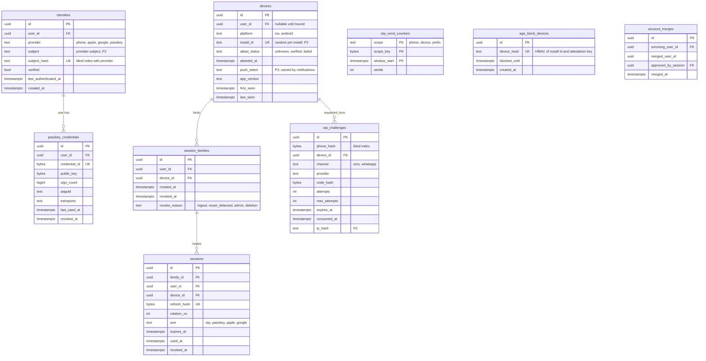

# Module: auth

Phase 0 (OTP, Apple, Google, passkeys, sessions) · Spec refs: §1, §B6, §T2, §T5 · Owner aggregates: `Identity`, `Session`, `Device`

## Flow
Phone OTP, Sign in with Apple, Google or passkey creates or resolves a `users` row (users module) through `identities`. A device-bound session is issued with a rotating refresh token. Reuse of a rotated refresh token revokes the whole family and notifies the user.

## Rules
- OTP: 6 digits, valid 5 min, max 5 attempts, 3 sends per 15 min per phone, 10 per day per device; exponential resend timer; WhatsApp as fallback channel.
- One account per phone number, enforced in `users` by a unique blind index (I-01).
- Access token JWT 10 min with `amr`; refresh token opaque, device-bound, 30 days, rotated on every use. Only the hash is stored.
- Under-18 DOB: no account is created. The device is soft-blocked for 30 days (I-05).
- Recycled number rule: OTP login for a phone with `last_authenticated_at` older than 180 days on a new device needs a second factor before any stored value is shown.
- Apple and phone identities merge only after both are verified, with an audit entry (I-04).

## Edge cases
- Apple private-relay email is valid and may not be unique across users.
- Pre-login devices exist before a user (I-02): `devices.user_id` is nullable until binding.
- Refresh race: two concurrent refreshes with the same token. The first wins, the second is treated as reuse only if outside a 10 s grace window (configurable), to avoid mobile retry false positives.
- Deleted or suspended user: all sessions are revoked, OTP challenges for the phone return the generic response.

## ER diagram

## Entities

| Entity | Ph | PK | FK (E enforced, L logical) | Indexes and uniqueness | PII | Tenancy | Partition | Retention |
|---|---|---|---|---|---|---|---|---|
| `identities` | P0 | `id` | `user_id` E to users | unique `(provider, subject_hash)`; index `(user_id)` | P2 (`subject` encrypted: phone, email or provider sub) | `user_id` | none | RET-USER |
| `passkey_credentials` | P0 | `id` | `user_id` E | unique `(credential_id)`; index `(user_id)` | P1 (public key only, no secret) | `user_id` | none | RET-USER |
| `devices` | P0 | `id` | `user_id` E nullable | unique `(install_id)`; index `(user_id, last_seen DESC)` | P2 (install id, push token) | `user_id` | none | RET-USER; unbound devices 90 d after `last_seen` (proposed) |
| `session_families` | P0 | `id` | `user_id` E, `device_id` E | index `(user_id) WHERE revoked_at IS NULL` | P1 | `user_id` | none | 90 d after revoke or expiry (proposed) |
| `sessions` | P0 | `id` | `family_id` E, `user_id` E, `device_id` E | unique `(refresh_hash)`; index `(family_id, rotation_no)` | P1 (hash only) | `user_id` | none | 30 d after `expires_at` (proposed) |
| `otp_challenges` | P0 | `id` | `device_id` E | index `(phone_hash, created_at DESC)`; index `(expires_at)` | P2 (phone blind index, ip hash) | none | daily by `created_at` | 7 d (proposed) |
| `otp_send_counters` | P0 | `(scope, scope_key, window_start)` | none | PK only; also mirrored in Redis for speed | P1 | none | none | 48 h (proposed) |
| `age_block_devices` | P0 | `id` | none | unique `(device_hash)`; index `(blocked_until)` | P2 (device hash only, no DOB, no phone) | none | none | `blocked_until` + 7 d (proposed) |
| `account_merges` | P1 | `id` | `surviving_user_id` E, `merged_user_id` L | index `(surviving_user_id)` | P1 | `user_id` | none | RET-TAX (audit evidence) |

## Data notes
- `users` itself lives in the [users](./users.md) module. The spec's `users`, `identities`, `devices`, `sessions` list (§1) is split by ownership: auth owns credentials and sessions, users owns the person and profile.
- `sessions.user_id` is added (I-03): the spec's `sessions(id, device_id, refresh_hash, family_id, expires_at, revoked_at)` cannot answer "list my sessions" when a device is shared.
- `session_families` is added because `family_id` had no owning row, and reuse detection needs a single revoke point.
- Staff (seller team, admin) authenticate through the same `identities` and `passkey_credentials` and are `users` rows with a staff membership in sellers or admin (I-53).

## API
| Endpoint | Scope | Idempotent | Rate limit |
|---|---|---|---|
| `POST /v1/auth/otp/request` | public + App Attest | no (rate-limited instead) | 3/15 min/phone, 10/day/device |
| `POST /v1/auth/otp/verify` | public | no | 5 attempts per challenge |
| `POST /v1/auth/apple`, `/google` | public + App Attest | yes | per IP and device |
| `POST /v1/auth/passkey/register`, `/assert` | user or public | yes | per user and IP |
| `POST /v1/auth/refresh` | refresh token | no (rotation is the guard) | per device |
| `POST /v1/auth/logout` | user | yes | per user |
| `GET/DELETE /v1/me/sessions/{id}` | user | yes (DELETE) | per user |

## Events
Outbox: `user.registered`, `user.age_blocked`, `session.revoked`, `identity.linked`, `identity.merged`. Analytics: `onboarding_step_completed(step)`.

## Failure handling
SMS provider down: failover to a second provider, then WhatsApp. Apple or Google outage: phone OTP remains. Challenge writes are single-row and retried idempotently by `(phone_hash, device_id, window)`.

## Security and abuse
- SMS pumping: EG country-code allow-list at launch, per-prefix budget caps (`otp_send_counters`), App Attest or Play Integrity required (API6).
- Refresh tokens stored as hashes only, constant-time compare. Reuse detection revokes `session_families`.
- `age_block_devices` stores an HMAC keyed by a server secret. A plain hash of a DOB is brute-forceable in under 40,000 guesses, so DOB is never stored for blocked users (I-05).
- BOLA: `GET/DELETE /v1/me/sessions/{id}` returns 404 for another user's session.

## Metrics
OTP delivery p95 under 10 s, SMS cost per verified user, age-block rate, refresh-reuse detections, passkey adoption.

## Acceptance
- A reused refresh token revokes every session in the family and a `session.revoked` event is emitted.
- A blocked device retrying with a different DOB inside 30 days is refused and no user, phone or DOB row is created.
- A fourth OTP send within 15 min for one phone returns 429.
