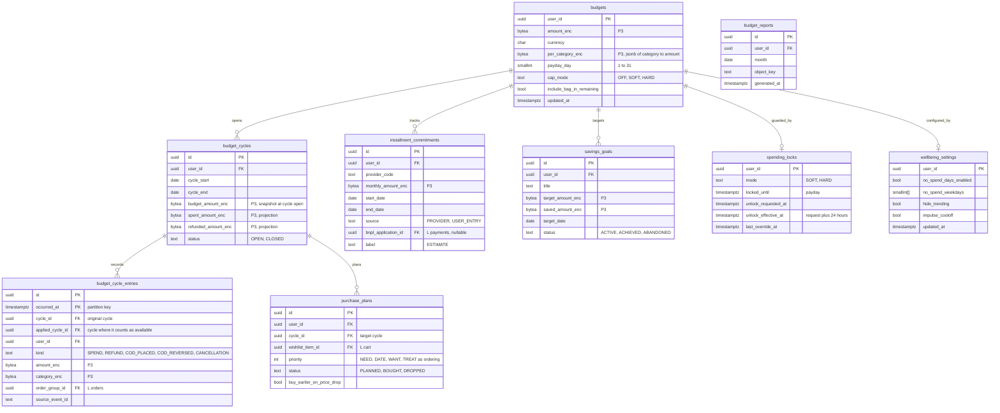

# Module: budget

Phase 2 (budget, affordability, wellbeing locks, installment calendar, savings goals) · Spec refs: §12, §B1 (`budget_insights` consent), §B3 (installment labels), §T5 (budget is P3), §20.5 (budget fit never stored as a seller-visible feature), §8, §11 · Owner aggregates: `Budget`, `BudgetCycle`, `InstallmentCommitment`, `SavingsGoal`, `SpendingLock`

## Flow
With `budget_insights` consent, a user sets a monthly budget (total and optional per category) and a payday. A cycle is opened per payday. Order and refund events post `budget_cycle_entries`, so `spent` is derived and net of refunds. The affordability query returns `remaining = budget - spent_this_cycle - bag_total (optional toggle) - installments_due_this_cycle`. Callers (feed, search, stylist, wishlist) receive the figure or a filter for that request only. The checkout saga asks for a boolean verdict from the spending lock. Plans assign wishlist items to future cycles by priority.

## Rules
- Every budget table is **P3, field-encrypted, user-scoped and opt-in**. Withdrawing `budget_insights` consent deletes the data (`budget_data` retention rule, purge job).
- **Budget data is never shared with sellers, never used for ads, ranking or promotion targeting** (§12, §20.5). Enforced by dependency-cruiser: `promotions`, `ads` and `sellers` modules cannot import budget; no outbox event or analytics event carries a budget amount (I-45).
- Spend counts net of refunds on the order's original cycle. COD counts at placement and is reversed on refusal. A refund in a later cycle is credited to the original cycle in reports and to "available now" in the current cycle (`applied_cycle_id` versus `original_cycle_id`).
- Installment commitments come only from provider data or the user's own entry and are labelled "estimate" / "estimated from provider". HAUL shows no credit scoring or loan recommendation (FRA, §B3).
- Payday on the 31st means the last day of the month. A mid-cycle budget change recomputes remaining.
- Wellbeing: soft lock needs a 10 s hold to override. Hard lock blocks checkout until payday, with a 24 h delayed unlock. No-spend days, hide-trending and impulse cool-off are settings.
- Savings use verified references only (pricing-integrity), never seller "was" prices.
- Multi-currency is out of scope. All amounts EGP with a currency column.

## Edge cases
- Budget removed with open commitments: commitments kept until the user deletes them, the dashboard hides budget math.
- Hard cap reached and the user is Plus: lock still applies, it is a user-chosen control.
- Cap unlock requested then cancelled: `unlock_requested_at` cleared, lock remains.
- Time zone: cycle boundaries are Africa/Cairo midnight.
- Export (DSAR) includes all budget tables because they are P3 and tagged.
- Consent withdrawn mid-cycle: data erased, derived caches purged within 24 h.
- An order placed through another device: events are the only source, so cycles stay consistent.

## ER diagram

## Entities

| Entity | Ph | PK | FK (E enforced, L logical) | Indexes and uniqueness | PII | Tenancy | Partition | Retention |
|---|---|---|---|---|---|---|---|---|
| `budgets` | P2 | `user_id` | `user_id` E | none | P3 | `user_id` | none | RET-BUDGET: until consent withdrawn or account deleted (spec, proposed purge job) |
| `budget_cycles` | P2 | `id` | `user_id` E | unique `(user_id, cycle_start)`; index `(user_id, status)` | P3 | `user_id` | none | RET-BUDGET |
| `budget_cycle_entries` | P2 | `(id, occurred_at)` | `cycle_id` E, `applied_cycle_id` E, `order_group_id` L | unique `(user_id, source_event_id, occurred_at)` (global key table, I-37); index `(cycle_id)` | P3 | `user_id` | monthly by `occurred_at` | RET-BUDGET |
| `installment_commitments` | P2 | `id` | `user_id` E, `bnpl_application_id` L | index `(user_id, end_date)` | P3 | `user_id` | none | RET-BUDGET |
| `savings_goals` | P2 | `id` | `user_id` E | index `(user_id, status)` | P3 | `user_id` | none | RET-BUDGET |
| `spending_locks` | P2 | `user_id` | `user_id` E | index `(unlock_effective_at)` | P3 | `user_id` | none | RET-BUDGET |
| `wellbeing_settings` | P2 | `user_id` | `user_id` E | none | P3 | `user_id` | none | RET-BUDGET |
| `purchase_plans` | P2 | `id` | `user_id` E, `cycle_id` E, `wishlist_item_id` L | index `(user_id, cycle_id)` | P3 | `user_id` | none | RET-BUDGET |
| `budget_reports` | P2 | `id` | `user_id` E | unique `(user_id, month)` | P3 | `user_id` | none | RET-BUDGET (object deleted with the data) |

## Data notes
- Spec data: `budgets(user_id, amount, per_category jsonb, payday, cap_mode)`, `budget_cycles(user_id, start, end, spent, refunded)`, `installment_commitments(user_id, provider, monthly, start, end, source)`, `savings_goals`. `spent` and `refunded` on the cycle are denormalised aggregates of entries. The spec gives no way to derive "credited to the original cycle in reports and to available now in the current cycle" from one number. `budget_cycle_entries` with `cycle_id` and `applied_cycle_id` provides both views (I-51).
- All amounts in this module are P3 and are envelope-encrypted per T5 ("budget" is in the P3 list). Aggregation therefore happens in the application after decrypt, never in SQL. This is acceptable because it is per user and bounded by cycle (decision, I-52).
- The spec's `per_category jsonb` is retained as one encrypted blob rather than a table, because per-category budgets are never queried across users.
- No `affordability` table. Results are computed per request and not stored. The wishlist reference (`has_budget`) in cart is a boolean only (I-48).
- `spending_locks` is the only data returned to checkout, as a boolean verdict plus `unlock_effective_at` for user messaging. The checkout does not store it.
- The stylist receives a budget value only as a request parameter supplied by the app after the user's choice. The outfit request must not persist a budget-derived default in clear (see stylist-gateway data notes).
- The DPIA for budget is `docs/privacy/dpia-budget.md`.

## API
| Endpoint | Scope | Idempotent | Rate limit |
|---|---|---|---|
| `PUT /v1/me/budget` | user, consent `budget_insights` | yes | 10/min |
| `GET /v1/me/budget/summary` | user | n/a | 60/min |
| `GET /v1/me/affordability?context=feed\|search\|stylist\|wishlist` | user | n/a | 60/min |
| `POST /v1/me/budget/plan` | user | yes | 10/min |
| `POST /v1/me/budget/lock/unlock-request` | user | yes | 5/min |

## Events
Outbox (internal only, no amounts): `budget.cap_reached`, `budget.cycle_closed`, `budget.lock_unlocked`. Consumes `order_group.placed`, `order_group.paid`, `refund.completed`, `order_group.failed`, cod refusal events. Analytics (no amounts): `budget_set`, `budget_warning_shown`, `affordability_view_opened`, `budget_cap_blocked_checkout`.

## Failure handling
Consumers are idempotent on `source_event_id`. If budget is unavailable, checkout treats the lock verdict as "no lock" (fail open, because the user's own preference must not block payment when the service is down) and records the fallback in the saga step result. This is a product decision to confirm (decisionsForOwner).

## Security and abuse
- P3 envelope encryption, blind indexes not needed (user-scoped).
- Never exposed to sellers, ads, ranking or promotions: DB roles for those modules have no grants on budget tables, and lint forbids imports.
- LLM prompts never receive amounts. The stylist receives a symbolic "within budget" constraint resolved server-side.
- Hard-cap bypass attempts (multiple devices, new account) are not an abuse problem to fight: the control is the user's own.

## Metrics
Adoption, share of users under budget, return rate versus control, retention uplift, lock override rate, share of affordability requests by context.

## Acceptance
- With a hard cap reached, checkout is blocked with a clear explanation and unlocking takes 24 h.
- A refund in the next cycle is credited to the original cycle in reports and increases "available now" in the current cycle.
- Withdrawing `budget_insights` consent deletes all rows of the user in these tables and derived caches within 24 h.
- No budget amount appears in any outbox payload, analytics event or seller-visible query.
