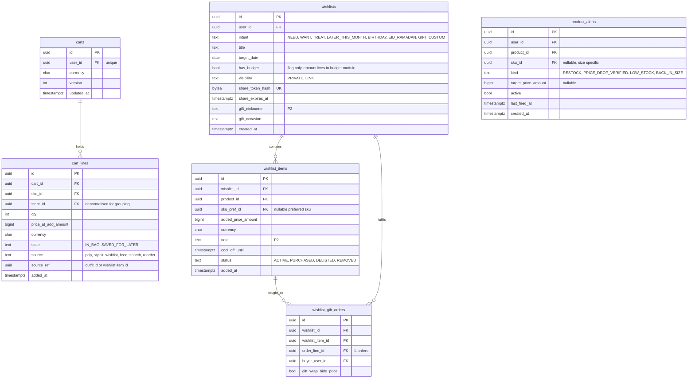

# Module: cart

Phase 1 (bag, wishlists with intent) and Phase 2 (shared and gift lists, alerts) · Spec refs: §6, §8, §5 (alerts), §28.2 · Owner aggregates: `Cart`, `Wishlist`, `ProductAlert`

## Flow
One server-side bag per user, grouped by store at read time. Lines carry the price at add so the UI can say honestly "price dropped" or "price rose". "Save for later" and "move to wishlist" change a line's state. Wishlists hold items with an intent, optional target date and budget flag, and can be shared by an unguessable link. Alerts (price drop verified only, back in size, low stock, date approaching) are subscriptions that notifications evaluates.

## Rules
- Max 50 lines and 10 units per SKU per user. Drop SKUs have their own per-user limit (inventory `purchase_limits`).
- No guest bag. An account (18+ gate) is required.
- Store grouping, subtotals and free-delivery progress are computed at read, never stored. The threshold base is the merchandise subtotal after item discounts and before vouchers and credit (open-questions default, VERIFY with product and legal).
- Wishlist `Want` items may carry a 24 h cool-off (`cool_off_until`). "Buy" becomes "Remind me tomorrow" until then.
- Share tokens are 128-bit, stored hashed, revocable, optional expiry. Enumeration limit 20/min per IP.
- A shared-list viewer must be 18+ to purchase.
- Price-drop alerts fire only on verified reductions (pricing-integrity claim), never on a plain seller price cut.

## Edge cases
- Item sold out: line `availability` is computed at read, checkout continues for the rest.
- Store suspended: its lines are locked and removed with a user notice.
- Threshold changed between add and checkout: checkout value applies and the change is shown.
- Wishlist item delisted: kept as ghost with "find similar".
- Gift purchase from a list ships to the owner's hidden address via an address token (users). The buyer never sees it (I-69).
- Merge of two accounts: lines are merged by SKU, quantities capped.

## ER diagram

## Entities

| Entity | Ph | PK | FK (E enforced, L logical) | Indexes and uniqueness | PII | Tenancy | Partition | Retention |
|---|---|---|---|---|---|---|---|---|
| `carts` | P1 | `id` | `user_id` E | unique `(user_id)` | P2 | `user_id` | none | RET-USER |
| `cart_lines` | P1 | `id` | `cart_id` E, `sku_id` E, `store_id` E | unique `(cart_id, sku_id) WHERE state = 'IN_BAG'`; index `(sku_id)` for demand and alerts; line-count check trigger (50) | P2 | `user_id` via cart | none | RET-USER; lines removed 30 d after conversion to order (proposed) |
| `wishlists` | P1 | `id` | `user_id` E | unique `(share_token_hash)`; index `(user_id, intent)`; index `(target_date)` for date alerts | P2 (`gift_nickname`, title) | `user_id` | none | RET-USER |
| `wishlist_items` | P1 | `id` | `wishlist_id` E, `product_id` E, `sku_pref_id` E | unique `(wishlist_id, product_id, COALESCE(sku_pref_id, nil))`; index `(product_id)` | P2 | `user_id` via wishlist | none | RET-USER |
| `wishlist_gift_orders` | P2 | `id` | `wishlist_id` E, `wishlist_item_id` E, `order_line_id` L, `buyer_user_id` E | index `(wishlist_id)` | P2 | `user_id` of buyer | none | RET-TAX when order retained, pseudonymised (buyer id replaced by tombstone) |
| `product_alerts` | P1 | `id` | `user_id` E, `product_id` E, `sku_id` E | unique `(user_id, product_id, sku_id, kind)`; index `(product_id, kind) WHERE active` | P2 | `user_id` | none | RET-USER; inactive rows 13 months (proposed) |

## Data notes
- The spec stores `price_at_add` with no currency and no state (I-23). Added `currency`, `state` and `source_ref`.
- `wishlist_items.product_id` plus optional `sku_pref_id` is the only place a product, not a SKU, is the primary reference (I-62). Alerts follow the same pattern.
- A wishlist budget is an amount in the budget module (P3). Here only `has_budget` is stored, so this table never carries financial behaviour (I-45, I-48).
- T1 has no wishlist module. They are housed here because "move to wishlist" is a bag action (I-67).
- Cart lines and wishlist items give demand signals to seller analytics only as aggregates with k at least 50.

## API
| Endpoint | Scope | Idempotent | Rate limit |
|---|---|---|---|
| `GET /v1/cart` | user | n/a | 60/min |
| `POST /v1/cart/lines` | user | yes | 60/min |
| `PATCH/DELETE /v1/cart/lines/{id}` | user | yes | 60/min |
| `GET /v1/cart/free-delivery-suggestions?store_id=` | user | n/a | 30/min |
| `CRUD /v1/me/wishlists`, `POST /v1/wishlists/{id}/items` | user | POST yes | 30/min |
| `GET /v1/shared/wishlists/{token}` | public, rate limited | n/a | 20/min/IP |
| `POST /v1/products/{id}/alerts` | user | yes | 30/min |

## Events
Outbox: `cart.line_unavailable`, `wishlist.shared`, `wishlist.gift_purchased`. Analytics: `add_to_bag`, `free_delivery_unlocked(store_id)`, `wishlist_added(intent)`, `wishlist_alert_sent(type)`, `gift_purchase_from_list`.

## Failure handling
Bag writes are optimistic-versioned (`carts.version`). Concurrent edits from two devices merge by SKU. A failed alert evaluation is retried and never produces a duplicate send (notification dedupe key = alert id + event id).

## Security and abuse
- BOLA: cart and wishlist ids are resolved from the token. A foreign id returns 404.
- Shared list endpoint returns only nickname, items and prices (hidden under gift wrap), never address or phone.
- Share-token brute force: 128-bit tokens, per-IP 20/min, constant-time hash compare.

## Metrics
Multi-store bag rate, free-delivery unlock rate, save to purchase by intent, cool-off regret reduction (return rate of cool-off purchases vs control), alert CTR.

## Acceptance
- Store A at 1,950 EGP plus a 60 EGP item from A makes A's shipping 0 in the bag view.
- A gift buyer completes a purchase from a shared list without receiving the recipient's address or phone.
- A revoked share token returns 404 immediately.
