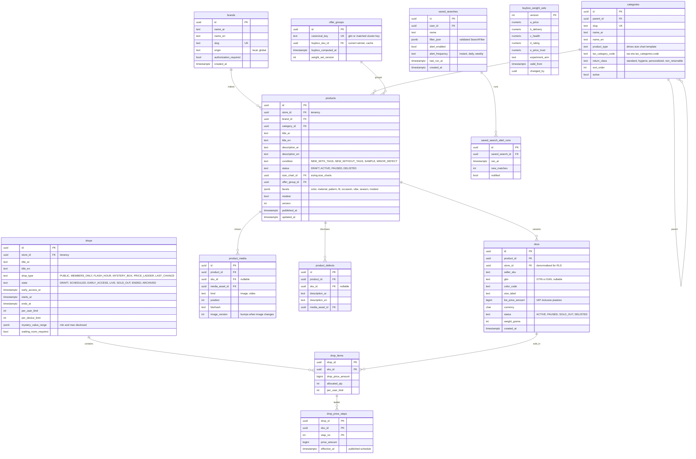

# Module: catalog

Phase 1 (catalog, stores listing, product page, Q&A excluded) and Phase 2 (drops, Buy Box tuning) · Spec refs: §3, §4, §5, §16, §19, §20.4, §B5 · Owner aggregates: `Product`, `Sku`, `Brand`, `Category`, `Drop`, `OfferGroup`, `SavedSearch`

## Flow
A seller (or a channel sync, or a CSV import) creates a `products` row with Arabic title and description, a condition, a category and one or more `skus` (colour x size variants with barcode). The product is published only when the Arabic text, a validated size chart (sizing module) and at least one image exist. Reads for the product page go to Postgres within a 5 s staleness bound (§5) and the search index is fed by outbox events (search-sync). Drops group SKUs into a time-boxed event with its own state machine. Identical items from several sellers are grouped into an `offer_groups` row and one offer wins the Buy Box by a versioned score.

## Rules
- Arabic title and description are mandatory, English is optional (§B5, A2.15). `title_ar` is `NOT NULL`, `title_en` nullable.
- Condition is one of `NEW_WITH_TAGS`, `NEW_WITHOUT_TAGS`, `SAMPLE`, `MINOR_DEFECT`. `MINOR_DEFECT` requires at least one `product_defects` row with a photo (§4).
- A listing without a validated size chart cannot show a size recommendation (§10). The product keeps `size_chart_id` (sizing module owns the chart).
- Seller legal identity shown on the product page is read from `sellers.sellers` at read time, never copied onto the product (single source, §B5).
- Price shown to shoppers is VAT-inclusive. `skus.list_price_amount` is the seller-set current price. The "was" price and discount percentage are never columns here: they come only from pricing-integrity output (§5 acceptance, §9).
- Drop state machine: `DRAFT -> SCHEDULED -> EARLY_ACCESS -> LIVE -> SOLD_OUT | ENDED -> ARCHIVED`. After `SCHEDULED` a seller may only increase stock, never change price (§16). Enforced by a trigger on `drop_items`.
- Buy Box: `score = a*price_norm + b*(-delivery_days) + c*seller_health + d*rating + e*price_trust`, tie-break on stock depth. Weights live in `buybox_weight_sets`, versioned and A/B-assigned (§20.4).
- Saved search alerts run at most once per `alert_frequency`, and `filter_json` is schema-validated (max 30 facets, §4).

## Edge cases
- SKU paused mid-view: `skus.status = PAUSED`, PDP disables the CTA and offers "notify me" (cart module `product_alerts`).
- Variant out of stock: the nearest size is recommended with a fit warning (sizing), computed at read time.
- Seller on vacation: the ETA is adjusted from `sellers.store_vacation_windows`, product rows are untouched.
- Product delisted but present in wishlists: row stays with `status = DELISTED` so wishlists can render a ghost entry (§8).
- Duplicate listing that resets price history: detected by pHash plus attributes (pricing-integrity, trust-safety), not prevented here.
- Currency is `EGP` only at launch, but every price column has a sibling `currency` column (I-65).

## ER diagram

## Entities

| Entity | Ph | PK | FK (E enforced, L logical) | Indexes and uniqueness | PII | Tenancy | Partition | Retention |
|---|---|---|---|---|---|---|---|---|
| `brands` | P1 | `id` | none | unique `(slug)` | P0 | none | none | RET-CONFIG |
| `categories` | P1 | `id` | `parent_id` E self | unique `(slug)`; index `(parent_id, sort_order)` | P0 | none | none | RET-CONFIG |
| `products` | P1 | `id` | `store_id` E, `brand_id` E, `category_id` E, `size_chart_id` L (sizing), `offer_group_id` E | index `(store_id, status)`; index `(category_id, status)`; index `(offer_group_id)`; GIN `(facets)`; trigram on `title_ar` (search fallback, §4) | P0 (seller text is untrusted, never P3) | `store_id` (RLS `app.current_store_id` for writes, public read of ACTIVE rows) | none | RET-TAX for rows referenced by orders (snapshot lives on order line), else delisted rows purged 24 months after delisting (proposed) |
| `skus` | P1 | `id` | `product_id` E, `store_id` E | unique `(store_id, seller_sku)`; index `(product_id)`; partial unique `(store_id, gtin, color_code, size_label) WHERE gtin IS NOT NULL` | P0 | `store_id` | none | with product |
| `product_media` | P1 | `id` | `product_id` E, `sku_id` E, `media_asset_id` E to platform | index `(product_id, position)` | P0 after moderation | `store_id` via product | none | with product |
| `product_defects` | P1 | `id` | `product_id` E, `sku_id` E, `media_asset_id` E | index `(product_id)` | P0 | `store_id` via product | none | with product |
| `offer_groups` | P2 | `id` | `buybox_sku_id` L | unique `(canonical_key)` | P0 | none | none | RET-CONFIG (derived, rebuilt) |
| `buybox_weight_sets` | P2 | `version` | `changed_by` L admin | none | P1 | none | none | indefinite (A/B evidence) |
| `drops` | P2 | `id` | `store_id` E | index `(state, starts_at)`; index `(store_id, starts_at DESC)` | P0 | `store_id` | none | RET-TAX when orders reference it, else 24 months after `ENDED` (proposed) |
| `drop_items` | P2 | `(drop_id, sku_id)` | `drop_id` E, `sku_id` E | index `(sku_id)`; check trigger blocks price change after `SCHEDULED` | P0 | `store_id` via drop | none | with drop |
| `drop_price_steps` | P2 | `(drop_id, sku_id, step_no)` | `(drop_id, sku_id)` E | none | P0 | `store_id` via drop | none | with drop |
| `saved_searches` | P1 | `id` | `user_id` E | index `(user_id)`; index `(alert_enabled, last_run_at)` for the alert scanner | P2 (may reveal intent, see I-48) | `user_id` | none | RET-USER |
| `saved_search_alert_runs` | P2 | `id` | `saved_search_id` E | index `(saved_search_id, ran_at DESC)` | P2 | `user_id` via parent | monthly by `ran_at` (proposed) | 90 d (proposed) |

## Data notes
- The spec gives no Data block for products, SKUs, brands or categories (I-14). Columns are derived from §4 filters, §5 content, §19 catalog features and §B5. Identifier discipline (I-15): `skus.id` is the purchasable unit everywhere (`sku_id` in cart, order lines, inventory). `products.id` is the display grouping. The spec's `haul_sku` (§9.7) and `sku_group` (§10 API) both resolve to `skus.id` and `products.id` respectively.
- `facets` is a JSONB document validated by Zod on write, indexed with GIN. Filterable facets in §4 that are numeric (price) are columns, not JSON.
- `product_attributes` and `product_embeddings` (§11) belong to stylist-gateway, keyed by `product_id` and `image_version`. This module owns the `image_version` counter.
- Free-delivery threshold, vacation windows and SLAs are store settings in sellers, never product columns (I-64).
- `saved_searches.filter_json` can contain a budget filter ("fits my remaining budget"). The reference must be the symbolic flag `fits_budget: true`, never the amount, because the budget value is P3 and must not leak into this table (I-48).
- Buy Box result is a cache (`offer_groups.buybox_sku_id`) recomputed on price, stock or health events. The score inputs are read from pricing-integrity (`price_trust_scores`), sellers (`seller_health_scores`), inventory and reviews aggregates.

## API
| Endpoint | Scope | Idempotent | Rate limit |
|---|---|---|---|
| `GET /v1/stores?world=&sort=&cursor=` | public | n/a | 60/min |
| `GET /v1/products/{id}` (ETag) | public | n/a | 120/min |
| `GET /v1/products/{id}/offers` | public | n/a | 60/min |
| `CRUD /v1/seller/products`, `POST /v1/seller/products/bulk` (CSV dry-run) | seller staff, store scoped | yes | 30/min |
| `CRUD /v1/seller/drops` | seller staff | yes | 30/min |
| `CRUD /v1/me/saved-searches` | user | POST yes | 30/min |
| `GET /v1/search`, `POST /v1/search/parse` | public / user | n/a | 30 per 10 s, 10/min |

## Events
Outbox: `product.created`, `product.updated`, `product.status_changed`, `sku.price_changed` (consumed by pricing-integrity to write `price_events`), `sku.status_changed`, `drop.state_changed`, `buybox.changed`. Analytics: `store_viewed`, `product_viewed`, `filter_applied`, `search_performed`.

## Failure handling
- Search index lag does not affect correctness: price and stock are re-read from Postgres on the PDP and in the bag.
- A bulk import is all-or-nothing per row batch of 500 with an error report. Partial failures never leave a product without SKUs (single transaction per product).
- Buy Box recompute is idempotent and rate-limited per group (at most once per 10 s).

## Security and abuse
- BOLA/BFLA: every seller write is checked by the policy guard and by RLS on `store_id`. A foreign `product_id` returns 404.
- Seller text (title, description, defects) is untrusted for the LLM (LLM01) and for the page (output encoding).
- Mass assignment: `status`, `published_at`, `offer_group_id`, `version` are server-controlled and absent from DTOs.
- A seller cannot set a "was" price. No column exists for it.

## Metrics
Catalog completeness (Arabic title, chart, image), listing-to-publish time, % SKUs with GTIN, search-index staleness p95 below 60 s, Buy Box recompute lag.

## Acceptance
- A product with no verified evidence returns no strike-through or percent-off field from `GET /v1/products/{id}` (contract test against the pricing-integrity output).
- A seller cannot change a `drop_items` price once the drop is `SCHEDULED`, but can raise `allocated_qty`.
- Seller A requesting seller B's product for edit receives 404.
