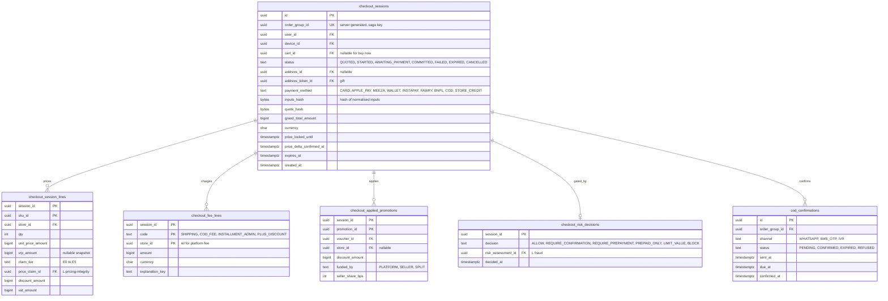

# Module: checkout

Phase 1 · Spec refs: §7, §6, §17 (evaluation), §20.7 (COD gating), §B3, §A2.8 · Owner aggregates: `CheckoutSession`, `PriceLock`, `CodConfirmation`

## Flow
`POST /v1/checkout/quote` is pure and writes nothing. `POST /v1/checkout` creates a `checkout_sessions` row (price lock, TTL 10 min), starts the checkout saga (platform `saga_instances`): validate cart, reserve inventory, apply store credit and gift card holds, create the payment intent, return a `client_action`. The order aggregate (`order_groups`, `seller_orders`, `order_lines`) is written by the orders module when the session commits. The webhook path is owned by payments.

## Rules
- The client total is never trusted. Prices, stock, promotions, age gates and fees are recomputed server-side at every step.
- Price lock: price at checkout start holds 10 min. A delta at commit asks the user to reconfirm (`price_delta_confirmed_at`).
- One payment intent per OrderGroup. `order_group_id` is a server-generated uuid at session creation and is the saga correlation id and the PSP idempotency key (I-37).
- All fees appear on the first render of the quote. No drip pricing.
- COD is risk gated (fraud module decision). For COD, saga skips payment steps and the order becomes `CONFIRMED_COD` after risk check and optional OTP/WhatsApp confirmation.
- Split tender: store credit and gift card plus one external method. A failed external payment releases credit holds.
- Plus status is read at commit. If Plus expires between start and payment, fees are recomputed and shown.
- Delivery option per shipment, validated against `fulfillment.courier_coverage`.
- Budget hard cap (budget module) can block checkout with a 24 h delayed unlock. This module asks budget for a boolean verdict, it never stores budget data (I-45).

## Edge cases
- Duplicate taps: one OrderGroup (idempotency on `order_group_id` and client key).
- Webhook before redirect: app polls `GET /v1/order-groups/{id}`, server is source of truth.
- Network drop after 3-DS: session resumable from Orders tab until `expires_at`.
- Payment succeeded but reservation expired: payments and inventory resolve (auto-claim or refund).
- Address deleted mid-checkout: the session holds its own snapshot reference (`address_snapshot_id` in orders on commit), not the live row.
- Gift purchase: shipping target is an address token, the session stores `address_token_id`, never the address.

## ER diagram

## Entities

| Entity | Ph | PK | FK (E enforced, L logical) | Indexes and uniqueness | PII | Tenancy | Partition | Retention |
|---|---|---|---|---|---|---|---|---|
| `checkout_sessions` | P1 | `id` | `user_id` E, `device_id` E, `cart_id` E, `address_id` E, `address_token_id` E | unique `(order_group_id)`; partial index `(expires_at) WHERE status IN ('QUOTED','STARTED','AWAITING_PAYMENT')`; index `(user_id, created_at DESC)` | P2 | `user_id` | monthly by `created_at` (proposed) | 90 d after terminal state, committed ones are superseded by `order_groups` (proposed) |
| `checkout_session_lines` | P1 | `(session_id, sku_id)` | `session_id` E, `sku_id` E, `store_id` E, `price_claim_id` L | none | P1 | `user_id` via session | with parent | with parent |
| `checkout_fee_lines` | P1 | `(session_id, code, store_id)` | `session_id` E | none | P1 | `user_id` via session | with parent | with parent |
| `checkout_applied_promotions` | P1 | `(session_id, promotion_id)` | `session_id` E, `promotion_id` L, `voucher_id` L | none | P1 | `user_id` via session | with parent | with parent |
| `cod_confirmations` | P1 | `id` | `order_group_id` L | index `(status, due_at)` for the 2 h auto-cancel sweeper | P2 | `user_id` via group | none | RET-TAX with the order |
| `checkout_risk_decisions` | P1 | `session_id` | `session_id` E, `risk_assessment_id` L | none | P1 | `user_id` via session | none | with parent |

## Data notes
- The spec lists `order_groups`, `seller_orders`, `order_lines`, `payment_intents`, `payment_events_raw`, `reservations` in this module's Data block. By T1 ownership they belong to orders, payments and inventory. The session is the checkout-specific part: it exists so quotes, price lock and saga inputs have a home before an order exists (I-67).
- `checkout_session_lines` freezes unit price and VRP snapshot at start. At commit, orders copies them into `order_lines`, so an order line never depends on a session after commit.
- No budget amount, cap status or affordability figure is stored on the session. Budget supplies a verdict at commit time that is logged only as a boolean in `saga_steps.result`.
- `inputs_hash` lets the idempotency layer detect a changed bag or address with the same client key (422).

## API
| Endpoint | Scope | Idempotent | Rate limit |
|---|---|---|---|
| `POST /v1/checkout/quote` | user | pure | 30/min |
| `POST /v1/checkout` | user, App Attest | yes | per user, device, IP |
| `GET /v1/order-groups/{id}` | owner or admin scope | n/a | 120/min |

## Events
Outbox: `checkout.started`, `order_group.placed` (emitted with orders), `checkout.expired`. Analytics: `checkout_started`, `payment_selected(method)`, `order_placed`.

## Failure handling
Saga with explicit compensation (release reservations, release credit holds, void intent). PSP calls: timeout 10 s, 3 idempotent retries. Expired sessions are swept and compensated by the same saga. Duplicate commits return the original result from `idempotency_keys`.

## Security and abuse
- BOLA: a session or order group is readable only by its owner and scoped admins. Foreign id returns 404.
- API6: rate limit per user, device and IP, App Attest required on `POST /v1/checkout`. Card-testing detection in fraud blocks BINs sweeps.
- Fees and totals are never accepted from the client body.

## Metrics
Checkout success at least 99.5% (SLO), time to confirmation p95 below 5 s, 3-DS drop-off, COD share, price-delta reconfirm rate, claim-after-expiry rate.

## Acceptance
- A cart across stores A, B and C yields one charge equal to the sum and three seller orders.
- Killing the API process mid-saga causes neither a double charge nor oversell.
- A price change at commit shows the delta and requires reconfirmation, and an unconfirmed commit fails with 409.
