# Module: fraud

Phase 1 (rules and risk score for COD and checkout, device and IP graph, blocklists, COD controls) and Phase 2 (GBDT model, cluster detector, BNPL cash-conversion signals, card testing) · Spec refs: §20.7, §15.4 (referral fraud), §15.1 (gift card abuse), §B3, §7 (card testing), §17 (abuse controls), §1 (SMS pumping, age block), dpia-fraud · Owner aggregates: `RiskAssessment`, `DeviceGraph`, `CodStanding`, `Blocklist`, `FraudCase`

## Flow
At checkout, gift-card purchase, referral attribution, voucher use and registration, the calling module asks fraud for a decision. Fraud gathers features (device and IP graph, phone age, account age, COD refusal history, velocity, voucher patterns, address quality, order value, time of day, chargebacks, BNPL signals), runs rules plus the GBDT score, writes a `risk_assessments` row and returns one of `ALLOW`, `REQUIRE_CONFIRMATION`, `REQUIRE_PARTIAL_PREPAYMENT`, `PREPAID_ONLY`, `LIMIT_VALUE`, `BLOCK`. COD standing is updated from courier refusal events. Clusters of linked accounts are detected in batch.

## Rules
- Decisions (§20.7): `allow`, `require OTP or WhatsApp confirmation`, `require partial prepayment (delivery fee or 20%)`, `prepaid only`, `limit value`, `block`.
- COD controls (defaults, config rows): new-user cap at most 1,500 EGP on the first order, at most 3,000 after 2 delivered orders. Confirmation within 2 h for risk at least medium, else auto-cancel. 1 refusal gives a warning and delivery fee prepaid next time. 2 refusals in 90 days gives prepaid-only for 90 days. Landmark and map pin required for COD, a low address quality score requires call confirmation. Multi-store COD: refusal of one seller order does not cancel the others. Refused COD return shipping is charged per policy, platform-funded on first refusal.
- Cross-courier sharing of refusal history only where lawful (VERIFY BEFORE LAUNCH). Default is HAUL's own history (`shared_with_other_couriers = false`).
- A model decision that blocks or limits a user must be explainable: `reason_codes` stored and a human appeal path exists in support. False-positive target: good users blocked below 0.5%.
- Rules never use protected attributes. Features and thresholds are versioned (`risk_models`, `risk_rules`). A shadow model runs before activation.
- Graph signals are hashed (IP hash, instrument fingerprint hash, address hash). Raw IP is not stored beyond the request log retention.
- BNPL anti-cash-conversion: BNPL order then quick return request then request for wallet credit raises a flag. The model can block BNPL for a user (§B3).
- Fraud data is not shared with sellers. Sellers receive only the outcome "COD not available".
- DPIA applies (docs/privacy/dpia-fraud.md).

## Edge cases
- Shared devices or IPs (family, office, mobile carrier NAT): graph edges weighted, a single shared IP never blocks.
- User in a governorate with high RTO: address quality and amount rules, never a blanket governorate ban.
- A decision engine outage: checkout falls back to conservative defaults (COD limited, prepaid allowed), not a block-all.
- Appeal upheld: standing reset, the case annotated for model feedback.
- False positive on gift card purchase: purchase held, support confirms.
- Account deletion: fraud rows are retained in hashed form for the legitimate-interest window (24 months proposed, VERIFY) and not exportable per user policy rules.
- Courier refusal reason "customer unreachable" vs "refused": different weights.

## ER diagram

```mermaid
erDiagram
    risk_models {
        uuid id PK
        text name "cod_gbdt, gift_card_screen, referral_cluster"
        int version
        text status "SHADOW, ACTIVE, RETIRED"
        jsonb card "features, metrics, thresholds"
        timestamptz activated_at
    }
    risk_rules {
        uuid id PK
        text rule_code
        int version
        jsonb definition "Zod validated"
        text action "ALLOW, REQUIRE_CONFIRMATION, REQUIRE_PARTIAL_PREPAYMENT, PREPAID_ONLY, LIMIT_VALUE, BLOCK, FLAG"
        bool active
        timestamptz valid_from
        uuid changed_by
    }
    risk_assessments {
        uuid id PK
        timestamptz created_at PK "partition key"
        text context "CHECKOUT, GIFT_CARD_PURCHASE, REFERRAL, VOUCHER, REGISTRATION, PLUS_TRIAL"
        uuid user_id FK
        uuid order_group_id FK "L orders, nullable"
        uuid device_id FK
        numeric score
        text decision
        text[] reason_codes
        int model_version
        int rules_version
        jsonb feature_snapshot "hashed or bucketed values"
        bool overridden
        uuid overridden_by
    }
    device_ip_graph_edges {
        uuid id PK
        uuid user_id FK
        uuid device_id FK
        bytea ip_hash
        bytea instrument_fingerprint_hash
        bytea address_hash
        bytea phone_hash
        timestamptz first_seen_at
        timestamptz last_seen_at
    }
    fraud_clusters {
        uuid id PK
        int size
        text signal "DEVICE, INSTRUMENT, ADDRESS, IP, MIXED"
        text status "OPEN, REVIEWED, ACTIONED, DISMISSED"
        timestamptz detected_at
    }
    fraud_cluster_members {
        uuid cluster_id PK
        uuid user_id PK
        numeric link_strength
    }
    cod_refusal_history {
        uuid id PK
        uuid user_id FK
        uuid shipment_id FK "L fulfillment"
        text refusal_reason
        timestamptz occurred_at
        bool shared_with_other_couriers
    }
    cod_standing {
        uuid user_id PK
        int refusals_90d
        text status "GOOD, WARNED, PREPAY_FEE, PREPAID_ONLY, BLOCKED"
        timestamptz prepaid_only_until
        int delivered_orders
        bigint cod_cap_amount
        timestamptz evaluated_at
    }
    fraud_blocklist_entries {
        uuid id PK
        text type "DEVICE, IP_HASH, INSTRUMENT_HASH, PHONE_HASH, ADDRESS_HASH, BIN"
        bytea value_hash
        text scope "ALL, COD, PAYMENT, REFERRAL, GIFT_CARD, REGISTRATION"
        text reason_code
        uuid added_by
        timestamptz expires_at
        timestamptz created_at
    }
    card_testing_signals {
        uuid id PK
        timestamptz observed_at PK "partition key"
        uuid device_id
        bytea ip_hash
        int small_auth_count
        int distinct_bins
        text action "NONE, THROTTLE, BLOCK"
    }
    fraud_cases {
        uuid id PK
        text type "COD_ABUSE, GIFT_CARD, REFERRAL_RING, CHARGEBACK, ACCOUNT_TAKEOVER, BNPL_CASH_CONVERSION"
        uuid subject_user_id FK
        text status "OPEN, INVESTIGATING, RESOLVED"
        text outcome "CONFIRMED, FALSE_POSITIVE, INCONCLUSIVE"
        uuid assignee
        timestamptz created_at
        timestamptz resolved_at
    }
    fraud_appeals {
        uuid id PK
        uuid assessment_id FK
        uuid user_id FK
        text status "OPEN, UPHELD, OVERTURNED"
        timestamptz created_at
        timestamptz decided_at
    }
    risk_models ||--o{ risk_assessments : scored_by
    risk_rules ||--o{ risk_assessments : applied_in
    fraud_clusters ||--|{ fraud_cluster_members : groups
    risk_assessments ||--o{ fraud_appeals : appealed_as
    fraud_cases ||--o{ risk_assessments : concerns
```

## Entities

| Entity | Ph | PK | FK (E enforced, L logical) | Indexes and uniqueness | PII | Tenancy | Partition | Retention |
|---|---|---|---|---|---|---|---|---|
| `risk_models` | P1 | `id` | none | unique `(name, version)` | P1 | none | none | indefinite (model cards) |
| `risk_rules` | P1 | `id` | `changed_by` L | unique `(rule_code, version)`; index `(active)` | P1 | none | none | RET-CONFIG |
| `risk_assessments` | P1 | `(id, created_at)` | `user_id` E, `device_id` E, `order_group_id` L | index `(user_id, created_at DESC)`; index `(order_group_id)`; index `(decision, created_at)` | P2 | none (fraud and support roles only) | monthly by `created_at` | RET-FRAUD 24 months (inventory `fraud_signals`, proposed, VERIFY) |
| `device_ip_graph_edges` | P1 | `id` | `user_id` E, `device_id` E | index `(ip_hash)`; index `(instrument_fingerprint_hash)`; index `(address_hash)`; index `(user_id)`; unique `(user_id, device_id, ip_hash)` | P2 (hashed identifiers) | none | none | RET-FRAUD, rolling window |
| `fraud_clusters` | P1 | `id` | none | index `(status, detected_at)` | P1 | none | none | RET-FRAUD |
| `fraud_cluster_members` | P1 | `(cluster_id, user_id)` | `cluster_id` E, `user_id` E | index `(user_id)` | P2 | none | none | RET-FRAUD |
| `cod_refusal_history` | P1 | `id` | `user_id` E, `shipment_id` L | index `(user_id, occurred_at DESC)`; unique `(shipment_id)` | P2 | none | none | RET-FRAUD 24 months (inventory `cod_refusal_history`) |
| `cod_standing` | P1 | `user_id` | `user_id` E | index `(status)`; index `(prepaid_only_until)` | P2 | `user_id` (user sees own status only as a reason in checkout) | none | RET-FRAUD |
| `fraud_blocklist_entries` | P1 | `id` | `added_by` L | unique `(type, value_hash, scope)`; index `(expires_at)` | P2 (hashed) | none | none | until expiry plus 12 months |
| `card_testing_signals` | P1 | `(id, observed_at)` | `device_id` L | index `(ip_hash, observed_at)` | P2 | none | daily or monthly by `observed_at` | 90 d |
| `fraud_cases` | P1 | `id` | `subject_user_id` E, `assignee` L | index `(status, created_at)`; index `(subject_user_id)` | P2 | none | none | RET-FRAUD |
| `fraud_appeals` | P1 | `id` | `assessment_id` L, `user_id` E | index `(status, created_at)` | P2 | `user_id` | none | RET-FRAUD |

## Data notes
- Spec §20.7 has no Data block. The data inventory names `risk_assessments`, `device_ip_graph_edges` and `cod_refusal_history`, and this model keeps those names and adds `cod_standing`, blocklists, clusters, cases and appeals which the rules and referral and gift-card abuse controls require.
- `risk_assessments.feature_snapshot` holds hashed or bucketed values so a score can be explained and reproduced without keeping raw identifiers. It carries no P3 (no address text, no measurements, no budget).
- `device_ip_graph_edges` keys by hashes (HMAC with a rotating key) to avoid joinable raw identifiers across systems. The key rotation schedule must keep the 24-month window usable, which needs an overlap policy (VERIFY with the DPO, I-70).
- Fraud features are never fed with `budget_*` tables (§12, I-45) and not with size profiles.
- Phone age and account age come from users and auth. SMS pumping and OTP abuse counters live in auth (`otp_send_counters`).
- Risk decisions are stored in `checkout_risk_decisions` (checkout) as a pointer to `risk_assessments`.

## API
| Endpoint | Scope | Idempotent | Rate limit |
|---|---|---|---|
| `POST /v1/internal/risk/assess` | internal only | keyed by context and subject | internal |
| `GET /v1/admin/fraud/cases`, `PATCH /v1/admin/fraud/cases/{id}` | fraud analyst | yes | 60/min |
| `POST /v1/admin/fraud/blocklist` | fraud analyst, dual approval for broad scopes | yes | 30/min |
| `POST /v1/me/risk-appeals` | user | yes | 5/min |

## Events
Outbox: `risk.assessed` (decision only), `cod_standing.changed`, `fraud_case.opened`, `blocklist.added`, `cluster.detected`. Consumes `shipment.delivery_failed`, `chargeback.opened`, `return.requested`, `order_group.placed`, `referral.attributed`.

## Failure handling
Assessment has a strict latency budget (proposed 150 ms). On timeout it returns the conservative default with `fallback_used = true`. Batch cluster detection is idempotent. Model failures route to rules only.

## Security and abuse
- The fraud tables are readable by fraud and support (masked) roles only, never by sellers.
- Adversarial probing: responses expose a decision class, not scores or reason details.
- Blocklist values are hashed. Entries expire by default.
- Decision overrides are audited with reason codes. Disparate impact is reviewed quarterly (DPIA).

## Metrics
COD refusal rate by governorate, fraud loss percent, false-positive rate (good users blocked below 0.5%), manual review rate, appeal overturn rate, cluster precision, time to decision p95.

## Acceptance
- A first COD order of 1,800 EGP from a new user is limited or prepaid, per the cap.
- Two refusals in 90 days result in prepaid-only for 90 days, with a notice.
- A fraud service outage does not block all checkouts.
- No budget table or size profile is read by any fraud feature.
