# Module: fulfillment

Phase 1 (Bosta first, ship-by-seller, COD reconciliation) and Phase 2 (Aramex, hub consolidation, try-at-door) · Spec refs: §21, §20.7, §B1, §19, §22, §T4, §28.6 · Owner aggregates: `Shipment`, `CourierAccount`, `CodRemittance`, `DeliveryAttempt`

## Flow
The seller packs a seller order and calls `POST /v1/seller/shipments`. A `shipments` row is created with a deterministic id, the courier adapter creates the AWB idempotently with that id, and a label job renders the A6 PDF. Courier tracking webhooks are stored raw, deduplicated by courier event id, normalized to HAUL statuses and written as `shipment_events`. Delivery sets `delivered_at` (OTP code or photo proof), which starts every legal window in orders and returns. COD collected cash is remitted by the courier in batches that are matched to shipments and reconciled with the ledger `cod_clearing:{courier}` account.

## Rules
- Courier choice is by governorate SLA, cost and seller preference, using `courier_coverage` and `courier_service_levels`. Checkout validates addresses against `courier_coverage`.
- ETA promise uses the p80 historical transit time per courier and governorate (`transit_time_stats`).
- Delivery attempts: 3, then RTO. Return pickups for approved returns are booked automatically as shipments of kind `RETURN`.
- Shipment states: `LABEL_PENDING -> LABEL_CREATED -> PICKUP_SCHEDULED -> PICKED_UP -> IN_TRANSIT -> OUT_FOR_DELIVERY -> DELIVERED | DELIVERY_FAILED -> RTO_IN_TRANSIT -> RTO_RECEIVED | CANCELLED | LOST`. Courier raw statuses map through a versioned `courier_status_map`.
- A shipment is a many-to-many with seller orders only for hub consolidation (Phase 2). Phase 1 shipments have exactly one seller order (junction table, see Data notes).
- COD amount on a shipment equals the unpaid amount of its seller orders at dispatch. A mismatch alerts Finance.
- Proof of delivery requires an OTP code or a photo (private bucket, strip EXIF), never both optional.
- Refused COD return shipping is charged per policy and platform-funded for the first refusal (§20.7). The policy outcome is stored on `delivery_attempts.refusal_charge_*`.
- Courier-reported or distance-estimated gCO2e per shipment is stored as `shipment_carbon` (P2 feature, §19.1).
- Hubs are `inventory.locations` rows of kind `HUB`. Fulfillment does not own stock.

## Edge cases
- Courier API down: shipment stays `LABEL_PENDING`, queue retries with backoff, the seller sees "label pending" (§21).
- Tracking webhook gap above 48 h: a poller backfills `shipment_events`.
- Duplicate or out-of-order tracking events: dedup key `(courier_code, courier_event_id)`, monotonic state machine with explicit allowed regressions (for example `OUT_FOR_DELIVERY -> IN_TRANSIT` after a failed attempt).
- COD remittance mismatch: lines flagged and reconciliation item raised, shipment keeps `cod_status = MISMATCH`.
- Courier lost parcel: `LOST` triggers cancellation and refund saga and a seller-fault flag.
- Seller on vacation: dispatch SLA is extended by `sellers.store_vacation_windows`, ETA adjusted at read time.
- Replaying all webhooks twice yields identical shipment state (acceptance).

## ER diagram

```mermaid
erDiagram
    couriers {
        text code PK "bosta, aramex, mylerz, jt"
        text name
        bool enabled
        int priority
        text cod_remittance_cycle "VERIFY BEFORE LAUNCH"
        text webhook_secret_ref
        timestamptz updated_at
    }
    courier_coverage {
        uuid id PK
        text courier_code FK
        text governorate
        text city
        text district "nullable"
        bool cod_supported
        bool open_box_supported
        bool active
        int version
    }
    courier_service_levels {
        uuid id PK
        text courier_code FK
        text from_governorate
        text to_governorate
        int sla_days
        bigint base_fee_amount
        char currency
        int version
    }
    transit_time_stats {
        text courier_code PK
        text from_governorate PK
        text to_governorate PK
        date window_end PK
        int p50_hours
        int p80_hours
        int sample_size
    }
    shipments {
        uuid id PK
        text kind "FORWARD, RETURN, EXCHANGE, RTO"
        uuid store_id FK "tenancy"
        text courier_code FK
        text awb UK "unique with courier"
        text status
        text fulfillment_mode "SHIP_BY_SELLER, FULFILLED_BY_HAUL"
        uuid origin_location_id FK "L inventory"
        uuid delivery_snapshot_id FK "L orders"
        bigint cod_amount
        char currency
        text cod_status "NONE, PENDING, COLLECTED, REMITTED, MISMATCH"
        int parcel_weight_grams
        text label_object_key
        text label_status "PENDING, READY, FAILED"
        timestamptz promised_delivery_at
        timestamptz picked_up_at
        timestamptz delivered_at
        timestamptz created_at
    }
    shipment_seller_orders {
        uuid shipment_id PK
        uuid seller_order_id PK
        int package_count
    }
    shipment_events {
        uuid id PK
        timestamptz occurred_at PK "partition key"
        uuid shipment_id FK
        text courier_event_id
        text courier_status_raw
        text status "normalised"
        text location_text
        text source "WEBHOOK, POLL, MANUAL"
    }
    courier_events_raw {
        uuid id PK
        timestamptz received_at PK "partition key"
        text courier_code
        text courier_event_id
        bool signature_ok
        jsonb body
        text processing_status
    }
    courier_event_dedup {
        text courier_code PK
        text courier_event_id PK
        uuid raw_event_id
    }
    delivery_attempts {
        uuid id PK
        uuid shipment_id FK
        int attempt_no
        timestamptz attempted_at
        text outcome "DELIVERED, REFUSED, NO_ANSWER, WRONG_ADDRESS, RESCHEDULED"
        text refusal_reason_code
        bool refusal_charge_applied
        text charged_to "NONE, SHOPPER, SELLER, PLATFORM"
    }
    proofs_of_delivery {
        uuid shipment_id PK
        text method "OTP, PHOTO"
        bytea otp_hash
        uuid media_asset_id FK "nullable"
        timestamptz captured_at
    }
    cod_remittances {
        uuid id PK
        text courier_code FK
        text courier_ref UK "unique with courier"
        date remittance_date
        bigint total_amount
        char currency
        text status "RECEIVED, MATCHED, PARTIALLY_MATCHED, MISMATCH"
        uuid ledger_entry_id FK "nullable"
        timestamptz received_at
    }
    cod_remittance_lines {
        uuid remittance_id PK
        uuid shipment_id PK
        bigint collected_amount
        bigint fee_amount
        text match_status "MATCHED, AMOUNT_DIFF, UNKNOWN_AWB"
    }
    shipment_carbon {
        uuid shipment_id PK
        numeric gco2e
        text method "COURIER_REPORTED, DISTANCE_ESTIMATE"
        text factor_version
    }
    couriers ||--o{ courier_coverage : covers
    couriers ||--o{ courier_service_levels : quotes
    couriers ||--o{ shipments : carries
    shipments ||--|{ shipment_seller_orders : bundles
    shipments ||--o{ shipment_events : tracked_by
    courier_events_raw ||--|| courier_event_dedup : deduped_by
    shipments ||--o{ delivery_attempts : attempts
    shipments ||--o| proofs_of_delivery : proved_by
    cod_remittances ||--|{ cod_remittance_lines : lists
    shipments ||--o{ cod_remittance_lines : remitted_in
    shipments ||--o| shipment_carbon : emits
```

## Entities

| Entity | Ph | PK | FK (E enforced, L logical) | Indexes and uniqueness | PII | Tenancy | Partition | Retention |
|---|---|---|---|---|---|---|---|---|
| `couriers` | P1 | `code` | none | none | P1 | none | none | RET-CONFIG |
| `courier_coverage` | P1 | `id` | `courier_code` E | unique `(courier_code, governorate, city, district, version)`; index `(governorate, city)` | P0 | none | none | RET-CONFIG |
| `courier_service_levels` | P1 | `id` | `courier_code` E | unique `(courier_code, from_governorate, to_governorate, version)` | P1 | none | none | RET-CONFIG |
| `transit_time_stats` | P1 | `(courier_code, from_governorate, to_governorate, window_end)` | `courier_code` E | none | P1 | none | none | 24 months |
| `shipments` | P1 | `id` | `store_id` E, `courier_code` E, `origin_location_id` L, `delivery_snapshot_id` L | unique `(courier_code, awb)`; index `(store_id, status, created_at DESC)`; index `(status, promised_delivery_at)`; partial index `(cod_status) WHERE cod_status IN ('PENDING','MISMATCH')` | P2 (delivery data is reached via the snapshot, not stored here) | `store_id` | monthly by `created_at` (proposed) | `delivery_records` 24 months then pseudonymize (proposed); COD fields follow RET-TAX |
| `shipment_seller_orders` | P1 | `(shipment_id, seller_order_id)` | `shipment_id` E, `seller_order_id` L | index `(seller_order_id)` | P1 | `store_id` via shipment | with shipment | with shipment |
| `shipment_events` | P1 | `(id, occurred_at)` | `shipment_id` E | unique `(shipment_id, courier_event_id, occurred_at)`; index `(shipment_id, occurred_at)` | P1 | `store_id` via shipment | monthly by `occurred_at` (T3) | 24 months (proposed) |
| `courier_events_raw` | P1 | `(id, received_at)` | none | index `(courier_code, courier_event_id)`; index `(processing_status)` | P2 (body may include recipient name, phone, address) | none | monthly by `received_at` (T3) | RET-WEBHOOK where it supports COD financial evidence (7 y, VERIFY), otherwise 24 months |
| `courier_event_dedup` | P1 | `(courier_code, courier_event_id)` | `raw_event_id` L | PK | P1 | none | none | same as raw |
| `delivery_attempts` | P1 | `id` | `shipment_id` E | unique `(shipment_id, attempt_no)` | P1 | `store_id` via shipment | with shipment | 24 months (proposed) |
| `proofs_of_delivery` | P1 | `shipment_id` | `shipment_id` E, `media_asset_id` E | none | P2 (photo may show a person or home) | `store_id` via shipment | none | 24 months (proposed), media private |
| `cod_remittances` | P1 | `id` | `courier_code` E, `ledger_entry_id` E | unique `(courier_code, courier_ref)`; index `(status, remittance_date)` | P1 | none | none | RET-TAX |
| `cod_remittance_lines` | P1 | `(remittance_id, shipment_id)` | `remittance_id` E, `shipment_id` E | index `(shipment_id)` | P1 | none | none | RET-TAX |
| `shipment_carbon` | P1 | `shipment_id` | `shipment_id` E | none | P1 | `store_id` via shipment | none | 24 months |

## Data notes
- Spec data: `shipments(id, seller_order_ids[], courier, awb, status, cod_amount, events[])`, `courier_events_raw` (dedup by courier event id), `cod_remittances`. Array columns hold orders and events, which cannot carry foreign keys, status per link or partitioning. They become `shipment_seller_orders` and `shipment_events` (I-17).
- `courier_events_raw` dedup has the same partition problem as `payment_events_raw` (I-37).
- `cod_refusal_history` is a fraud feature fed by `delivery_attempts` refusals. It lives in fraud, not here, because it can be shared across couriers under a lawful basis (VERIFY BEFORE LAUNCH).
- Recipient data is not stored on `shipments`. The courier adapter reads `orders.delivery_snapshots` and sends the relay number where supported (§B1). Sellers who ship themselves still go through `seller_delivery_access_grants`.
- Return shipments reuse `shipments` with `kind = RETURN` and are linked from `returns.return_shipment_id`.
- Courier cost per shipment (billing) is not in the spec. A `courier_charges` table is needed for contribution margin per order (§23) and courier invoice reconciliation. It is listed in Decisions as a gap, not invented here (I-31).

## API
| Endpoint | Scope | Idempotent | Rate limit |
|---|---|---|---|
| `POST /v1/seller/shipments` | seller staff, store scoped | yes (shipment id) | 60/min |
| `GET /v1/seller/shipments/{id}/label` | seller staff | n/a | 60/min |
| `GET /v1/me/shipments/{id}/tracking` | owner | n/a | 60/min |
| `POST /v1/webhooks/courier/{courier}` | allow-list, HMAC | dedup by event id | provider-based |
| `GET /v1/admin/logistics/cod-remittances` | finance | n/a | 30/min |

## Events
Outbox: `shipment.created`, `shipment.picked_up`, `shipment.delivered`, `shipment.delivery_failed`, `shipment.rto_received`, `cod.collected`, `cod_remittance.matched`, `cod_remittance.mismatch`. Analytics: `order_delivered`.

## Failure handling
Courier timeouts retry with backoff and jitter, circuit breaker per courier (API10). Webhook handler failure goes to `dead_letter_events`. Polling covers webhook gaps above 48 h. COD mismatch alerts Finance and creates a reconciliation item.

## Security and abuse
- Webhook endpoints verify HMAC and IP, and treat bodies as untrusted input (API10, API7).
- Label PDFs are in a private bucket with signed URLs of at most 15 minutes.
- A seller can only create shipments for their own seller orders (BOLA, 404 otherwise).
- AWB and OTP codes are not guessable. The OTP is stored as a hash.
- Seller fake-dispatch abuse: dispatch SLA is satisfied only by a courier `PICKED_UP` event, not by the seller's click.

## Metrics
On-time dispatch, delivery success rate, RTO rate, cost per order by governorate, COD refusal rate by governorate, courier webhook lag, remittance match rate, gCO2e per shipment.

## Acceptance
- Replaying every webhook twice yields identical shipment state.
- A COD shipment remitted with a different amount raises a reconciliation item and keeps `cod_status = MISMATCH`.
- `delivered_at` from the courier event, not the seller, starts the return window.
- Checkout rejects an address for which no `courier_coverage` row is active.
