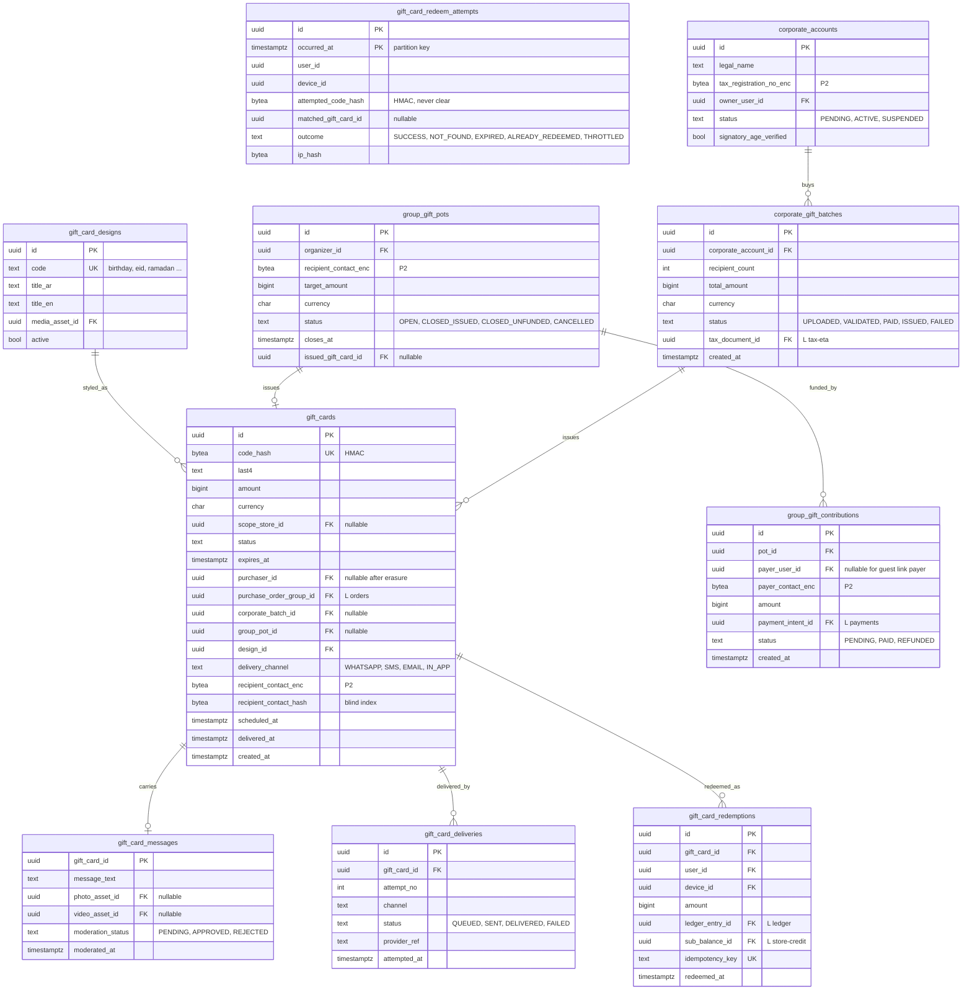

# Module: gift-cards

Phase 2 (single cards, group gifts) and Phase 2/3 (corporate bulk) · Spec refs: §15.1, §8 (group gift chip-in), §28.5, §28.11, §B2, §B4, §B6 · Owner aggregates: `GiftCard`, `GiftCardRedemption`, `GroupGiftPot`, `CorporateAccount`

## Flow
A buyer picks a design, amount (100 to 10,000 EGP), message and delivery channel and time, then pays through checkout. On payment the card is `ISSUED` with a high-entropy code shown once and stored as an HMAC hash plus last 4. A delivery job sends the card to the recipient (WhatsApp, SMS, email or in-app). The recipient redeems the code, which converts the remaining balance into a store-credit sub-balance. Group gifts collect contributions into a pot and issue a card when the pot closes. Corporate buyers upload recipients by CSV and receive an ETA e-invoice.

## Rules
- Code: at least 16 characters from a CSPRNG (Crockford base32), stored as `code_hash` (HMAC) and `last4`. The clear code exists only in the delivery payload and is purged after delivery.
- Scope: platform-wide or store-specific (`scope_store_id`).
- Redemption converts the card to store credit (a `gift_card` sub-balance). Partial use happens in the wallet after conversion. There is no partial redemption of the card object itself (I-41, the spec says both "converts the card" and "partial use is allowed").
- Expiry default 3 years, clearly shown. Egyptian limits on gift-card expiry and the VAT point are VERIFY BEFORE LAUNCH.
- Not redeemable for cash. Cannot be used to buy gift cards or Plus (anti-laundering).
- State machine: `PENDING_PAYMENT -> ISSUED -> DELIVERED -> REDEEMED(partial|full) -> EXPIRED | VOIDED`. For this model, partial and full are expressed by the remaining value in the ledger sub-account, not by an extra state.
- Brute force: 5 failed redemptions per hour per account, 20 per day per device, global anomaly alerts. The correct code still works after throttling expires and all attempts are in the audit log (acceptance).
- Purchases with a new card above 2,000 EGP require 3-DS. Velocity limits and fraud screening apply to purchases.
- Purchaser age 21 for purchases above 5,000 EGP, corporate or B2B (§B6).
- Group gift: each contributor pays the PSP directly. The pot is never held by HAUL beyond issuance. Unfunded contributions are refunded when the pot closes unfilled (§28.5, §B2).
- Recipient contact is P2, field-encrypted and kept only to deliver (30 days after the event date per the inventory proposal).
- Moderated gift messages, photos and videos go through the media pipeline and moderation.

## Edge cases
- Payment fails after card creation: card stays `PENDING_PAYMENT` and expires, never deliverable.
- Delivery bounce: retry per channel, fallback to in-app, buyer notified.
- Redeemed by the wrong person: redemption belongs to whoever has the code, support can void only before redemption.
- Card voided after redemption started: not possible once the credit entry is posted. Fraud recovery uses credit clawback to the extent of unspent sub-balance.
- Refund of the purchase: allowed only while unredeemed (card `VOIDED`, payment refunded).
- Group pot closes at 1 contributor: issues a card for that amount.
- Buyer deletes account: card remains valid, purchaser reference pseudonymized.

## ER diagram

## Entities

| Entity | Ph | PK | FK (E enforced, L logical) | Indexes and uniqueness | PII | Tenancy | Partition | Retention |
|---|---|---|---|---|---|---|---|---|
| `gift_card_designs` | P2 | `id` | `media_asset_id` E | unique `(code)` | P0 | none | none | RET-CONFIG |
| `gift_cards` | P2 | `id` | `scope_store_id` E, `purchaser_id` E (nullable), `purchase_order_group_id` L, `corporate_batch_id` E, `group_pot_id` E, `design_id` E | unique `(code_hash)`; index `(purchaser_id)`; index `(status, expires_at)`; index `(recipient_contact_hash)` | P2 (recipient contact, purchaser) | `user_id` (purchaser) and redemption by code | none | RET-TAX for value records (liability); recipient contact `gift_recipient_contact` 30 d after event date (proposed, VERIFY) |
| `gift_card_messages` | P2 | `gift_card_id` | `gift_card_id` E, media E | none | P2 (free text, photos) | `user_id` via card | none | with card, media deleted at expiry plus 30 d (proposed) |
| `gift_card_deliveries` | P2 | `id` | `gift_card_id` E | unique `(gift_card_id, attempt_no)` | P1 | via card | none | 90 d (proposed) |
| `gift_card_redemptions` | P2 | `id` | `gift_card_id` E, `user_id` E, `device_id` E, `ledger_entry_id` L, `sub_balance_id` L | unique `(idempotency_key)`; unique `(gift_card_id)` (one conversion) | P2 | `user_id` | none | RET-TAX |
| `gift_card_redeem_attempts` | P2 | `(id, occurred_at)` | `matched_gift_card_id` L | index `(user_id, occurred_at)`; index `(device_id, occurred_at)` for the 20 per day rule | P2 (user, device, ip hash) | none | monthly by `occurred_at` | 13 months (proposed), fraud window |
| `group_gift_pots` | P2 | `id` | `organizer_id` E, `issued_gift_card_id` E | index `(status, closes_at)` | P2 | `user_id` (organizer) | none | 30 d after close for contact, rest RET-TAX |
| `group_gift_contributions` | P2 | `id` | `pot_id` E, `payer_user_id` E, `payment_intent_id` L | index `(pot_id)`; index `(payer_user_id)` | P2 | `user_id` (payer) | none | RET-TAX |
| `corporate_accounts` | P2 | `id` | `owner_user_id` E | unique `(owner_user_id)` | P2 | `corporate_account_id` | none | RET-KYC |
| `corporate_gift_batches` | P2 | `id` | `corporate_account_id` E, `tax_document_id` L | index `(corporate_account_id, created_at)` | P2 (recipient CSV is held in a private object, deleted after issue) | `corporate_account_id` | none | RET-TAX |

## Data notes
- Spec data: `gift_cards(id, code_hash, last4, amount, currency, scope_store_id, status, expires_at, purchaser_id, recipient_contact P2-enc, design, scheduled_at)` and `gift_card_redemptions`. `design` becomes an FK to `gift_card_designs`. `amount` is the face value. The remaining balance is **not** a column: before redemption it equals the face value, after conversion it is the ledger sub-account balance (ledger `gift_card_liability`, then `store_credit:{user}:gift_card:{card}`).
- The spec's required "audit log records all attempts" (acceptance) needs a dedicated `gift_card_redeem_attempts` table with HMAC of the attempted code, since the audit log must not hold clear codes.
- The inventory's `group_gift_pots(id, organizer_id, recipient_contact, payer_user_id, payer_contact, amount, status)` mixes a pot and contributions in one row. A pot has many contributions, so the model splits them (I-42).
- `gift_card_liability` holds the unredeemed face value. Breakage reporting uses expiry entries (ledger I-11).
- `design` options listed in §15.1 are data rows (`gift_card_designs`) rather than an enum.

## API
| Endpoint | Scope | Idempotent | Rate limit |
|---|---|---|---|
| `POST /v1/gift-cards` | user, 21+ above 5,000 EGP | yes | 10/min |
| `POST /v1/gift-cards/redeem` | user, App Attest | yes | 5 failures per hour per account, 20 per day per device |
| `GET /v1/me/gift-cards` | user | n/a | 60/min |
| `POST /v1/b2b/gift-cards/bulk` | corporate account | yes | 5/min |
| `POST /v1/gift-pots`, `POST /v1/gift-pots/{id}/contributions` | user or guest link | yes | 10/min |

## Events
Outbox: `gift_card.issued`, `gift_card.delivered`, `gift_card.redeemed`, `gift_card.expired`, `gift_card.voided`, `gift_pot.closed`. Analytics: `gift_card_purchased`, `gift_card_redeemed`.

## Failure handling
Delivery retries per channel with backoff and fallback channel. Failed redemption posting rolls back the status. Pot close job is idempotent: refunds unfunded contributions through payments. WhatsApp template rejection falls back to SMS (transactional only, §24).

## Security and abuse
- Redemption requires App Attest or Play Integrity. Code comparison is constant time on HMAC. Responses for wrong codes are uniform.
- Purchase fraud screening via fraud module, card testing detection, velocity limits.
- Laundering loops blocked: gift cards cannot buy gift cards or Plus (domain rule and DB check on tender usage).
- Recipient contact is encrypted and has a blind index for duplicate detection only.

## Metrics
Gift card GMV, redemption rate, breakage (reported, never optimized against users), fraud loss rate below 0.1%, delivery success rate, throttled redemption rate.

## Acceptance
- The sixth wrong code in an hour returns 429, the right code still works afterwards, and every attempt is audited.
- A card redeemed twice with the same idempotency key creates one sub-balance credit.
- A group gift with unfunded contributions refunds them when the pot closes.
- A gift card cannot be applied to the purchase of another gift card or HAUL Plus.
