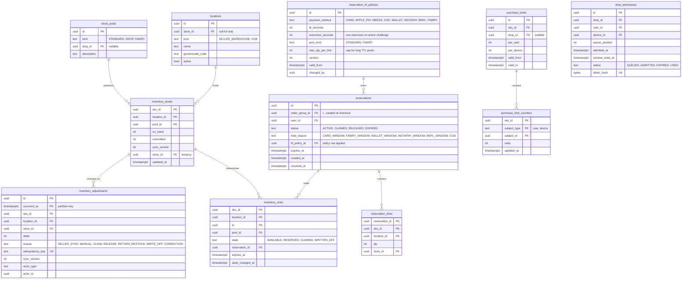

# Module: inventory

Phase 1 (row-per-unit pool, reservations, seller stock sync) and Phase 2 (drop admission, Fawry pool, hub stock) · Spec refs: §20.2, §7, §16, §6, ADR-0005 · Owner aggregates: `StockLevel`, `Reservation`, `StockUnit`, `StockPool`

## Flow
Seller stock arrives through versioned adjustments and sets `inventory_levels.on_hand`. A background replenisher materialises up to 1,000 `inventory_units` rows per `(sku, location, pool)` from the free count. Checkout reserves units in one transaction with `FOR UPDATE SKIP LOCKED`, SKUs locked in sorted order, TTL from `reservation_ttl_policies` by payment method (ADR-0011: 10 min card and COD, 15 min BNPL, 30 min wallet and InstaPay, 24 h Fawry on the non-drop pool). Payment success claims the units and writes outbox and ledger rows in the same transaction. A sweeper releases expired reservations every 30 s. Redis holds only a "definitely sold out" pre-filter.

## Rules
- One reservation per OrderGroup (§7). A multi-SKU reserve is all-or-nothing and reports the shortfall.
- Pool cap: `min(on_hand_free, 1000)` rows per `(sku_id, location_id, pool_id)`.
- Drop SKUs are excluded from the Fawry pool. Fawry (24 h) and wallet redirects (30 min) hold stock in the separate `FAWRY` pool (§7, I-61).
- Max 10 units per SKU per user in the bag, drop SKUs have their own per-user and per-device limit (`purchase_limits`).
- A negative seller adjustment while units are reserved: orders are honoured, a penalty event is emitted to sellers health (§20.2).
- Real-stock display ("2 left in M") only at 5 or fewer, computed from `on_hand - committed`, never from the pool.
- Row ids are the only identity of a unit. The composite PK `(sku_id, location_id, id)` exists to partition locks, and all joins must carry all three columns (I-21).

## Edge cases
- Payment succeeded but reservation expired: auto-claim if stock exists, else automatic refund and apology voucher. Alert if rate exceeds 0.1% (§7).
- Stock sync arrives out of order: version guard on `inventory_levels.sync_version`.
- Return received and approved for restock: a new `available` unit is created, increasing `on_hand` through an adjustment with reason `RETURN_RESTOCK`.
- Unit in `claimed` is lost or damaged at inspection: state `WRITTEN_OFF` (I-22).
- Hub consolidation (Phase 2): hub locations hold stock for Fulfilled-by-HAUL, same tables with `location.kind = HUB`.

## ER diagram

## Entities

| Entity | Ph | PK | FK (E enforced, L logical) | Indexes and uniqueness | PII | Tenancy | Partition | Retention |
|---|---|---|---|---|---|---|---|---|
| `locations` | P1 | `id` | `store_id` E | index `(store_id)` | P1 (warehouse address is business data) | `store_id` | none | store lifetime |
| `stock_pools` | P1 | `id` | `drop_id` L (catalog) | unique `(kind) WHERE kind <> 'DROP'`; unique `(drop_id)` | P0 | none | none | RET-CONFIG |
| `inventory_levels` | P1 | `(sku_id, location_id, pool_id)` | `sku_id` L (catalog, hot path avoids FK check), `location_id` E, `pool_id` E | check `on_hand >= 0`, `committed >= 0`, `committed <= on_hand` | P0 | `store_id` | none | life of SKU |
| `inventory_units` | P1 | `(sku_id, location_id, id)` | `reservation_id` E, `pool_id` E | partial index `(sku_id, location_id, pool_id, id) WHERE state = 'AVAILABLE'` for the pick query; partial index `(expires_at) WHERE state = 'RESERVED'` for the sweeper | P1 | `store_id` via level | hash on `sku_id` (16 partitions, proposed) | claimed and written-off rows 13 months after `state_changed_at` (proposed), order line keeps the truth |
| `reservation_ttl_policies` | P1 | `id` | `changed_by` L | unique `(payment_method, version)` | P0 | none | none | RET-CONFIG, versions kept (a reservation cites the policy it ran under) |
| `reservations` | P1 | `id` | `order_group_id` L, `user_id` E | unique `(order_group_id)`; partial index `(expires_at) WHERE status = 'ACTIVE'` | P2 (user id) | `user_id` | none | 90 d after resolution (proposed) |
| `reservation_lines` | P1 | `(reservation_id, sku_id, location_id)` | `reservation_id` E | none | P2 via parent | `user_id` via parent | none | with parent |
| `inventory_adjustments` | P1 | `(id, occurred_at)` | `sku_id`, `location_id` E | unique `(idempotency_key)` includes `occurred_at` via global unique index (not partitioned-unique, uses a dedupe table, see notes) | P1 | `store_id` | monthly by `occurred_at` | RET-TAX 7 y (stock movements support tax and dispute evidence, proposed) |
| `purchase_limits` | P2 | `id` | `sku_id` E, `drop_id` L | index `(sku_id, valid_from)` | P0 | `store_id` via sku | none | RET-CONFIG |
| `purchase_limit_counters` | P2 | `(sku_id, subject_type, subject_id)` | none | none | P2 (device and user ids) | `user_id` when subject is user | none | 30 d after `valid_to` (proposed) |
| `drop_admissions` | P2 | `id` | `drop_id` L, `user_id` E, `device_id` E | unique `(token_hash)`; unique `(drop_id, user_id)` | P2 | `user_id` | none | 30 d after drop end (proposed) |

## Data notes
- Spec sets the unit PK to `(sku_id, location_id, id)` but the reserve SQL updates `WHERE u.id = picked.id`. The update must also match `sku_id` and `location_id`, or use a globally unique `id` (uuidv7). Decision: ids are globally unique uuids and the composite PK is kept to allow hash partitioning on `sku_id` (I-21).
- `inventory_levels` holds `on_hand` (all physical units) and `committed` (claimed). Free count = `on_hand - committed - reserved`. The pool is a materialised cache of the free count capped at 1,000 and is the sole object of `SKIP LOCKED`, so `on_hand` and unit counts legitimately differ (I-21).
- `inventory_adjustments.idempotency_key` uniqueness crosses partitions. Partitioned tables cannot enforce that natively, so a small unpartitioned `inventory_adjustment_keys(idempotency_key PK, adjustment_id)` table is written in the same transaction. Same pattern as I-37 for any partitioned table with a global uniqueness rule.
- `location_id` appears in the spec with no entity (I-21). `locations` fixes that.
- Reservation state is stored on the unit rows (source of truth for stock) and mirrored in `reservations` (source of truth for TTL and ownership).
- Redis never stores truth: the sold-out flag is rebuilt from `inventory_levels` and the waiting-room queue persists admission only after `ADMITTED` in `drop_admissions`.

## API
| Endpoint | Scope | Idempotent | Rate limit |
|---|---|---|---|
| internal `Reserve(order_group_id, lines)` | checkout saga | yes (keyed by order group) | n/a |
| internal `Claim`, `Release` | checkout saga, sweeper | yes | n/a |
| `PUT /v1/seller/inventory/{sku_id}` | seller warehouse role | yes, versioned | 60/min |
| `POST /v1/seller/inventory/bulk` | seller warehouse role | yes | 10/min |
| `POST /v1/drops/{id}/admission` | user, App Attest | yes | per device |

## Events
Outbox: `inventory.reserved`, `inventory.claimed`, `inventory.released`, `inventory.stock_changed`, `inventory.oversold` (seller penalty), `drop.sold_out`. Analytics: `drop_joined_queue`, `drop_admitted`.

## Failure handling
Reserve fails closed with a typed shortfall. Statement timeout 2 s on the reserve path. Sweeper uses `FOR UPDATE SKIP LOCKED` batches of 500. A crash mid-claim rolls back everything because claim, outbox and ledger share one transaction. Replenisher runs under `pg_advisory_xact_lock(hash(sku))` for hot SKUs.

## Security and abuse
- Stock sync is idempotent and authenticated per store. A foreign `sku_id` returns 404.
- Per-user and per-device purchase limits, App Attest required for drop admission (API6).
- Seller-visible stock counts are their own only. No other store's levels are exposed.

## Metrics
Oversell count (must be 0), reservation expiry rate, reserve p95 latency, pool starvation events, claim-after-expiry rate below 0.1%, sweeper lag.

## Acceptance
- 10,000 concurrent reserves on 100 units produce exactly 100 claimed, 0 oversold, no deadlocks across 1,000 runs (§20.2).
- k6 with 50k virtual users on a 500-unit drop gives at most 500 claimed units (§16).
- Killing the API mid-saga leaves reservations either claimed with a ledger entry or released, never half applied.
