# Module: ledger

Phase 0 (core, already migrated in `0003_ledger.sql`) and Phase 1 (holds, projections, integrity, reconciliation) · Spec refs: §T4, §15.2, §A2.4, §A2.5, §B2, §B4 · Owner aggregates: `LedgerAccount`, `JournalEntry`, `Posting`, `LedgerHold`, `ReconciliationRun`

## Flow
Every money movement is one `journal_entries` row plus at least two `postings` rows written in a single transaction by a use case in another module (payments, refunds, payouts, store-credit, gift-cards, subscriptions). The caller supplies a permanent `idempotency_key`. A deferred constraint trigger checks at COMMIT that postings sum to zero per currency. Balances are never stored as truth: `balance_projections` is a cache refreshed from postings and compared with them nightly. Reservations of value that are not yet money movement (store credit and gift card held during checkout) are `ledger_holds`, not pending postings, so that postings stay immutable.

## Rules
- Sign convention: positive amount is a debit, negative is a credit. Amounts are `BIGINT` minor units, never zero, and every row carries `currency` (§A2.4).
- Postings and journal entries are immutable (UPDATE, DELETE and TRUNCATE rejected). A correction is a reversing entry with `reverses_entry_id`, at most one per entry.
- A posting's currency must equal its account's currency (composite FK `(account_id, currency)`).
- `journal_entries.idempotency_key` is permanently unique. The 24 h `idempotency_keys` table is not enough for money (platform module).
- Postings may be added only in the transaction that created the entry (`txid` check).
- Account identity is `(type, owner_type, owner_id, sub_key, currency)`. Only `closed_at` may change. Platform accounts have `owner_id = ''`.
- Chart of accounts: §T4 lists `psp_clearing:{psp}`, `cod_clearing:{courier}`, `seller_payable:{store}`, `platform_commission`, `platform_vat_output`, `shipping_revenue`, `promo_expense_platform`, `promo_receivable_seller`, `store_credit:{user}:{sub}`, `gift_card_liability`, `refund_reserve`, `bnpl_clearing:{provider}`, `plus_revenue`, `deferred_plus_revenue`. `docs/specs/ledger-chart-of-accounts.md` (code: `packages/domain/src/chart-of-accounts`) adds `bank_settlement:{account}`, `provider_fee_expense` and `courier_fee_expense`, parameterises `promo_receivable_seller:{store}`, and keeps `refund_reserve` reserved and unused. The code `ACCOUNT_TYPES` table is the source of truth. `ledger_account_types` is its generated seed mirror, so that an unknown type cannot be created by a typo (I-08). It exists as migration `0011_ledger_account_types.sql`, generated by `tooling/db/generate-account-types-migration.mjs` (`--check` fails on drift) and guarded by `packages/db/src/ledger-account-types.test.ts`. `ledger_accounts.type` has a validated foreign key to it. Owner kinds are mapped between domain (`seller`, `shopper`) and persistence (`store`, `user`) only by `packages/db/src/ledger-owner.ts` (ADR-0018). The FK constrains the type name only: it does not yet check that an account's `owner_type` equals the type's `owner_type`; that is a possible follow-up composite FK.
- VAT on commission is computed once, by the single rounding point `divideRoundHalfEven` (§A2.4). The spec's worked example shows `32.2` piastres, which is not a legal amount; the example only balances because 32.2 + 37.8 = 70 (I-09).
- A COD order is not money until delivery: `order_recognised` is posted at delivery against `cod_clearing:{courier}` and nothing is posted at placement (ledger-chart-of-accounts R3 and example 2). Prepaid orders are recognised when payment is captured.
- A hold is `HELD` until captured (a journal entry is posted and `captured_entry_id` is set) or released. A hold that is neither captured nor released by `expires_at` is released by the sweeper and emits `inventory`-style compensations through the checkout saga.
- The integrity job is the only writer of `ledger_chain_links`. It runs after commit so ledger writers are never serialised on a single hash head.

## Edge cases
- Entry with two currencies: allowed only if each currency balances on its own (money-and-ledger spec).
- Concurrent reversal of the same entry: the second insert fails on `journal_entries_reverses_uq`.
- Refund after payout: `seller_payable:{store}` goes negative. This is valid state, netted by the next payout (§22 Payout interplay).
- Account for a deleted user: the account row stays (RET-TAX), `owner_id` is re-pointed to a tombstone id by the privacy erasure job. Postings never change.
- Store credit expiry is a normal entry (`store_credit_expired`, supported for the three promotional sub-balances). Gift-card breakage is deliberately not built in the domain and needs a VERIFY BEFORE LAUNCH decision, so a gift card never expires silently in the ledger (I-11).
- Clock skew: `occurred_at` is business time supplied by the caller, `created_at` is database time. Reports use `occurred_at`.

## ER diagram

```mermaid
erDiagram
    ledger_account_types {
        text code PK "seller_payable, psp_clearing ..."
        text category "asset, liability, revenue, expense"
        text normal_side "debit, credit"
        text owner_type "platform, store, user, psp, courier, bnpl_provider, bank"
        bool in_spec_t4
        text status "active, reserved"
        timestamptz created_at
    }
    ledger_accounts {
        uuid id PK
        text type FK "ledger_account_types.code"
        text owner_type
        text owner_id "empty for platform"
        text sub_key
        char currency
        timestamptz created_at
        timestamptz closed_at
    }
    journal_entries {
        uuid id PK
        text kind
        text idempotency_key UK
        timestamptz occurred_at
        text ref_type
        text ref_id
        uuid reverses_entry_id FK "UK, nullable"
        xid8 txid
        timestamptz created_at
    }
    postings {
        bigint id PK
        uuid entry_id FK
        uuid account_id FK
        bigint amount "signed, never zero"
        char currency
    }
    ledger_holds {
        uuid id PK
        uuid account_id FK "store_credit or gift_card sub account"
        bigint amount
        char currency
        text ref_type "order_group"
        text ref_id
        text status "HELD, CAPTURED, RELEASED, EXPIRED"
        uuid captured_entry_id FK "nullable"
        text idempotency_key UK
        timestamptz expires_at
        timestamptz created_at
        timestamptz settled_at
    }
    balance_projections {
        uuid account_id PK
        char currency PK
        bigint balance_amount "signed"
        bigint held_amount
        bigint last_posting_id
        timestamptz refreshed_at
    }
    balance_drift_reports {
        uuid id PK
        timestamptz run_at
        uuid account_id FK
        bigint projection_amount
        bigint postings_amount
        text status "OPEN, REPAIRED, ACCEPTED"
    }
    ledger_chain_links {
        uuid entry_id PK
        text chain_id "one chain per UTC day"
        bigint seq
        bytea prev_hash
        bytea hash
    }
    ledger_snapshots {
        uuid id PK
        date snapshot_date UK
        jsonb trial_balance "per currency totals"
        bytea chain_head_hash
        bytea signature
        timestamptz signed_at
    }
    reconciliation_runs {
        uuid id PK
        text source "PSP_SETTLEMENT, COD_REMITTANCE, BNPL_SETTLEMENT, ETA_SUBMISSION, STORE_CREDIT_PROJECTION"
        text counterparty "psp or courier or provider code"
        date business_date
        text mode "NIGHTLY, INTRADAY"
        text status "RUNNING, COMPLETED, FAILED"
        int matched_count
        int unmatched_count
        timestamptz started_at
        timestamptz finished_at
    }
    reconciliation_items {
        uuid id PK
        uuid run_id FK
        text source_ref_type "settlement_line, cod_remittance_line, tax_document"
        uuid source_ref_id
        uuid entry_id FK "nullable, matched ledger entry"
        bigint expected_amount
        bigint actual_amount
        char currency
        text status "MATCHED, UNMATCHED, AMOUNT_MISMATCH, MISSING_LEDGER, MISSING_SOURCE, RESOLVED"
        text ticket_ref
        timestamptz first_seen_at
        timestamptz resolved_at
    }
    ledger_account_types ||--o{ ledger_accounts : classifies
    ledger_accounts ||--o{ postings : receives
    journal_entries ||--|{ postings : balances
    journal_entries ||--o| journal_entries : reversed_by
    ledger_accounts ||--o{ ledger_holds : reserves
    journal_entries ||--o| ledger_holds : captures
    ledger_accounts ||--o| balance_projections : cached_as
    ledger_accounts ||--o{ balance_drift_reports : audited_by
    journal_entries ||--o| ledger_chain_links : chained_as
    reconciliation_runs ||--o{ reconciliation_items : contains
    journal_entries ||--o{ reconciliation_items : matched_to
```

## Entities

| Entity | Ph | PK | FK (E enforced, L logical) | Indexes and uniqueness | PII | Tenancy | Partition | Retention |
|---|---|---|---|---|---|---|---|---|
| `ledger_account_types` | P0 | `code` | none | none | P1 | none | none | RET-CONFIG |
| `ledger_accounts` | P0 | `id` | `type` E | unique `(type, owner_type, owner_id, sub_key, currency)`; unique `(id, currency)` for the posting FK; index `(owner_type, owner_id)` | P1 (an `owner_id` holding a user id makes the row personal data, pseudonymized on erasure) | owner (`store` rows are visible to that store's finance role only through views) | none | RET-TAX |
| `journal_entries` | P0 | `id` | `reverses_entry_id` E self | unique `(idempotency_key)`; unique `(reverses_entry_id)`; index `(ref_type, ref_id)`; index `(occurred_at)` | P1 | none, no direct app read, finance views per store | monthly by `occurred_at` (proposed, needs a global unique on `idempotency_key` kept in an unpartitioned table, same pattern as I-37) | RET-TAX |
| `postings` | P0 | `id` | `entry_id` E, `(account_id, currency)` E | index `(entry_id)`; index `(account_id, currency)`; deferred trigger sum per entry and currency is 0 | P1 | none | monthly by entry `occurred_at` (proposed, with the entry table) | RET-TAX |
| `ledger_holds` | P1 | `id` | `account_id` E, `captured_entry_id` E | unique `(idempotency_key)`; partial index `(expires_at) WHERE status = 'HELD'`; index `(ref_type, ref_id)` | P1 | none | none | 90 d after `settled_at` (proposed), financial effect lives in the captured entry |
| `balance_projections` | P1 | `(account_id, currency)` | `account_id` E | none | P1 | none | none | rebuilt from postings, no retention of its own |
| `balance_drift_reports` | P1 | `id` | `account_id` E | index `(status, run_at)` | P1 | none | none | 13 months (proposed) |
| `ledger_chain_links` | P0 | `entry_id` | `entry_id` E | unique `(chain_id, seq)` | P1 | none | monthly by chain day (proposed) | RET-TAX |
| `ledger_snapshots` | P0 | `id` | none | unique `(snapshot_date)` | P1 | none | none | RET-TAX, WORM copy |
| `reconciliation_runs` | P1 | `id` | none | unique `(source, counterparty, business_date, mode)` | P1 | none | none | RET-TAX |
| `reconciliation_items` | P1 | `id` | `run_id` E, `entry_id` E, `source_ref_id` L | index `(status, first_seen_at)` for the 3-day aging alert; index `(run_id)` | P1 | none | none | RET-TAX |

## Data notes
- Migration `0003_ledger.sql` already contains `ledger_accounts`, `journal_entries` and `postings`. It deviates from the spec by adding `postings.id`, `journal_entries.txid`, `reverses_entry_id`, `ledger_accounts.sub_key` and `closed_at`. These are improvements, not conflicts, and this document follows the migration. Ledger ids default to `gen_random_uuid()` (v4), whereas the convention elsewhere is uuidv7. Not a correctness problem, but index locality is worse (I-10).
- `owner_id` is `text` here and `uuid` elsewhere. It holds uuid strings for stores and users and provider codes for PSP, courier and BNPL. `journal_entries.ref_id` is `text` for the same reason (I-10).
- Journal entry `kind` values are those emitted by the domain builders: `order_recognised`, `refund_issued`, `clearing_settled`, `seller_payout`, `seller_promo_netted`, `gift_card_sold`, `gift_card_redeemed`, `store_credit_granted`, `store_credit_expired`, `plus_charged`, `plus_revenue_recognised`, `reversal`. The spec itself defines none (I-13). `ref_type` values follow the owning aggregate (`seller_order`, `refund`, `payout`, `gift_card`, `subscription_invoice`, `credit_grant`, `settlement_file`).
- Still missing from the chart after the domain spec: a coin liability or promo-expense account for coins (rewards), gift-card breakage or expiry income, chargeback clearing, and VAT on seller supplies. Coins, chargebacks and breakage cannot be posted until Finance decides (I-11, VERIFY BEFORE LAUNCH tax treatment).
- `ledger_holds` replaces the spec's "a ledger hold (pending entries)" (§7 saga step 3). Pending postings would break immutability and the zero-sum trigger. A hold reduces the spendable balance (`balance_amount - held_amount`) but is not a movement (I-12).
- §T4 requires a "verified hash chain on journal entries" but the spec and migration 0003 give journal entries no hash column. `ledger_chain_links` supplies it outside the write path (I-74).
- Reconciliation inputs live in their owner modules: PSP and BNPL settlement files in payments, COD remittances in fulfillment, ETA submissions in tax-eta. Items point at them by logical id.

## API
No public API. Internal port `LedgerPort`: `post(entry)`, `reverse(entryId, key)`, `hold`, `captureHold`, `releaseHold`, `balance(account)`. Admin read model: `GET /v1/admin/ledger/trial-balance`, `GET /v1/admin/reconciliation/runs`, `POST /v1/admin/reconciliation/items/{id}/resolve` (dual approval above threshold, audited).

## Events
Outbox: `ledger.entry_posted` (kind, ref, no amounts per account beyond what consumers need), `ledger.hold_released`, `ledger.drift_detected`, `reconciliation.item_unmatched`. Analytics: none (finance data is never an analytics event).

## Failure handling
- A failing balance trigger aborts the caller's transaction. No partial entry exists.
- Projection drift: the nightly job recomputes from postings, writes `balance_drift_reports`, repairs the projection and alerts. Postings are never repaired.
- Chain verification failure: page Security and Finance, freeze payouts through a kill switch.
- Reconciliation item aging above 3 days escalates to Finance (§T4). Intraday runs during mega events use the same tables with `mode = INTRADAY`.

## Security and abuse
- ASVS Level 3 scope. The application role has INSERT and SELECT only on `journal_entries`, `postings` and `ledger_chain_links`. UPDATE, DELETE and TRUNCATE are not granted and are also blocked by triggers.
- No endpoint accepts account ids from clients. Seller and finance views are filtered by `store_id` through the owning module.
- Manual adjustments (`ADJUSTMENT`) need dual approval and an audit row with a reason code.
- Gift-card and credit redemption abuse is controlled in their modules. The ledger only enforces that a spend cannot exceed `balance_amount - held_amount` for accounts with `allows_negative = false`.

## Metrics
Trial balance equals zero (hard invariant, must be 0 failures), projection drift count, unmatched reconciliation lines by age, hold expiry rate, entry write p95, chain verification lag.

## Acceptance
- A cart across three stores yields entries that balance to zero per currency, with three seller payables, platform commission and VAT (§7).
- Posting an entry whose postings sum to 1 is rejected at COMMIT.
- Reversing an entry yields zero net per account and a second reversal is rejected.
- Capturing a hold twice posts one entry (idempotency key).
- Dropping a row from `postings` in a test database makes the chain verification and the trial balance job fail.
