# Module: notifications

Phase 1 (transactional, push, in-app inbox, WhatsApp templates, preferences) and Phase 2 (journeys, send-time optimization, price-drop and payday triggers) · Spec refs: §24, §B1 (consent per channel), §1 (OTP channels), §A2.15 (Arabic first), §23 (WhatsApp inbox) · Owner aggregates: `NotificationTemplate`, `NotificationPreference`, `NotificationMessage`, `Journey`

## Flow
A module emits a domain event or calls the notification port with a `trigger`, a recipient and a payload. The module resolves the template (versioned, Arabic first with EN fallback), the channel, the preference and consent, applies frequency caps and quiet hours (Africa/Cairo, 23:00 to 09:00, transactional exempt), writes a `notification_messages` row and a send job, calls the provider (Expo push, WhatsApp BSP, SMS, email), and records delivery receipts. Journeys (welcome, first purchase, win-back, trial conversion) enrol users and schedule steps.

## Rules
- **Marketing requires consent per channel** (`marketing_push`, `marketing_whatsapp`, `marketing_email`, and SMS under the added `marketing_sms` purpose, privacy I-06). Transactional messages do not need marketing consent.
- Frequency caps: marketing at most 1 push per day and 3 per week. Bag reminder once. Caps are config rows.
- Quiet hours 23:00 to 09:00 Africa/Cairo for marketing. Transactional (order lifecycle, OTP, refunds) exempt.
- Triggers: followed-store drops, verified price drops, back in size, payday budget reset (message must not contain budget amounts in the payload to providers), stylist, waitlist turn, order lifecycle, refunds, coins expiring, monthly budget report, Plus renewal with savings.
- Every message exists in Arabic. A missing AR template key blocks the template from activation (CI and DB check).
- WhatsApp templates are provider-approved. A rejection falls back to SMS for transactional only (§24).
- Marketing content may not use fake urgency or stock (copy lint, §A2.13).
- Provider failover per channel, with the order configured in `channel_providers`.
- Push tokens live on `devices` (auth). The notification module reads the token reference at send time and never copies it.
- Budget-derived triggers (payday, affordability) use only the boolean or symbolic outcome when talking to providers and never include amounts in third-party payloads unless the user opted in (decision, I-60).
- Unsubscribe is one tap and immediate. It writes a consent record (privacy) and a suppression row.

## Edge cases
- Device token invalid: provider feedback deactivates the token, the message falls back to the in-app inbox.
- User without consent for any marketing channel: only inbox and transactional.
- Duplicate trigger event: unique `(trigger, subject_key)` makes it a no-op.
- Template changed while messages are queued: queued messages keep their template version.
- Quiet hours with delayed delivery beyond relevance (flash drop): dropped, not delayed, with a metric.
- Provider outage across all channels: transactional retried with backoff up to the message TTL, then logged as failed.
- Recipient deleted: queued messages cancelled, log pseudonymized.

## ER diagram

```mermaid
erDiagram
    notification_templates {
        uuid id PK
        text key "order_shipped, plus_renewal ..."
        int version
        text channel "PUSH, WHATSAPP, SMS, EMAIL, IN_APP"
        text category "TRANSACTIONAL, MARKETING, SECURITY"
        text subject_ar
        text subject_en
        text body_ar
        text body_en
        text provider_template_id "WhatsApp approved id, nullable"
        text approval_status "DRAFT, SUBMITTED, APPROVED, REJECTED"
        bool active
        timestamptz valid_from
    }
    notification_preferences {
        uuid user_id PK
        text category PK "ORDER_UPDATES, PRICE_DROPS, BACK_IN_SIZE, STYLIST, BUDGET, PROMOTIONS, REWARDS, PLUS"
        text channel PK
        bool enabled
        timestamptz updated_at
    }
    notification_suppressions {
        uuid id PK
        text subject_type "USER, ADDRESS_HASH"
        text subject_key
        text channel
        text reason "UNSUBSCRIBED, BOUNCE, COMPLAINT, INVALID_TOKEN"
        timestamptz created_at
    }
    notification_requests {
        uuid id PK
        text trigger_key
        text subject_key "idempotency scope, order id etc"
        uuid user_id FK
        jsonb payload "no P3, validated by template schema"
        text status "ACCEPTED, SUPPRESSED, SCHEDULED, SENT, FAILED, CANCELLED"
        text suppressed_reason "NO_CONSENT, FREQUENCY_CAP, QUIET_HOURS, PREFERENCE, SUPPRESSION_LIST"
        timestamptz created_at
    }
    notification_log {
        uuid id PK
        timestamptz sent_at PK "partition key"
        uuid request_id FK
        uuid user_id FK
        text channel
        text template_key
        int template_version
        text category
        text provider_code
        text provider_ref
        text status "QUEUED, SENT, DELIVERED, READ, FAILED, BOUNCED"
        text failure_code
        timestamptz delivered_at
    }
    inbox_messages {
        uuid id PK
        uuid user_id FK
        uuid request_id FK
        text title_ar
        text title_en
        text body_ar
        text body_en
        text deep_link
        timestamptz read_at
        timestamptz expires_at
    }
    frequency_counters {
        uuid user_id PK
        text channel PK
        date day PK
        int marketing_count
        int week_count
    }
    journeys {
        uuid id PK
        text code "WELCOME, FIRST_PURCHASE, WIN_BACK, TRIAL_CONVERSION"
        int version
        jsonb steps "delay, template, exit conditions"
        bool active
    }
    journey_enrollments {
        uuid id PK
        uuid journey_id FK
        uuid user_id FK
        int current_step
        text status "ACTIVE, COMPLETED, EXITED"
        timestamptz next_step_at
        timestamptz enrolled_at
    }
    channel_providers {
        text channel PK
        text provider_code PK
        int priority
        bool enabled
        text webhook_secret_ref
    }
    send_time_windows {
        uuid user_id PK
        smallint best_hour_cairo
        numeric confidence
        timestamptz computed_at
    }
    notification_templates ||--o{ notification_log : rendered_as
    notification_requests ||--o{ notification_log : delivered_by
    notification_requests ||--o| inbox_messages : mirrored_in
    journeys ||--o{ journey_enrollments : enrols
```

## Entities

| Entity | Ph | PK | FK (E enforced, L logical) | Indexes and uniqueness | PII | Tenancy | Partition | Retention |
|---|---|---|---|---|---|---|---|---|
| `notification_templates` | P1 | `id` | none | unique `(key, version, channel)`; partial unique `(key, channel) WHERE active` | P0 | none | none | RET-CONFIG, versions kept |
| `notification_preferences` | P1 | `(user_id, category, channel)` | `user_id` E | none | P2 | `user_id` | none | RET-USER |
| `notification_suppressions` | P1 | `id` | none | unique `(subject_type, subject_key, channel)` | P2 (hashed address) | none | none | until unsuppressed or 24 months (proposed) |
| `notification_requests` | P1 | `id` | `user_id` E | unique `(trigger_key, subject_key, user_id)`; index `(status, created_at)` | P2 (payload may contain order refs and names) | `user_id` | monthly by `created_at` (proposed) | `notification_log` 12 months (proposed) |
| `notification_log` | P1 | `(id, sent_at)` | `request_id` L, `user_id` E | index `(user_id, sent_at DESC)`; index `(provider_code, provider_ref)` | P2 | `user_id` | monthly by `sent_at` (spec: partitioned) | 12 months (proposed) |
| `inbox_messages` | P1 | `id` | `user_id` E, `request_id` E | index `(user_id, created_at DESC)` | P2 | `user_id` | none | 90 d after read or expiry (proposed) |
| `frequency_counters` | P1 | `(user_id, channel, day)` | `user_id` E | none | P2 | `user_id` | none | 14 d |
| `journeys` | P1 | `id` | none | unique `(code, version)` | P0 | none | none | RET-CONFIG |
| `journey_enrollments` | P1 | `id` | `journey_id` E, `user_id` E | unique `(journey_id, user_id)`; index `(status, next_step_at)` | P2 | `user_id` | none | RET-USER |
| `channel_providers` | P1 | `(channel, provider_code)` | none | none | P1 | none | none | RET-CONFIG |
| `send_time_windows` | P1 | `user_id` | `user_id` E | none | P2 | `user_id` | none | RET-PERSONALIZATION, purged with personalization data |

## Data notes
- Spec data (§24): `notification_templates(versioned, AR/EN)`, `notification_log(partitioned)`, `preferences`. `preferences` becomes `notification_preferences` and the data inventory name is `notification_preferences`.
- Consent lives in privacy (`consents_current`). Preferences are the user's per-type choices inside a consented channel. A message is sent only if both pass. They are two different tables on purpose (I-66 covers the overlap between them).
- Push tokens are on `devices.push_token` (spec §1 Data). The token is P2 and is rotated by the provider. No copy exists here.
- `notification_requests.payload` is validated by the template's payload schema and must contain no P3. Templates carry placeholders, not raw values, for sensitive fields.
- WhatsApp inbox threads (support) are in admin, not here. This module sends outbound template messages only.
- OTP delivery is owned by auth (`otp_challenges`), which calls the SMS and WhatsApp providers through this module's provider port for failover (spec §1).

## API
| Endpoint | Scope | Idempotent | Rate limit |
|---|---|---|---|
| `GET /v1/me/notifications/preferences`, `PATCH` | user | yes | 30/min |
| `GET /v1/me/inbox`, `POST /v1/me/inbox/{id}/read` | user | yes | 60/min |
| `POST /v1/webhooks/notifications/{provider}` | allow-list, HMAC | dedup | provider-based |
| `CRUD /v1/admin/notification-templates` | marketing role, translation check | yes | 30/min |
| `GET /v1/unsubscribe/{token}` | signed token | yes | edge |

## Events
Outbox: `notification.sent`, `notification.failed`, `notification.suppressed`. Consumes order, return, refund, drop, price, coins and budget events. Analytics: none beyond opt-in and click metrics from the app.

## Failure handling
Provider failover by priority, retry with exponential backoff and jitter within the message TTL, DLQ for poison messages. WhatsApp template rejection falls back to SMS for transactional only. Suppressed or capped messages are recorded, not retried.

## Security and abuse
- Spam control: marketing needs consent, caps and quiet hours enforced server side, not in the client.
- SMS pumping: OTP volume is protected in auth. Notification SMS has per-prefix budget caps.
- Template injection: payload values are escaped, templates are not user-editable by sellers.
- BOLA: inbox rows readable by the owner only.
- Webhooks from providers are signature verified.

## Metrics
Opt-in rate, CTR, unsubscribe rate (guardrail), delivery rate by channel and provider, suppression reasons, quiet-hours drops, cost per message, time to deliver transactional p95.

## Acceptance
- A marketing push to a user without `marketing_push` consent is never sent.
- No more than 1 marketing push per day and 3 per week are delivered.
- A marketing message scheduled at 23:30 Cairo is deferred to 09:00 while an order shipped message is sent immediately.
- A template without an Arabic body cannot be activated.
