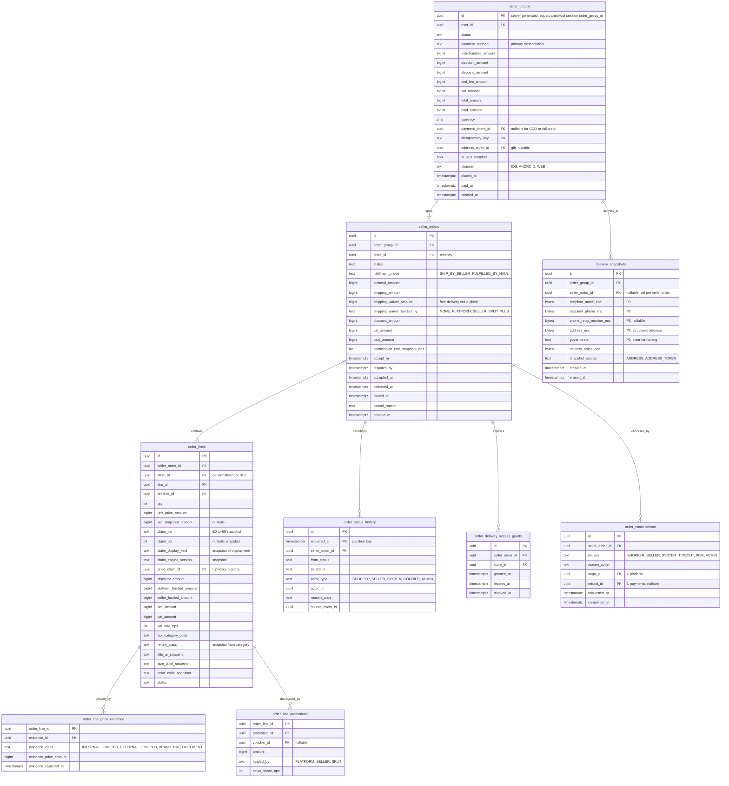

# Module: orders

Phase 1 · Spec refs: §7 (domain model), §20.1, §19 (seller order states and SLAs), §B1 (seller data access), §B5, §9.3 (snapshots) · Owner aggregates: `OrderGroup`, `SellerOrder`, `OrderLine`, `DeliverySnapshot`

## Flow
When the checkout saga commits, orders writes one `order_groups` row, one `seller_orders` row per store and one `order_lines` row per SKU, copying prices, VRP snapshot, evidence trail, discount allocation and VAT from the checkout session. A `delivery_snapshots` row freezes the recipient and address as they were, encrypted. Seller order states move along the main path `PENDING_PAYMENT -> PAID | CONFIRMED_COD -> ACCEPTED -> PACKED -> SHIPPED -> OUT_FOR_DELIVERY -> DELIVERED -> CLOSED`. Every transition appends `order_status_history`. Orders reacts to fulfillment, returns and payments events, never the other way round.

## Rules
- The aggregate is `OrderGroup (one payment intent) -> SellerOrder -> OrderLine`. Shipments belong to fulfillment and reference seller orders. Returns reference order lines.
- Seller order states (§20.1): main path above; returns `RETURN_REQUESTED -> RETURN_PICKUP_SCHEDULED -> RETURN_IN_TRANSIT -> RETURN_RECEIVED -> RETURN_INSPECTED -> REFUNDED | RETURN_REJECTED`; exceptions `CANCELLED`, `REJECTED_BY_SELLER`, `DELIVERY_FAILED -> RTO -> RETURNED_TO_SELLER`, `DISPUTED`. Seller-facing states from §19: `PAID -> ACCEPTED -> PACKED -> SHIPPED`, or `PAID -> REJECTED_BY_SELLER`. An invalid transition throws a typed error (§A2.6). The return sub-states are mirrored from the returns module, not owned twice (I-26).
- `OrderGroup` status (the spec lists OrderGroup in the A2.6 state machine list but defines no states, I-75): `PENDING_PAYMENT`, `PAID`, `CONFIRMED_COD`, `PARTIALLY_FULFILLED`, `COMPLETED`, `CANCELLED`, `FAILED`. It is derived from its seller orders after payment and never edited by hand.
- SLA timestamps are computed at `PAID`: `accept_by = paid_at + 24 h`, `dispatch_by = accepted_at + 48 h`. Both are store settings (sellers module) frozen onto the row. Missing `accept_by` auto-cancels, refunds and applies a health penalty (§19).
- All windows count from courier-confirmed `delivered_at`, never from the order date (§B5). `closed_at` is `delivered_at + return window`, the point at which payout accrual becomes eligible (+3 days, payouts).
- Cancellation is free before `SHIPPED`. After it, the case becomes refusal or return. The 7-day distance-selling right is honoured as a free return (VERIFY BEFORE LAUNCH, §20.1).
- Money columns on lines: `unit_price_amount` (VAT inclusive), `discount_amount` (item level), `voucher_alloc_amount`, `platform_funded_amount`, `seller_funded_amount`, `net_amount`, `vat_amount`, `gross_amount`. Allocation uses largest remainder (money-and-ledger spec) so line parts sum exactly to the order total.
- The funding of a free-delivery waiver is stored per seller order now (`shipping_waiver_amount`, `shipping_waiver_funded_by`) so the ledger does not need a later migration (ADR-0010, I-84). Who funds it is a Finance decision, safe default seller only where the seller opted in.
- `commission_rate_snapshot_bps` is frozen per seller order. Later contract changes never rewrite history.
- Every line stores `vrp_snapshot_amount`, the claim tier, percentage, display kind and engine version, and `price_claim_id` plus `order_line_price_evidence` rows, the evidence trail for Consumer Protection Agency enquiries (§9.3, I-18).
- Seller staff see delivery details only through `seller_delivery_access_grants`, which end 30 days after delivery or return closure (§B1). The relay number replaces the phone where the courier supports it.
- Gift orders reference `address_token_id` and store a delivery snapshot the buyer can never read (§8).

## Edge cases
- Partial seller acceptance: a rejected line yields a partial refund, never a new charge (§7).
- Courier refusal of one seller order does not cancel its siblings in the group (§20.7).
- Seller suspended after order placement: `PAID` orders are honoured or cancelled and refunded by the cancellation saga, not silently dropped.
- Duplicate `POST /v1/checkout`: same `idempotency_key` returns the existing group.
- Price delta at commit not confirmed: no order exists, only a failed session.
- Return after `CLOSED`: refused by the window rule except defects within 30 days from delivery, so `CLOSED` is derived from the longest applicable window (30 d), with payout eligibility using the shorter window plus defect holdback (I-27).
- A user who deletes their account: PII in `delivery_snapshots` erased, order rows pseudonymized and kept (RET-TAX).
- Zero-value order (fully covered by credit): allowed, no payment intent, ledger still balances.

## ER diagram

## Entities

| Entity | Ph | PK | FK (E enforced, L logical) | Indexes and uniqueness | PII | Tenancy | Partition | Retention |
|---|---|---|---|---|---|---|---|---|
| `order_groups` | P1 | `id` | `user_id` E, `payment_intent_id` L (payments), `address_token_id` L (users) | unique `(idempotency_key)`; index `(user_id, placed_at DESC)`; index `(status, placed_at)` | P2 | `user_id` (RLS `app.current_user_id`); admin by scope | monthly by `placed_at` (proposed; uniqueness of `idempotency_key` kept by a small unpartitioned key table, I-37) | RET-TAX, pseudonymized after deletion |
| `seller_orders` | P1 | `id` | `order_group_id` E, `store_id` E | index `(store_id, status, created_at DESC)`; partial index `(accept_by) WHERE status = 'PAID'`; partial index `(dispatch_by) WHERE status = 'ACCEPTED'`; index `(order_group_id)` | P2 | `store_id` (RLS `app.current_store_id`) and `user_id` via group | with parent group (hash by `order_group_id` if partitioned) | RET-TAX |
| `order_lines` | P1 | `id` | `seller_order_id` E, `store_id` E, `sku_id` L, `product_id` L, `price_claim_id` L | index `(seller_order_id)`; index `(sku_id, seller_order_id)`; index `(store_id)` | P1 | `store_id` | with order | RET-TAX |
| `order_line_price_evidence` | P1 | `(order_line_id, evidence_id)` | `order_line_id` E, `evidence_id` L | index `(evidence_id)` | P1 | `store_id` via line | with line | RET-TAX (consumer-agency inquiry trail) |
| `order_line_promotions` | P1 | `(order_line_id, promotion_id)` | `order_line_id` E, `promotion_id` L, `voucher_id` L | index `(promotion_id)` for ROI reports | P1 | `store_id` via line | with line | RET-TAX |
| `order_status_history` | P1 | `(id, occurred_at)` | `seller_order_id` E | index `(seller_order_id, occurred_at)` | P1 | `store_id` via order | monthly by `occurred_at` | RET-TAX |
| `delivery_snapshots` | P1 | `id` | `order_group_id` E, `seller_order_id` E | index `(seller_order_id)`; index `(erased_at)` for the erasure job | P3 (name, phone, address) | `user_id`; sellers only through an active access grant | none | `delivery_records` 24 months then pseudonymize (proposed), erased on deletion unless legal hold |
| `seller_delivery_access_grants` | P1 | `id` | `seller_order_id` E, `store_id` E | unique `(seller_order_id, store_id)`; index `(expires_at)` | P1 | `store_id` | none | 30 d after expiry (proposed) |
| `order_cancellations` | P1 | `id` | `seller_order_id` E, `saga_id` L, `refund_id` L | unique `(seller_order_id)` | P1 | `store_id` | none | RET-TAX |

## Data notes
- Spec §7 lists `order_groups(id, user_id, status, totals…, payment_intent_id, idempotency_key)`. `totals…` is not specified. It is expanded to the columns above (I-28).
- The spec's `order_lines(id, seller_order_id, sku_id, unit_price, vrp_snapshot, qty, discount_alloc, vat)` has one `discount_alloc`. Promotion funding (platform, seller, co-funded) must be recorded per line for the ledger and the VAT base (§17, §B4). It is split into `platform_funded_amount`, `seller_funded_amount` and `order_line_promotions` rows (I-29).
- `order_lines` copies title, size and colour so the invoice and the e-receipt stay stable when the seller edits the product. They are P0 and are not personal data.
- `vrp_snapshot_amount`, `claim_tier`, `claim_pct`, `claim_display_kind`, `claim_engine_version` and `order_line_price_evidence` (I-18) are what the §9.3 snapshot rule means by "`vrp_snapshot`, `evidence_ids` and the claim type".
- Shipments, courier events and COD remittances are in fulfillment. The spec's `shipments(seller_order_ids[])` array is replaced there by a junction table (I-17).
- `order_groups.paid_amount` is a convenience copy of the sum of captured tenders and COD collected. The ledger remains the truth.
- Hub consolidation (Phase 2) produces a shipment over several seller orders. `seller_orders.delivered_at` is set per seller order by the shipment event, so the return window still starts per seller order.
- The ordering of `PENDING_PAYMENT -> PAID | CONFIRMED_COD` means COD has no `PAID` state until remittance. Seller payout accrual is based on `CLOSED`, not on `PAID`, so COD and prepaid orders follow the same path (I-30).

## API
| Endpoint | Scope | Idempotent | Rate limit |
|---|---|---|---|
| `GET /v1/me/orders`, `GET /v1/order-groups/{id}` | owner | n/a | 120/min |
| `POST /v1/order-groups/{id}/cancel` or per seller order | owner, before `SHIPPED` | yes | 10/min |
| `GET /v1/seller/orders`, `GET /v1/seller/orders/{id}` | seller staff, store scoped, PII masked | n/a | 60/min |
| `POST /v1/seller/orders/{id}/accept`, `/reject`, `/pack` | seller staff | yes | 60/min |
| `GET /v1/admin/orders/{id}` | support or finance scope, PII view logged with reason | n/a | 60/min |

## Events
Outbox: `order_group.placed`, `order_group.paid`, `order_group.failed`, `seller_order.accepted`, `seller_order.rejected`, `seller_order.packed`, `seller_order.shipped`, `seller_order.delivered`, `seller_order.closed`, `seller_order.cancelled`. Analytics: `order_placed`, `order_delivered`.

## Failure handling
- Event consumers (fulfillment, returns, payouts) are idempotent through the inbox.
- Seller does not accept within 24 h: a timer job auto-cancels, starts the refund saga and emits a health penalty event.
- A failed delivery-snapshot write aborts the commit, so no order exists without a delivery target.
- Replaying courier webhooks twice yields the same `order_status_history` (unique `(seller_order_id, source_event_id)`).

## Security and abuse
- BOLA/BFLA: seller A reading seller B's order returns 404 (RLS plus guard). A shopper cannot read another user's group.
- `delivery_snapshots` is P3 field-encrypted, never copied into analytics, and decrypted only in the seller access window or by support with reason code.
- Totals are never accepted from the client body. Mass assignment is blocked: `status`, `commission_rate_snapshot_bps` and money columns are server-owned.
- Order enumeration is limited by uuid ids and by the access rules.

## Metrics
Seller accept rate within 24 h, dispatch SLA, cancellation rate by initiator, RTO rate, time to confirmation p95 below 5 s, orders per user, contribution margin per order (joined with ledger).

## Acceptance
- A cart with three stores produces one group, three seller orders and lines whose discounts sum to the group discount exactly.
- Seller B cannot read seller A's order, and gets 404.
- Delivery details disappear from the seller view 30 days after delivery.
- Each order line has a snapshot of VRP and the evidence ids used at the time of purchase.
