# Module: payments

Phase 1 (PSP intents, webhooks, saved cards, refunds, one BNPL partner, settlement files) and Phase 2 (more BNPL partners, recurring helpers) · Spec refs: §7, §15.6, §B2, §B3, §B8, §20.7, §A2.5, §A2.8 · Owner aggregates: `PaymentIntent`, `PaymentMethod`, `Refund`, `BnplApplication`, `Chargeback`

## Flow
Checkout calls `PaymentProviderPort` once per OrderGroup. The module creates a `payment_intents` row (`idempotency_key = order_group_id`), calls the primary PSP (failover to the secondary), and returns a `client_action` (3-DS redirect, Apple Pay sheet, Fawry reference, InstaPay request). The PSP calls back. A webhook is verified (IP allow-list, HMAC, timestamp window), the raw body is stored in `payment_events_raw` deduplicated by `(provider, event_id)`, and a handler moves the intent state, which triggers inventory claim and ledger posting through the checkout saga. Refunds are created by returns or cancellation, routed by the `RefundRouter` rules of §15.6, and executed against the PSP or BNPL provider. Nightly settlement files are parsed into `settlement_lines` and handed to ledger reconciliation.

## Rules
- Card data never touches HAUL (§B8, SAQ A). Only PSP tokens are stored: `psp_token`, `brand`, `last4`, `exp_month`, `exp_year`, `fingerprint`.
- One payment intent per OrderGroup (§7). A shopper who fails 3-DS and retries with another method creates a new `payment_attempts` row on the same intent while it is `CREATED` or `REQUIRES_ACTION`, and a new method change after `FAILED` creates a new OrderGroup, because the PSP idempotency key is the order group id (I-73). Split tender means store credit and gift card tenders plus at most one external intent (`payment_tenders`).
- Intent states: `CREATED -> REQUIRES_ACTION -> AUTHORIZED -> CAPTURED | FAILED | EXPIRED | VOIDED`, plus `PARTIALLY_REFUNDED` and `REFUNDED` as derived views. Transitions are table driven in domain (§A2.6).
- Webhooks: HMAC over the raw body, timestamp within 5 minutes, source IP allow-listed. Dedup key is `(provider, event_id)`. A signature failure is stored with `signature_ok = false` and never processed.
- Refund router (§15.6): card, Apple Pay and Meeza go back to the original instrument. Wallet and InstaPay reverse at the PSP where supported, else a bank transfer to a verified IBAN (VERIFY BEFORE LAUNCH per PSP). Fawry goes to store credit or a Fawry refund voucher. **BNPL refunds go only to the BNPL provider as cancel or partial cancel** (§B3). COD goes to store credit instantly or to a bank or wallet transfer. Store credit and gift card tenders go back to the same sub-balance.
- The shopper chooses between original method and instant store credit where both are legal. Default is the original method. Refund state machine: `REQUESTED -> APPROVED -> PROCESSING -> COMPLETED | FAILED(retry) | MANUAL_REVIEW`.
- Partial refunds are allocated per order line, including the proportional voucher share, and the delivery fee where the seller is at fault. All refunds are ledger-first (reversing or new entries before provider calls).
- Installment copy ("from X per month") comes only from `installment_quotes` rows fetched from the provider, with provider name, tenor, admin fees and terms URL. HAUL never computes it.
- BNPL eligibility is decided by the provider. `bnpl_applications` stores the provider's verdict, never a HAUL credit decision.
- Saved cards are optional and per user. A fingerprint feeds trial-abuse and fraud checks as a hash only.
- The primary and secondary PSP are chosen by `psp_routes` rules and kill switches, not by code.

## Edge cases
- Payment succeeded after the reservation expired: auto-claim if stock exists, else automatic refund plus apology voucher. A counter alerts above 0.1% (§7).
- Webhook arrives before the app returns from the redirect: the intent row is already moved, the app polls the order group.
- Duplicate webhook: the unique `(provider, event_id)` insert fails, the handler returns 200 without effect.
- Out-of-order webhooks (captured before authorized): the handler compares provider event time and the state table, and ignores stale transitions.
- PSP returns an amount different from the intent: intent goes to `FAILED` with `AMOUNT_MISMATCH`, funds are refunded automatically and Finance is alerted.
- Refund fails at the provider: retried with the same refund id as provider idempotency key, then `MANUAL_REVIEW`.
- Chargeback after payout: the seller payable goes negative and is netted (payouts).
- Currency is always EGP at launch. Every amount still has a `currency` sibling.

## ER diagram

```mermaid
erDiagram
    payment_providers {
        text code PK "kashier, paymob, fawry, valu, sympl ..."
        text kind "PSP, FAWRY, BNPL, WALLET"
        bool enabled
        int priority
        text failover_of
        text settlement_cycle "T+n, VERIFY BEFORE LAUNCH"
        timestamptz updated_at
    }
    psp_routes {
        uuid id PK
        text method "CARD, APPLE_PAY, MEEZA, WALLET, INSTAPAY, FAWRY, BNPL"
        text provider_code FK
        int min_amount
        int max_amount
        bool enabled
        int version
    }
    payment_intents {
        uuid id PK
        uuid order_group_id UK "idempotency key to the PSP"
        uuid user_id FK
        text provider_code FK
        text provider_ref UK "unique with provider"
        text method
        bigint amount
        char currency
        text status
        text client_action_type "REDIRECT, SDK, REFERENCE, QR, NONE"
        text three_ds_status
        uuid payment_method_id FK "nullable"
        timestamptz expires_at
        timestamptz authorized_at
        timestamptz captured_at
        timestamptz created_at
    }
    payment_attempts {
        uuid id PK
        uuid intent_id FK
        int attempt_no
        text provider_code
        text request_id "outgoing idempotency key"
        int http_status
        text outcome "OK, TIMEOUT, DECLINED, ERROR"
        int latency_ms
        timestamptz attempted_at
    }
    payment_tenders {
        uuid id PK
        uuid order_group_id FK
        text tender_type "STORE_CREDIT, GIFT_CARD, EXTERNAL"
        uuid ledger_hold_id FK "nullable"
        uuid payment_intent_id FK "nullable"
        uuid sub_balance_id FK "nullable, store credit"
        bigint amount
        char currency
        text status "HELD, CAPTURED, RELEASED, FAILED"
    }
    payment_events_raw {
        uuid id PK
        timestamptz received_at PK "partition key"
        text provider
        text event_id
        bool signature_ok
        bytea body_hash
        jsonb body
        text processing_status "PENDING, PROCESSED, IGNORED, FAILED"
        uuid intent_id FK "nullable"
    }
    payment_event_dedup {
        text provider PK
        text event_id PK
        uuid raw_event_id
        timestamptz first_seen_at
    }
    payment_methods {
        uuid id PK
        uuid user_id FK
        text provider_code
        text psp_token "tokenised reference"
        text brand
        text last4
        smallint exp_month
        smallint exp_year
        bytea fingerprint_hash
        bool is_default
        timestamptz created_at
        timestamptz deleted_at
    }
    refunds {
        uuid id PK
        uuid order_group_id FK
        uuid seller_order_id FK "nullable"
        uuid return_id FK "nullable"
        text origin "RETURN, CANCELLATION, SELLER_REJECT, GOODWILL, PAYMENT_RECOVERY"
        text route "ORIGINAL_METHOD, STORE_CREDIT, BNPL_CANCEL, BANK_TRANSFER, FAWRY_VOUCHER"
        text chosen_by "SHOPPER, SYSTEM_DEFAULT, LEGAL"
        text status "REQUESTED, APPROVED, PROCESSING, COMPLETED, FAILED, MANUAL_REVIEW"
        bigint amount
        char currency
        uuid ledger_entry_id FK "nullable"
        uuid approval_request_id FK "nullable, dual approval"
        text idempotency_key UK
        timestamptz requested_at
        timestamptz completed_at
    }
    refund_lines {
        uuid refund_id PK
        uuid order_line_id PK
        bigint item_amount
        bigint voucher_share_amount
        bigint delivery_fee_amount
        bigint vat_amount
        text fault "SELLER, PLATFORM, SHOPPER, NONE"
    }
    refund_attempts {
        uuid id PK
        uuid refund_id FK
        int attempt_no
        text provider_code
        text provider_ref
        text outcome
        text failure_code
        timestamptz attempted_at
    }
    bnpl_quote_requests {
        uuid id PK
        text provider_code FK
        text subject_type "SKU, CART, ORDER_GROUP"
        text subject_key
        bigint amount
        char currency
        timestamptz fetched_at
        timestamptz expires_at
    }
    installment_quotes {
        uuid id PK
        uuid quote_request_id FK
        smallint tenor_months
        bigint monthly_amount
        bigint admin_fee_amount
        text terms_url
        text provider_disclosure_ar
    }
    bnpl_applications {
        uuid id PK
        uuid order_group_id FK
        text provider_code FK
        text provider_application_ref UK
        text status "CREATED, REDIRECTED, APPROVED, DECLINED, ACTIVE, CANCELLED, PARTIALLY_CANCELLED"
        smallint tenor_months
        bigint approved_amount
        bigint cancelled_amount
        timestamptz updated_at
    }
    chargebacks {
        uuid id PK
        uuid payment_intent_id FK
        text provider_case_ref UK
        bigint amount
        text reason_code
        text status "OPEN, EVIDENCE_SUBMITTED, WON, LOST"
        timestamptz due_at
        timestamptz opened_at
    }
    settlement_files {
        uuid id PK
        text provider_code FK
        date settlement_date
        text object_key
        bytea sha256
        text status "RECEIVED, PARSED, FAILED"
        timestamptz received_at
    }
    settlement_lines {
        uuid id PK
        uuid file_id FK
        text provider_txn_ref
        uuid payment_intent_id FK "nullable"
        text line_type "SALE, REFUND, FEE, CHARGEBACK, PAYOUT"
        bigint gross_amount
        bigint fee_amount
        bigint net_amount
        char currency
        date value_date
    }
    payment_providers ||--o{ psp_routes : routes
    payment_providers ||--o{ payment_intents : processes
    payment_intents ||--o{ payment_attempts : tried
    payment_intents ||--o{ payment_events_raw : notified_by
    payment_events_raw ||--|| payment_event_dedup : deduped_by
    payment_methods ||--o{ payment_intents : used_for
    payment_intents ||--o{ payment_tenders : part_of
    refunds ||--|{ refund_lines : allocates
    refunds ||--o{ refund_attempts : executed_by
    bnpl_quote_requests ||--o{ installment_quotes : offers
    payment_intents ||--o| bnpl_applications : financed_by
    payment_intents ||--o{ chargebacks : disputed_as
    settlement_files ||--o{ settlement_lines : contains
    payment_intents ||--o{ settlement_lines : settled_in
```

## Entities

| Entity | Ph | PK | FK (E enforced, L logical) | Indexes and uniqueness | PII | Tenancy | Partition | Retention |
|---|---|---|---|---|---|---|---|---|
| `payment_providers` | P1 | `code` | `failover_of` E self | none | P1 | none | none | RET-CONFIG |
| `psp_routes` | P1 | `id` | `provider_code` E | unique `(method, provider_code, version)` | P1 | none | none | RET-CONFIG, versions kept |
| `payment_intents` | P1 | `id` | `order_group_id` L (orders), `user_id` E, `provider_code` E, `payment_method_id` E | unique `(order_group_id)`; unique `(provider_code, provider_ref)`; partial index `(expires_at) WHERE status IN ('CREATED','REQUIRES_ACTION')` for the expiry sweeper | P2 (user key) | `user_id` | monthly by `created_at` (proposed, uniqueness via `order_group_id` is kept in orders as well, I-37) | RET-TAX |
| `payment_attempts` | P1 | `id` | `intent_id` E | unique `(intent_id, attempt_no)` | P1 | `user_id` via intent | with intent | RET-TAX |
| `payment_tenders` | P1 | `id` | `order_group_id` L, `ledger_hold_id` E, `payment_intent_id` E, `sub_balance_id` L (store-credit) | index `(order_group_id)`; unique `(order_group_id, tender_type, sub_balance_id)` | P2 | `user_id` via order group | none | RET-TAX |
| `payment_events_raw` | P1 | `(id, received_at)` | `intent_id` L | index `(provider, event_id)`; index `(processing_status, received_at)` for the DLQ sweeper | P2 (body may include payer name, masked PAN, phone) | none | monthly by `received_at` (T3) | RET-WEBHOOK, 7 y (spec §B1, financial evidence, VERIFY) |
| `payment_event_dedup` | P1 | `(provider, event_id)` | `raw_event_id` L | PK is the guarantee (the spec's `event_id UNIQUE` cannot hold across partitions, I-37) | P1 | none | none | same as raw |
| `payment_methods` | P1 | `id` | `user_id` E, `provider_code` E | index `(user_id) WHERE deleted_at IS NULL`; unique `(user_id, provider_code, psp_token)` | P2 (last4, brand, expiry) | `user_id` | none | RET-USER, token deleted at provider on removal |
| `refunds` | P1 | `id` | `order_group_id` L, `seller_order_id` L, `return_id` L, `ledger_entry_id` E, `approval_request_id` L (admin) | unique `(idempotency_key)`; index `(status, requested_at)`; index `(order_group_id)` | P2 | `user_id` via order group; `store_id` via seller order for seller views | none | RET-TAX |
| `refund_lines` | P1 | `(refund_id, order_line_id)` | `refund_id` E, `order_line_id` L | index `(order_line_id)` | P1 | via refund | none | RET-TAX |
| `refund_attempts` | P1 | `id` | `refund_id` E | unique `(refund_id, attempt_no)` | P1 | via refund | none | RET-TAX |
| `bnpl_quote_requests` | P1 | `id` | `provider_code` E | index `(provider_code, subject_type, subject_key, expires_at)` | P1 | none | none | 7 d, cache only (24 h freshness per §4) |
| `installment_quotes` | P1 | `id` | `quote_request_id` E | unique `(quote_request_id, tenor_months)` | P1 | none | none | with request |
| `bnpl_applications` | P1 | `id` | `order_group_id` L, `provider_code` E | unique `(provider_code, provider_application_ref)`; unique `(order_group_id)` | P2 | `user_id` via order group | none | RET-TAX |
| `chargebacks` | P1 | `id` | `payment_intent_id` E | unique `(provider_case_ref)`; index `(status, due_at)` | P2 | none | none | RET-TAX |
| `settlement_files` | P1 | `id` | `provider_code` E | unique `(provider_code, settlement_date, sha256)` | P1 | none | none | RET-TAX |
| `settlement_lines` | P1 | `id` | `file_id` E, `payment_intent_id` L | index `(provider_txn_ref)`; index `(payment_intent_id)`; index `(file_id)` | P1 | none | monthly by `value_date` (proposed) | RET-TAX |

## Data notes
- Raw webhook bodies are kept 7 years as financial evidence (§B1) yet contain payer personal data. Erasure on account deletion must therefore pseudonymize the body in place (replace fields) rather than delete the row (I-78).
- The spec's Data block (§7) names `payment_intents(id, provider, provider_ref, method, amount, status)` and `payment_events_raw(id, provider, event_id UNIQUE, signature_ok, body jsonb, received_at)`. It does not name refunds, tenders, saved cards, BNPL, chargebacks or settlement lines, yet §15.6, §B3, §B8, §20.7 and §T4 need them.
- `payment_events_raw.event_id UNIQUE` conflicts with monthly partitioning (T3 lists webhooks as partitioned). A unique index on a partitioned table must include the partition key, so uniqueness is held by `payment_event_dedup` written in the same transaction (I-37).
- `payment_intents.amount` is the external remainder only. Gift card and credit tenders are in `payment_tenders`. The order group total is the sum of tenders plus any COD portion (I-24).
- `refunds` and the refund state machine sit here (money execution) while the decision to refund sits in returns, orders (cancellation) or admin (goodwill). T1 lists no `refunds` module (I-25).
- `payment_methods.psp_token` is a provider reference, not card data. It is classed P2 because it identifies a payment instrument of a person. `fingerprint_hash` is an HMAC, never the provider fingerprint in clear, so cross-table joins for fraud use the same keyed hash (fraud module).
- BNPL monthly figures are quoted rows with `expires_at`. A BNPL order stores no HAUL-computed installment amount.
- `settlement_lines.net_amount` equals gross minus fee. PSP fee expense posts to the ledger on matching (I-11).

## API
| Endpoint | Scope | Idempotent | Rate limit |
|---|---|---|---|
| `POST /v1/webhooks/{provider}` | IP allow-list, HMAC, timestamp ±5 min | dedup by event id | provider-based |
| `POST /v1/webhooks/{provider}/recurring` | same | dedup | provider-based |
| `GET /v1/me/payment-methods` | user | n/a | 60/min |
| `DELETE /v1/me/payment-methods/{id}` | user | yes | 30/min |
| `GET /v1/installments/quote?amount=` | user | n/a | 30/min |
| `POST /v1/admin/refunds/{id}/retry` | finance, dual approval above threshold | yes | 30/min |
| `GET /v1/admin/payments/intents/{id}` | finance, support (masked) | n/a | 60/min |

Initiation of payment is through `POST /v1/checkout` (checkout module).

## Events
Outbox: `payment.authorized`, `payment.captured`, `payment.failed`, `refund.requested`, `refund.completed`, `refund.failed`, `chargeback.opened`, `bnpl.application_approved`. `order_group.paid` and `order_group.failed` are emitted by the checkout saga on the intent transition. Analytics: `payment_selected(method)`, `refund_completed`.

## Failure handling
- PSP calls: timeout 10 s, 3 idempotent retries with exponential backoff and jitter, then failover to the secondary PSP or hide the method by kill switch.
- Webhook handler failure: row stays `PENDING`, retried, then `dead_letter_events` with replay tool. Handler never loses a signature-valid event.
- Refund execution failure: retry then `MANUAL_REVIEW` with a Finance ticket. The ledger entry is already posted, so the shopper balance is correct while the cash movement is pending.
- Settlement file missing by 10:00 Cairo: alert and ticket.
- Circuit breakers on every provider adapter (API10). Provider responses are Zod-validated before use.

## Security and abuse
- Card testing: many small authorizations across BINs from one device or account is blocked by fraud, and counters live in fraud.
- BOLA: an intent or refund is readable by the owner and by scoped staff only. Foreign id returns 404.
- Raw webhook bodies are P2 and are readable only by finance and security roles, never by sellers.
- PSP secrets are in the secrets manager, never in tables. Webhook IP allow-list is config, not hard-coded.
- Refund creation is not exposed as a client endpoint. Only returns, cancellation saga and admin create it.
- BNPL cash conversion: refunds on BNPL orders are structurally unable to route to store credit (check constraint on `refunds.route` when the intent method is BNPL, enforced in domain and by a trigger).

## Metrics
Payment success rate by method and PSP, 3-DS drop-off, webhook lag p95, webhook signature-failure rate, refund time p95 (initiated within 24 h, paid within the legal deadline, VERIFY BEFORE LAUNCH), refund `MANUAL_REVIEW` rate, settlement mismatches, chargeback rate, reservation-expired-but-paid rate (alert above 0.1%).

## Acceptance
- Replaying a webhook twice leaves one processed event and one state transition.
- A BNPL order refund can only be created with `route = BNPL_CANCEL`.
- A partial refund of one line allocates the proportional voucher share and sums exactly to the refund amount (property test).
- Killing the process after the PSP call but before the intent update results in the correct state after webhook replay and no double charge.
