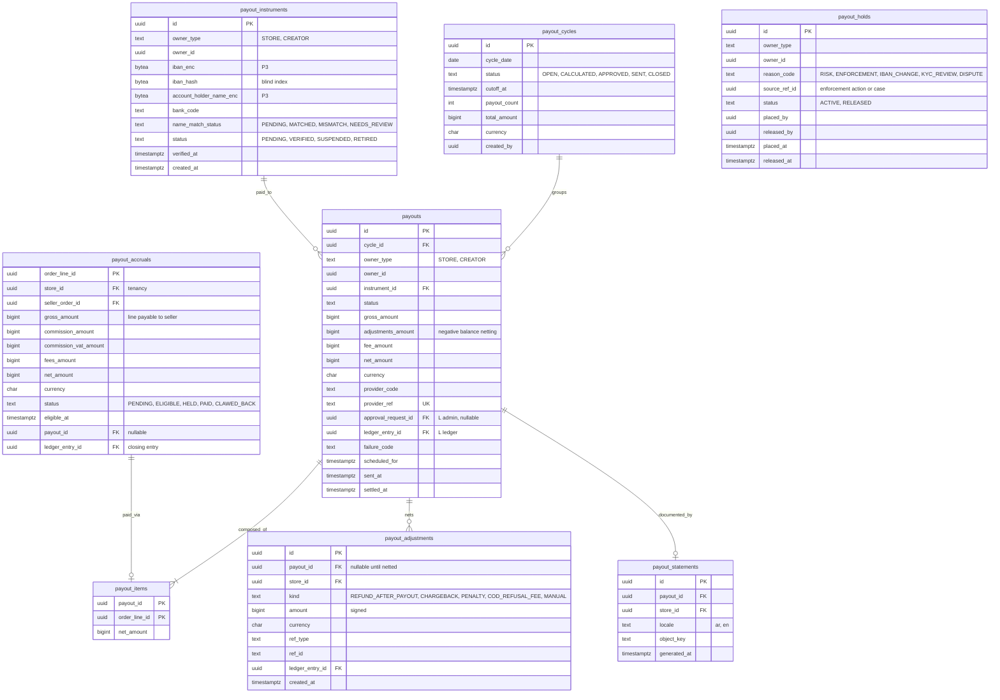

# Module: payouts

Phase 1 (weekly seller payouts, dual approval, IBAN name match) and Phase 3 (creator payouts at scale) · Spec refs: §T4, §22 (payout interplay), §19 (finance), §B2, §15.4, §B6, §23 (dual approval) · Owner aggregates: `Payout`, `PayoutInstrument`, `PayoutAccrual`, `PayoutCycle`

## Flow
When a seller order line becomes `CLOSED` (return window plus 3 days, no dispute), a `payout_accruals` row moves from `PENDING` to `ELIGIBLE`. A weekly `payout_cycles` run groups eligible accruals per store (or creator), nets any negative seller balance (refunds after payout, chargebacks, penalties), creates a `payouts` row `SCHEDULED`, applies risk holds, requires dual approval above a threshold, sends through the PSP or bank API with an idempotent request, and posts the ledger entry. The bank or PSP result moves it to `SETTLED` or `FAILED`.

## Rules
- State machine: `SCHEDULED -> ON_HOLD (risk) -> APPROVED -> SENT -> SETTLED | FAILED` (§T4). Valid transitions are table driven (§A2.6). `ON_HOLD -> APPROVED` needs a hold release with a reason.
- Eligibility: line `CLOSED` (return window plus 3 days) and no open dispute, return or price enforcement hold. Payout money comes from `seller_payable:{store}` only.
- A refund after payout leaves `seller_payable` negative. The next payout nets it. If a seller never earns again the negative balance is a receivable handled by Finance (decision needed, I-32).
- IBAN is P3, field-encrypted, with a blind index `iban_hash`. The account holder name must match the KYC legal name (name-match check) before the instrument is `VERIFIED`. An IBAN change puts the next payout on `ON_HOLD` for a cooling period (proposed 7 days).
- Dual approval above a threshold (config) through admin `approval_requests`. The approver cannot be the requester.
- Seller Agreement hold: payouts can be held on severe or repeat price-integrity enforcement (§9.5), recorded as `payout_holds` with a reference to the enforcement action.
- Creator payouts need KYC and age 21 (§B6, §15.4). Creator VAT above EGP 500k and payout tax are VERIFY BEFORE LAUNCH.
- A payout request to the bank or PSP carries `provider_idempotency_key = payout_id`. A retry never creates a second transfer.
- Payout currency is EGP. Fees are explicit `payout_fee_amount`, never hidden in the net.
- The weekly cycle day and thresholds are admin config (`config_parameters`), versioned and audited.

## Edge cases
- Payout `SENT` but no confirmation within the provider window: reconcile by provider reference before any resend.
- Name match fails: instrument `NEEDS_REVIEW`, payout stays `ON_HOLD`, seller notified.
- Seller suspended: payouts `ON_HOLD` per agreement, human review of suspension within 5 business days (§9.5).
- IBAN reused across stores: flagged for fraud (`iban_hash` index across stores).
- Partial failure in a bulk file: per-payout status, never per-file.
- Negative net: no payout created, balance carried forward, seller sees the statement.
- COD-heavy sellers: accrual still waits for `CLOSED`, COD cash arrives through remittance but is not seller money until then.

## ER diagram

## Entities

| Entity | Ph | PK | FK (E enforced, L logical) | Indexes and uniqueness | PII | Tenancy | Partition | Retention |
|---|---|---|---|---|---|---|---|---|
| `payout_instruments` | P1 | `id` | `owner_id` L (stores or creator_accounts) | index `(owner_type, owner_id)`; index `(iban_hash)` (cross-owner reuse detection); unique `(owner_type, owner_id, iban_hash)` | P3 (IBAN, holder name) | `store_id` when `owner_type = STORE` (finance role only) | none | RET-KYC: contract plus 5 years (spec §B1), VERIFY |
| `payout_cycles` | P1 | `id` | `created_by` L | unique `(cycle_date)` | P1 | none | none | RET-TAX |
| `payout_accruals` | P1 | `order_line_id` | `store_id` E, `seller_order_id` L, `order_line_id` L, `payout_id` E, `ledger_entry_id` L | partial index `(store_id, eligible_at) WHERE status = 'ELIGIBLE'`; index `(payout_id)` | P1 | `store_id` | none | RET-TAX |
| `payouts` | P1 | `id` | `cycle_id` E, `instrument_id` E, `approval_request_id` L, `ledger_entry_id` L | unique `(provider_code, provider_ref)`; index `(owner_type, owner_id, scheduled_for DESC)`; index `(status, scheduled_for)` | P2 (links to an identified store or creator) | `store_id` via owner | none | RET-TAX |
| `payout_items` | P1 | `(payout_id, order_line_id)` | `payout_id` E, `order_line_id` L | unique `(order_line_id)` (a line is paid once) | P1 | via payout | none | RET-TAX |
| `payout_adjustments` | P1 | `id` | `payout_id` E, `store_id` E, `ledger_entry_id` L | index `(store_id, payout_id)`; index `(ref_type, ref_id)` | P1 | `store_id` | none | RET-TAX |
| `payout_holds` | P1 | `id` | `owner_id` L, `source_ref_id` L | partial index `(owner_type, owner_id) WHERE status = 'ACTIVE'` | P1 | `store_id` via owner | none | RET-TAX |
| `payout_statements` | P1 | `id` | `payout_id` E, `store_id` E | unique `(payout_id, locale)` | P1 | `store_id` | none | RET-TAX |

## Data notes
- The spec gives no Data block for payouts. Entities are derived from §T4 (state machine, eligibility, dual approval, IBAN name match) and §19 (statements).
- The ledger is the source of truth for seller balance. `payout_accruals` is a work queue and an audit trail: its rows must reconcile with `seller_payable:{store}` postings. A nightly check compares `sum(ELIGIBLE and HELD and PENDING net_amount)` with the account balance (I-33: the spec does not define the seller balance timeline pending, eligible, held).
- Commission and VAT on commission per line come from the order line snapshot (`commission_rate_snapshot_bps`). VAT 14% on commission is posted to `platform_vat_output` by the single rounding point (ledger I-09).
- `payout_instruments.owner_type = CREATOR` serves creator payouts (referrals). KYC for creators is in `creator_kyc_records` (referrals).
- The data inventory names `payout_instruments(id, owner_user_id, iban, iban_hash, account_holder_name)`. This model uses `owner_type` and `owner_id` because the owner can be a store (a legal entity) or a creator (a user). Alignment is a follow-up for the inventory (I-34).
- IBAN is envelope-encrypted with a blind index, never logged and never returned to the client beyond the last 4 characters.

## API
| Endpoint | Scope | Idempotent | Rate limit |
|---|---|---|---|
| `GET /v1/seller/finance/balance`, `/payouts`, `/statements` | seller finance role | n/a | 60/min |
| `POST /v1/seller/finance/instruments` | seller manager or finance, recent auth | yes | 5/min |
| `GET /v1/admin/payouts`, `POST /v1/admin/payouts/{id}/hold`, `/release`, `/approve` | finance, dual approval above threshold | yes | 30/min |
| `POST /v1/admin/payout-cycles/{id}/run` | finance | yes | 5/min |

## Events
Outbox: `payout.scheduled`, `payout.held`, `payout.approved`, `payout.sent`, `payout.settled`, `payout.failed`. Analytics: none for seller money.

## Failure handling
Saga with explicit compensation: if the provider send fails before acceptance, the ledger entry is reversed and the accruals return to `ELIGIBLE`. If status is unknown after timeout, no resend until reconciliation by provider reference. Retries with backoff, max N, then `FAILED` with Finance ticket. Provider callbacks are deduplicated and processed through the inbox.

## Security and abuse
- ASVS Level 3 scope. Dual approval, IP allow-list for Finance, passkey required.
- IBAN change is the main takeover vector: it requires recent auth, notifies all store managers, and holds the next payout.
- BOLA: a seller sees only their own balances and payouts (404 otherwise).
- The approver and requester differ, enforced by a database check on `approval_requests`.
- Payout file or API credentials live in the secrets manager.

## Metrics
Payout success rate, time from `CLOSED` to cash, held payouts count and age, name-match failure rate, negative seller balances, payout reconciliation mismatches.

## Acceptance
- A line is never in two payouts (unique `payout_items.order_line_id`).
- A refund after payout produces a negative adjustment netted in the next cycle.
- A payout above the threshold cannot move to `APPROVED` without a second approver.
- A failed provider send restores accrual eligibility and reverses the ledger entry.
