# Platform tables: outbox, inbox, idempotency, audit, sagas, jobs, media, crypto

Status: Draft for review · Spec refs: §A2.5, §A2.7, §A2.8, §A2.9, §T3, §T5 · Not a T1 business module: these tables are shared kernel infrastructure used by every module. Inconsistency IDs (I-nn) are defined in [inconsistencies.md](./inconsistencies.md). Conventions are in [../data-model.md](../data-model.md).

## Flow
1. A use case changes aggregate state and inserts one `outbox_events` row in the same transaction.
2. The relay (apps/workers) reads unpublished rows in `(occurred_at, id)` order per `ordering_key`, publishes to the queue, and sets `published_at`. Delivery is at-least-once (§A2.7).
3. Every consumer wraps its side effect and an `inbox_processed` insert in one transaction. A duplicate insert means the message was already handled and the consumer returns without effect.
4. HTTP writes that move money, stock or orders carry an `Idempotency-Key`. The middleware stores the response in `idempotency_keys` for 24 h (§A2.5).
5. Sensitive actions append to `audit_log` (hash-chained) in the caller's transaction.

## ER diagram

```mermaid
erDiagram
    outbox_events {
        uuid id PK "uuidv7"
        timestamptz occurred_at PK "partition key"
        text aggregate_type
        uuid aggregate_id
        text event_type
        int event_version
        text ordering_key
        jsonb payload "P0-P2 only, no P3"
        jsonb headers "trace_id, actor, idempotency_key"
        timestamptz published_at
        int publish_attempts
    }
    inbox_processed {
        text consumer PK
        uuid message_id PK
        timestamptz processed_at
    }
    idempotency_keys {
        uuid key PK
        text route PK
        uuid actor_id PK "user, staff or service principal"
        bytea request_hash
        int response_status
        jsonb response_body
        timestamptz locked_until
        timestamptz expires_at
    }
    audit_log {
        uuid id PK
        timestamptz occurred_at PK "partition key"
        text chain_id "one chain per tenant and month"
        bigint seq
        text actor_type
        uuid actor_id
        text action
        text target_type
        uuid target_id
        jsonb diff_redacted
        text ip_hash "P2"
        uuid device_id
        text request_id
        text reason_code
        bytea prev_hash
        bytea hash
    }
    audit_chain_checkpoints {
        text chain_id PK
        bigint last_seq
        bytea last_hash
        timestamptz signed_at
        bytea signature
    }
    saga_instances {
        uuid id PK
        text saga_type "checkout, refund, payout, cancellation"
        uuid correlation_id "order_group_id, refund_id, payout_id"
        text state
        int current_step
        timestamptz deadline_at
        text idempotency_key UK
    }
    saga_steps {
        uuid id PK
        uuid saga_id FK
        int step_no
        text step_name
        text status "PENDING, DONE, FAILED, COMPENSATED"
        int attempts
        jsonb result
        timestamptz executed_at
    }
    dead_letter_events {
        uuid id PK
        text source "outbox, webhook, courier, eta"
        text consumer
        uuid message_id
        jsonb payload
        text error
        int attempts
        timestamptz replayed_at
    }
    job_runs {
        uuid id PK
        text job_name
        timestamptz started_at
        timestamptz finished_at
        text status
        bigint rows_affected
        jsonb metrics
    }
    media_assets {
        uuid id PK
        text owner_module
        uuid owner_id
        uuid store_id "tenancy, nullable"
        text purpose "product_image, kyc_doc, return_photo, review_photo"
        text bucket_key
        text content_type
        bigint size_bytes
        bytea sha256
        text av_status
        bool exif_stripped
        bigint phash64
        text visibility "public, private"
        timestamptz deleted_at
    }
    crypto_key_registry {
        text key_ref PK
        int version PK
        text purpose "dek, blind_index, hmac"
        text kms_arn
        timestamptz activated_at
        timestamptz retired_at
    }
    saga_instances ||--o{ saga_steps : has
```

## Entities

| Entity | Ph | PK | FK (E enforced, L logical) | Indexes and uniqueness | PII | Tenancy | Partition | Retention |
|---|---|---|---|---|---|---|---|---|
| `outbox_events` | P0 | `(id, occurred_at)` | `aggregate_id` L | partial index `(ordering_key, occurred_at)` WHERE `published_at IS NULL`; index `(aggregate_type, aggregate_id)` | P1; payload must contain no P3 and only the P2 the consumer needs | none (events carry `store_id` in headers) | monthly by `occurred_at` | published rows 30 d (proposed); unpublished never purged; business truth lives in module tables, not here |
| `inbox_processed` | P0 | `(consumer, message_id)` | `message_id` L | PK is the uniqueness guarantee | P1 | none | monthly by `processed_at` (proposed) | 30 d (proposed, must exceed the longest redelivery window) |
| `idempotency_keys` | P0 | `(actor_id, route, key)` | `actor_id` L | index `(expires_at)` for purge; same key and different `request_hash` returns 422 | P2 (response may embed the caller's own PII) | none | none | 24 h then purged (spec §A2.5) |
| `audit_log` | P0 | `(id, occurred_at)` | `actor_id`, `target_id` L | unique `(chain_id, seq)`; index `(target_type, target_id, occurred_at)`; index `(actor_id, occurred_at)` | P2 (IP, device, diff redacted) | none, readable only by `dpo`, `security`, `super_admin` | monthly by `occurred_at` | not defined in spec (B1 says "follows §B1"); proposed 7 y, shipped to WORM storage (§T5), I-77. VERIFY BEFORE LAUNCH |
| `audit_chain_checkpoints` | P0 | `chain_id` | none | none | P1 | none | none | same as `audit_log` |
| `saga_instances` | P0 | `id` | `correlation_id` L | unique `(saga_type, correlation_id)`; index `(state, deadline_at)` for the timeout sweeper | P1 | none | none | 90 d after terminal state (proposed); financial outcome is in ledger and orders |
| `saga_steps` | P0 | `id` | `saga_id` E | unique `(saga_id, step_no)` | P1 | none | none | with parent |
| `dead_letter_events` | P0 | `id` | none | index `(source, replayed_at)` | P2 (raw payload may hold PII) | none | none | 90 d (proposed), webhook DLQ rows follow raw-webhook retention (7 y, §B1) |
| `job_runs` | P0 | `id` | none | index `(job_name, started_at DESC)` | P1 | none | none | 13 months (proposed) |
| `media_assets` | P1 | `id` | `owner_id` L | unique `(bucket_key)`; index `(owner_module, owner_id)`; index `(phash64)` for near-duplicate search (see trust-safety) | P2 by default, P3 for KYC documents and body photos | `store_id` where store-owned | none | follows the owner row; deleted with the owner; private bucket, signed URLs at most 15 min (§T5) |
| `crypto_key_registry` | P0 | `(key_ref, version)` | none | none | P1 | none | none | key metadata kept for the life of any ciphertext that references it |

## Rules
- **Outbox row is mandatory** for every domain event in a module's `Events` list. The `event_type` and `event_version` must exist in the shared Zod registry (packages/domain). Payloads are validated on write.
- **Ordering**: events for one aggregate share an `ordering_key` (the aggregate id) and are relayed in order. There is no global order.
- **Inbox key is `(consumer, message_id)`**, not `message_id` alone, because two consumers legitimately process the same message (I-35).
- **Idempotency**: a request with the same key and identical `request_hash` while the first is in flight returns 409 with `Retry-After` (lock via `locked_until`). A completed key replays the stored response. After 24 h the key is gone, so permanent uniqueness for money lives in `journal_entries.idempotency_key` and `order_groups.idempotency_key`, not here.
- **Audit chain**: `hash = SHA-256(prev_hash || canonical(row))`. One chain per `(tenant, month)` avoids a single global writer. A daily job verifies chains, signs `audit_chain_checkpoints`, and ships rows to WORM storage. UPDATE and DELETE are revoked from the application role (I-36).
- **Sagas**: `saga_instances` stores orchestration state only. Domain truth stays in orders, payments, inventory and ledger. Each step is idempotent and its compensation is explicit (§A2.8).
- **Media**: upload pipeline is type sniff, size cap, AV scan, EXIF/GPS strip, re-encode, private bucket (§T5). `av_status` must be `CLEAN` before any non-owner can read.
- **Crypto**: P3 fields are stored as `bytea` envelopes `(key_ref, version, nonce, ciphertext)`. A blind index is a separate `bytea` column holding an HMAC from a key with purpose `blind_index`. Keys rotate yearly (§T5).

## Failure handling
- Relay crash: unpublished rows are picked up again, consumers dedupe through the inbox.
- Poison message: after N attempts (default 5, exponential backoff with jitter) it moves to `dead_letter_events` with a replay tool.
- Idempotency store unavailable: money, stock and order writes fail closed with 503. They are never executed without the key check.
- Audit write failure: the business transaction aborts (the audit insert is in the same transaction).

## Security and abuse
- `audit_log` and `outbox_events` are insert-only for the application role. Reads of `audit_log` are themselves audited with a reason code.
- `idempotency_keys.response_body` can hold P2. The row is scoped to `actor_id`, so a key cannot be replayed by another actor (API1).
- `media_assets.visibility = private` is the default, public only for catalog images after moderation.

## Metrics
Outbox lag p95 (alert above 30 s), oldest unpublished event age, DLQ depth, inbox duplicate rate, idempotency replay rate, audit chain verification failures (must be 0), media AV rejection rate.

## Acceptance
- Killing the relay between publish and `published_at` update delivers the event twice and the consumer applies it once.
- Reusing an `Idempotency-Key` with a different body returns 422 and does not execute.
- Altering any `audit_log` row makes the nightly chain verification fail and page Security.
