# Module: pricing-integrity

Phase 1 (internal ledger, Shopify and WooCommerce channels, display rules) and Phase 2 (crawler, image matching, brand RRP) · Spec refs: §9, §5, §B5, §T3, `docs/specs/price-integrity.md` (tiers E0 to E5, lite mode, engine config) · Owner aggregates: `PriceHistory`, `ChannelConnection`, `ProductMatch`, `PriceClaim`, `Enforcement`

## Flow
Every price change on a SKU becomes an immutable `price_events` row. Channel integrations (OAuth first, crawler fallback) deliver `channel_snapshots`. A matcher links a HAUL SKU to an external listing (`product_matches`). A scorer computes the Verified Reference Price (VRP) from internal 30-day low and external 30-day low (strictest wins) and writes a `price_claims` row with evidence. Display and ranking read the latest claim. Enforcement actions follow the automatic ladder. A human reviews only suspensions.

## Rules
- Internal price history is append-only. Rather than store `valid_to` (I-16), an interval is derived by `LEAD(valid_from)`. A materialised `sku_price_reference` holds `low_30d`, refreshed on every event.
- `VRP = min(internal_low_30d, external_low_30d)` when both exist and history is at least 30 days. `discount_pct = floor((VRP - price) * 100 / VRP)` in piastres. `claim_allowed = VRP IS NOT NULL AND discount_pct >= 5`.
- Brand RRP and document price are separate evidence classes, never mixed into VRP.
- Match counts only when `match_conf >= tau` (start 0.92, tuned to precision >= 0.98). Tau is a versioned config, VERIFY BEFORE LAUNCH (register row 13).
- Anti-inflation: any price increase within 30 days before a discount resets the reference to the lowest price in that window.
- Evidence older than 72 h degrades the claim to plain price (fail closed).
- Enforcement ladder (§9.5) is stored as data (`enforcement_policies`), not code constants.
- Fully automatic suspension without human review: VERIFY BEFORE LAUNCH (register row 15). A human review task is mandatory within 5 business days for any suspension.
- Crawler only for domains in `crawler_domains` verified by the seller, one request per 5 s per domain, robots.txt honoured.

## Edge cases
- Listing age under 30 days and no history: label `LAUNCH_PRICE`, never percent off.
- Price raised then cut within 30 days: claim is bounded by the true 30-day minimum (property test, §9.7).
- OAuth token revoked: connection `status = REVOKED`, seller alerted, evidence goes stale after 72 h.
- Duplicate listing that resets history: matched via pHash plus attributes, history is inherited through `product_matches` from the earlier listing (I-20).
- Seller price change during a drop: forbidden by catalog trigger. Price ladder steps are written as scheduled `price_events` with `source = DROP_LADDER`.

## ER diagram

```mermaid
erDiagram
    price_events {
        uuid id PK
        timestamptz valid_from PK "partition key"
        uuid sku_id FK
        uuid store_id FK "tenancy"
        bigint price_amount
        char currency
        text source "SELLER, CHANNEL_SYNC, DROP_LADDER, ADMIN, IMPORT"
        text actor_type "seller_staff, system, admin"
        uuid actor_id
        uuid prev_event_id "chain of price changes"
        text idempotency_key UK "global, see I-37"
    }
    sku_availability_events {
        uuid id PK
        timestamptz valid_from PK "partition key"
        uuid sku_id FK
        uuid store_id FK "tenancy"
        bool purchasable "active, visible, at least one unit"
        text source "INVENTORY, STATUS_CHANGE, SYSTEM"
    }
    sku_price_reference {
        uuid sku_id PK
        bigint current_price_amount
        bigint low_30d_amount
        timestamptz low_30d_at
        timestamptz history_start "first event"
        bigint increase_reset_amount "anti-inflation floor"
        timestamptz refreshed_at
    }
    channel_connections {
        uuid id PK
        uuid store_id FK "tenancy"
        text type "SHOPIFY, WOOCOMMERCE, ODOO, GOOGLE_SHEETS, CRAWLER"
        text external_account_ref
        text domain "seller verified domain"
        timestamptz store_created_at "for min store age check"
        timestamptz connected_at
        text oauth_token_ref "KMS reference only"
        text status "ACTIVE, REVOKED, ERROR, PENDING"
        timestamptz last_synced_at
        timestamptz consent_to_monitoring_at
    }
    crawler_domains {
        uuid id PK
        uuid store_id FK
        text domain UK
        timestamptz verified_at
        text verification_method "dns_txt, file"
        int min_interval_seconds
        bool robots_allows
    }
    channel_listings {
        uuid id PK
        uuid connection_id FK
        text external_ref
        text external_url
        text title
        bytea image_phash
        text gtin
        timestamptz first_seen_at
    }
    channel_snapshots {
        uuid id PK
        timestamptz captured_at PK "partition key"
        uuid listing_id FK
        bigint price_amount
        char currency
        bool in_stock
        bytea dom_hash
        text capture_method "api, crawler"
        text tax_basis "INCLUSIVE, EXCLUSIVE, UNKNOWN"
    }
    product_matches {
        uuid id PK
        uuid sku_id FK "haul sku"
        uuid listing_id FK
        text method "GTIN, SELLER_SKU_VARIANT, PHASH, EMBEDDING, LLM_ATTRS, CLASSIFIER"
        uuid attested_by FK "seller staff, lite mode"
        numeric match_conf
        text model_version
        text status "ACCEPTED, REJECTED, PENDING_LABEL"
        timestamptz matched_at
    }
    price_evidence {
        uuid id PK
        uuid sku_id FK
        text evidence_class "INTERNAL_LOW_30D, EXTERNAL_LOW_30D, BRAND_RRP, DOCUMENT"
        bigint amount
        char currency
        uuid source_ref "price_events or snapshot or match"
        timestamptz observed_at
        timestamptz expires_at
    }
    price_evidence_documents {
        uuid id PK
        uuid store_id FK
        uuid sku_id FK
        text doc_type "INVOICE, TAG_PHOTO, PRICE_LIST, OTHER"
        bigint declared_amount
        char currency
        date doc_date
        bytea file_sha256 "cross-seller duplicate check"
        uuid media_asset_id FK "private"
        text status "RECEIVED, CHECKED, ACCEPTED, REJECTED, CONTRADICTED"
        numeric doc_conf "Phase 2 OCR scoring"
    }
    price_claims {
        uuid id PK
        uuid sku_id FK
        uuid store_id FK
        uuid price_event_id FK "L price_events"
        bigint price_amount
        bigint vrp_amount "nullable"
        int discount_pct "nullable, floor in bigint math"
        text tier "E0, E1, E2, E3, E4, E5"
        text display_kind "PLAIN, FIRST_LISTED, SELLER_DECLARED, VERIFIED_DISCOUNT, LOWEST_30D, BRAND_PRICE"
        text decision "SHOW_CLAIM, PLAIN, WITHHELD, CORRECTED"
        text[] reason_codes
        int trust_score "nullable"
        text status "SCORED, DISPLAYED, CORRECTED, APPEALED, SUPERSEDED"
        text engine_version
        int config_version
        int evidence_version
        timestamptz evaluated_at
    }
    price_claim_evidence {
        uuid claim_id PK
        uuid evidence_id PK
        text role "VRP_INPUT, SUPPORT, CONTRADICTION"
    }
    price_trust_scores {
        uuid store_id PK
        timestamptz computed_at PK
        int score
        jsonb components
        text model_version
    }
    enforcement_policies {
        text trigger_code PK
        int version PK
        text action "HIDE_PERCENT, CORRECT_TO_VRP, REMOVE_BADGE_30D, DEMOTE_48H_PAUSE, LOSE_VERIFIED, SUSPEND"
        jsonb params
        timestamptz valid_from
    }
    enforcement_actions {
        uuid id PK
        uuid store_id FK
        uuid sku_id FK "nullable"
        uuid claim_id FK "nullable"
        text trigger_code
        text action
        text status "APPLIED, NOTIFIED, FIXED, ESCALATED, REVERSED"
        timestamptz applied_at
        timestamptz expires_at
        uuid suspension_review_id "L, human review task"
    }
    price_appeals {
        uuid id PK
        uuid claim_id FK
        uuid store_id FK
        text evidence_kind "api_integration, machine_readable_file"
        uuid media_asset_id FK
        text outcome "UPHELD, REJECTED, PENDING"
        timestamptz decided_at
    }
    price_violations {
        uuid id PK
        uuid store_id FK
        uuid sku_id FK "nullable"
        uuid claim_id FK "nullable"
        text rule_code "ASSERTED_ABOVE_COMPUTED, INFLATE_THEN_CUT, CHANNEL_CHEAPER, FORGED_DOCUMENT"
        int config_version
        timestamptz detected_at
        timestamptz window_expires_at "rolling 90 days"
    }
    price_engine_config {
        int version PK
        jsonb parameters "history_days, min_claim_pct, doc_claim_cap_pct ..."
        uuid actor_id
        uuid approval_request_id FK "L admin"
        timestamptz created_at
    }
    price_reports {
        uuid id PK
        uuid product_id FK
        uuid reporter_user_id FK
        text reason
        timestamptz created_at
    }
    sku_price_reference ||--|| price_events : derived_from
    price_events ||--o{ price_claims : evaluated_in
    price_evidence_documents ||--o{ price_evidence : supports
    price_violations ||--o{ enforcement_actions : escalates
    price_engine_config ||--o{ price_claims : configured_by
    channel_connections ||--o{ channel_listings : lists
    channel_listings ||--o{ channel_snapshots : snapshots
    channel_listings ||--o{ product_matches : matched
    price_claims ||--o{ price_claim_evidence : cites
    price_evidence ||--o{ price_claim_evidence : cited
    price_claims ||--o{ enforcement_actions : triggers
    price_claims ||--o{ price_appeals : appealed
```

## Entities

| Entity | Ph | PK | FK (E enforced, L logical) | Indexes and uniqueness | PII | Tenancy | Partition | Retention |
|---|---|---|---|---|---|---|---|---|
| `price_events` | P1 | `(id, valid_from)` | `sku_id` E, `store_id` E, `actor_id` L | index `(sku_id, valid_from DESC)`; unique `idempotency_key` via an unpartitioned key table (I-37); UPDATE and DELETE revoked | P1 (actor id of staff is P2 only when staff) | `store_id` | monthly by `valid_from` (T3) | RET-TAX 7 y (evidence trail for Consumer Protection Agency inquiries, proposed, VERIFY BEFORE LAUNCH) |
| `sku_availability_events` | P1 | `(id, valid_from)` | `sku_id` E, `store_id` E | index `(sku_id, valid_from DESC)`; UPDATE and DELETE revoked | P1 | `store_id` | monthly by `valid_from` | RET-TAX 7 y with price events (purchasable intervals decide the claim) |
| `sku_price_reference` | P1 | `sku_id` | `sku_id` E | index `(low_30d_at)` | P1 | `store_id` via sku | none | derived, rebuilt from events |
| `channel_connections` | P1 | `id` | `store_id` E | unique `(store_id, type, external_account_ref)`; unique `(type, domain)` | P1 (token is a KMS reference, never the token) | `store_id` | none | store lifetime + 90 d |
| `crawler_domains` | P2 | `id` | `store_id` E | unique `(domain)` | P1 | `store_id` | none | store lifetime |
| `channel_listings` | P2 | `id` | `connection_id` E | unique `(connection_id, external_ref)`; index `(gtin)`; index `(image_phash)` | P0 (third-party public data) | `store_id` via connection | none | 24 months after last seen (proposed) |
| `channel_snapshots` | P2 | `(id, captured_at)` | `listing_id` E | index `(listing_id, captured_at DESC)` | P0 | `store_id` via listing | daily by `captured_at` per spec, monthly per T3 (I-19) | 13 months raw, then aggregated to daily low (proposed) |
| `product_matches` | P2 | `id` | `sku_id` E, `listing_id` E | unique `(sku_id, listing_id)`; index `(status, match_conf)` | P1 | `store_id` via sku | none | life of SKU, labeled pairs kept for ML evaluation |
| `price_evidence` | P1 | `id` | `sku_id` E, `source_ref` L | index `(sku_id, observed_at DESC)` | P0 | `store_id` via sku | monthly by `observed_at` | RET-TAX 7 y when cited by an order line, else 13 months |
| `price_evidence_documents` | P1 | `id` | `store_id` E, `sku_id` E, `media_asset_id` E | index `(file_sha256)`; index `(sku_id)` | P2 if the file shows people or personal data, else P1 | `store_id` | none | per retention policy once ADR-0002 is decided, 7 y when cited (VERIFY BEFORE LAUNCH) |
| `price_claims` | P1 | `id` | `sku_id` E, `store_id` E, `price_event_id` L | unique `(sku_id, price_event_id, evidence_version, config_version)`; index `(sku_id, evaluated_at DESC)`; partial index `(sku_id) WHERE status = 'DISPLAYED'` | P0 for the public projection (tier, display kind, pct), P1 otherwise | `store_id` | monthly by `evaluated_at` | RET-TAX 7 y when cited, else 13 months |
| `price_claim_evidence` | P1 | `(claim_id, evidence_id)` | both E | index `(evidence_id)` | P1 | via claim | with claim | with claim (replaces spec array `evidence_ids[]`, I-17) |
| `price_trust_scores` | P1 | `(store_id, computed_at)` | `store_id` E | index `(store_id, computed_at DESC)` | P1 | `store_id` | none | 24 months |
| `enforcement_policies` | P1 | `(trigger_code, version)` | none | none | P1 | none | none | RET-CONFIG |
| `enforcement_actions` | P1 | `id` | `store_id` E, `sku_id` E, `claim_id` E | index `(store_id, applied_at DESC)`; index `(status, expires_at)` | P1 | `store_id` | none | 5 y (proposed) |
| `price_violations` | P1 | `id` | `store_id` E, `sku_id` E, `claim_id` E | index `(store_id, detected_at DESC)`; partial index `(store_id) WHERE window_expires_at > now()` for the 3-in-90-days rule | P1 | `store_id` | none | 5 y (proposed) |
| `price_engine_config` | P1 | `version` | `approval_request_id` L | none | P1 | none | none | RET-CONFIG, kept: each claim stores its `config_version` |
| `price_appeals` | P1 | `id` | `claim_id` E, `store_id` E, `media_asset_id` E | index `(outcome, decided_at)` | P1 | `store_id` | none | 5 y (proposed) |
| `price_reports` | P2 | `id` | `product_id` E, `reporter_user_id` E | index `(product_id)`; unique `(product_id, reporter_user_id)` | P2 | `user_id` | none | 13 months (proposed) |

## Data notes
- `price_claims` are written for every scoring run but only the latest `DISPLAYED` row per SKU is shown. Older rows remain because order lines cite claims by id (see orders `order_line_price_evidence`, I-18).
- The spec shows `evidence_ids[]` on `price_claims`. An array cannot carry the evidence role nor a foreign key, so `price_claim_evidence` replaces it (I-17).
- `product_matches(haul_sku, external_ref, ...)` in the spec has no row for the external listing. `channel_listings` supplies it (I-20).
- `crawler_domains` backs the SSRF guard (API7): fetches are allowed only for verified domains, resolved to public IPs, with a DNS-rebinding check.
- Budget data is never an input to any table here (§12 privacy rule).

- `docs/specs/price-integrity.md` §10 says "final table names and types belong to the data-model owner" and gives the required shape. This model adopts its entities: `sku_availability_events`, `price_evidence_documents`, `price_violations`, `price_engine_config`, and the claim columns `tier`, `decision`, `reason_codes`, `engine_version`, `config_version`, `evidence_version`. The master prompt's `claim_type` (VERIFIED, LOWEST_30D, LAUNCH_PRICE) is kept as `display_kind` derived from the tier, so the two vocabularies do not both drive logic (I-85).
- `evidence_ids[]` on the spec's `price_claims` is `price_claim_evidence` (I-17). Spec `product_matches` is unique `(sku_id, external_ref)`, here unique `(sku_id, listing_id)` because the external ref is on `channel_listings` (I-20).
- Spec `channel_snapshots` is keyed by `connection_id, external_ref, sku_id`. Here a `listing_id` joins them, which removes a repeated string key from a daily-volume table.
- The report endpoint in the spec is `POST /v1/products/{id}/price-reports` and the master prompt has `report-price`. Same entity, the path is an API decision.

## API
| Endpoint | Scope | Idempotent | Rate limit |
|---|---|---|---|
| `GET /v1/products/{id}/price-evidence` | public (summary only) | n/a | 60/min |
| `GET /v1/products/{id}/price-history` | public | n/a | 60/min |
| `POST /v1/seller/channels` | seller manager | yes | 10/min |
| `POST /v1/seller/price-claims/{id}/appeal` | seller manager | yes | 10/min |
| `GET /v1/seller/price-trust` | seller staff | n/a | 30/min |
| `POST /v1/products/{id}/price-reports` | verified user | yes | strict per user and per product |
| `POST /v1/seller/price-evidence` | seller | yes | low |
| `GET/PUT /v1/admin/price-integrity/config` | admin, role checked, audited | PUT idempotent by version | low |

## Events
Consumes `sku.price_changed`. Emits `price.changed`, `price_claim.scored`, `price_enforcement.applied`, `channel_snapshot.ingested`. Analytics: `price_badge_viewed`, `price_reported`.

## Failure handling
Crawler failure leaves evidence to expire at 72 h and the claim degrades to plain price (fail closed). Snapshot ingestion is idempotent on `(listing_id, captured_at)`. A scoring run that errors never publishes a claim, the previous `DISPLAYED` claim keeps its `expires_at`.

## Security and abuse
- Crawler egress through a dedicated proxy with no internal credentials, allow-listed domains only, no private IPs.
- Seller and listing text is untrusted to the LLM attribute extractor (LLM01).
- `price_reports` is rate-limited and treated as a signal only, never as a direct trigger.
- Seller cannot write `price_claims`, `price_evidence` or `enforcement_actions`.

## Metrics
Percent of listings with verified claims, auto-corrections, appeals upheld below 2%, complaints about fake discounts target near zero, evidence staleness distribution.

## Acceptance
- A property test: a price raised then cut within 30 days never yields a claim above the true 30-day minimum.
- A SKU with no evidence has tier E0 with `display_kind = PLAIN` and no discount fields in any API response.
- Revoking an OAuth token produces a seller alert and the claim degrades after 72 h.
