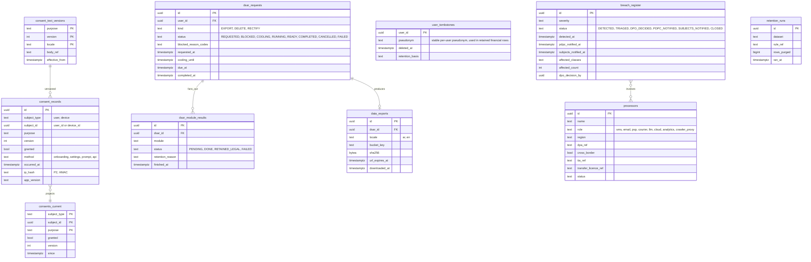

# Module: privacy

Phase 0 (consent core) and Phase 1 (Privacy Center, DSAR, DPO console) · Spec refs: §B1, §2, §T6, §A2.9 · Owner aggregates: `Consent`, `DataSubjectRequest`, `Breach`, `TransferRegister`

## Flow
Consent is captured per purpose, versioned and withdrawable in one tap. A data export or deletion request becomes a `dsar_requests` row that runs as a saga: collect from every module's registered exporter, build the ZIP, issue a signed URL. Deletion waits 14 days (cooling), then each module erases or pseudonymizes through its registered `Eraser` port.

## Rules
- Purposes (spec §B1): `marketing_push`, `marketing_whatsapp`, `marketing_email`, `analytics`, `personalization`, `budget_insights`, `measurements`, `location_precise`, `cross_border_ml`. SMS marketing has no purpose in the spec (I-06): added here as `marketing_sms` pending owner confirmation.
- Consent is never pre-ticked. SDKs initialise only after the matching consent.
- Consent history is append-only. The current state is a projection (`consents_current`).
- Deletion is blocked while orders, returns or disputes are open, and the UI shows the exact reasons.
- Export SLA default 30 days, ready within 72 h target, signed URL 24 h. Statutory deadline VERIFY BEFORE LAUNCH (register row 1).
- Breach clock: PDPC notice within 72 h, subject notice within 3 days. Figures from the spec, VERIFY BEFORE LAUNCH.

## Edge cases
- Consent given before an account exists (onboarding runs before registration completes): stored against `subject_ref` (device or user) and re-linked at registration (I-06).
- Withdrawal during an in-flight job (a marketing send): the send path rechecks `consents_current` at send time.
- Deletion of a user who is the referrer of a pending reward: reward cancelled, referee unaffected.
- Legal hold on a user (open dispute, fraud case): erasure of financial rows is refused and logged. Personal fields are still pseudonymized where law permits.

## ER diagram

## Entities

| Entity | Ph | PK | FK (E enforced, L logical) | Indexes and uniqueness | PII | Tenancy | Partition | Retention |
|---|---|---|---|---|---|---|---|---|
| `consent_text_versions` | P0 | `(purpose, version, locale)` | none | none | P0 | none | none | indefinite (legal evidence of what was shown) |
| `consent_records` | P0 | `id` | `subject_id` L (user or device) | index `(subject_type, subject_id, purpose, occurred_at DESC)` | P2 | `user_id` when subject is user | yearly by `occurred_at` (proposed) | proof of consent: retained for the life of the relationship plus the limitation period; VERIFY BEFORE LAUNCH |
| `consents_current` | P0 | `(subject_type, subject_id, purpose)` | none | none | P2 | `user_id` | none | RET-USER |
| `dsar_requests` | P1 | `id` | `user_id` E | index `(status, due_at)`; partial unique `(user_id, kind) WHERE status NOT IN terminal` | P2 | `user_id` | none | 5 y after completion as DSAR evidence (proposed, VERIFY BEFORE LAUNCH) |
| `dsar_module_results` | P1 | `id` | `dsar_id` E | unique `(dsar_id, module)` | P1 | none | none | with parent |
| `data_exports` | P1 | `id` | `dsar_id` E | none | P3 (archive contents), row itself P1 | `user_id` via dsar | none | file removed at `url_expires_at` + 7 d (proposed), row kept with parent |
| `user_tombstones` | P1 | `user_id` | none (user row may be gone) | unique `(pseudonym)` | P1 | none | none | as long as retained financial rows reference the pseudonym (RET-TAX) |
| `breach_register` | P1 | `id` | none | index `(status, detected_at)` | P1 (counts, not subjects) | none, DPO only | none | 5 y (proposed, VERIFY BEFORE LAUNCH) |
| `processors` | P1 | `id` | none | unique `(name, role)` | P1 | none | none | indefinite (transfer register) |
| `retention_runs` | P1 | `id` | none | index `(dataset, ran_at DESC)` | P1 | none | none | 13 months (proposed) |

## Data notes
- `consent_records.user_id` in the spec cannot represent consent given before registration (I-06), hence `subject_type` and `subject_id`. At registration a job copies the device-subject rows to the new user.
- The data inventory (`data_inventory.yaml`, a separate P5 deliverable) is the source for exporters and erasers: every P2 and P3 column in this data model maps to a module exporter.
- `user_tombstones.pseudonym` replaces direct identifiers in retained financial rows (orders, ledger references, e-receipts).

## API
| Endpoint | Scope | Idempotent | Rate limit |
|---|---|---|---|
| `GET /v1/me/privacy/consents` | user | n/a | 30/min |
| `PATCH /v1/me/privacy/consents` | user | yes | 30/min |
| `POST /v1/me/privacy/export` | user + recent auth | yes | 2/day |
| `GET /v1/me/privacy/export/{id}` | user | n/a | 30/min |
| `POST /v1/me/privacy/delete` | user + recent auth | yes | 2/day |
| `DELETE /v1/me/privacy/delete` | user | yes | 5/day |
| `GET /v1/admin/privacy/dsar`, `/breaches`, `/transfers` | role `dpo` | n/a | 60/min |

## Events
Outbox: `consent.changed`, `privacy.export_requested`, `privacy.export_ready`, `privacy.deletion_requested`, `privacy.deletion_completed`, `breach.status_changed`. Analytics: `consent_changed`.

## Failure handling
- Module exporter or eraser fails: `dsar_module_results.status = FAILED`, retried with backoff, then the DSAR shows `FAILED` to the DPO queue. The deletion is never reported complete while any module is `PENDING` or `FAILED`.
- Export link expires: the user re-requests, a new ZIP is built.
- Eraser must be idempotent: running it twice yields the same state.

## Security and abuse
- Export and delete require a recent strong authentication (passkey or OTP within 5 min) to defeat session hijack data theft.
- Exports are encrypted at rest, private bucket, signed URL at most 24 h, one download audited.
- The DPO console reads `dsar_requests` with reason codes logged to `audit_log`.
- Abuse: repeated export requests are limited, export size is capped, and generation runs in a low-priority queue.

## Metrics
DSAR completion within SLA (target 100%), time to export, consent withdrawal propagation time (target under 1 min to send path), breach-notice clock adherence, consent coverage per SDK.

## Acceptance
- The export for a user contains every P2 and P3 field tagged in `data_inventory.yaml` for that user.
- After the cooling period, no P3 field of the user remains readable and retained financial rows show only the pseudonym.
- Withdrawing `marketing_push` stops marketing push within one minute, transactional pushes continue.
