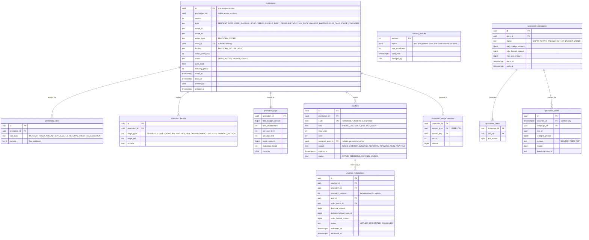

# Module: promotions

Phase 1 (vouchers core, deterministic evaluation, store vouchers) and Phase 2 (all promo types, Plus-only, sponsored products placed provisionally here) · Spec refs: §17, §15.3, §12 (no budget targeting), §9 (no "% off" from vouchers), §23, §19 (marketing), §B4 · Owner aggregates: `Promotion`, `Voucher`, `StackingPolicy`, `Redemption`, `SponsoredCampaign` (provisional)

## Flow
Admin or a seller creates a promotion with a type, targeting, funding split, caps and a Cairo-timezone window. Vouchers are codes (or auto-applied) attached to a promotion. At quote time the deterministic engine evaluates candidates in the order item-level, store-level, order-level, shipping, payment-partner, enforces the stacking matrix, picks the "auto-best" combination (exact search over at most 5 candidates) and returns line-level allocations. At commit a `voucher_redemptions` row is written with the order group. Cancelling the whole order before shipping reinstates the voucher.

## Rules
- Types: percent, fixed, free shipping, BOGO, tiered, bundle, first order, birthday, win-back, payment-partner, Plus-only, store follower.
- Funding: platform, seller or co-funded with `seller_share_bps`. Recorded per line for the ledger (`promo_expense_platform`, `promo_receivable_seller`) and for the VAT base.
- Targeting: segment, store, category, product, city or governorate, tier, Plus. **Budget data is never used** (§12): the module has no FK, join or import to budget tables, enforced by a lint rule and a dependency-cruiser rule.
- Constraints: budget caps (promotion spend, not user budget), per-user, per-day, minimum order, maximum discount, dates in Africa/Cairo, payment method.
- Stacking: at most one platform code, one store voucher per store, auto promos and one payment-partner offer. Evaluation order is fixed and idempotent.
- A discount never creates a "% off" claim unless pricing-integrity verifies it. Vouchers show as "voucher minus X", never as a reference price.
- Abuse controls: device fingerprint, verified phone, velocity rules, multi-account graph (fraud), refund-then-reuse block (the voucher is reinstated only if the whole order is cancelled before shipping).
- Promotion versions are immutable once active. Editing creates a new version, and orders reference the version they used (`promotion_version`).
- Admin-editable parameters are audited and, for platform-wide changes above a threshold, dual-approved (admin module).

## Edge cases
- Concurrent redemption of a single-use voucher: unique `(voucher_id)` where cap is 1, or a counter with row lock.
- Voucher expires between quote and commit: commit re-evaluates, shows delta, requires reconfirmation.
- Promotion budget exhausted mid-checkout: the engine returns the next best set, never a negative total.
- Partial refund of a voucher order: the proportional voucher share is refunded by lines, the voucher is not reinstated.
- Time zone: all windows are Cairo time, stored UTC, evaluated by the caller's injected clock.
- Free shipping plus Plus free delivery: not additive. The shipping fee is zero once.
- Currency EGP only at launch.

## ER diagram

## Entities

| Entity | Ph | PK | FK (E enforced, L logical) | Indexes and uniqueness | PII | Tenancy | Partition | Retention |
|---|---|---|---|---|---|---|---|---|
| `promotions` | P1 | `id` | `store_id` E | unique `(promotion_key, version)`, rows are immutable once ACTIVE; index `(status, starts_at, ends_at)`; index `(store_id, status)` | P0 | `store_id` (seller promotions), none for platform | none | RET-TAX when an order references it, else RET-CONFIG |
| `promotion_rules` | P1 | `id` | `promotion_id` E | index `(promotion_id)` | P0 | `store_id` via promotion | none | with promotion |
| `promotion_targets` | P1 | `id` | `promotion_id` E, `target_ref` L | index `(promotion_id, target_type)`; index `(target_type, target_ref)` | P1 | `store_id` via promotion | none | with promotion |
| `promotion_caps` | P1 | `promotion_id` | `promotion_id` E | none (counters updated with row lock) | P1 | `store_id` via promotion | none | with promotion |
| `vouchers` | P1 | `id` | `promotion_id` E, `assigned_user_id` E | unique `(code)` where not null; index `(assigned_user_id, status)`; index `(promotion_id)` | P2 when personal (`assigned_user_id`) | `user_id` for personal vouchers; public lookup by code through rate-limited API | none | RET-USER for personal rows, 24 months for expired (proposed) |
| `voucher_redemptions` | P1 | `id` | `voucher_id` E, `promotion_id` E, `user_id` E, `order_group_id` L | unique `(voucher_id, order_group_id)`; index `(user_id, redeemed_at)`; index `(promotion_id)` | P2 | `user_id` | monthly by `redeemed_at` (proposed) | RET-TAX |
| `promotion_usage_counters` | P1 | `(promotion_id, subject_type, subject_key)` | `promotion_id` E | none | P2 for USER keys | `user_id` for USER keys | none | with promotion |
| `stacking_policies` | P1 | `version` | `changed_by` L | none | P1 | none | none | RET-CONFIG, kept |
| `sponsored_campaigns` | P2 | `id` | `store_id` E | index `(store_id, status)` | P1 | `store_id` | none | RET-TAX for billing, 24 months otherwise |
| `sponsored_items` | P2 | `(campaign_id, sku_id)` | `campaign_id` E, `sku_id` E | index `(sku_id)` | P0 | `store_id` via campaign | none | with campaign |
| `sponsored_clicks` | P2 | `(id, occurred_at)` | `campaign_id` E | index `(campaign_id, occurred_at)` | P1 (pseudonymous id only, no user id) | `store_id` via campaign | monthly by `occurred_at` | 13 months (proposed) |

## Data notes
- The spec has no Data block for §17. It gives API, abuse controls and tests only. Entities are derived from the types, funding, targeting, constraints and stacking text. The data inventory has no promotion tables yet.
- **Sponsored products have no module owner in T1.** §4 (sponsored results), §19 (CPC, ad ROAS), §23 (Ads manager) and §12 (lint: budget tables cannot be imported by `promotions` or `ads`) imply an `ads` module that is not in the T1 module list (I-39). Tables are provisionally housed here and flagged in gaps. They must not import budget either.
- `vouchers.code` is a marketing code (not a gift-card secret). Gift cards use HMAC hashed codes (gift-cards). Voucher codes are guessable by design for short campaign codes, so redemption lookups are rate limited and brute force is monitored.
- Discount amounts on order lines are in orders (`order_line_promotions`). The engine output is deterministic and re-evaluation is idempotent, so no separate evaluation log is stored by default.
- Segments (the targeting object) are defined in admin (`segments`). Segment criteria must not include budget-derived attributes. This is enforced in the segment builder allow-list (I-45 applies to budget access from here).
- "Store follower" deals use `user_favorite_stores` (users). Follower semantics are unclear since favorites are capped at 30 per user while §16 refers to following stores and friends (I-40).

## API
| Endpoint | Scope | Idempotent | Rate limit |
|---|---|---|---|
| `POST /v1/promotions/evaluate` | internal only | pure | internal |
| `CRUD /v1/admin/promotions` | marketing role, dual approval for platform-wide above threshold | yes | 30/min |
| `CRUD /v1/seller/promotions` | seller manager or marketing role | yes | 30/min |
| `POST /v1/vouchers/validate` | user | n/a | 10/min per user and device |
| `CRUD /v1/seller/ads/campaigns` | seller manager (provisional) | yes | 30/min |

## Events
Outbox: `promotion.activated`, `promotion.ended`, `voucher.redeemed`, `voucher.reinstated`, `promotion.budget_exhausted`. Analytics: none beyond `payment_selected`, `order_placed` properties.

## Failure handling
Evaluation is pure and has no external calls. Cap counters use a transactional increment, and the commit path re-validates caps. If the promotion store is unavailable, checkout proceeds without auto promos and shows no discount rather than guessing.

## Security and abuse
- API6: voucher code guessing is rate limited per user, device and IP, with lockouts and alerts.
- Mass assignment: `uses`, `status`, caps counters and funding split are server owned.
- Seller promotions affect only the seller's own lines and cannot be platform-funded.
- Targeting by budget, age band below 18 or protected attributes is not offered.

## Metrics
Promo ROI, incremental GMV (holdout), redemption rate, abuse rate, budget burn, time to evaluate p95.

## Acceptance
- A property test shows no combination exceeds caps, no total goes negative and re-evaluation is idempotent.
- A voucher is reinstated only when the whole order is cancelled before shipping.
- A discounted price never produces a percent-off field in the product response.
- The module has no import path to budget tables (dependency-cruiser rule).
