# Module: recommendations-gateway

Phase 1 (history, recently viewed, non-personalized ranking inputs) and Phase 2 (personalized feed, similar items, drops feed, LTR) and Phase 3 (session models, live shopping content) · Spec refs: §13, §16, §20.5, §20.6, §B1 (personalization consent), §4 (sponsored), §28.13 · Owner aggregates: `UserEvent`, `UserFeatures`, `FeedItem`, `ItemSimilarity`, `RankingModel`

## Flow
Client and server actions create `user_events` (viewed, searched, saved, bought, returned with reasons, outfits generated). A feature job builds `user_features` for the feature store and `item_similarity` batches (co-view, co-buy, visual). The gateway serves feed and recommendation modules with a two-stage pipeline: candidates (ANN plus rules), then learning-to-rank, then a diversity re-rank and new-seller exploration. Content for the explore feed (cards, videos, shop-the-look hotspots) is stored as `feed_items`. Clearing history deletes events and derived features within 24 h.

## Rules
- Personalization toggle off means `personalized=false`: the ranking model receives no user features (acceptance, verified in an integration test).
- History can be paused or cleared at any time. Clear wipes derived recommendation features within 24 h.
- Ranking features include budget fit **only as a request-time filter or computed on device, never stored as a seller-visible feature** (§20.5). No stored feature column derives from budget tables.
- Diversity: at most 2 consecutive items per store. New-seller exploration through Thompson sampling is capped at 5% of impressions. Bot traffic is filtered before feature updates.
- Sponsored items are labelled, capped at 2 in the top 10 and pass the same filters (§4, promotions provisional ads tables).
- "Similar for less" is similar AND cheaper AND verified (pricing-integrity), never based on a seller "was" price.
- "Social proof" counters ("212 bought today", "38 viewing now") are computed from real events with a 1-minute refresh and shown only above a threshold, never invented (§16, §A2.13).
- `user_events` retention is 25 months, then aggregated (§B1, §13).
- Event ingestion uses the pseudonymous analytics id where possible. The history API needs the user id because the user reads their own history (so `user_events` is personal data and subject to DSAR).
- Experiments (A/B with guardrails: return rate, complaints) are assigned in analytics-ingest.

## Edge cases
- Cold start: popularity plus freshness by category and world.
- A viewed product is delisted: dropped from recently viewed.
- User with history paused: events are not written, only strictly necessary counters.
- Social proof threshold not met: nothing shown.
- Feature store lag: stale user features degrade to defaults, never block the feed.
- Multi-device history merge: dedup by `(user_id, event_type, entity_id, occurred_at bucket)`.
- Region or governorate scoping: feed candidates are filtered by courier coverage for the default address.

## ER diagram

```mermaid
erDiagram
    user_events {
        uuid id PK
        timestamptz occurred_at PK "partition key"
        uuid user_id FK
        uuid device_id
        text event_type "VIEWED, SEARCHED, SAVED, BOUGHT, RETURNED, OUTFIT_GENERATED, ADDED_TO_BAG"
        text entity_type "PRODUCT, STORE, QUERY, OUTFIT, ORDER_LINE"
        uuid entity_id
        text query_norm "nullable, scrubbed"
        text reason_code "returns only"
        text surface
    }
    history_controls {
        uuid user_id PK
        bool paused
        timestamptz cleared_at
        timestamptz derived_purge_due_at "cleared_at plus 24 hours"
        timestamptz derived_purged_at
    }
    recently_viewed {
        uuid user_id PK
        uuid product_id PK
        timestamptz viewed_at
        int view_count
    }
    user_features {
        uuid user_id PK
        text feature_set PK "AFFINITY, PRICE_SENSITIVITY, CATEGORY_MIX, SIZE_AVAILABILITY"
        int feature_version PK
        bytea values_enc "P2, no budget derived values"
        timestamptz computed_at
        timestamptz expires_at
    }
    item_similarity {
        uuid product_id PK
        text relation PK "CO_VIEW, CO_BUY, VISUAL, ATTRIBUTE, GOES_WITH"
        uuid similar_product_id PK
        numeric score
        int model_version
        timestamptz computed_at
    }
    ranking_models {
        uuid id PK
        text surface "FEED, SEARCH, SIMILAR, HOME"
        text stage "RETRIEVAL, LTR, REORDER"
        int version
        text status "SHADOW, AB_TEST, ACTIVE, RETIRED"
        jsonb card "model card link, metrics, features"
        timestamptz activated_at
    }
    recommendation_impressions {
        uuid id PK
        timestamptz occurred_at PK "partition key"
        text pseudonymous_id
        text surface
        uuid product_id
        int position
        int model_version
        bool personalized
        bool sponsored
        bool exploration
    }
    feed_items {
        uuid id PK
        uuid store_id FK "nullable for platform content"
        uuid creator_id FK "nullable"
        text kind "CARD, VIDEO, LOOK, DROP_TEASER, EDITORIAL"
        text title_ar
        text title_en
        uuid media_asset_id FK
        text status "DRAFT, PUBLISHED, REMOVED"
        timestamptz publish_at
        timestamptz expires_at
    }
    feed_item_products {
        uuid feed_item_id PK
        uuid product_id PK
        numeric hotspot_x
        numeric hotspot_y
    }
    social_proof_counters {
        uuid product_id PK
        text window PK "VIEWING_NOW, BOUGHT_TODAY"
        int value
        timestamptz refreshed_at
        bool shown "threshold met"
    }
    user_events }o--|| history_controls : governed_by
    feed_items ||--o{ feed_item_products : tags
    ranking_models ||--o{ recommendation_impressions : served
```

## Entities

| Entity | Ph | PK | FK (E enforced, L logical) | Indexes and uniqueness | PII | Tenancy | Partition | Retention |
|---|---|---|---|---|---|---|---|---|
| `user_events` | P1 | `(id, occurred_at)` | `user_id` E | index `(user_id, event_type, occurred_at DESC)`; index `(entity_type, entity_id, occurred_at)` | P2 | `user_id` | monthly by `occurred_at` (spec: partitioned) | RET-EVENTS 25 months then aggregated (spec §13) |
| `history_controls` | P1 | `user_id` | `user_id` E | partial index `(derived_purge_due_at) WHERE derived_purged_at IS NULL` | P2 | `user_id` | none | RET-USER |
| `recently_viewed` | P1 | `(user_id, product_id)` | `user_id` E, `product_id` E | index `(user_id, viewed_at DESC)`; cap 50 per user | P2 | `user_id` | none | RET-USER, cleared with history |
| `user_features` | P1 | `(user_id, feature_set, feature_version)` | `user_id` E | index `(expires_at)` | P2 | `user_id` | none | RET-PERSONALIZATION, purged within 24 h of clear or consent withdrawal |
| `item_similarity` | P1 | `(product_id, relation, similar_product_id)` | both E | index `(product_id, relation, score DESC)` | P0 | none | none | derived, rebuilt per batch |
| `ranking_models` | P1 | `id` | none | unique `(surface, stage, version)` | P1 | none | none | indefinite (model cards) |
| `recommendation_impressions` | P1 | `(id, occurred_at)` | `product_id` L | index `(surface, occurred_at)` | P1 (pseudonymous id) | none | monthly by `occurred_at` | RET-EVENTS 13 months (proposed) |
| `feed_items` | P1 | `id` | `store_id` E, `creator_id` L, `media_asset_id` E | index `(status, publish_at)`; index `(store_id, status)` | P0 | `store_id` | none | RET-CONFIG |
| `feed_item_products` | P1 | `(feed_item_id, product_id)` | both E | index `(product_id)` | P0 | via feed item | none | with feed item |
| `social_proof_counters` | P1 | `(product_id, window)` | `product_id` E | none | P0 | none | none | cache only, rebuilt each minute |

## Data notes
- Spec data (§13): `user_events` (partitioned, 25-month retention) and `user_features` (feature store). `user_features` is a feature store concern (Redis, parquet, or a managed store), not necessarily Postgres. The table here is the Postgres-resident view for online serving of small feature sets and to carry deletion semantics (I-58).
- `values_enc` is encrypted because derived affinity can be sensitive, but must contain no budget-derived value (lint rule on feature definitions).
- History "returned (with reasons)" duplicates information in returns. It is a copy for the history view and personalization, written from the `return.requested` event, and erased with history (not authoritative).
- T1 has no module for the explore feed, drops feed, social features or live shopping content. `feed_items` is housed here provisionally because feed ranking is the gateway's job (I-59). Photo reviews and live chat are in trust-safety.
- The spec states the feed request carries `personalized=false` when disabled. The flag is a request attribute, not a column, apart from the stored `recommendation_impressions.personalized` for evaluation.
- The ML feature store, model registry (MLflow) and warehouse tables live outside Postgres (T3) and are listed in `data_inventory.yaml`, not here.

## API
| Endpoint | Scope | Idempotent | Rate limit |
|---|---|---|---|
| `GET /v1/me/history?type=` | user | n/a | 60/min |
| `DELETE /v1/me/history` | user | yes | 5/min |
| `PATCH /v1/me/settings {personalization:false}` | user | yes (users module) | 30/min |
| `GET /v1/feed?world=&cursor=` | user or anonymous device | n/a | 60/min |
| `GET /v1/products/{id}/similar`, `/similar-for-less`, `/goes-with` | public or user | n/a | 60/min |

## Events
Outbox: `history.cleared`, `personalization.toggled`, `feed_item.published`. Consumes domain events for product views, orders, returns, search. Analytics: `store_viewed`, `product_viewed`, `search_performed`.

## Failure handling
Feature store or ranker timeout degrades to popularity and freshness. History clear is an idempotent job with `derived_purge_due_at`. Missing features never produce errors in the feed.

## Security and abuse
- BOLA: `GET /v1/me/history` returns only the caller's events.
- Bot and scraper traffic is excluded from popularity and social proof.
- Ranking cannot be manipulated by sellers through impressions: velocity is decayed and de-duplicated by device.
- No budget data enters features. Sellers never see user-level events.

## Metrics
Feed CTR, add-to-bag per impression, diversity (consecutive same-store rate), exploration share (at most 5%), personalized versus not delta, feature freshness, feed p95 latency.

## Acceptance
- With personalization off, the feed request carries `personalized=false` and the ranking model receives no user features.
- Clearing history removes events and derived features within 24 h.
- "38 viewing now" is shown only above the threshold and is computed from real events.
- At most 2 consecutive items from one store appear in the feed.
