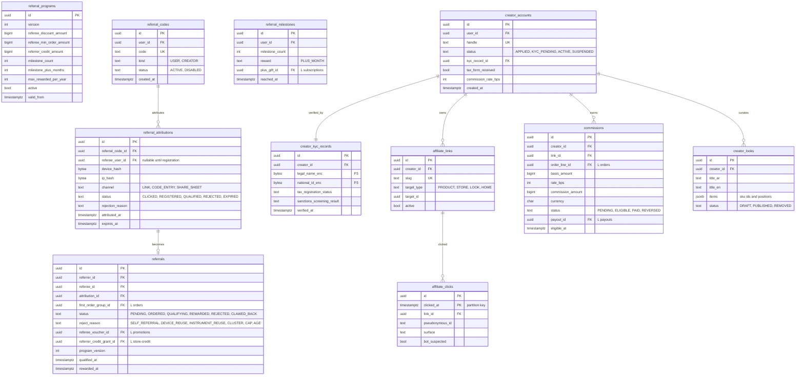

# Module: referrals

Phase 1 (referral core) and Phase 3 (creator program, affiliate dashboard) · Spec refs: §15.4, §B6, §20.7, §8 (share links), §T4, §B4 · Owner aggregates: `ReferralCode`, `Referral`, `CreatorAccount`, `AffiliateClick`, `Commission`

## Flow
A user receives a code and a deep link. A friend installs, opens the link (attribution is recorded), registers as a new person, and places a first order of at least 600 EGP, receiving a discount (150 EGP, a voucher). The referrer receives referral credit (100 EGP) only after the friend's return window closes and the order is not refunded. Milestone: 10 referrals gives one free Plus month. Creators publish affiliate links and curated looks, earn commissions that become payouts after KYC.

## Rules
- Friend eligibility: new phone, new device, new payment fingerprint, age 18+. Referrer must have at least one delivered order. Max 50 rewarded referrals per year.
- Reward timing: after the referee order is `CLOSED` and not refunded. COD first orders reward only after delivery and the window closes (§15.4).
- Amounts and thresholds are `referral_programs` rows (versioned config), not constants: referee reward 150 EGP off a first order of at least 600, referrer 100 EGP credit, milestone 10 referrals = 1 free Plus month. They are stated here as spec defaults.
- Fraud: device, IP, instrument and address graph (fraud module), self-referral blocking, cluster detector (connected components above N). A self-referral on the same device is rejected silently with no reward and is logged (acceptance).
- Creator program: affiliate links, curated looks, commissions through payouts with KYC, age 21 (§B6), tax form. Creator VAT above EGP 500k is VERIFY BEFORE LAUNCH (register row 17).
- Attribution window and last-click rule are config. Clicks are pseudonymous, partitioned, and retained 13 months (proposed).
- Referral rewards are `referral_credit` sub-balances (6 months expiry, store-credit) and vouchers (promotions).
- Creator commission is calculated on net-of-returns merchandise value and accrues only after `CLOSED`.

## Edge cases
- Referee registers but never orders: attribution expires, no cost.
- Referrer account deleted: pending rewards cancelled.
- Referee refunds after reward: reward clawback within the claim window, else absorbed (decision, I-49).
- Multiple codes presented: first valid attribution wins, others recorded.
- Code owner suspended: new attributions rejected, pending ones frozen.
- Creator tries to refer themselves through affiliate links: commission blocked.
- Deep link opened without install: deferred attribution token with short TTL.

## ER diagram

## Entities

| Entity | Ph | PK | FK (E enforced, L logical) | Indexes and uniqueness | PII | Tenancy | Partition | Retention |
|---|---|---|---|---|---|---|---|---|
| `referral_programs` | P1 | `id` | none | unique `(version)` | P0 | none | none | RET-CONFIG |
| `referral_codes` | P1 | `id` | `user_id` E | unique `(code)`; unique `(user_id, kind)` | P2 | `user_id` | none | RET-USER |
| `referral_attributions` | P1 | `id` | `referral_code_id` E, `referee_user_id` E | index `(referee_user_id)`; index `(device_hash)`; index `(status, expires_at)` | P2 (device and IP hashes) | none (referrer sees counts only) | monthly by `attributed_at` (proposed) | 13 months (proposed) for unconverted, with the referral for converted |
| `referrals` | P1 | `id` | `referrer_id` E, `referee_id` E, `attribution_id` E, `first_order_group_id` L, `referee_voucher_id` L, `referrer_credit_grant_id` L | unique `(referee_id)` (one referral per referee); index `(referrer_id, status)`; partial index `(status) WHERE status = 'QUALIFYING'` | P2 | `user_id` (referrer) | none | RET-TAX when a reward was paid, else RET-USER |
| `referral_milestones` | P1 | `id` | `user_id` E, `plus_gift_id` L | unique `(user_id, milestone_count)` | P2 | `user_id` | none | RET-USER |
| `creator_accounts` | P3 | `id` | `user_id` E, `kyc_record_id` E | unique `(user_id)`; unique `(handle)` | P2 | `user_id` | none | RET-KYC |
| `creator_kyc_records` | P3 | `id` | `creator_id` E | unique `(creator_id)` | P3 (national id, legal name) | `creator_id`, finance and compliance only | none | RET-KYC contract plus 5 years (spec §B1, VERIFY) |
| `affiliate_links` | P3 | `id` | `creator_id` E, `target_id` L | unique `(slug)`; index `(creator_id)` | P1 | `creator_id` | none | RET-CONFIG |
| `affiliate_clicks` | P3 | `(id, clicked_at)` | `link_id` E | index `(link_id, clicked_at)` | P1 (pseudonymous id, never user id) | `creator_id` via link (aggregates only) | monthly by `clicked_at` (spec: partitioned) | 13 months, `affiliate_attribution` (proposed) |
| `commissions` | P3 | `id` | `creator_id` E, `link_id` E, `order_line_id` L, `payout_id` L | unique `(creator_id, order_line_id)`; partial index `(eligible_at) WHERE status = 'PENDING'` | P2 | `creator_id` | none | RET-TAX |
| `creator_looks` | P3 | `id` | `creator_id` E | index `(creator_id, status)` | P0 | `creator_id` | none | RET-USER |

## Data notes
- Spec data: `referral_codes`, `referrals(referrer_id, referee_id, status, order_id)`, `creator_accounts`, `affiliate_clicks(partitioned)`, `commissions`. `referrals.order_id` becomes `first_order_group_id`. An attribution table is added because a click, a registration and a qualified order are different events and different fraud signals (I-50).
- `referral_codes` and `referral credits` use store credit grants (`referral_credit`, 6 months) and promotion vouchers. No money value is stored in this module.
- The creator KYC uses the same checks as sellers but a creator is a person, so it is stored here as `creator_kyc_records` (the inventory references a `kyc_record_id` of `seller_kyc_records`, I-34).
- Fraud graphs (device, IP, instrument, address) live in fraud. This module stores only hashes needed for attribution and passes them to fraud.
- Commission payouts use `payout_instruments` with `owner_type = CREATOR` (payouts).
- Sellers see no referral data of their customers.

## API
| Endpoint | Scope | Idempotent | Rate limit |
|---|---|---|---|
| `GET /v1/me/referral` | user | n/a | 60/min |
| `POST /v1/referrals/attribute` | user or device, App Attest | yes | 10/min |
| `GET /v1/creator/dashboard` | creator | n/a | 60/min |
| `POST /v1/creator/applications` | user 21+ | yes | 5/min |
| `GET /r/{slug}` | public redirect, bot filtered | n/a | edge |

## Events
Outbox: `referral.attributed`, `referral.qualified`, `referral.rewarded`, `referral.rejected`, `creator.activated`, `commission.accrued`. Analytics: `referral_shared`, `referral_converted`.

## Failure handling
Reward grant uses store-credit idempotency keys. A failing grant leaves the referral `QUALIFYING` for retry. Click ingestion is best effort and sampled under load. Attribution tokens are single-use.

## Security and abuse
- Referral farming: multi-account graph, cluster detector, silent rejection (no oracle for attackers), per-year cap.
- API6: attribution endpoint requires attestation and has per-device limits.
- Affiliate links cannot redirect to arbitrary URLs (target is an internal id). Open-redirect is not possible.
- Creator KYC data is P3, encrypted, and viewable by compliance only.

## Metrics
K-factor, referral CAC, fraud rejection rate, time from friend order to reward, creator GMV share, commission paid versus accrued.

## Acceptance
- A self-referral on the same device is rejected silently (no reward) and logged.
- The referrer reward is granted only after the friend's order is `CLOSED` and not refunded.
- The 51st rewarded referral in a year is not rewarded.
- Creator commission is blocked until KYC is `VERIFIED` and age 21 is attested.
