# Module: returns

Phase 1 (returns, exchange-first, inspection, disputes, serial-returner policy) and Phase 2 (returns-resale lane) · Spec refs: §22, §15.6, §B5, §20.1, §T4 (payout interplay), §28.7, §28.16 · Owner aggregates: `Return`, `Exchange`, `Inspection`, `Dispute`, `ReturnPolicy`

## Flow
The shopper opens an order line, picks a reason from the taxonomy, attaches photos where required, picks pickup or drop-off, and gets a resolution proposal (exchange first for size reasons, otherwise refund). The module creates a `returns` row, books a return shipment through fulfillment, tracks `RETURN_RECEIVED`, records the seller or hub inspection within 48 h (silence auto-approves), and on approval asks payments for a refund through the `RefundRouter`. A rejected inspection with photos can be disputed, which opens a trust-safety case with a 5 business day SLA.

## Rules
- Window starts at courier-confirmed `delivered_at` (orders). Policy rows hold the windows so counsel changes are config, not code. Defaults (VERIFY BEFORE LAUNCH): change of mind 14 d, defective or not as described or wrong item 30 d, size exchange 14 d with a free first exchange.
- Return shipping payer: shopper (free for Plus) for change of mind, seller for defects, free first size exchange.
- Refund scope: item price for change of mind (delivery fee not refunded unless the whole order is returned within 7 d), full including delivery for defects (§22 table). Refund amounts are calculated by payments from the order line allocations.
- Non-returnable classes come from `categories.return_class` (hygiene, personalized) and are disclosed on the PDP and at checkout. Defective items are still returnable.
- Minor-defect or sample items sold as-is: the disclosed defect is not a return reason, other defects are (`product_defects`).
- Inspection: the seller or Fulfilled-by-HAUL hub inspects within 48 h. No answer auto-approves. A rejection needs photos.
- Serial returners: return rate above 60% over at least 10 orders in 6 months removes free returns and sends a notice. The policy is published and thresholds are `return_policy_rules` rows, never secret (§22).
- Exchange-first: for reason `too small` or `too large`, an instant size swap creates a new order line on a new seller order at the same price if in stock, reserved before the return is confirmed.
- Returns-resale lane (Phase 2): inspected items can be relisted as "Open-box, returned" with condition grading.
- Refund deadline: the spec states two bases (14 days from delivery in §B5, 14 days from return receipt in §15.6). ADR-0009 (proposed) tracks both clocks per return and alerts on whichever expires first (`refund_deadline_basis` policy, VERIFY BEFORE LAUNCH, I-83).
- Payout interplay: a line is payout-eligible only after `CLOSED`. A refund after payout makes the seller balance negative and is netted from the next payout (payouts).
- State machine for `returns`: `REQUESTED -> APPROVED_FOR_PICKUP | REJECTED_AT_REQUEST -> PICKUP_SCHEDULED -> IN_TRANSIT -> RECEIVED -> INSPECTED -> REFUND_REQUESTED -> REFUNDED | EXCHANGED | INSPECTION_REJECTED -> DISPUTED -> DISPUTE_UPHELD | DISPUTE_OVERTURNED`, plus `CANCELLED`.

## Edge cases
- Return requested on day 15 for change of mind: refused with a clear reason. Defect on day 29: accepted (acceptance).
- Partial quantity return: `qty` smaller than the line quantity. Remaining quantity can be returned later while the window is open.
- Exchange SKU out of stock between request and receipt: falls back to refund route chosen by the shopper.
- Item lost in return transit: courier `LOST` raises a seller-neutral claim, refund is paid on proof of dispatch, cost allocated by policy.
- Return of a BNPL order: only provider cancel or partial cancel (payments enforces).
- Return of a COD order: store credit instantly or bank or wallet transfer within the deadline (payments).
- Shopper deletes account with an open return: deletion blocked until closed (§2).
- Seller suspended while a return is in flight: HAUL hub or T&S takes over the inspection.

## ER diagram

```mermaid
erDiagram
    return_reason_codes {
        text code PK "TOO_SMALL, TOO_LARGE, NOT_AS_DESCRIBED, DEFECTIVE, CHANGED_MIND, LATE, WRONG_ITEM"
        text title_ar
        text title_en
        bool photos_required
        bool exchange_first
        text fault_default "SELLER, SHOPPER, PLATFORM"
        text window_class "CHANGE_OF_MIND, DEFECT, SIZE_EXCHANGE"
        int version
    }
    return_policies {
        uuid id PK
        text window_class
        text return_class "standard, hygiene, personalized, non_returnable"
        int window_days
        text shipping_payer "SHOPPER, SELLER, PLATFORM"
        bool plus_free_shipping
        int version
        timestamptz valid_from
        text legal_review_status "UNVERIFIED, VERIFIED"
    }
    return_policy_rules {
        uuid id PK
        text rule_code "SERIAL_RETURNER_RATE, SERIAL_RETURNER_MIN_ORDERS, INSPECTION_HOURS, AUTO_APPROVE, REFUND_DEADLINE_BASIS, REFUND_DEADLINE_DAYS, REFUND_ON_PICKUP_RISK_LIMIT"
        numeric numeric_value
        text unit
        int version
        timestamptz valid_from
        uuid changed_by
    }
    returns {
        uuid id PK
        uuid user_id FK
        uuid order_line_id FK
        uuid seller_order_id FK
        uuid store_id FK "tenancy"
        int qty
        text reason_code FK
        text reason_note
        text method "PICKUP, DROP_OFF"
        text status
        text resolution_requested "EXCHANGE, REFUND_ORIGINAL, REFUND_CREDIT"
        text resolution_final
        uuid return_shipment_id FK "L fulfillment"
        uuid exchange_order_line_id FK "nullable"
        uuid refund_id FK "L payments, nullable"
        timestamptz requested_at
        timestamptz window_ends_at
        timestamptz refund_due_from_delivery_at "clock 1, ADR-0009"
        timestamptz refund_due_from_receipt_at "clock 2, ADR-0009"
        timestamptz refund_initiate_by "24 h after receipt"
        timestamptz received_at
        timestamptz closed_at
        text idempotency_key UK
    }
    return_evidence {
        uuid id PK
        uuid return_id FK
        uuid media_asset_id FK
        text kind "SHOPPER_PHOTO, INSPECTION_PHOTO, DISPUTE_PHOTO, TAG_PHOTO"
        text uploaded_by_type "SHOPPER, SELLER, HUB, TS"
        timestamptz uploaded_at
    }
    return_inspections {
        uuid id PK
        uuid return_id FK
        text inspector_type "SELLER, HUB"
        uuid inspector_id
        text result "APPROVED, PARTIAL, REJECTED, AUTO_APPROVED"
        text condition_grade "A, B, C, DAMAGED, WRITTEN_OFF"
        text rejection_reason_code
        timestamptz due_at
        timestamptz inspected_at
    }
    return_disputes {
        uuid id PK
        uuid return_id FK
        uuid ts_case_id FK "L trust-safety"
        text opened_by "SHOPPER, SELLER"
        text status "OPEN, UPHELD, OVERTURNED, WITHDRAWN"
        text decision_note_code
        timestamptz sla_due_at
        timestamptz opened_at
        timestamptz decided_at
    }
    return_status_history {
        uuid id PK
        timestamptz occurred_at PK "partition key"
        uuid return_id FK
        text from_status
        text to_status
        text actor_type
        uuid actor_id
    }
    returner_standing {
        uuid user_id PK
        int orders_6m
        int returns_6m
        numeric return_rate
        bool free_returns_removed
        timestamptz notice_sent_at
        timestamptz evaluated_at
    }
    return_resale_items {
        uuid id PK
        uuid return_id FK
        uuid sku_id FK "original sku"
        uuid listing_sku_id FK "open-box sku, nullable until listed"
        text grade "A, B, C"
        bigint list_price_amount
        text status "PENDING_LISTING, LISTED, SOLD, WITHDRAWN"
    }
    return_reason_codes ||--o{ returns : explains
    returns ||--o{ return_evidence : documented_by
    returns ||--o{ return_inspections : inspected_by
    returns ||--o{ return_disputes : disputed_by
    returns ||--o{ return_status_history : transitions
    returns ||--o| return_resale_items : relisted_as
```

## Entities

| Entity | Ph | PK | FK (E enforced, L logical) | Indexes and uniqueness | PII | Tenancy | Partition | Retention |
|---|---|---|---|---|---|---|---|---|
| `return_reason_codes` | P1 | `code` | none | none | P0 | none | none | RET-CONFIG |
| `return_policies` | P1 | `id` | none | unique `(window_class, return_class, version)` | P0 | none | none | RET-CONFIG, versions kept (windows applied at the time of order are re-derivable) |
| `return_policy_rules` | P1 | `id` | `changed_by` L admin | unique `(rule_code, version)` | P1 | none | none | RET-CONFIG |
| `returns` | P1 | `id` | `user_id` E, `order_line_id` L, `seller_order_id` L, `store_id` E, `reason_code` E, `return_shipment_id` L, `refund_id` L | unique `(idempotency_key)`; index `(user_id, requested_at DESC)`; index `(store_id, status, requested_at DESC)`; index `(order_line_id)`; partial index `(status, received_at) WHERE status = 'RECEIVED'` for the 48 h inspection sweeper | P2 | `user_id` and `store_id` | none | `returns_evidence` for photos 12 months (proposed); the return row itself RET-TAX because it justifies a refund |
| `return_evidence` | P1 | `id` | `return_id` E, `media_asset_id` E | index `(return_id)` | P2 (photos of person or home are possible) | `store_id` via return | none | `returns_evidence` 12 months after closure (proposed, VERIFY) |
| `return_inspections` | P1 | `id` | `return_id` E | index `(return_id)`; partial index `(due_at) WHERE inspected_at IS NULL` | P1 | `store_id` via return | none | RET-TAX |
| `return_disputes` | P1 | `id` | `return_id` E, `ts_case_id` L | unique `(return_id) WHERE status = 'OPEN'`; index `(status, sla_due_at)` | P2 | `user_id`, `store_id` via return | none | RET-TAX |
| `return_status_history` | P1 | `(id, occurred_at)` | `return_id` E | index `(return_id, occurred_at)` | P1 | via return | monthly by `occurred_at` | RET-TAX |
| `returner_standing` | P1 | `user_id` | `user_id` E | index `(free_returns_removed)` | P2 | `user_id` | none | RET-USER, recomputed daily |
| `return_resale_items` | P2 | `id` | `return_id` E, `sku_id` E, `listing_sku_id` E | unique `(return_id)` | P0 | `store_id` of the owner | none | RET-CONFIG |

## Data notes
- The spec has no Data block for §22 (only API and events). Entities are derived from the flow, rules table and §20.1 states. The return state names in §20.1 are order-level (`RETURN_REQUESTED ... REFUNDED`) and are not the same enumeration as the return aggregate (A2.6 lists "Return" and "Refund" as separate machines). `seller_orders.status` mirrors a coarse subset (I-26).
- Return per order line (spec API: `POST /v1/orders/lines/{id}/returns`) versus data inventory's `returns(order_line_id)` is consistent. Multi-line "returns" in the UI are several rows created in one request and grouped by `return_batch_id` (not stored in Phase 1, the shipment groups them).
- `returner_standing` is a derived read model, not a profile. The thresholds in `return_policy_rules` are public.
- Return windows are computed at request time from `seller_orders.delivered_at` and the policy version in force on `delivered_at`, and stored as `window_ends_at` so later policy changes do not change an existing decision.
- The seven-day cancellation versus 14-day return interplay is VERIFY BEFORE LAUNCH (§B5, register row 7). The model supports both by storing `window_class` on policy rows and the applied class on `returns`.

## API
| Endpoint | Scope | Idempotent | Rate limit |
|---|---|---|---|
| `POST /v1/orders/lines/{id}/returns` | owner | yes | 10/min |
| `GET /v1/me/returns` | owner | n/a | 60/min |
| `POST /v1/seller/returns/{id}/inspect` | seller staff, store scoped | yes | 60/min |
| `POST /v1/returns/{id}/dispute` | owner or seller | yes | 10/min |
| `GET /v1/returns/policy` | public | n/a | 60/min |

## Events
Outbox: `return.requested`, `return.approved`, `return.received`, `return.inspected`, `return.disputed`, `return.closed`, `exchange.created`. `refund.completed` is emitted by payments. Analytics: `return_requested(reason)`, `refund_completed`.

## Failure handling
Return pickup booking uses the fulfillment adapter with retries. A missed 48 h inspection auto-approves through a sweeper. If payments refund fails, the return stays `REFUND_REQUESTED` and a retry job runs. Event consumers are idempotent.

## Security and abuse
- BOLA: a return is readable by its owner, the store of the order, and scoped admin or T&S. Foreign id returns 404.
- Return fraud: wardrobing, wrong item returned, empty box. Inspection evidence and serial-returner standing feed fraud signals. Refund to store credit after BNPL is blocked.
- Photos are uploaded through the media pipeline (type sniff, AV scan, EXIF strip).
- The serial-returner policy is transparent and logged. Users receive a notice, and a human T&S review path exists (no silent punishment).

## Metrics
Return rate by category, seller and reason, size-related return rate (target minus 10% vs control), time from received to refund, inspection SLA hit rate, dispute rate and overturn rate, exchange share, refund time p95.

## Acceptance
- A change-of-mind return requested on day 15 after delivery is refused with a clear reason, and a defect on day 29 is accepted.
- Inspection silence for 48 h auto-approves and requests the refund.
- A returned line produces exactly one refund, even with duplicate events.
- A BNPL order refund request cannot select store credit.
