# Module: rewards

Phase 2 (coins, tiers, challenges, light games) · Spec refs: §15.5, §15.2 (cashback_coins), §18 (variable rewards, disclosed odds), §14 (Plus cashback), §22 (clawback), §B6 · Owner aggregates: `CoinAccount`, `CoinLot`, `TierStatus`, `GamePlay`, `Challenge`

## Flow
Events (order delivered and not returned, photo review with size info, size-profile completion, fit feedback, referral, streak, challenge) create `coin_lots` in `PENDING` that become `AVAILABLE` when the earning condition closes (for purchases: after the return window). A user converts coins into store credit (a ledger entry through store-credit). Tiers are computed from 12-month net spend. Light games (daily spin, scratch card after delivery) are played server-side with disclosed, versioned odds and award only coins or vouchers.

## Rules
- Earning rules are config rows (`coin_earn_rules`, versioned, admin-editable with audit). Coins for purchases accrue on delivered and not-returned items. Coins for reviews are given for any honest review, never for positive ones (§27).
- 1 coin = 1 piastre of store credit when converted (config `coin_conversion_rate`). Coins expire after 12 months (FIFO by lot).
- Plus members earn +5% coins cashback (rule row), not a separate mechanism.
- Coins earned on an order are clawed back if the order is returned. A clawback larger than the remaining balance leaves a debt, which is netted against future earnings, never charged in cash (I-44).
- Tiers by 12-month net spend: Bronze, Silver, Gold, Black. Thresholds and benefits are `tier_definitions` rows. Net spend is derived from orders net of refunds, and is not stored per order here beyond a rolling total.
- Games: free to play, no paid chance mechanic, odds are disclosed and versioned (`game_odds_versions`), awards are coins or vouchers only, never cash. Egyptian promotional and lottery rules are VERIFY BEFORE LAUNCH (register row 9).
- Randomness is injected, never `Math.random`. The outcome is derived from a server-side seed and stored so that odds can be audited.
- Eligibility to play: one daily spin per user per Cairo day, one scratch card per delivered order, age 18+, verified phone.
- Behavioural design follows §18: no fake timers or hidden odds, expiring coins are disclosed with dates.
- Rewards never uses budget data (§12) for targeting or nudges.

## Edge cases
- Order partially returned: coins clawed back pro rata by line.
- Coins expire while a conversion is in progress: conversion locks the lot rows, expiry skips locked.
- Tier downgrade mid-year: benefit changes at the next evaluation date, with notice.
- Duplicate event delivery: earning is idempotent on `(source_type, source_ref, rule_id)`.
- Account deletion: coins forfeited with a warning (as credit), game history erased.
- Game replay attempt (double tap): idempotency key per play.
- Rule change: applies to new accruals, lots carry the rule version.

## ER diagram

```mermaid
erDiagram
    coin_earn_rules {
        uuid id PK
        text rule_code "PURCHASE_DELIVERED, PHOTO_REVIEW_SIZE, SIZE_PROFILE_COMPLETE, FIT_FEEDBACK, REFERRAL, STREAK, CHALLENGE, PLUS_CASHBACK"
        int version
        int coins_flat
        int coins_bps_of_net "basis points of net spend"
        int daily_cap
        bool active
        timestamptz valid_from
        uuid changed_by
    }
    coin_accounts {
        uuid user_id PK
        bigint available_coins
        bigint pending_coins
        bigint debt_coins
        timestamptz updated_at
    }
    coin_lots {
        uuid id PK
        uuid user_id FK
        bigint coins
        bigint remaining
        text source_type "ORDER_LINE, REVIEW, SIZE_PROFILE, FIT_FEEDBACK, REFERRAL, STREAK, CHALLENGE, GAME"
        text source_ref
        uuid rule_id FK
        text status "PENDING, AVAILABLE, CONVERTED, EXPIRED, CLAWED_BACK"
        timestamptz available_at
        timestamptz expires_at
        timestamptz created_at
    }
    coin_transactions {
        uuid id PK
        timestamptz occurred_at PK "partition key"
        uuid user_id FK
        uuid lot_id FK "nullable"
        text kind "EARN, RELEASE, CONVERT, EXPIRE, CLAWBACK, DEBT_NETTED"
        bigint coins "signed"
        text idempotency_key
        text ref_type
        text ref_id
    }
    coin_conversions {
        uuid id PK
        uuid user_id FK
        bigint coins
        bigint credit_amount
        char currency
        uuid credit_grant_id FK "L store-credit"
        text idempotency_key UK
        timestamptz converted_at
    }
    tier_definitions {
        text code PK "BRONZE, SILVER, GOLD, BLACK"
        int version PK
        bigint min_net_spend_12m_amount
        jsonb benefits "Zod validated"
        int sort_order
        timestamptz valid_from
    }
    user_tiers {
        uuid user_id PK
        text tier_code
        bigint net_spend_12m_amount
        timestamptz evaluated_at
        timestamptz next_evaluation_at
        timestamptz tier_since
    }
    game_definitions {
        uuid id PK
        text code "DAILY_SPIN, SCRATCH_CARD"
        text title_ar
        text title_en
        bool active
        text eligibility "DAILY, PER_DELIVERED_ORDER"
    }
    game_odds_versions {
        uuid id PK
        uuid game_id FK
        int version
        jsonb prizes "prize, probability_bps, disclosed"
        text disclosure_text_ar
        timestamptz valid_from
        uuid approved_by
    }
    game_plays {
        uuid id PK
        timestamptz played_at PK "partition key"
        uuid user_id FK
        uuid game_id FK
        int odds_version
        text outcome_code
        bigint coins_awarded
        uuid voucher_id FK "L promotions, nullable"
        bytea seed_hash
        text idempotency_key
    }
    challenges {
        uuid id PK
        text title_ar
        text title_en
        jsonb criteria "Zod validated"
        bigint reward_coins
        timestamptz starts_at
        timestamptz ends_at
        bool active
    }
    challenge_progress {
        uuid challenge_id PK
        uuid user_id PK
        int progress
        int target
        text status "IN_PROGRESS, COMPLETED, EXPIRED"
        timestamptz completed_at
    }
    user_streaks {
        uuid user_id PK
        text streak_type PK "DAILY_OPEN, WEEKLY_PURCHASE"
        int current_count
        int best_count
        date last_day
    }
    coin_earn_rules ||--o{ coin_lots : creates
    coin_accounts ||--o{ coin_lots : holds
    coin_lots ||--o{ coin_transactions : moves
    coin_accounts ||--o{ coin_conversions : converts
    game_definitions ||--o{ game_odds_versions : odds
    game_definitions ||--o{ game_plays : played
    challenges ||--o{ challenge_progress : tracked
    tier_definitions ||--o{ user_tiers : assigns
```

## Entities

| Entity | Ph | PK | FK (E enforced, L logical) | Indexes and uniqueness | PII | Tenancy | Partition | Retention |
|---|---|---|---|---|---|---|---|---|
| `coin_earn_rules` | P2 | `id` | `changed_by` L | unique `(rule_code, version)` | P0 | none | none | RET-CONFIG |
| `coin_accounts` | P2 | `user_id` | `user_id` E | none | P2 | `user_id` | none | RET-USER |
| `coin_lots` | P2 | `id` | `user_id` E, `rule_id` E | unique `(source_type, source_ref, rule_id)`; partial index `(user_id, expires_at) WHERE status = 'AVAILABLE'`; partial index `(available_at) WHERE status = 'PENDING'` | P2 | `user_id` | none | RET-USER; liability evidence follows RET-TAX through conversions |
| `coin_transactions` | P2 | `(id, occurred_at)` | `user_id` E, `lot_id` E | unique `(user_id, idempotency_key, occurred_at)` (global uniqueness via small key table, I-37); index `(user_id, occurred_at DESC)` | P2 | `user_id` | monthly by `occurred_at` | 25 months then aggregated (proposed) |
| `coin_conversions` | P2 | `id` | `user_id` E, `credit_grant_id` L | unique `(idempotency_key)` | P2 | `user_id` | none | RET-TAX |
| `tier_definitions` | P2 | `(code, version)` | none | none | P0 | none | none | RET-CONFIG |
| `user_tiers` | P2 | `user_id` | `user_id` E | index `(tier_code)` | P2 | `user_id` | none | RET-USER |
| `game_definitions` | P2 | `id` | none | unique `(code)` | P0 | none | none | RET-CONFIG |
| `game_odds_versions` | P2 | `id` | `game_id` E, `approved_by` L | unique `(game_id, version)` | P0 | none | none | indefinite (disclosure evidence) |
| `game_plays` | P2 | `(id, played_at)` | `user_id` E, `game_id` E, `voucher_id` L | index `(user_id, played_at DESC)`; index `(game_id, played_at)` | P2 | `user_id` | monthly by `played_at` | 25 months (proposed) |
| `challenges` | P2 | `id` | none | index `(active, starts_at, ends_at)` | P0 | none | none | RET-CONFIG |
| `challenge_progress` | P2 | `(challenge_id, user_id)` | `challenge_id` E, `user_id` E | index `(user_id)` | P2 | `user_id` | none | RET-USER |
| `user_streaks` | P2 | `(user_id, streak_type)` | `user_id` E | none | P2 | `user_id` | none | RET-USER |

## Data notes
- The spec lists no tables for §15.5. The data inventory lists none either. Entities are derived from the prose. Coin conversion (1 coin = 1 piastre) links to store credit's `cashback_coins` sub-balance (I-44).
- Coin liability is not in the §T4 chart of accounts (I-11). Two accounting options exist: recognise liability at earning (`coins_liability`) or recognise a promo expense at conversion. Finance and tax decide (VAT on coins is VERIFY BEFORE LAUNCH). `coin_lots` supports both.
- Net spend for tiers is computed from orders, returns and refunds events, not from budget tables.
- Odds disclosure is part of the model (`disclosure_text_ar`), and the UI renders it from the same row, so what is shown is what is applied.
- `game_plays.seed_hash` is a hash of the server seed and context, for audit without exposing future outcomes.

## API
| Endpoint | Scope | Idempotent | Rate limit |
|---|---|---|---|
| `GET /v1/me/rewards` | user | n/a | 60/min |
| `POST /v1/me/rewards/convert` | user | yes | 10/min |
| `POST /v1/me/games/{code}/play` | user, App Attest | yes | 5/min |
| `GET /v1/me/challenges` | user | n/a | 60/min |
| `GET /v1/games/{code}/odds` | public | n/a | 60/min |
| `CRUD /v1/admin/rewards/rules` | marketing, dual approval above threshold | yes | 30/min |

## Events
Outbox: `coins.earned`, `coins.released`, `coins.expired`, `coins.clawed_back`, `coins.converted`, `tier.changed`, `game.played`. Analytics: `coins_earned`.

## Failure handling
Earning consumers use the inbox, so duplicate delivery is a no-op. Conversion is a two-step with the store-credit grant under one idempotency key. Expiry job is per lot and idempotent. A failed game play never double-awards (idempotency key).

## Security and abuse
- API6: game plays and challenge claims rate limited, App Attest required, multi-account detection from fraud, no award to flagged accounts.
- Self-review and incentivised review bias are prevented by the rule, not by the reward amount.
- Mass assignment: coins, lots and tiers are server-owned.
- Odds rows are immutable once approved.

## Metrics
Coins issued versus converted, breakage (reported), tier distribution, play rate, redemption rate, clawback rate, reward-driven repeat rate.

## Acceptance
- An order's coins are `PENDING` until the return window closes, and are clawed back if returned.
- Two identical earn events produce one lot.
- Game odds shown equal the odds used for the play (version stored on the play).
- Converting 1,000 coins yields 1,000 piastres of `cashback_coins` credit under the configured rate.
