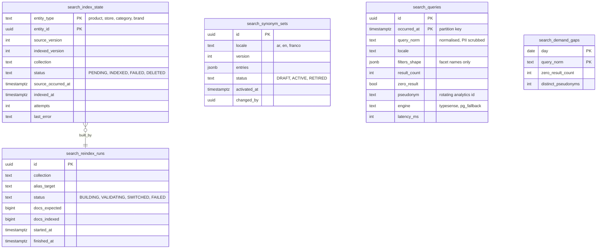

# Module: search-sync

Phase 1 (index sync, Arabic normalisation config, fallback) and Phase 3 (visual search) · Spec refs: §4, §5, §T3 · Owner aggregates: `SearchIndexState`, `SynonymSet`

## Flow
Catalog, price, stock and health outbox events are consumed here and turned into Typesense documents. `search_index_state` records which version of each entity is indexed so the sync is idempotent and can be audited for the 60 s staleness SLO. Synonym sets (Arabic, English, Franco-Arabic) are managed here and pushed to the engine. If Typesense is down, a kill switch routes reads to a Postgres trigram/FTS fallback.

## Rules
- Index is a projection. Postgres is the source of truth for price and stock, which are rechecked on the product page and in the bag (§4).
- A document carries only P0 data. No user data enters the shared index (LLM08).
- Index writes are version-guarded: a document with a lower `source_version` than `indexed_version` is ignored.
- Staleness SLO: 95th percentile below 60 s from outbox `occurred_at` to `indexed_at`.
- Sponsored placement flags are written by ads (Phase 2) and capped in ranking, not here.

## Edge cases
- Event arrives before the product row is visible: retried with backoff, then dead-lettered.
- Entity deleted or delisted: tombstone document removed, `status = DELETED` kept for audit.
- Full reindex while live: a new collection alias is built, validated by count and sample, then the alias flips.
- Synonym conflict between AR and Franco sets: later `version` wins, conflicts reported.

## ER diagram

## Entities

| Entity | Ph | PK | FK (E enforced, L logical) | Indexes and uniqueness | PII | Tenancy | Partition | Retention |
|---|---|---|---|---|---|---|---|---|
| `search_index_state` | P1 | `(entity_type, entity_id)` | `entity_id` L | partial index `(status, source_occurred_at) WHERE status <> 'INDEXED'` | P0 | none | none | rebuilt, row removed 30 d after `DELETED` (proposed) |
| `search_reindex_runs` | P1 | `id` | none | index `(started_at DESC)` | P1 | none | none | 13 months |
| `search_synonym_sets` | P1 | `id` | `changed_by` L | unique `(locale, version)`; partial unique `(locale) WHERE status = 'ACTIVE'` | P0 | none | none | RET-CONFIG |
| `search_queries` | P1 | `(id, occurred_at)` | none | index `(occurred_at)`; index `(zero_result, occurred_at)` | P1 by design (pseudonymous, no user id, no free-text PII) | none | monthly by `occurred_at` | RET-EVENTS 25 months then aggregated (inventory `search_queries`) |
| `search_demand_gaps` | P1 | `(day, query_norm)` | none | none | P1 (aggregate, k-threshold applied) | none | none | 25 months |

## Data notes
- `search_queries` is "analytics, PII-free" in §4. It stores no user id. A rotating pseudonym allows session-level analysis only (analytics-ingest owns pseudonym keys). Free text is passed through a PII scrubber (phone, email, ID patterns) before storage. Because free text can still contain personal data, the inventory marks it `verify: true`.
- Demand gaps are aggregated with a minimum of 5 distinct pseudonyms before they are shown to sellers.
- The vector side (pgvector or Typesense vectors) is owned by stylist-gateway (`product_embeddings`) and recommendations-gateway. This module only syncs the lexical documents and a reference to the vector.

## API
| Endpoint | Scope | Idempotent | Rate limit |
|---|---|---|---|
| `GET /v1/search?q=&filters=&cursor=` (served by catalog facade, uses this index) | public | n/a | 30 per 10 s per user |
| `POST /v1/admin/search/reindex` | admin ops | yes | 2/hour |
| `PUT /v1/admin/search/synonyms/{locale}` | admin ops | yes | 10/hour |

## Events
Consumes `product.*`, `sku.*`, `buybox.changed`, `price_claim.scored`, `store.*`, `inventory.stock_changed`. Emits `search_index.synced` (internal). Analytics: `search_performed`, `search_no_result`.

## Failure handling
Poison document goes to `dead_letter_events` after 5 attempts. Typesense outage triggers the kill switch and the FTS fallback with reduced features. Stale documents are corrected by a periodic reconciler that compares `source_version` with `indexed_version`.

## Security and abuse
Filter JSON validated by Zod (max 30 facets, page size 50). Index credentials are scoped: the API holds a search-only key, only workers hold write keys. Query logging passes the PII scrubber before storage.

## Metrics
Index lag p95, sync failure rate, zero-result rate below 8%, search p95 below 150 ms, fallback activation count.

## Acceptance
- A price change reaches the index within 60 s at the 95th percentile.
- Killing Typesense flips to the Postgres fallback without 5xx on `GET /v1/search`.
- A document with an older `source_version` never overwrites a newer one.
