# Module: sellers

Phase 1 (KYC onboarding, stores, team roles, health score, agreements, store settings) and Phase 2 (storefront builder, brand authorizations, advanced penalties) · Spec refs: §19, §B1 (sellers as controllers and processors), §B5 (seller legal identity), §B6 (21+ signatory), §9.5 (enforcement), §3 (stores), §T5 (passkey, TOTP) · Owner aggregates: `Seller`, `Store`, `KycCase`, `StoreMember`, `SellerHealthScore`, `SellerAgreement`

## Flow
A prospective seller registers a legal entity (a `sellers` row) and submits KYC documents: commercial register, tax card, signatory national ID (21+), IBAN, brand authorization or proof of purchase for third-party brands. Automatic checks (OCR, validation, sanctions and watchlist screening) run where APIs exist, otherwise an Ops queue handles it. On `APPROVED` the seller creates one or more `stores`, invites team members with roles and mandatory passkey or TOTP, signs the Seller Agreement (with the DPA and monitoring consent), and connects channels. Health scores are computed continuously and drive visibility.

## Rules
- KYC states: `DRAFT -> SUBMITTED -> AUTO_CHECKS -> (APPROVED | NEEDS_INFO | REJECTED)` and `APPROVED -> SUSPENDED` (§19, A2.6).
- The spec has one KYC state machine (`APPROVED -> SUSPENDED`) at seller level, while the price enforcement ladder suspends a store. Both levels exist here: `sellers.status` for legal-entity suspension (KYC, sanctions) and `stores.status` for enforcement per store. Which level each trigger uses is a product decision (I-80).
- Seller legal identity (legal name, commercial register number, tax card, governorate) is the **single source** shown on every listing (§B5). Product rows never copy it.
- A store is the shopper-facing and RLS tenant (`store_id`). A seller may have several stores. Tenant isolation uses the policy guard and RLS `app.current_store_id`.
- Roles: Manager, Catalog, Warehouse, Finance, Support. Staff are `users` rows with a membership (users `staff_memberships_ref`). Passkey or TOTP is mandatory (§19, §T5).
- ETA registration status and e-receipt capability are captured (tax-eta `eta_taxpayer_profiles`, cross-reference).
- SLAs: accept within 24 h (else auto-cancel and refund with a health penalty), dispatch within 48 h (configurable), answer Q&A within 48 h. Values are store or platform config.
- Health score inputs: dispatch SLA, cancellations, return rate, rating, Price Trust Score. It drives visibility automatically. Weights are admin config with versions.
- Seller staff see buyer PII only for active orders through delivery access grants, ending 30 days after delivery or return closure (§B1).
- Suspension may be automatic (price integrity ladder) but a human reviews a suspension within 5 business days (VERIFY BEFORE LAUNCH, counsel). A suspension hides the store, locks its bag groups, holds payouts per agreement.
- Free-delivery threshold default 2,000 EGP per store, admin and store configurable (cart), stored as store settings, not product columns (catalog I-64).
- The Seller Agreement includes the DPA and consent to price monitoring (§B1, §9.2). Agreement versions and acceptance are evidence (`seller_agreement_acceptances`).
- Unverified third-party brand claims block listing of that brand's products (anti-counterfeit, §B5).

## Edge cases
- KYC document expiry (commercial register renewal): store moves to `NEEDS_INFO` before suspension, with a grace period.
- Signatory below 21: rejected with reason code.
- Name mismatch between IBAN holder and legal name: payout instrument review (payouts).
- Staff leaves: membership revoked, sessions revoked, access to orders ends immediately.
- Store vacation: `store_vacation_windows` adjust ETA and dispatch SLA, listings stay visible.
- Seller deletes account with pending payouts: blocked until settled.
- Store ownership transfer: new KYC case, history kept, not edited in place.

## ER diagram

```mermaid
erDiagram
    sellers {
        uuid id PK
        text legal_name_ar
        text legal_name_en
        text entity_type "COMPANY, SOLE_TRADER, BRAND_OWNER, DISTRIBUTOR"
        bytea commercial_register_no_enc "P2"
        bytea tax_card_no_enc "P2"
        text governorate
        text origin "LOCAL, GLOBAL"
        text kyc_status
        text status "ACTIVE, SUSPENDED, OFFBOARDED"
        timestamptz created_at
    }
    stores {
        uuid id PK
        uuid seller_id FK
        text kind "local, global"
        text slug UK
        text display_name_ar
        text display_name_en
        text status "DRAFT, ACTIVE, PAUSED, SUSPENDED"
        int health_score
        bool verified_badge
        uuid logo_asset_id FK
        uuid cover_asset_id FK
        timestamptz created_at
    }
    store_settings {
        uuid store_id PK
        bigint free_delivery_threshold_amount
        text waiver_funded_by "SELLER, PLATFORM, SPLIT, DISABLED"
        bool seller_opted_in_waiver
        int accept_sla_hours
        int dispatch_sla_hours
        int qa_response_sla_hours
        text fulfillment_mode "SHIP_BY_SELLER, FULFILLED_BY_HAUL"
        text default_courier_code
        text return_address_ref
        int version
        timestamptz updated_at
    }
    store_vacation_windows {
        uuid id PK
        uuid store_id FK
        timestamptz starts_at
        timestamptz ends_at
        text note
    }
    store_members {
        uuid id PK
        uuid store_id FK
        uuid user_id FK
        text role "MANAGER, CATALOG, WAREHOUSE, FINANCE, SUPPORT"
        text status "INVITED, ACTIVE, REVOKED"
        bool second_factor_enrolled
        uuid invited_by
        timestamptz joined_at
        timestamptz revoked_at
    }
    store_member_invitations {
        uuid id PK
        uuid store_id FK
        bytea email_hash
        text role
        bytea token_hash
        timestamptz expires_at
        timestamptz accepted_at
    }
    seller_kyc_records {
        uuid id PK
        uuid seller_id FK
        text status "DRAFT, SUBMITTED, AUTO_CHECKS, APPROVED, NEEDS_INFO, REJECTED, SUSPENDED"
        bytea representative_name_enc "P3"
        bytea national_id_number_enc "P3"
        bytea national_id_hash "blind index"
        bool signatory_age_ok
        bytea tax_registration_number_enc "P2"
        text sanctions_screening_result "CLEAR, MATCH, REVIEW"
        timestamptz submitted_at
        timestamptz verified_at
        timestamptz expires_at
    }
    kyc_documents {
        uuid id PK
        uuid kyc_id FK
        text doc_type "COMMERCIAL_REGISTER, TAX_CARD, NATIONAL_ID, IBAN_PROOF, BRAND_AUTH, PROOF_OF_PURCHASE"
        uuid media_asset_id FK
        text ocr_status "PENDING, OK, MISMATCH, UNREADABLE"
        jsonb ocr_fields_enc
        timestamptz uploaded_at
    }
    kyc_checks {
        uuid id PK
        uuid kyc_id FK
        text check_type "OCR_VALIDATION, SANCTIONS, WATCHLIST, IBAN_NAME_MATCH, BRAND_AUTH"
        text provider_code
        text result "PASS, FAIL, REVIEW, ERROR"
        text reason_code
        timestamptz checked_at
    }
    kyc_review_tasks {
        uuid id PK
        uuid kyc_id FK
        text reason_code
        text status "OPEN, IN_REVIEW, DONE"
        uuid assignee
        timestamptz sla_due_at
    }
    seller_brand_authorizations {
        uuid id PK
        uuid seller_id FK
        uuid brand_id FK
        text proof_type "AUTHORIZATION_LETTER, PROOF_OF_PURCHASE, OWN_BRAND"
        uuid document_id FK
        text status "PENDING, VERIFIED, REJECTED, EXPIRED"
        timestamptz valid_until
    }
    seller_agreements {
        text code PK "SELLER_AGREEMENT, DPA, MONITORING_CONSENT"
        int version PK
        text body_object_key_ar
        text body_object_key_en
        timestamptz effective_from
    }
    seller_agreement_acceptances {
        uuid id PK
        uuid seller_id FK
        text agreement_code
        int agreement_version
        uuid accepted_by FK
        timestamptz accepted_at
        bytea ip_hash
    }
    seller_health_scores {
        uuid store_id PK
        timestamptz computed_at PK
        int score
        numeric dispatch_sla_rate
        numeric cancellation_rate
        numeric return_rate
        numeric rating_avg
        int price_trust_score
        int weight_version
    }
    seller_penalty_events {
        uuid id PK
        uuid store_id FK
        text kind "ACCEPT_TIMEOUT, DISPATCH_LATE, OVERSELL, CANCELLATION, QA_LATE, PRICE_ENFORCEMENT"
        int points
        text ref_type
        uuid ref_id
        timestamptz occurred_at
        timestamptz expires_at
    }
    store_directory_stats {
        uuid store_id PK
        int follower_count
        int max_verified_discount_pct
        numeric rating_avg
        int rating_count
        bool live_drop
        timestamptz refreshed_at
    }
    storefront_pages {
        uuid id PK
        uuid store_id FK
        text slug
        jsonb sections "Zod validated blocks"
        text status "DRAFT, PUBLISHED"
        int version
    }
    sellers ||--o{ stores : operates
    sellers ||--o{ seller_kyc_records : verified_by
    seller_kyc_records ||--o{ kyc_documents : evidenced_by
    seller_kyc_records ||--o{ kyc_checks : screened_by
    seller_kyc_records ||--o{ kyc_review_tasks : reviewed_in
    stores ||--|| store_settings : configured_by
    stores ||--o{ store_vacation_windows : pauses
    stores ||--o{ store_members : staffed_by
    stores ||--o{ store_member_invitations : invites
    sellers ||--o{ seller_brand_authorizations : authorised_for
    sellers ||--o{ seller_agreement_acceptances : accepts
    stores ||--o{ seller_health_scores : scored
    stores ||--o{ seller_penalty_events : penalised_by
    stores ||--|| store_directory_stats : summarised_as
    stores ||--o{ storefront_pages : presents
```

## Entities

| Entity | Ph | PK | FK (E enforced, L logical) | Indexes and uniqueness | PII | Tenancy | Partition | Retention |
|---|---|---|---|---|---|---|---|---|
| `sellers` | P1 | `id` | none | index `(status)`; unique blind index of commercial register number (dup entity check) | P2 (sole traders are natural persons) | `seller_id` (stores of one seller) | none | RET-KYC contract plus 5 years (spec, VERIFY) |
| `stores` | P1 | `id` | `seller_id` E, `logo_asset_id` E, `cover_asset_id` E | unique `(slug)`; index `(kind, status)`; index `(seller_id)` | P0 (public profile) | `store_id` (self) | none | RET-CONFIG, kept while orders reference it |
| `store_settings` | P1 | `store_id` | `store_id` E | none | P1 | `store_id` | none | RET-CONFIG, versioned history |
| `store_vacation_windows` | P1 | `id` | `store_id` E | index `(store_id, starts_at)`; exclusion constraint on overlap | P0 | `store_id` | none | 24 months |
| `store_members` | P1 | `id` | `store_id` E, `user_id` E | unique `(store_id, user_id)`; index `(user_id)` | P2 | `store_id` | none | `staff_access`: contract end plus 12 months (proposed) |
| `store_member_invitations` | P1 | `id` | `store_id` E | unique `(token_hash)`; index `(expires_at)` | P2 (email hash) | `store_id` | none | 30 d |
| `seller_kyc_records` | P1 | `id` | `seller_id` E | index `(seller_id, status)`; unique blind index on `national_id_hash` per active record | P3 | `seller_id`, ops and compliance roles only | none | RET-KYC contract plus 5 years (spec, VERIFY) |
| `kyc_documents` | P1 | `id` | `kyc_id` E, `media_asset_id` E | index `(kyc_id, doc_type)` | P3 (identity documents) | `seller_id` via kyc | none | with KYC, private bucket |
| `kyc_checks` | P1 | `id` | `kyc_id` E | index `(kyc_id, check_type)` | P2 | via kyc | none | with KYC |
| `kyc_review_tasks` | P1 | `id` | `kyc_id` E, `assignee` L | index `(status, sla_due_at)` | P2 | ops roles | none | with KYC |
| `seller_brand_authorizations` | P1 | `id` | `seller_id` E, `brand_id` E, `document_id` E | unique `(seller_id, brand_id)` | P1 | `seller_id` | none | contract plus 5 years (proposed) |
| `seller_agreements` | P1 | `(code, version)` | none | none | P0 | none | none | indefinite (legal evidence) |
| `seller_agreement_acceptances` | P1 | `id` | `seller_id` E, `accepted_by` E | unique `(seller_id, agreement_code, agreement_version)` | P2 | `seller_id` | none | RET-TAX |
| `seller_health_scores` | P1 | `(store_id, computed_at)` | `store_id` E | index `(store_id, computed_at DESC)` | P1 | `store_id` | monthly by `computed_at` (proposed) | 24 months |
| `seller_penalty_events` | P1 | `id` | `store_id` E | index `(store_id, occurred_at)`; partial index on unexpired | P1 | `store_id` | none | 24 months |
| `store_directory_stats` | P1 | `store_id` | `store_id` E | index `(max_verified_discount_pct DESC)` | P0 | none | none | derived cache |
| `storefront_pages` | P2 | `id` | `store_id` E | unique `(store_id, slug, version)` | P0 | `store_id` | none | RET-CONFIG |

## Data notes
- The spec gives no Data block for §19. The only table names in the data inventory are `stores(id, seller_id, kind, slug, status, health_score, verified_badge)` (§3) and `seller_kyc_records`. This model keeps those names and splits the rest from the §19 prose.
- `stores.health_score` is a cache of the latest `seller_health_scores`. The spec §3 puts `health_score` on `stores` and §19 calls it "Seller Health Score" at the seller level. The model scores at the store level (a seller with two stores can have two scores) (I-68).
- Signatory age: the spec requires 21+ for the signatory. The model stores only `signatory_age_ok`. The DOB is read from the ID document at verification time and is not retained (decision for owner).
- `store_members` mirrors `users.staff_memberships_ref`. Source of truth is here. The inventory has `staff_accounts(id, user_id, role, store_id, mfa_enrolled, last_access_at)` which is `store_members` plus admin roles (I-53 covers staff as users).
- Seller-visible aggregates (size demand, sales funnels) are warehouse-side (analytics-ingest). Buyer PII is exposed only through orders grants.
- Channel connections (Shopify, Woo, Odoo, Sheets) are in pricing-integrity (`channel_connections`) because they feed §9.
- "Local" means seller registered and stock held in Egypt (§3). `stores.kind` is per store but stock is per location. A store with both domestic and cross-border stock needs a second store or a per-SKU origin (I-81).
- Followers (`store_directory_stats.follower_count`) are derived from `user_favorite_stores` (I-40).

## API
| Endpoint | Scope | Idempotent | Rate limit |
|---|---|---|---|
| `POST /v1/seller/applications` | user | yes | 5/min |
| `POST /v1/seller/kyc/documents` | seller manager | yes | 20/min |
| `GET /v1/seller/store`, `PATCH /v1/seller/store/settings` | seller manager | PATCH yes | 30/min |
| `CRUD /v1/seller/team` | seller manager, passkey | yes | 20/min |
| `GET /v1/seller/health` | seller staff | n/a | 30/min |
| `POST /v1/admin/sellers/{id}/suspend`, `/approve` | ops or T&S, dual approval for suspensions | yes | 30/min |

## Events
Outbox: `seller.kyc_submitted`, `seller.kyc_approved`, `seller.kyc_rejected`, `store.created`, `store.status_changed`, `store.suspended`, `store_member.added`, `store_member.revoked`, `seller_health.updated`, `seller_penalty.recorded`.

## Failure handling
KYC provider failure falls back to the Ops queue, never auto-approve. Health score recompute is idempotent. Suspension runs a saga: hide store, lock bags, hold payouts, notify, open human review task.

## Security and abuse
- BOLA/BFLA with a cross-tenant negative test for every Seller Center endpoint (API1, API5).
- KYC documents are P3: encrypted at rest, private bucket, signed URL at most 15 min, access reason logged.
- Seller impersonation: second factor required for team and bank changes. IBAN change triggers payout hold (payouts).
- Fake store farms: duplicate registration numbers and shared IBAN or device detection (fraud and trust-safety).
- Mass assignment: `status`, `verified_badge`, `health_score` are server-owned.

## Metrics
Time to KYC decision, KYC auto-approve rate, seller activation rate, health score distribution, SLA hit rate, suspension and reinstatement counts, appeal overturn rate.

## Acceptance
- Seller A cannot read seller B's store settings, members or KYC (404).
- A signatory attested below 21 is rejected and no DOB is retained.
- A suspended store disappears from directory and its bag groups are locked.
- Each Seller Center endpoint has a cross-tenant negative test.
