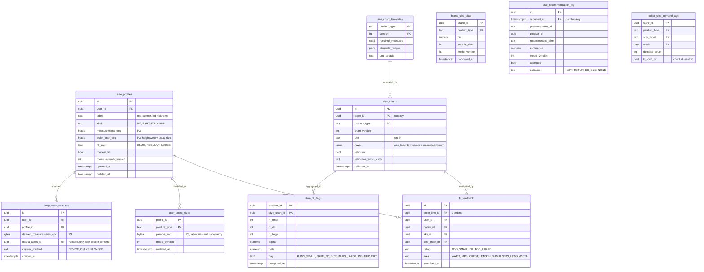

# Module: sizing

Phase 1 (profiles, charts, item flags, fit v1) and Phase 2 (latent size model, brand bias) and Phase 3 (photo-based estimation on device) · Spec refs: §10, §5 (size recommendation), §B1 (minors, measurements), §T5 (measurements P3), §8/§28.2 (back-in-size alerts live in cart) · Owner aggregates: `SizeProfile`, `SizeChart`, `FitFeedback`, `FitModelParams`

## Flow
A user builds one or more size profiles (me, partner, kids) by guided measurement or quick start (height, weight, usual size). Sellers attach a structured size chart to each product type. At the PDP, the fit engine combines the chart, item flags learned from feedback, the user's latent size and brand bias to return `{size, confidence, explanation[], alternatives}`. After delivery, the user submits fit feedback tied to an order line, which updates item flags, user latent size and brand bias.

## Rules
- Measurements are P3, field-encrypted, **never visible to sellers**, and feed the ML model only with the `measurements` consent. Sellers see only aggregated size demand with k at least 50 (`seller_size_demand_agg`).
- A listing without a validated size chart cannot show a recommendation. Charts must be monotonic across sizes with plausible deltas, normalised to cm (inches converted), impossible values (for example waist above 250 cm) rejected.
- Kids profiles exist only under an adult account and hold measurements and a nickname, never a DOB or photo (§B1).
- Item flags "runs small or large" use a Beta-Binomial with minimum n = 20 and are shown with the count.
- Per-user latent size is a hierarchical Bayesian (IRT-style) model across brands, updated on keep, return and fit feedback. Brand bias is learned from returns.
- Output confidence below 0.6 shows "We're not sure, check the chart". Fit preference (snug, regular, loose) and modest fit are inputs.
- Photo-based estimation (Phase 3) runs on device. Images are not stored without explicit consent (`body_scan_captures` only when consent exists).
- Model parameters are versioned with `model_version`. Calibration (ECE below 0.05) is measured from `size_recommendation_log`.
- Fit feedback also earns coins (rewards) but feedback correctness is not rewarded.

## Edge cases
- Between sizes: choose by fit preference and fabric stretch.
- Unisex and kids charts: product type templates carry the required measures.
- Chart in inches: normalised and original unit kept.
- User deletes a profile: model parameters for that profile are deleted, aggregated item and brand parameters remain (not personal).
- Cold start user: priors by brand and category, confidence low.
- Seller edits a chart after sales: new `chart_version`, feedback stays bound to the version it used.
- Return reason "too small" twice in brand X shifts the recommendation up with an explanation citing it (acceptance).

## ER diagram

## Entities

| Entity | Ph | PK | FK (E enforced, L logical) | Indexes and uniqueness | PII | Tenancy | Partition | Retention |
|---|---|---|---|---|---|---|---|---|
| `size_profiles` | P1 | `id` | `user_id` E | index `(user_id) WHERE deleted_at IS NULL`; check max 6 profiles per user (proposed) | P3 | `user_id` | none | RET-MEASUREMENTS: until user deletes or the account is deleted (spec §B1) |
| `size_chart_templates` | P1 | `(product_type, version)` | none | none | P0 | none | none | RET-CONFIG |
| `size_charts` | P1 | `id` | `store_id` E, `product_type` E | unique `(store_id, product_type, chart_version)`; index `(store_id, validated)` | P0 | `store_id` | none | RET-CONFIG, versions kept while referenced |
| `fit_feedback` | P1 | `id` | `order_line_id` L, `user_id` E, `profile_id` E, `sku_id` E, `size_chart_id` E | unique `(order_line_id)`; index `(sku_id)`; index `(user_id, submitted_at DESC)` | P2 | `user_id` | none | RET-PERSONALIZATION 24 months after consent withdrawal rule (proposed) |
| `item_fit_flags` | P1 | `(product_id, size_chart_id)` | `product_id` E, `size_chart_id` E | none | P0 (aggregate counts, no user) | none | none | derived, rebuilt |
| `brand_size_bias` | P1 | `(brand_id, product_type)` | `brand_id` E | none | P0 | none | none | derived, rebuilt |
| `user_latent_sizes` | P1 | `(profile_id, product_type)` | `profile_id` E | none | P3 | `user_id` via profile | none | with profile |
| `size_recommendation_log` | P1 | `(id, occurred_at)` | none | index `(product_id, occurred_at)` | P1 (pseudonymous id, never user id) | none | monthly by `occurred_at` | RET-EVENTS 25 months then aggregated |
| `seller_size_demand_agg` | P1 | `(store_id, product_type, size_label, week)` | `store_id` E | none | P0 (k at least 50 enforced at write, rows below k are not created) | `store_id` | none | 24 months |
| `body_scan_captures` | P3 | `id` | `user_id` E, `profile_id` E, `media_asset_id` E | index `(user_id)` | P3 | `user_id` | none | deleted with profile, media by explicit consent only |

## Data notes
- Spec data: `size_profiles(id, user_id, label, measurements P3-enc, fit_pref, updated_at)`, `size_charts(id, store_id, product_type, rows jsonb, unit, validated)`, `fit_feedback(order_line_id, rating too_small|ok|too_large, area)`, `fit_model_params(user_id|item_id|brand_id…)`. `fit_model_params` is a polymorphic key (`user_id|item_id|brand_id`) that cannot have foreign keys. It is split into `user_latent_sizes`, `item_fit_flags` and `brand_size_bias` (I-54).
- `size_charts.rows jsonb` stays JSONB because charts are read as a whole and validated by Zod (monotonic checks), but a template table fixes the required measures.
- The spec's `GET /v1/fit/recommend?sku_group=&profile_id=` uses `sku_group`, which resolves to `products.id` (catalog I-15).
- `size_recommendation_log` exists to measure calibration (ECE) and acceptance (§10 Metrics). It uses the rotating pseudonymous id of analytics, not `user_id`, so it can stay beyond a user deletion without being personal data.
- Back-in-my-size network alerts (§28.2) are `product_alerts` in cart. The data inventory calls them `size_alerts`. One table is kept (I-55).
- `seller_size_demand_agg` rows are created only when `demand_count >= 50`, so small-cell values never exist (k-anonymity at source).
- The DPIA for fit is `docs/privacy/dpia-fit.md`.

## API
| Endpoint | Scope | Idempotent | Rate limit |
|---|---|---|---|
| `CRUD /v1/me/size-profiles` | user | POST and PUT yes | 30/min |
| `GET /v1/fit/recommend?sku_group=&profile_id=` | user | n/a | 60/min |
| `POST /v1/orders/lines/{id}/fit-feedback` | owner of line | yes | 10/min |
| `CRUD /v1/seller/size-charts` | seller catalog role | yes | 30/min |
| `GET /v1/seller/size-demand` | seller staff (aggregates only) | n/a | 30/min |

## Events
Outbox: `size_profile.updated`, `size_chart.validated`, `fit_feedback.submitted`. Analytics: `size_recommended`, `fit_feedback_submitted`.

## Failure handling
Model service down: fall back to chart matching with a rule-based confidence. Feedback ingestion is idempotent on `order_line_id`. A chart that fails validation is saved as draft and blocks recommendations only (not listing).

## Security and abuse
- BOLA: profiles are owner only. Kids profiles are under the adult account only.
- Measurements never leave the device for external LLMs. The stylist receives a size label only (LLM02).
- Feedback poisoning: feedback accepted only from delivered lines of the user, rate limited, outliers down-weighted.
- Seller charts are untrusted input (schema validated, no HTML).

## Metrics
Size-related return rate (target minus 10% versus control), recommendation coverage, calibration ECE below 0.05, recommendation acceptance, feedback rate.

## Acceptance
- A user who returned "too small" twice in brand X gets a recommendation shifted up for X with an explanation citing it.
- A product without a validated chart returns no size recommendation.
- Seller queries never return a demand cell below 50.
- Deleting a profile removes its measurements, latent sizes and scans.
