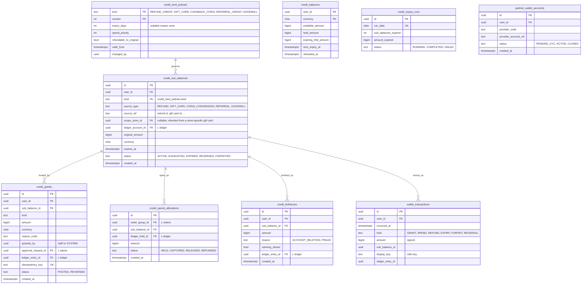

# Module: store-credit

Phase 1 (credit balance as a tender for refund credit, goodwill and referral credit, no top-up, ADR-0014), Phase 2 (gift card and coins sub-balances behind kill switches until the licence opinion VR-03 exists) and Phase 3 (optional partner wallet behind `WalletProviderPort`) · Spec refs: §15.2, §B2, §15.6, §2 (forfeiture warning), §T4, ADR-0003, ADR-0014 · Owner aggregates: `StoreCreditAccount`, `SubBalance`, `CreditGrant`, `PartnerWalletAccount` (Phase 3)

## Flow
Value enters a user's wallet only through a grant: refund the shopper chose to take as credit, gift card redemption, cashback coins conversion, referral credit, goodwill. Each grant creates (or tops up) a `credit_sub_balances` row bound to its own ledger sub-account `store_credit:{user}:{sub}` and posts a journal entry through the ledger. A spend at checkout reserves value with a ledger hold, orders soonest-expiring first and refund credit last, and captures at payment success. Expiry is a nightly job that posts an expiry entry per lapsed sub-balance. The wallet screen reads a projection and the derived transaction list.

## Rules
- Sub-balance kinds and expiry (ADR-0003): `refund_credit` none, `gift_card` per card (default 3 y), `cashback_coins` 12 months rolling, `referral_credit` 6 months, `goodwill` 90 days. Expiry periods are `credit_kind_policies` rows, admin-editable and audited.
- **No top-up** by cash or card, **no withdrawal**, **no P2P transfer** (§B2). There is no endpoint, table column or ledger path for any of them. The UI says "credit", never "cash" or "money".
- A store-specific gift card (§15.1 scope) converts into a sub-balance that keeps `scope_store_id`, so conversion cannot widen where the value is spendable (I-76). Spend allocation must filter sub-balances by the order's store.
- Spendable only on HAUL goods. Not usable to buy gift cards or Plus (anti-laundering).
- Spend order: soonest-expiring first, `refund_credit` last, ties broken by creation time, fully deterministic.
- Balance is derived from postings. `credit_balances` is a cached projection reconciled nightly, and any drift alerts (acceptance).
- Refund to credit is available only where legal and chosen by the shopper (or default for COD instant refunds). BNPL orders cannot be refunded to credit (payments).
- A refund of a credit-paid portion goes back to the same sub-balance (original expiry restored if still valid, otherwise a new `refund_credit` grant, decision needed, I-43).
- Account deletion: balance shown with a forfeiture warning, refund-to-original offered where legally required (§2). Forfeiture is a ledger entry with a record in `credit_forfeitures`.
- `PartnerWalletAccount` (Phase 3) is a separate aggregate and never shares rows or accounts with store credit (ADR-0003).
- Whether partner-wallet value counts under the licence is VERIFY BEFORE LAUNCH (registers row 3). Nothing here is e-money design until counsel confirms.

## Edge cases
- Concurrent checkouts spending the same credit: holds are taken under a per-user advisory lock, the second fails with insufficient credit.
- Sub-balance expires while held: the hold keeps value until released or captured, expiry skips held amounts and retries.
- Partial spend across several sub-balances: `credit_spend_allocations` rows, one per sub-balance, sum exactly to the spend.
- Goodwill above threshold: needs dual approval (admin).
- User deletes the app: balance remains, no action.
- Negative adjustment after fraud: reversing entry and `credit_grants.status = REVERSED`, balance can go to zero but not below (clawback limited to unspent).
- Coins converted but later order returned: clawback on remaining sub-balance, or recorded debt, decided in rewards (I-44).

## ER diagram

## Entities

| Entity | Ph | PK | FK (E enforced, L logical) | Indexes and uniqueness | PII | Tenancy | Partition | Retention |
|---|---|---|---|---|---|---|---|---|
| `credit_kind_policies` | P1 | `(kind, version)` | `changed_by` L | none | P0 | none | none | RET-CONFIG |
| `credit_sub_balances` | P1 | `id` | `user_id` E, `kind` E, `ledger_account_id` L | unique `(ledger_account_id)`; index `(user_id, status)`; partial index `(expires_at) WHERE status = 'ACTIVE'` for the expiry job | P2 (user key, financial) | `user_id` | none | RET-TAX (liability evidence), pseudonymized on deletion |
| `credit_grants` | P1 | `id` | `user_id` E, `sub_balance_id` E, `ledger_entry_id` L, `approval_request_id` L | unique `(idempotency_key)`; index `(user_id, created_at DESC)` | P2 | `user_id` | none | RET-TAX |
| `credit_spend_allocations` | P1 | `id` | `order_group_id` L, `sub_balance_id` E, `ledger_hold_id` L | unique `(order_group_id, sub_balance_id)`; index `(sub_balance_id, status)` | P2 | `user_id` via sub-balance | none | RET-TAX |
| `credit_balances` | P1 | `(user_id, currency)` | `user_id` E | none | P2 | `user_id` | none | rebuilt from postings |
| `credit_expiry_runs` | P1 | `id` | none | unique `(run_date)` | P1 | none | none | 13 months |
| `credit_forfeitures` | P1 | `id` | `user_id` E, `sub_balance_id` E, `ledger_entry_id` L | index `(user_id)` | P2 | `user_id` | none | RET-TAX |
| `wallet_transactions` | P1 | `id` | `user_id` E | index `(user_id, occurred_at DESC)` | P2 | `user_id` | monthly by `occurred_at` (proposed) | RET-USER, derived and rebuildable |
| `partner_wallet_accounts` | P3 | `id` | `user_id` E | unique `(provider_code, provider_account_ref)` | P2 | `user_id` | none | RET-KYC, only when licensed partner exists (VERIFY BEFORE LAUNCH) |

## Data notes
- The spec has no tables for §15.2. It gives sub-balance kinds, spend order, API and the nightly acceptance (sum of postings equals projection). Tables above implement those.
- Each sub-balance has its own ledger account (`store_credit:{user}:{sub}`), so that expiry, spend ordering and original-method refunds are exact. `sub_key` in `ledger_accounts` carries the sub-balance id.
- `credit_balances` is a projection of `balance_projections` summed per user. It exists for fast `GET /v1/me/wallet`. The source of truth is postings.
- `wallet_transactions` is a read model built from journal entries, not a second ledger.
- Cashback coins relationship to this module is unclear in the spec: §15.2 lists `cashback_coins` as a sub-balance, §15.5 says coins convert at 1 coin = 1 piastre. This model treats coins as a rewards-side balance that converts into a `cashback_coins` sub-balance (I-44).
- Phasing: the spec lists store credit as a Phase 1 checkout tender and the wallet as Phase 2. ADR-0014 (proposed) keeps the credit balance in Phase 1 without top-up and keeps gift card sale and redemption behind kill switches (I-86).
- `partner_wallet_accounts` is a placeholder for the Phase 3 licensed partner path. It is not populated before a licence decision.

## API
| Endpoint | Scope | Idempotent | Rate limit |
|---|---|---|---|
| `GET /v1/me/wallet` | user | n/a | 60/min |
| `GET /v1/me/wallet/transactions?cursor=` | user | n/a | 60/min |
| `POST /v1/admin/credit/grants` | support or finance, dual approval above threshold | yes | 30/min |

Credit spend is part of `POST /v1/checkout`, not a separate endpoint.

## Events
Outbox: `credit.granted`, `credit.spent`, `credit.released`, `credit.expired`, `credit.forfeited`, `credit.expiring_soon`. Analytics: none (financial).

## Failure handling
Spend is two-phase (hold, capture) inside the checkout saga with compensation (release). Expiry job is idempotent per sub-balance and run date. Projection drift is repaired from postings and alerted. Any ledger failure aborts the whole grant or spend.

## Security and abuse
- Grant endpoints are admin only, never exposed to shoppers. Goodwill is capped per agent and per day and needs a reason code.
- Credit laundering is blocked structurally: no transfer, no withdrawal, no gift card or Plus purchase tender.
- BOLA: wallet data readable only by the owner (404 otherwise).
- Fraud can freeze a user's credit through a hold reason (does not alter postings).

## Metrics
Credit liability outstanding, expiry breakage (reported), credit share of refunds, projection drift count (must be 0), expiring-soon notification CTR, spend order correctness.

## Acceptance
- For every user, the sum of postings equals the projection balance (nightly job, alert on drift).
- Spending 1,000 across a goodwill sub-balance expiring in 10 days and a refund credit consumes goodwill first.
- There is no code path or endpoint that moves credit to a bank, wallet or another user.
- A deleted account's remaining balance is forfeited with a recorded warning, or refunded where legally required.
