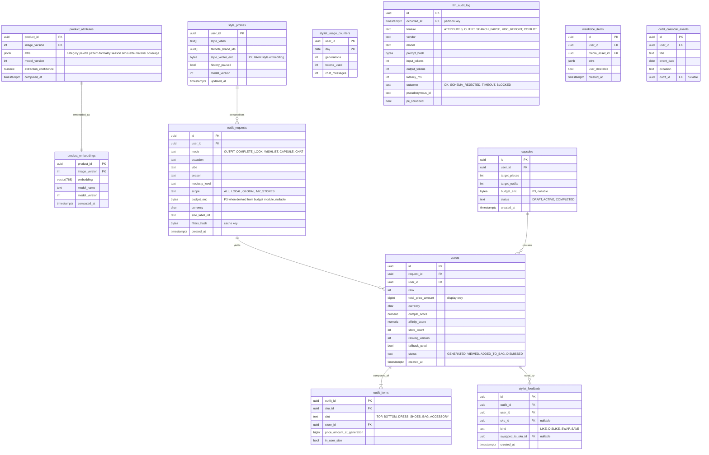

# Module: stylist-gateway

Phase 2 (outfits within budget, complete the look, capsule) and Phase 3 (chat, wardrobe digitization, outfit calendar) · Spec refs: §11, §28.3, §28.4, §T12, §T6 (DPIA), LLM Top 10 mapping, ADR-0004 (fair use) · Owner aggregates: `Outfit`, `StyleProfile`, `ProductAttributes`, `ProductEmbedding`, `LlmCall`

## Flow
A background pipeline computes `product_attributes` and `product_embeddings` once per product image version (vision plus LLM attribute extraction, then an embedding). On request, the gateway validates input with Zod, resolves scopes (My Stores, Local or Global), reads size label and an optional budget, calls the ML service (beam search, width 50, 300 ms budget) over read-only tools, validates the returned product ids against the catalog, and persists the outfits. One tap adds the outfit to the bag through cart. Feedback (like, dislike, swap) updates the style vector online.

## Rules
- LLM01: seller text is untrusted and passed as delimited data. LLM02: no P3 data in prompts (size as label, never measurements; budget as a symbolic constraint where possible). LLM05: outputs are JSON product ids validated against the catalog, prices are never generated by the model. LLM06: tools are read-only (search, stock, size, budget verdict), add-to-bag needs a user tap. LLM07: no secrets in the system prompt. LLM08: vector stores are scoped, no user data in shared indexes. LLM09: the UI states "AI suggestions". LLM10: per-user token budgets, a global cost circuit breaker and a cache keyed by filter hash.
- Fair use: 30 outfit generations per day free, capsule planner and chat free with limits (ADR-0004 Plan A: the stylist is not behind Plus).
- Every item is re-validated for stock and price at add-to-bag (cart). Outfit prices stored are for display only.
- Diversity: outfits differ in at least 2 slots, store fairness cap of at most 2 items per store per outfit unless scoped to one store.
- Modest mode excludes items below the sleeve or neckline threshold using `product_attributes.coverage`.
- External LLM or ML APIs receive no P2 or P3 unless `cross_border_ml` consent and a transfer licence exist (§B1).
- Embeddings are P0 (derived from public product data). A user style vector is P2 and is deleted when personalization is turned off or history cleared (derived data within 24 h).
- Model, prompt and ranking versions are recorded on every outfit for evaluation and rollback.

## Edge cases
- Budget too low: best partial outfit with "add X EGP for shoes".
- No items in size: explain and suggest sizes elsewhere.
- ML service down: rule-based fallback (template, popularity, color rules). LLM down: structured UI without chat.
- Product delisted between generation and view: item shows as unavailable and swap is offered.
- Re-run with the same filters inside the cache TTL: cached outfits returned, not billed against fair use.
- User with personalization off: outfits use non-personalized affinity only and no style vector read.
- Attribute extraction fails: product excluded from outfit candidate pool, not from catalog.

## ER diagram

## Entities

| Entity | Ph | PK | FK (E enforced, L logical) | Indexes and uniqueness | PII | Tenancy | Partition | Retention |
|---|---|---|---|---|---|---|---|---|
| `product_attributes` | P2 | `(product_id, image_version)` | `product_id` E | GIN `(attrs)`; index `(model_version)` | P0 | none | none | RET-CONFIG, old versions pruned after 90 d (proposed) |
| `product_embeddings` | P2 | `(product_id, image_version)` | `product_id` E | HNSW or IVFFlat on `embedding` (pgvector) | P0 | none (LLM08: per scope, no user data) | none | with attributes |
| `style_profiles` | P2 | `user_id` | `user_id` E | none | P2 | `user_id` | none | RET-PERSONALIZATION, 24 months or on consent withdrawal and history clear (within 24 h) |
| `outfit_requests` | P2 | `id` | `user_id` E | index `(user_id, created_at DESC)`; index `(filters_hash, created_at)` for the cache | P3 when `budget_enc` present, else P2 | `user_id` | monthly by `created_at` (proposed) | RET-PERSONALIZATION 24 months |
| `outfits` | P2 | `id` | `request_id` E, `user_id` E | index `(request_id, rank)`; index `(user_id, created_at DESC)` | P2 | `user_id` | monthly by `created_at` (proposed) | RET-PERSONALIZATION |
| `outfit_items` | P2 | `(outfit_id, sku_id)` | `outfit_id` E, `sku_id` E, `store_id` E | index `(sku_id)` (for stylist inclusion rate aggregates) | P2 | `user_id` via outfit | with outfit | with outfit |
| `stylist_feedback` | P2 | `id` | `outfit_id` E, `user_id` E, `sku_id` E | index `(user_id, created_at DESC)` | P2 | `user_id` | none | RET-PERSONALIZATION |
| `capsules` | P2 | `id` | `user_id` E | index `(user_id, status)` | P2, P3 for budget | `user_id` | none | RET-PERSONALIZATION |
| `stylist_usage_counters` | P2 | `(user_id, day)` | `user_id` E | none | P2 | `user_id` | none | 90 d (proposed) |
| `llm_audit_log` | P2 | `(id, occurred_at)` | none | index `(feature, occurred_at)` | P1 (pseudonymous id, prompt hash only, no prompt text) | none | monthly by `occurred_at` | 13 months (proposed) |
| `wardrobe_items` | P3 | `id` | `user_id` E, `media_asset_id` E | index `(user_id)` | P2 (images user-deletable) | `user_id` | none | `user_content` until user removes or deletes the account |
| `outfit_calendar_events` | P3 | `id` | `user_id` E, `outfit_id` E | index `(user_id, event_date)` | P2 | `user_id` | none | RET-USER |

## Data notes
- Spec data: `product_attributes(product_id, attrs jsonb, model_version)`, `product_embeddings(product_id, vec vector(768))`, `outfits(id, user_id, request jsonb, items[], scores, created_at)`, `stylist_feedback`. `items[]` becomes `outfit_items` (no FK and no per-item price snapshot in an array, I-17). `request jsonb` is split into `outfit_requests` with typed columns and an encrypted budget (I-56).
- `outfit_requests.budget_enc` could be derived from the budget module when "no budget" defaults to the remaining monthly budget (§11 Rules). Stored in clear it would copy P3 data into a P2 table, so it is encrypted and treated as P3 (I-56). Preferably the request stores only `budget_source = REMAINING_BUDGET` and the amount lives in memory for the request.
- `product_attributes` and `product_embeddings` are keyed by `image_version` which catalog owns (catalog data notes).
- `llm_audit_log` and the data inventory's `llm_external_calls` overlap. One table with a `vendor` column serves both (I-57).
- Wardrobe digitization and outfit calendar are Phase 3 and included for completeness, gated by flags.
- The stylist-driven GMV metric needs attribution from `outfits.status = ADDED_TO_BAG` to `order_lines`. A nullable `cart_lines.source_ref` (cart) carries the outfit id.

## API
| Endpoint | Scope | Idempotent | Rate limit |
|---|---|---|---|
| `POST /v1/stylist/outfits` | user, personalization consent optional | n/a | 10/min |
| `POST /v1/stylist/complete-look` | user | n/a | 10/min |
| `POST /v1/stylist/capsule` | user | n/a | 5/min |
| `POST /v1/stylist/outfits/{id}/add-to-bag` | owner | yes | 20/min |
| `POST /v1/stylist/feedback` | owner | yes | 60/min |

## Events
Outbox: `outfit.generated`, `outfit.added_to_bag`, `stylist.feedback_recorded`, `product_attributes.computed`. Analytics: `stylist_outfit_generated(n, budget, latency)`, `outfit_added_to_bag`, `stylist_feedback`. The `budget` property is a bucket, not an amount.

## Failure handling
ML service timeout (300 ms budget on the optimizer, 1.5 s p95 overall) falls back to rules. LLM failures never block the structured UI. Cost circuit breaker disables LLM features globally. Cached outfits serve repeated filters. Embedding recompute is idempotent per image version.

## Security and abuse
- Prompt injection from seller text is mitigated by delimiting, schema-constrained output, no tools with write effect.
- Rate and token budgets per user (LLM10), global cost breaker, no external call carries P2 or P3.
- BOLA: outfits are visible to the owner only.
- Abuse of the stylist as a free LLM is prevented by fixed schemas and no free-form passthrough.

## Metrics
Outfit add-to-bag rate, stylist-driven GMV share, multi-store outfit share, p95 latency below 1.5 s, cost per generation, fallback rate, schema-rejection rate.

## Acceptance
- With budget 3,000 EGP, size M, wedding guest, modest: 3 to 5 outfits, each total at most 3,000, every item in stock in M and modest-compliant.
- A property test over 10,000 random catalogs never exceeds the budget.
- With personalization off, no `style_profiles` row is read.
- No prompt or log contains a measurement or an address.
