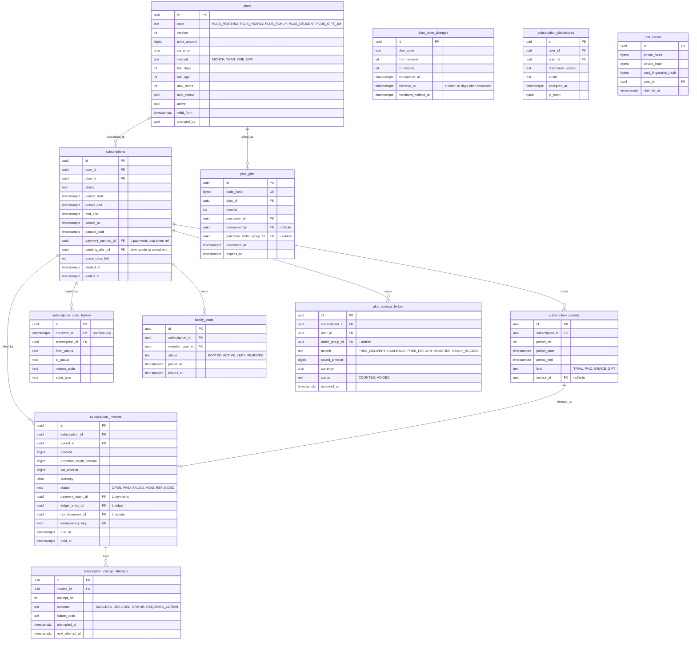

# Module: subscriptions

Phase 2 (HAUL Plus monthly and yearly, trial, dunning, pause) and Phase 2/3 (family, student, gift Plus) · Spec refs: §14, §B6, §B7, §B4, §A2.6, §T4 (`plus_revenue`, `deferred_plus_revenue`) · Owner aggregates: `Plan`, `Subscription`, `SubscriptionInvoice`, `TrialClaim`, `PlusGift`

## Flow
The shopper views versioned plans, accepts the auto-renew disclosure, and subscribes through the PSP with a tokenised card (age gate 21 by default). A trial may start (14 days, once per person). Each period an invoice is created, charged against the saved token, and on success the period is extended, the ledger recognises revenue over time, and an ETA e-receipt is issued. Failures run dunning at day 1, 3 and 7 with a 7-day grace. The user can pause, switch plan or cancel in at most two taps.

## Rules
- Plans are admin-configurable and versioned. Defaults (not constants): monthly 200 EGP, yearly 800 EGP, trial 14 days, family 1,200 EGP per year up to 4 adults (Phase 2), student discounted with verification (Phase 2), gift Plus 1, 3 or 12 months non-renewing. Price changes notify members at least 30 days ahead (§23).
- State machine: `TRIALING -> ACTIVE -> PAST_DUE -> (ACTIVE | EXPIRED)`, `ACTIVE -> PAUSED -> ACTIVE`, `ACTIVE -> CANCELLED_AT_PERIOD_END -> EXPIRED`.
- Benefits are commerce only (ADR-0004 Plan A): free delivery on every order, 24 h early access, +5% coins cashback, free returns, monthly Plus Day sale, monthly surprise voucher, birthday gift, priority support. The stylist is not gated. If Plan B is triggered, a separate IAP entitlement table is added (decision needed, I-46).
- Trial abuse: one trial per person by phone, device and card fingerprint (`trial_claims` with hashes).
- Dunning: day 1, 3, 7, grace 7 days with benefits continuing, then `PAST_DUE -> EXPIRED`.
- Monthly to yearly upgrade: prorated credit of unused monthly days against 800. Downgrade at period end.
- Refunds: cancel anytime with benefits until period end. Pro-rata refund where required (VERIFY BEFORE LAUNCH), default full refund within 14 days if no benefit was used (`plus_savings_ledger` proves "no benefit used").
- Auto-renew disclosure is recorded before purchase (`subscription_disclosures`) and printed in the receipt.
- Family seats: each seat is an 18+ account (21 if plan age gate is 21). Leaving frees the seat at next cycle.
- Gift Plus: non-renewing, redeemable by code, hashed like gift-card codes.
- Plus cannot be bought with gift cards or store credit (anti-laundering).
- Recurring charging with Egyptian PSPs and mobile-wallet recurring rules are VERIFY BEFORE LAUNCH.

## Edge cases
- Free delivery used on an order that is then cancelled: no savings counted, no effect.
- Plus expires between checkout start and payment: fee is recomputed at commit and shown.
- Card token deleted by the user: next renewal fails, dunning proceeds, no silent charge on another method.
- Trial started with a new phone but a known card fingerprint: no trial, flow continues as paid.
- Year boundary and leap days: periods computed by calendar arithmetic in domain, injected clock, property tested.
- Chargeback on a renewal: subscription `PAST_DUE`, benefits suspended, fraud signal.
- Pause while in grace: not allowed.

## ER diagram

## Entities

| Entity | Ph | PK | FK (E enforced, L logical) | Indexes and uniqueness | PII | Tenancy | Partition | Retention |
|---|---|---|---|---|---|---|---|---|
| `plans` | P2 | `id` | `changed_by` L | unique `(code, version)` | P0 | none | none | RET-CONFIG, kept (invoices reference versions) |
| `plan_price_changes` | P2 | `id` | none | index `(plan_code, effective_at)` | P1 | none | none | RET-CONFIG |
| `subscriptions` | P2 | `id` | `user_id` E, `plan_id` E, `payment_method_id` L, `pending_plan_id` E | partial unique `(user_id) WHERE status IN ('TRIALING','ACTIVE','PAST_DUE','PAUSED','CANCELLED_AT_PERIOD_END')`; index `(status, period_end)` for the renewal sweeper | P2 | `user_id` | none | RET-TAX (invoices); row itself RET-USER, pseudonymized on deletion |
| `subscription_periods` | P2 | `id` | `subscription_id` E, `invoice_id` E | unique `(subscription_id, period_no)` | P1 | `user_id` via subscription | none | RET-TAX |
| `subscription_invoices` | P2 | `id` | `subscription_id` E, `period_id` E, `payment_intent_id` L, `ledger_entry_id` L, `tax_document_id` L | unique `(idempotency_key)`; index `(status, due_at)`; index `(subscription_id)` | P2 | `user_id` via subscription | none | RET-TAX |
| `subscription_charge_attempts` | P2 | `id` | `invoice_id` E | unique `(invoice_id, attempt_no)`; index `(next_attempt_at)` | P1 | via invoice | none | RET-TAX |
| `subscription_disclosures` | P2 | `id` | `user_id` E, `plan_id` E | index `(user_id, accepted_at)` | P2 | `user_id` | none | RET-TAX (evidence of disclosure) |
| `subscription_state_history` | P2 | `(id, occurred_at)` | `subscription_id` E | index `(subscription_id, occurred_at)` | P1 | via subscription | monthly by `occurred_at` | RET-TAX |
| `family_seats` | P2 | `id` | `subscription_id` E, `member_user_id` E | unique `(subscription_id, member_user_id)`; unique `(member_user_id)` where active | P2 | `user_id` | none | RET-USER |
| `trial_claims` | P2 | `id` | `user_id` E | index `(phone_hash)`; index `(device_hash)`; index `(card_fingerprint_hash)` | P2 (hashed identifiers) | none (fraud use) | none | 24 months (proposed, VERIFY) |
| `plus_gifts` | P2 | `id` | `plan_id` E, `purchaser_id` E, `redeemed_by` E, `purchase_order_group_id` L | unique `(code_hash)` | P2 | `user_id` (purchaser) | none | RET-TAX |
| `plus_savings_ledger` | P2 | `id` | `subscription_id` E, `user_id` E, `order_group_id` L | index `(user_id, occurred_at)`; unique `(order_group_id, benefit)` | P2 | `user_id` | monthly by `occurred_at` (proposed) | RET-USER |

## Data notes
- Spec data: `plans(id, code, price, interval, active, version)`, `subscriptions(id, user_id, plan_id, status, period_start, period_end, psp_token_ref, trial_end, cancel_at)`, `subscription_invoices`, `plus_savings_ledger`. `psp_token_ref` becomes `payment_method_id` pointing at payments (single place for tokens, I-47).
- Revenue is recognised over the period: the charge posts to `deferred_plus_revenue` and a daily or monthly entry moves it to `plus_revenue` (ledger chart). Recognition entries are generated from `subscription_periods`.
- `plans.price_amount` is VAT inclusive (consumer price), consistent with §B4. The ETA e-receipt for each charge is created from the invoice.
- `min_age` per plan reads the capability from `age_policy` (users) at purchase time. The plan row stores the default, the effective gate is `age_policy`.
- The "pay 4 months, get 8 free" message is copy derived by arithmetic from two plan rows and is unit tested (800 = 4 × 200, saving 1,600). It is not a column.
- Stylist Pro (Plan B) is not modelled until triggered. IAP receipts would need a separate table (decision, I-46).

## API
| Endpoint | Scope | Idempotent | Rate limit |
|---|---|---|---|
| `GET /v1/plus/plans` | public | n/a | 60/min |
| `POST /v1/plus/subscribe` | user, age gate, App Attest | yes | 5/min |
| `POST /v1/plus/cancel`, `/pause`, `/switch-plan` | owner | yes | 10/min |
| `POST /v1/webhooks/{provider}/recurring` | allow-list, HMAC | dedup | provider-based |
| `POST /v1/plus/gifts`, `POST /v1/plus/gifts/redeem` | user | yes | 5/min |

## Events
Outbox: `subscription.started`, `subscription.renewed`, `subscription.payment_failed`, `subscription.past_due`, `subscription.paused`, `subscription.cancelled`, `subscription.expired`, `plan.price_change_announced`. Analytics: `plus_paywall_viewed`, `plus_started(plan, trial)`, `plus_cancelled(reason)`.

## Failure handling
Renewal charge uses the invoice idempotency key. Attempts follow the dunning schedule with backoff, never double-charge. A webhook arriving late is deduped by event id. Failed ETA submission does not block the subscription (retry queue).

## Security and abuse
- Trial and refund abuse: hashes of phone, device and card fingerprint, fraud signals. Plus cannot be bought with credit or gift cards.
- Cancel is reachable in at most 2 taps, no confirm-shaming (copy lint).
- BOLA: a subscription is readable and changeable by its owner only (family members read seat status only).
- Plan price changes require dual approval and the 30-day notice.

## Metrics
Penetration, trial to paid, monthly churn, yearly mix, savings delivered versus fee (median target at least 2×), dunning recovery rate, involuntary churn, time to cancel.

## Acceptance
- Yearly shows "Pay 4, get 8 free" and unit tests assert 800 = 4 × 200 and saving 1,600.
- Cancel is reachable in 2 taps and benefits end exactly at `period_end`.
- Dunning produces attempts on day 1, 3 and 7, then `EXPIRED` after the grace.
- A second trial with the same card fingerprint is refused.
