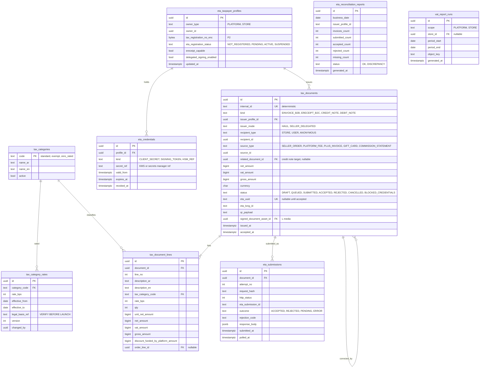

# Module: tax-eta

Phase 1 (VAT engine, ETA e-invoice for commission and fees, e-receipts, daily reconciliation) and Phase 2 (e-receipt as a service for sellers) · Spec refs: §B4, §T4, §19 (finance), §14 (receipts), §15.1 (gift card tax) · Owner aggregates: `TaxCategory`, `TaxDocument`, `EtaSubmission`, `EtaCredential`

## Flow
`TaxEngine` returns net, VAT and gross per line from a tax category and a rate version. Shopper prices are VAT inclusive. After business events (order closed, platform fee charged, Plus charged, gift card sold) tax-eta creates `tax_documents` with deterministic internal ids, builds the ETA payload, queues a submission, signs (HAUL's own certificate or the seller's delegated token), submits, polls status, and stores the signed document and UUID/QR. A daily job compares submitted, accepted and rejected counts with the invoices and reports differences.

## Rules
- Standard VAT rate is 14%, admin-editable exemptions per tax category, with effective dates (versioned). The rate applied to an order line is snapshotted on `order_lines.vat_rate_bps`.
- HAUL issues an **ETA e-invoice (B2B) to each seller** for commission, fees, ads and Fulfilled-by-HAUL services (VAT 14%).
- HAUL issues an **ETA e-receipt (B2C) to the shopper** for its own supplies: delivery fees it charges, HAUL Plus, gift card sales (treatment VERIFY BEFORE LAUNCH).
- For seller goods the **seller is the supplier** and issues the e-receipt. Optional "e-receipt as a service" signs on the seller's behalf with a seller-uploaded token or HSM integration (delegation rules VERIFY BEFORE LAUNCH). The order page shows each seller's receipt UUID and QR when available.
- Documents are immutable once `ACCEPTED`. Corrections are credit notes or cancellations, never edits.
- Internal id is deterministic (`kind:ref:version`) so a retry cannot create a second document.
- Invoices and receipts are Arabic first (§B5). The stored human-readable copy has both languages.
- Open items tagged VERIFY BEFORE LAUNCH: marketplace withholding or reporting duties, HAUL's own e-receipt wave date, VAT on coins, vouchers and gift cards, and the VAT base when the platform funds a discount.
- Seller VAT reports are derived from order lines and e-invoices and are labelled as informational.

## Edge cases
- ETA outage or rejection: queue retries with backoff, `REJECTED` documents go to a Finance work list with the rejection code.
- Seller credentials expired or revoked: documents wait `BLOCKED_CREDENTIALS`, the seller is alerted, orders are not blocked.
- Refund after the receipt was accepted: a credit note is issued (the spec does not describe return receipts, I-38).
- Partial refund of a bundle: the credit note is line-level with VAT split.
- Platform-funded discount: VAT base treatment is open (VERIFY). The model stores `discount_funded_by_platform_amount` on the document line so either treatment can be computed.
- Rate change mid-flight: a line uses the rate version valid at supply date, not submission date.
- Seller without ETA registration: capability flag on `eta_taxpayer_profiles`, e-receipt service disabled for that seller.

## ER diagram

## Entities

| Entity | Ph | PK | FK (E enforced, L logical) | Indexes and uniqueness | PII | Tenancy | Partition | Retention |
|---|---|---|---|---|---|---|---|---|
| `tax_categories` | P1 | `code` | none | none | P0 | none | none | RET-CONFIG |
| `tax_category_rates` | P1 | `id` | `category_code` E, `changed_by` L | unique `(category_code, version)`; exclusion constraint on overlapping `[effective_from, effective_to)` per category | P1 | none | none | RET-CONFIG, kept (historic orders refer to it) |
| `eta_taxpayer_profiles` | P1 | `id` | `owner_id` L | unique `(owner_type, owner_id)` | P2 (tax registration number of a business, personal for a sole trader) | `store_id` when STORE | none | RET-KYC |
| `eta_credentials` | P1 | `id` | `profile_id` E | index `(profile_id, expires_at)` | P1 (only references, never the secret) | `store_id` via profile | none | contract end plus tail (proposed) |
| `tax_documents` | P1 | `id` | `issuer_profile_id` E, `related_document_id` E self, `recipient_id` L, `source_id` L, `signed_document_asset_id` L | unique `(internal_id)`; unique `(eta_uuid)` where not null; index `(source_type, source_id)`; index `(status, issued_at)`; index `(recipient_type, recipient_id, issued_at DESC)` | P2 (B2C receipt can identify a shopper) | `store_id` for seller-issued or B2B documents, `user_id` for receipts | monthly by `issued_at` (proposed) | RET-TAX 7 y (VERIFY), pseudonymize recipient on deletion |
| `tax_document_lines` | P1 | `id` | `document_id` E, `tax_category_code` E, `order_line_id` L | unique `(document_id, line_no)` | P1 | via document | with document | RET-TAX |
| `eta_submissions` | P1 | `id` | `document_id` E | unique `(document_id, attempt_no)`; index `(outcome, submitted_at)` | P2 (response may contain taxpayer details) | none | monthly by `submitted_at` (proposed) | RET-TAX |
| `eta_reconciliation_reports` | P1 | `id` | none | unique `(business_date, issuer_profile_id)` | P1 | none | none | RET-TAX |
| `vat_report_runs` | P1 | `id` | `store_id` E | index `(store_id, period_start)` | P1 | `store_id` | none | RET-TAX |

## Data notes
- The spec names no tables for tax-eta. It specifies `TaxEngine`, `EtaAdapter` (submission queue, idempotent internal ids, status polling, signed document storage, daily reconciliation) and line-level `net`, `vat`, `gross` in piastres. Tables are derived from those requirements.
- Line-level net, vat and gross are stored on `order_lines` (orders) and copied into `tax_document_lines`. VAT is not recomputed after the fact.
- `categories.tax_category_code` (catalog) references `tax_categories.code` logically.
- Credit notes and cancellation flows are not mentioned in §B4 although refunds and returns (§15.6, §22) require them (I-38).
- The platform's own taxpayer profile is one `eta_taxpayer_profiles` row with `owner_type = PLATFORM`.
- Gift-card sales and Plus charges: tax point and receipt timing are open (VERIFY BEFORE LAUNCH). Documents carry `source_type` so either treatment can be implemented without reshaping.
- E-receipt fields required by the ETA schema are not enumerated in the spec, and are not invented here. The payload mapping lives in the adapter and is validated against the ETA specification and sandbox before launch (VERIFY BEFORE LAUNCH).

## API
| Endpoint | Scope | Idempotent | Rate limit |
|---|---|---|---|
| `GET /v1/me/orders/{id}/receipts` | owner | n/a | 60/min |
| `GET /v1/seller/finance/invoices` | seller finance role | n/a | 60/min |
| `POST /v1/seller/eta/credentials` | seller manager, recent auth | yes | 5/min |
| `GET /v1/admin/tax/documents`, `POST /v1/admin/tax/documents/{id}/resubmit` | tax console | yes | 30/min |
| `GET /v1/admin/tax/reconciliation` | tax console | n/a | 30/min |

## Events
Outbox: `tax_document.created`, `tax_document.accepted`, `tax_document.rejected`, `eta.reconciliation_discrepancy`. Consumes `seller_order.closed`, `refund.completed`, `subscription.renewed` and `gift_card.issued`.

## Failure handling
Queue with retry and exponential backoff and jitter, max N, then Finance work list. Polling for status, circuit breaker on the ETA API (API10). Responses are schema-validated. Duplicate submissions are impossible because the internal id is deterministic and the ETA call carries it.

## Security and abuse
- Seller signing tokens and HSM references are in the secrets manager or KMS, never in tables or logs. Use is audited.
- A seller can see only documents where they are issuer or recipient (404 otherwise).
- Tax console access is role scoped (tax), with every PII view logged with reason code.
- Document immutability is enforced by a trigger that blocks updates after `ACCEPTED` except status metadata.

## Metrics
Submission success rate, ETA latency p95, rejection rate by code, reconciliation discrepancies (target 0), documents blocked on credentials, credit note lag.

## Acceptance
- Prices shown are VAT-inclusive and each order line has net, vat and gross that sum exactly.
- Submitting the same document twice yields one ETA record.
- The daily reconciliation report lists submitted, accepted and rejected counts and any invoice missing a submission.
- A refund after acceptance produces a credit note linked to the original document.
