# Module: trust-safety

Phase 1 (counterfeit notice and takedown, moderation, reviews, disputes and suspension review cases) and Phase 2 (pHash duplicate detection across stores, Q&A) and Phase 3 (live shopping chat, community looks) · Spec refs: §27, §16 (photo reviews, community looks, live shopping), §22 (dispute review, 5 business days), §9.5 (suspension review), §5 (reviews, Q&A), §B5 · Owner aggregates: `ModerationItem`, `TsCase`, `CounterfeitNotice`, `Review`, `ProductQuestion`

## Flow
User and seller content (reviews with photos, Q&A, gift messages, community looks, chat) is submitted, scanned (image classifiers for nudity and violence, AR/EN text toxicity) and either published, held or rejected, creating `moderation_items`. Rights holders file counterfeit notices through a brand-owner portal with a 48 h SLA. Image hashes (`pHash`) detect reuse and duplicates across stores. Human-in-the-loop cases (return disputes, suspension reviews, counterfeit decisions) are `ts_cases` with SLA clocks. Reports from any UGC surface create `ugc_reports`.

## Rules
- Reviews: verified purchase only, a seller cannot review itself, no incentive bias (coins for any honest review, §27). One review per order line. Reviews can carry size and fit info and photos (feeds sizing).
- Moderation: images through nudity and violence classifiers, AR/EN text toxicity. Low confidence goes to a human queue. Decisions are logged with the model version.
- Counterfeit: notice-and-takedown for brand owners with a 48 h SLA, prohibited items list, seller duplicate and counterfeit detection via pHash across stores, strikes against sellers feeding enforcement and health.
- Human review SLAs: return dispute 5 business days (§22), suspension 5 business days (§9.5, VERIFY BEFORE LAUNCH counsel). The SLA is a stored deadline with alerts.
- Report flows exist on every UGC surface and reports are rate limited per user.
- Community looks ("worn by the community") need explicit consent for use of the photo (privacy purpose, VERIFY BEFORE LAUNCH) and are revocable.
- Live shopping chat (Phase 3) is moderated and retained 30 days (inventory `live_chat`, proposed).
- Social proof or review counts are never fabricated. Aggregates are computed from verified rows only (§A2.13).
- Moderation never uses personal data beyond content and account standing, and never budget data.

## Edge cases
- Review submitted for a returned item: allowed, flagged as returned, weight in the score reduced (config).
- Review text in Franco-Arabic: toxicity model handles it, unknown handled by human queue.
- Brand owner notice abuse (false notices): notice outcome recorded, repeat abusers rate limited.
- Photo EXIF with GPS: stripped at upload, location never retained.
- Seller responds to review: allowed, visible, flagged as seller content.
- Takedown of a product with open orders: orders continue, new sales blocked.
- User deletes account: reviews anonymised (display name removed) unless the user asks for deletion.

## ER diagram

```mermaid
erDiagram
    reviews {
        uuid id PK
        uuid user_id FK "nullable after anonymisation"
        uuid order_line_id FK "L orders, UK"
        uuid product_id FK
        uuid store_id FK
        smallint rating
        text body
        text locale "ar, en"
        text fit_note "TOO_SMALL, OK, TOO_LARGE, nullable"
        text size_label_snapshot
        text status "PENDING, PUBLISHED, HELD, REJECTED, REMOVED"
        bool verified_purchase
        bool item_returned
        timestamptz created_at
        timestamptz published_at
    }
    review_photos {
        uuid review_id PK
        uuid media_asset_id PK
        int position
    }
    review_responses {
        uuid id PK
        uuid review_id FK
        uuid store_member_id FK
        text body
        text status "PUBLISHED, REMOVED"
        timestamptz created_at
    }
    product_questions {
        uuid id PK
        uuid product_id FK
        uuid user_id FK
        text body
        text status "PENDING, PUBLISHED, REJECTED"
        timestamptz answer_due_at "48 hours"
        timestamptz created_at
    }
    product_answers {
        uuid id PK
        uuid question_id FK
        uuid store_member_id FK "nullable"
        uuid user_id FK "nullable, verified buyer"
        text body
        text status
        timestamptz created_at
    }
    product_rating_aggregates {
        uuid product_id PK
        int rating_count
        numeric rating_avg
        int fit_small_count
        int fit_ok_count
        int fit_large_count
        timestamptz refreshed_at
    }
    moderation_items {
        uuid id PK
        text content_type "REVIEW, REVIEW_PHOTO, QUESTION, ANSWER, GIFT_MESSAGE, COMMUNITY_LOOK, LIVE_CHAT, PRODUCT_IMAGE, STORE_PROFILE"
        uuid content_id
        uuid owner_user_id FK
        uuid store_id FK "nullable"
        text status "PENDING, AUTO_APPROVED, AUTO_REJECTED, HUMAN_QUEUE, APPROVED, REJECTED"
        numeric nudity_score
        numeric violence_score
        numeric toxicity_score
        int classifier_version
        timestamptz created_at
        timestamptz decided_at
    }
    moderation_decisions {
        uuid id PK
        uuid item_id FK
        text decided_by_type "MODEL, STAFF"
        uuid decided_by
        text decision "APPROVE, REJECT, ESCALATE"
        text reason_code
        timestamptz decided_at
    }
    ugc_reports {
        uuid id PK
        uuid reporter_user_id FK
        text content_type
        uuid content_id
        text reason_code "SPAM, ABUSE, FAKE_REVIEW, COUNTERFEIT, PRIVATE_INFO, OTHER"
        text status "OPEN, ACTIONED, DISMISSED"
        timestamptz created_at
    }
    ip_rights_holders {
        uuid id PK
        text legal_name
        uuid brand_id FK "nullable"
        text contact_email_hash
        text verification_status "PENDING, VERIFIED, REJECTED"
        timestamptz verified_at
    }
    counterfeit_notices {
        uuid id PK
        uuid rights_holder_id FK
        uuid product_id FK
        uuid store_id FK
        text claim_type "TRADEMARK, COPYRIGHT, DESIGN"
        jsonb evidence_refs
        text status "RECEIVED, UNDER_REVIEW, UPHELD, REJECTED, COUNTER_NOTICE"
        timestamptz sla_due_at "48 hours"
        timestamptz received_at
        timestamptz decided_at
    }
    ts_cases {
        uuid id PK
        text type "RETURN_DISPUTE, SUSPENSION_REVIEW, COUNTERFEIT, UGC_REPORT, SELLER_APPEAL"
        text subject_type
        uuid subject_id
        uuid store_id FK "nullable"
        text status "OPEN, IN_REVIEW, DECIDED, CLOSED"
        text decision_code
        uuid assignee
        timestamptz sla_due_at
        timestamptz opened_at
        timestamptz decided_at
    }
    image_hash_matches {
        uuid id PK
        uuid media_asset_id FK
        uuid matched_media_asset_id FK
        smallint hamming_distance
        uuid store_id FK
        uuid matched_store_id FK
        text signal "IMAGE_REUSE, DUPLICATE_LISTING, COUNTERFEIT_SUSPECT"
        timestamptz detected_at
    }
    seller_content_strikes {
        uuid id PK
        uuid store_id FK
        text kind "COUNTERFEIT, PROHIBITED_ITEM, IMAGE_REUSE, MISLEADING"
        uuid source_case_id FK
        timestamptz created_at
        timestamptz expires_at
    }
    prohibited_item_rules {
        uuid id PK
        text code
        text description_ar
        text description_en
        jsonb matchers "category, keywords"
        int version
        bool active
    }
    live_sessions {
        uuid id PK
        uuid store_id FK
        text title_ar
        text status "SCHEDULED, LIVE, ENDED"
        jsonb pinned_product_ids
        timestamptz starts_at
        timestamptz ended_at
    }
    live_chat_messages {
        uuid id PK
        timestamptz sent_at PK "partition key"
        uuid session_id FK
        uuid user_id FK
        text body
        text moderation_status
    }
    reviews ||--o{ review_photos : shows
    reviews ||--o{ review_responses : answered_by
    product_questions ||--o{ product_answers : answered_in
    moderation_items ||--o{ moderation_decisions : decided_by
    ip_rights_holders ||--o{ counterfeit_notices : files
    counterfeit_notices ||--o| ts_cases : reviewed_as
    live_sessions ||--o{ live_chat_messages : hosts
```

## Entities

| Entity | Ph | PK | FK (E enforced, L logical) | Indexes and uniqueness | PII | Tenancy | Partition | Retention |
|---|---|---|---|---|---|---|---|---|
| `reviews` | P1 | `id` | `user_id` E, `order_line_id` L, `product_id` E, `store_id` E | unique `(order_line_id)`; index `(product_id, status, published_at DESC)`; index `(store_id, status)` | P2 (public display name, free text) | `user_id` for write, public read of PUBLISHED, `store_id` for response | none | `user_content`: until user removes or deletes the account, then anonymised |
| `review_photos` | P1 | `(review_id, media_asset_id)` | `review_id` E, `media_asset_id` E | none | P2 (photos may show persons) | via review | none | with review |
| `review_responses` | P1 | `id` | `review_id` E, `store_member_id` E | unique `(review_id)` | P1 | `store_id` via review | none | with review |
| `product_questions` | P1 | `id` | `product_id` E, `user_id` E | index `(product_id, status)`; partial index `(answer_due_at) WHERE status = 'PUBLISHED'` | P2 | `user_id` | none | `user_content` |
| `product_answers` | P1 | `id` | `question_id` E, `store_member_id` E, `user_id` E | index `(question_id)` | P2 | `store_id` or `user_id` | none | `user_content` |
| `product_rating_aggregates` | P1 | `product_id` | `product_id` E | none | P0 | none | none | derived |
| `moderation_items` | P1 | `id` | `owner_user_id` E, `store_id` E, `content_id` L | index `(status, created_at)`; index `(content_type, content_id)` | P2 | none (T&S roles) | monthly by `created_at` (proposed) | 12 months after decision (proposed) |
| `moderation_decisions` | P1 | `id` | `item_id` E | index `(item_id)` | P1 | none | none | with item |
| `ugc_reports` | P1 | `id` | `reporter_user_id` E, `content_id` L | index `(content_type, content_id)`; index `(status, created_at)` | P2 | `user_id` for reporter | none | 12 months (proposed) |
| `ip_rights_holders` | P1 | `id` | `brand_id` E | index `(verification_status)` | P2 (contact hash) | none | none | RET-KYC contract plus 5 years (proposed) |
| `counterfeit_notices` | P1 | `id` | `rights_holder_id` E, `product_id` E, `store_id` E | index `(status, sla_due_at)`; index `(store_id)` | P1 | `store_id` (seller may read notices about its products) | none | RET-TAX not required, 5 years (proposed, legal evidence) |
| `ts_cases` | P1 | `id` | `store_id` E, `subject_id` L | index `(status, sla_due_at)`; index `(type, subject_type, subject_id)` | P2 | none (T&S roles) | none | 5 years for suspension and counterfeit, 12 months for UGC (proposed) |
| `image_hash_matches` | P1 | `id` | `media_asset_id` E, `matched_media_asset_id` E, `store_id` E, `matched_store_id` E | index `(store_id, detected_at)`; index `(hamming_distance)` | P0 | none | none | 24 months |
| `seller_content_strikes` | P1 | `id` | `store_id` E, `source_case_id` E | index `(store_id, expires_at)` | P1 | `store_id` | none | 24 months |
| `prohibited_item_rules` | P1 | `id` | none | unique `(code, version)` | P0 | none | none | RET-CONFIG |
| `live_sessions` | P3 | `id` | `store_id` E | index `(status, starts_at)` | P0 | `store_id` | none | 24 months |
| `live_chat_messages` | P3 | `(id, sent_at)` | `session_id` E, `user_id` E | index `(session_id, sent_at)` | P2 | `user_id` | daily or monthly by `sent_at` | 30 days (inventory `live_chat`, proposed) |

## Data notes
- The spec has no Data block for §27 and §16. Reviews, Q&A and live chat appear in the inventory (`reviews`, `live_chat_messages`) but T1 has no reviews module. They are housed here because moderation and verified-purchase integrity are the core of their rules (I-71).
- Review aggregates feed Buy Box (`d*rating`), seller health and sizing item flags. Reviews also feed voc topic extraction through events, not through direct table reads.
- `ts_cases` is the single human-review work queue the spec implies in three places: return disputes (§22, 5 business days), suspension reviews (§9.5, 5 business days) and counterfeit notices (§27, 48 h). Separate SLA clocks per type.
- `media_assets.phash64` (platform) is the hash source for `image_hash_matches`. This module owns matching and results, not storage.
- Community looks ("worn by the community") are a content type in moderation. Consent for reuse of a user photo is not in the §B1 purposes list (VERIFY BEFORE LAUNCH, I-72).
- Gift message moderation is requested by gift-cards, and the result is read back via `moderation_items`.

## API
| Endpoint | Scope | Idempotent | Rate limit |
|---|---|---|---|
| `POST /v1/orders/lines/{id}/review` | owner of delivered line | yes | 5/min |
| `GET /v1/products/{id}/reviews`, `/questions` | public | n/a | 60/min |
| `POST /v1/products/{id}/questions` | user | yes | 5/min |
| `POST /v1/reports` | user | yes | 10/min |
| `POST /v1/ip/notices` | verified rights holder | yes | 20/min |
| `GET/PATCH /v1/admin/ts/cases` | T&S role | PATCH yes | 60/min |
| `POST /v1/seller/reviews/{id}/response` | seller support role | yes | 20/min |

## Events
Outbox: `review.published`, `review.removed`, `moderation.rejected`, `counterfeit_notice.received`, `counterfeit_notice.upheld`, `ts_case.opened`, `ts_case.decided`, `seller_strike.recorded`, `image_reuse.detected`.

## Failure handling
Classifier timeout holds content as `PENDING` (not auto-published) except for transactional gift messages that are delivered only after approval. Human queue overflow escalates by SLA. Matching jobs are idempotent per asset hash.

## Security and abuse
- Review fraud: verified purchase required, device and account graph checks, burst detection, seller self-review prevented by ownership join.
- Notice abuse: rights holders verified, counter-notice path.
- Report brigading limited per user and per target.
- Moderation staff see content only. Identity lookups need a reason code (admin `pii_access_log`).
- Uploaded media follows the upload pipeline (type sniff, AV scan, EXIF strip).

## Metrics
Time to moderate, auto-approve precision, takedown SLA hit rate, review share with photos, dispute overturn rate, duplicate image hits, report-to-action rate.

## Acceptance
- A seller cannot review its own product, and only a delivered order line can be reviewed.
- A counterfeit notice not decided within 48 h raises an SLA alert.
- A return dispute has a case with a 5 business day deadline.
- Reusing another store's image triggers an `image_hash_matches` row with `IMAGE_REUSE`.
