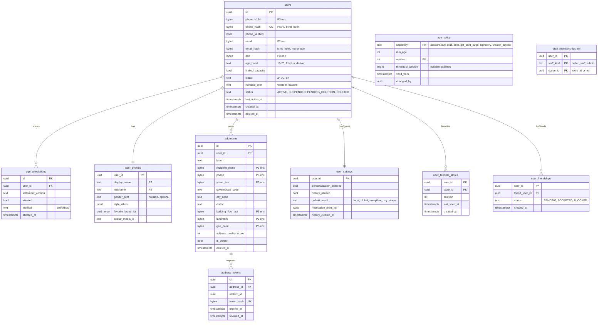

# Module: users

Phase 0-1 · Spec refs: §1, §3, §B6, §7 (addresses), §8 (address token), §13, §16 (friends) · Owner aggregates: `User`, `Address`, `UserSettings`

## Flow
After auth resolves an identity, `users` holds the person: profile, locale, age band, capacity flag, addresses, settings and favorite stores. Onboarding steps after DOB (vibes, sizes, brands, budget) are skippable and write to their own modules (style profile here, sizes in sizing, budget in budget).

## Rules
- Accounts require age 18 or more by DOB. DOB is collected with an attestation checkbox (`age_attestations`).
- Users aged 18-20 get `limited_capacity = true`. Capability thresholds come from `age_policy` (admin-editable, audited), never from code constants.
- `age_band` is derived and refreshed daily because it changes with time (I-07).
- Favorite stores: 1-30 per user, ordered by `position`. `last_seen_at` is server-side per store for "new since last visit" counters.
- DOB edit allowed once through support, with audit.
- Phone verification must precede first order, store-credit use, referral or COD.

## Edge cases
- A favorited store that is suspended is hidden with an explanation (the row stays).
- Address deleted while referenced by an open order: orders keep their own snapshot (see orders `order_addresses`), the address row is soft-deleted.
- Gift purchases ship to a hidden address through `address_tokens`. The buyer never receives the address.
- Account in deletion cooling period: login allowed only to cancel deletion.

## ER diagram

## Entities

| Entity | Ph | PK | FK (E enforced, L logical) | Indexes and uniqueness | PII | Tenancy | Partition | Retention |
|---|---|---|---|---|---|---|---|---|
| `users` | P0 | `id` | none | unique `(phone_hash)` WHERE `status <> 'DELETED'`; index `(email_hash)`; index `(status, last_active_at)` | P3 (phone, DOB), P2 (email, locale) | `user_id` (self) | none | RET-USER; on deletion fields erased, row pseudonymized and kept while orders exist (RET-TAX) |
| `age_attestations` | P0 | `id` | `user_id` E | index `(user_id, attested_at DESC)` | P2 | `user_id` | none | RET-USER |
| `age_policy` | P0 | `(capability, version)` | `changed_by` L to admin | unique `(capability) WHERE valid_to IS NULL` pattern via `valid_from` ordering | P1 | none | none | indefinite (config history, audited) |
| `user_profiles` | P1 | `user_id` | `user_id` E | none | P2 | `user_id` | none | RET-USER |
| `addresses` | P1 | `id` | `user_id` E | index `(user_id) WHERE deleted_at IS NULL`; partial unique `(user_id) WHERE is_default` | P3 | `user_id` | none | RET-USER; soft-deleted rows purged 30 d after last order reference (proposed) |
| `address_tokens` | P1 | `id` | `address_id` E, `wishlist_id` L | unique `(token_hash)` | P1 (token only) | `user_id` via address | none | until revoked or expiry + 30 d (proposed) |
| `user_settings` | P1 | `user_id` | `user_id` E | none | P2 | `user_id` | none | RET-USER |
| `user_favorite_stores` | P1 | `(user_id, store_id)` | `user_id` E, `store_id` E to sellers.stores | index `(store_id)`; check count 30 per user via trigger | P2 | `user_id` | none | RET-USER |
| `user_friendships` | P3 | `(user_id, friend_user_id)` | both E | index `(friend_user_id)` | P2 (private graph, opt-in) | `user_id` | none | RET-USER |
| `staff_memberships_ref` | P0 | `(user_id, staff_kind, scope_id)` | `user_id` E | none | P1 | see sellers and admin | none | mirrors sellers.store_members and admin.role_assignments, read model only (I-53) |

## Data notes
- `users.phone_e164` is P3 field-encrypted. Lookup goes through `phone_hash` (HMAC blind index) and uniqueness is enforced on it. Email has the same pair, but `email_hash` is not unique because Apple relay and shared inboxes exist (I-01).
- `style_vibes`, `favorite_brand_ids` are derived from onboarding. `uuid_array` columns are acceptable here because they are a bounded preference list, not referential data (see I-17 for where arrays are not acceptable).
- Courier coverage validation uses `courier_coverage` in fulfillment. The address stores `governorate_code` and `city_code` that match its keys.
- A user's "world" selection is remembered per device and per account: account-level in `user_settings.default_world`, device-level in the mobile app store.
- `user_friendships` is Phase 3 and private by default. Friends can see nothing until the target accepts.

## API
| Endpoint | Scope | Idempotent | Rate limit |
|---|---|---|---|
| `GET/PATCH /v1/me` | user | PATCH yes | 30/min |
| `CRUD /v1/me/addresses` | user | POST/PUT yes | 30/min |
| `PUT /v1/me/favorite-stores` | user | yes | 30/min |
| `GET /v1/me/favorite-stores/new-counts` | user | n/a | 60/min |
| `PATCH /v1/me/settings` | user | yes | 30/min |
| `GET/DELETE /v1/me/history` | user | DELETE yes | 10/min |

## Events
Outbox: `user.registered` (auth), `user.updated`, `user.deleted`, `address.created`, `favorite_store.changed`. Analytics: `world_selected`, `store_viewed`.

## Failure handling
Profile writes are single-aggregate and retried idempotently. Favorite-store counters are recomputed from `last_seen_at` on read, so a lost write only delays a counter.

## Security and abuse
- BOLA: every `/me` route resolves the id from the token, never from the path. A foreign `address_id` returns 404.
- Address and phone are P3: encrypted at rest with envelope encryption and never logged. Responses to sellers use order snapshots with masked fields.
- Mass assignment: `limited_capacity`, `age_band`, `status` are server-derived and absent from the request DTO.

## Metrics
Onboarding completion at least 75%, My Stores adoption, share of users with `limited_capacity`, address quality score distribution.

## Acceptance
- A user aged 19 has `limited_capacity = true` and is soft-gated from Plus while `age_policy.plus.min_age = 21`.
- Changing the Plus threshold in `age_policy` takes effect without a deploy and is written to `audit_log`.
- A gift buyer receives only an `address_token`, never address fields (§8 acceptance).
