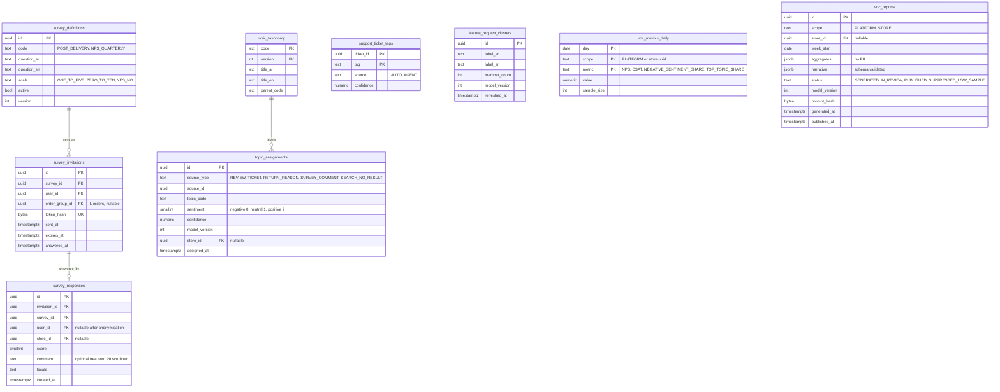

# Module: voc

Phase 2 (post-delivery micro-survey, NPS, sentiment, taxonomy analytics, weekly VoC report) · Spec refs: §18 (VoC), §23, §19.1 (seller-visible demand gaps, return reasons), §22 (reason taxonomy), §4 (no-result searches), §T12 (LLM rules), §B1 (PII stripped before prompt) · Owner aggregates: `SurveyResponse`, `TopicAssignment`, `VocReport`

## Flow
After delivery the shopper gets a one-question micro-survey. Quarterly NPS goes to a sample. Review text, support tickets and return reasons are processed (sentiment, topics, auto-tagging). Search no-result and demand-gap aggregates come from search-sync. A weekly job gathers aggregates, strips PII, asks an LLM to draft a narrative with schema-constrained output, and stores a platform report and per-seller reports (their own data only).

## Rules
- The report is generated **from aggregates**, never from raw rows. PII is stripped before any prompt, and no P2 or P3 reaches an external LLM (§B1, §T12, LLM02).
- Per-seller reports contain only that seller's data, with k-anonymity at least 50 for any demographic or cohort cut (§19.1).
- Surveys are optional, one question per survey, never blocking an order flow, and rate limited (at most 1 survey per order and 1 NPS per quarter per user).
- Survey responses are personal data. They are linked to the order for analysis, shown to sellers only as aggregates, and anonymised after the analysis window (proposed 13 months).
- Topic assignments carry a model version and a confidence. Low-confidence items are bucketed "other".
- No fabricated metrics: a report with insufficient sample states so and omits the insight.
- Sentiment and topic modeling run in AR and EN, with Franco-Arabic as a known weak spot (flag).
- LLM output is JSON validated against a schema. Narrative text is drafted and reviewed by a human before publishing to sellers (config, default on for the first release).

## Edge cases
- User answers after account deletion: not possible, survey links are signed and expire.
- Duplicate response: unique per `(survey_id, order_group_id, user_id)`.
- Seller with fewer than the minimum number of responses: report section hidden.
- Review in mixed script: processed by both language pipelines.
- Ticket auto-tag disagrees with agent tag: agent tag wins and feeds training.
- LLM vendor outage: the report is generated without the narrative from aggregates only.
- Topic taxonomy change: assignments are re-run and versioned, trend charts annotate the break.

## ER diagram

## Entities

| Entity | Ph | PK | FK (E enforced, L logical) | Indexes and uniqueness | PII | Tenancy | Partition | Retention |
|---|---|---|---|---|---|---|---|---|
| `survey_definitions` | P2 | `id` | none | unique `(code, version)` | P0 | none | none | RET-CONFIG |
| `survey_invitations` | P2 | `id` | `survey_id` E, `user_id` E, `order_group_id` L | unique `(token_hash)`; unique `(survey_id, user_id, order_group_id)`; index `(expires_at)` | P2 | `user_id` | none | 90 d after expiry (proposed) |
| `survey_responses` | P2 | `id` | `invitation_id` E, `survey_id` E, `user_id` E, `store_id` E | unique `(invitation_id)`; index `(store_id, created_at)`; index `(survey_id, created_at)` | P2 (comment may include PII) | `user_id` for owner, `store_id` aggregate only | monthly by `created_at` (proposed) | 13 months then user link dropped and kept as aggregate (proposed, VERIFY) |
| `topic_taxonomy` | P2 | `(code, version)` | none | none | P0 | none | none | RET-CONFIG |
| `topic_assignments` | P2 | `id` | `source_id` L, `store_id` E | index `(source_type, source_id)`; index `(topic_code, assigned_at)`; index `(store_id, topic_code)` | P1 (no text copy, only references) | `store_id` via aggregates | monthly by `assigned_at` (proposed) | 25 months then aggregated |
| `support_ticket_tags` | P2 | `(ticket_id, tag)` | `ticket_id` L (admin) | index `(tag)` | P1 | none | none | with ticket (2 years) |
| `feature_request_clusters` | P2 | `id` | none | none | P1 | none | none | RET-CONFIG |
| `voc_metrics_daily` | P2 | `(day, scope, metric)` | none | index `(scope, day)` | P1 | `store_id` when scope is a store | none | 25 months |
| `voc_reports` | P2 | `id` | `store_id` E | unique `(scope, store_id, week_start)` | P1 (aggregates only) | `store_id` | none | 24 months |

## Data notes
- The spec lists no tables for §18 VoC. Entities are derived from "post-delivery 1-question micro-survey and quarterly NPS", "AR/EN review sentiment and topic modeling", "support-ticket auto-tagging and a return-reason taxonomy", "no-result searches", "feature-request clustering" and "weekly auto-generated VoC report".
- The return-reason taxonomy is owned by returns (`return_reason_codes`). VoC consumes it and does not duplicate it.
- No-result searches and demand gaps are owned by search-sync (`search_queries`, `search_demand_gaps`). VoC reads aggregates.
- "Rage-tap and drop-off analytics" are analytics events (analytics-ingest warehouse), not tables here.
- Review and ticket text is not copied. `topic_assignments` points at the source and stores only the label, which keeps deletion simple (source deletion cascades through a job keyed on `source_id`).
- `voc_reports.aggregates` contains no user-level rows, and its schema is validated to forbid keys that resemble identifiers.
- The weekly report prompt hash is stored (not the prompt), like `llm_audit_log` (stylist-gateway), and the call is also logged there (`feature = VOC_REPORT`).

## API
| Endpoint | Scope | Idempotent | Rate limit |
|---|---|---|---|
| `GET /v1/me/surveys/pending` | user | n/a | 30/min |
| `POST /v1/surveys/{token}/respond` | signed token | yes | 5/min |
| `GET /v1/seller/voc/report` | seller staff (own data) | n/a | 30/min |
| `GET /v1/admin/voc/reports`, `/topics` | admin analytics role | n/a | 30/min |

## Events
Outbox: `survey.answered`, `voc_report.generated`, `voc_report.published`. Consumes `order_delivered`, `review.published`, `ticket.resolved`, `return.requested`. Analytics: none beyond survey interaction events.

## Failure handling
Pipelines are batch and idempotent per source id and model version. LLM failure produces an aggregates-only report. Insufficient sample yields `SUPPRESSED_LOW_SAMPLE`. A failed survey send is not retried beyond the invitation expiry.

## Security and abuse
- Prompt injection from review text: review text is aggregated into topics before any narrative prompt, and raw text is never included.
- Seller isolation: seller reports are RLS scoped by `store_id`, with a cross-tenant negative test.
- Survey spam and brigading: one response per invitation, signed tokens, rate limits.
- No incentives tied to positive scores (§27 spirit).

## Metrics
Survey response rate, NPS and CSAT trend, share of tickets auto-tagged and accuracy against agent tags, topic coverage, report freshness, suppressed-report share, time from review to topic.

## Acceptance
- A seller sees only its own VoC report and cannot request another store's (404).
- A report is produced without any email, phone or name in the stored prompt hash input or output.
- With fewer than the minimum responses, the seller report section is suppressed.
- A survey link cannot be answered twice.
