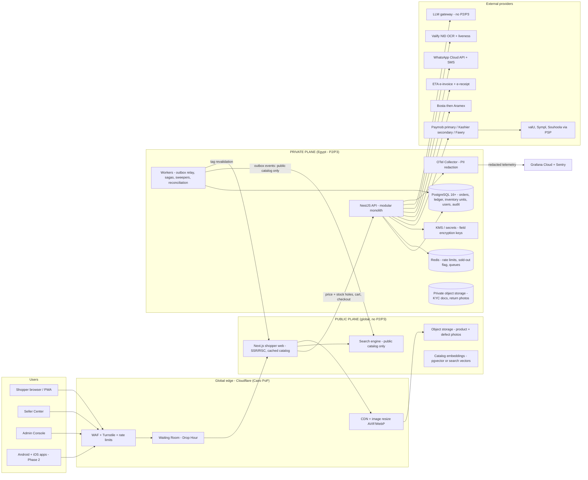

# Build Outlet NK in 30 weeks, residency first

**Short answer.** Outlet NK can reach a public web launch about **30 weeks from now (around early June 2027)** with a core team of **about 5 engineers, 1 designer, 1 QA and 4 business leads**, a **gross budget of about USD 1.2–1.5m over 18 months** (planning estimate, unsourced), and a stack built on a **custom NestJS hexagonal monolith, Next.js for the web, PostgreSQL as the single source of truth for money and stock, and Expo only in Phase 2**. The decision that shapes everything else is **where personal data lives**. No AWS, Azure, Google or Oracle region exists in Egypt as of November 2026, while **Huawei Cloud Cairo has been live since May 2024** ([Huawei Cloud](https://www.huaweicloud.com/intl/en-us/news/20240523155312706.html)), and any hosting abroad needs a **PDPC transfer licence with a review of up to 90 days** ([Legal500](https://www.legal500.com/guides/hot-topic/strategic-challenges-and-opportunities-in-cross-border-data-transfers-under-egypts-personal-data-protection-regime)). The recommended ADR-0002 is therefore a **hybrid**: customer, order and ledger data stay in Egypt, while the public catalog, images and search run on a global edge, with a single AWS UAE region as the tested fallback. The second hard fact is that **no Egyptian payment provider publicly documents a marketplace split-and-payout product**. Kashier's "connected accounts" is the only documented sub-merchant primitive ([Kashier](https://developers.kashier.io/docs/accept-payments/connected-accounts)), so the payment contract is a critical-path item, not a detail. The PDPL compliance deadline (about November 2026) has already arrived, so the PDPC licence and a DPO are **this week's work**, in parallel with signing brands. Almost every price and salary figure below comes from aggregators or the model's own estimates and is marked **UNVERIFIED** or **estimate**. Treat them as planning numbers until a quote replaces each one.

How to read this report: each section ends in a decision or a table you can act on. "UNVERIFIED" means a secondary or conflicting source. "Estimate" means no source at all, only reasoning. "⚠" means the item goes into `docs/compliance/verify-register.md`.

---

## The system is one modular monolith with two data planes

The architecture follows the master prompt (hexagonal modular monolith, outbox, sagas, double-entry ledger) and the vision addendum (web first, seller plans, defect grading, Outlet Village). The one structural addition is the **split into an in-country "private plane" and a global "public plane"**, which comes from ADR-0002 below. The rule is simple: **anything that can identify a person (P2/P3) never enters the public plane**, and that includes logs, error reports, analytics and LLM prompts.

### Target architecture diagram



The diagram shows three design choices that matter. First, **price and stock are never served from cache**: the Next.js page caches the catalog, but the price block and the "2 left in M" line are dynamic holes read from PostgreSQL, as the spec requires (§5, §T3). Second, **Redis is never a source of truth**. It holds only a "sold out" pre-filter, rate limits and the queue, while the row-per-unit reservation (`FOR UPDATE SKIP LOCKED`) lives in the same PostgreSQL database as the ledger ([Shopify Engineering](https://shopify.engineering/scaling-inventory-reservations)). Third, **every flow from the private plane to the public plane goes through outbox events that carry only public catalog fields**, which makes the residency boundary testable in CI.

### Module map

The master prompt lists 33 backend modules. The vision addendum adds `seller-plans`, `condition-grading`, `lots`, `village` (map, Brand Streets, Drop Hour, Outlet Parties) and `calendar`. The table groups them by plane and by phase so the team builds only what Phase 1 needs.

| Group | Modules | Data plane | Phase 1 (web MVP) | Phase 2+ |
|---|---|---|---|---|
| Identity and privacy | auth, users, privacy (consent, DSAR, deletion), age policy | Private | Yes | Passkeys for shoppers |
| Sellers and SaaS | sellers (KYC), **seller-plans**, storefront (Brand Street builder), channel guard | Private (KYC), public (storefront) | Yes | Sell-through insights (paid) |
| Catalog and trust | catalog, **condition-grading** (defect card, QR passport), pricing-integrity (VRP v1), trust-safety | Public (listing), private (evidence) | Yes | Defect vision grader, crawler |
| Discovery | search-sync, **village** (map, Drop Hour, parties), **calendar** (Ramadan–Eid), recommendations-gateway | Public | Search, map, Drop Hour, calendar | Ranking ML, recommendations |
| Buying | cart, checkout (saga), promotions (vouchers, store bundle), wishlists (family) | Private | Yes | Family Bag, Make an Offer |
| Money | payments, ledger, payouts, store-credit, refunds, tax-eta, reconciliation | Private | Yes | Gift cards, Plus, rewards |
| Stock | inventory (row-per-unit) | Private | Yes | Hub stock |
| Delivery | orders, fulfillment (CourierPort), returns (exchange-first) | Private | Yes | Hub consolidation, Try Room, Repair Lane |
| Risk | fraud (COD risk rules), referrals (core) | Private | Rules only | GBDT risk model |
| Comms | notifications (WhatsApp, SMS, email, push) | Private | Yes | Push (apps) |
| B2B | **lots**, B2B gift cards | Private | No | V2 ⚠ |
| AI | llm-gateway, listing copilot, stylist-gateway | Public data only | Listing copilot | Assistant, stylist |
| Ops and admin | admin, DPO console, VoC, analytics-ingest | Private | Essentials | Advanced analytics |

### Repository layout

The monorepo follows §T1 with one change from the vision addendum: `apps/web` (the shopper site) moves into Phase 1 and `apps/mobile` moves to Phase 2.

| Path | Content | Phase |
|---|---|---|
| `apps/web` | Next.js shopper site, PWA, Arabic-first RTL | 1 |
| `apps/seller-web` | Next.js Seller Center | 1 |
| `apps/admin-web` | Next.js Admin Console | 1 |
| `apps/api` | NestJS modular monolith | 1 |
| `apps/workers` | Outbox relay, saga steps, sweepers, reconciliation, ETA queue | 1 |
| `apps/mobile` | Expo app (Android + iOS together) | 2 |
| `apps/crawler`, `apps/ml-services` | Price crawler, FastAPI ML | 2 |
| `packages/*` | domain, validation (Zod), api-client, ui-tokens, ui-web, ui-native, i18n, analytics, config, policy | 1 (ui-native in 2) |
| `infra/*` | OpenTofu, container definitions, observability, waiting room | 1 |

---

## Keep personal data in Egypt and put the catalog on the edge

### What exists in and near Egypt

The research found **no hyperscaler region inside Egypt in November 2026**. AWS met Egypt's Communications Minister in May 2026, but the reports name no region or Local Zone ([Arab Finance](https://arabfinance.com/en/news/newdetails/aws-eyes-broader-expansion-in-egypt-ai-cloud-computing-infrastructure)). Microsoft has only a network point of presence with Telecom Egypt, not a datacenter region ([Zawya](https://www.zawya.com/en/press-release/microsoft-collaborates-with-telecom-egypt-to-announce-its-first-cloud-network-in-egypt-triu14y1)). **Huawei Cloud Cairo** is the only public cloud region in the country, hosted by Telecom Egypt in a Tier III facility at Smart Village ([Huawei Cloud](https://www.huaweicloud.com/intl/en-us/news/20240523155312706.html)). Cloudflare has served Egypt from a Cairo PoP since 2015 ([Cloudflare blog](https://blog.cloudflare.com/cairo)). Large announced builds such as the USD 250m Khazna/Benya data center have no confirmed go-live ([The National](https://www.thenationalnews.com/business/technology/2023/05/08/abu-dhabis-khazna-to-open-250m-data-centre-in-egypt-amid-global-acquisition-plan)). NTRA regulates data centers and cloud providers ([Baker McKenzie](https://resourcehub.bakermckenzie.com/en/resources/cloud-compliance-center/emea/egypt)).

The legal constraint is clear even though the fees are not. A **separate PDPC licence is needed before any personal data goes abroad**, the application must name the destination and security measures, the PDPC reviews within **90 days**, and the fee is reported as **50% of the controller/processor licence fee** ([Legal500](https://www.legal500.com/guides/hot-topic/strategic-challenges-and-opportunities-in-cross-border-data-transfers-under-egypts-personal-data-protection-regime), [Clyde & Co](https://www.clydeco.com/fr/insights/2026/01/egypt-regulatory-update-on-data-privacy)). On the CBE, Baker McKenzie says Egyptian law is silent on where financial institutions using cloud must store data ([Baker McKenzie](https://resourcehub.bakermckenzie.com/en/resources/cloud-compliance-center/emea/egypt/topics/permissibility-of-cloud)). Outlet NK is a merchant, not a CBE licensee, and card data stays with the PSP, so CBE localization most likely applies to the PSPs, not to Outlet NK (⚠ counsel).

### Three options compared

| | Option A: all in AWS UAE (me-central-1) + transfer licence | Option B: all in Egypt (Huawei Cairo or telco/colocation) | **Option C: hybrid (recommended)** |
|---|---|---|---|
| Where P2/P3 lives | UAE | Egypt | Egypt |
| Where public catalog, images, search live | UAE + CDN | Egypt + CDN | Global edge (Cloudflare, plus Vercel or AWS for the web) |
| Transfer licence needed for core data | **Yes, up to 90 days review** | No | No (still needed for processors abroad, see below) |
| Managed Postgres quality | Mature RDS Multi-AZ, PITR, pg_cron, pgvector (verify) | Huawei RDS/GaussDB; **pgvector and pg_cron UNVERIFIED** | Same as B for the core; pgvector moves to the public plane where catalog embeddings are public data |
| Ops burden for 4–8 engineers | Lowest | Highest (self-run parts likely) | Medium: two planes, one strict data boundary |
| Regulatory risk | Licence refused or delayed = launch blocked | Lowest | Low |
| Vendor or partner risk | Low | Some partners may object to Huawei (estimate) | Medium; core is portable if built on plain containers + Postgres |
| Latency from Cairo | About 40–70 ms to the Gulf (**UNVERIFIED, measure**) | Lowest | Lowest for private calls; edge for pages |
| Monthly cost, small production | **About USD 500–1,000** + search VM USD 50–150 (estimate, 2025 list prices) | No data; likely similar list price plus more staff time | A + B pieces; estimate USD 800–1,800 |

The cost figures for Option A are built from component estimates. The one third-party 2026 data point is about **USD 55/month for an RDS db.t4g.medium in me-central-1 (Single-AZ)**, with Multi-AZ priced at exactly double in us-east-1 ([Bytebase](https://www.bytebase.com/dbcost/rds/instance/db.t4g.medium/), [InfraTally](https://infratally.com/articles/aws-rds-pricing-explained-2026/)). Everything else needs an AWS calculator run and a Huawei Cairo quote.

### The hybrid pattern in practice

The hybrid only works if the boundary is enforced by code, not by good intentions. The table lists each data flow and where it is allowed to go.

| Data | Class | Plane | Enforcement |
|---|---|---|---|
| Users, phone, DOB, addresses, measurements, budgets | P2/P3 | Private, field-encrypted (KMS DEKs) | `data_inventory.yaml` tag; CI fails on untagged column |
| Orders, ledger, payouts, inventory units, audit log | P1/P2 | Private | Only the API and workers can reach the database |
| Seller KYC documents, return photos | P3 | Private object storage, signed URLs ≤ 15 min | Bucket policy; no CDN |
| Products, prices (display copy), defect photos, store pages | P0 | Public | Outbox event schema allows only P0 fields (Zod + contract test) |
| Search index, catalog embeddings | P0 | Public | Same event schema; no user features in shared indexes (LLM08) |
| Logs and traces | Mixed | Redacted in the in-country OTel Collector before export | Collector processor + a test that fails if a phone pattern leaves |
| Error reports (Sentry), product analytics (PostHog), LLM calls, email/SMS | Processors abroad | **Still a transfer** | Pseudonymous IDs only, no PII, and file the transfer licence anyway |

The last row is the key insight: **even the hybrid needs a transfer licence**, because Sentry, PostHog EU (Frankfurt), LLM vendors and email providers are hosted abroad ([PostHog EU](https://posthog.com/eu)). The hybrid reduces what crosses the border to pseudonymous telemetry, which makes the licence application smaller and lower-risk, but it does not remove the need for it.

### ADR-0002 draft decision

| Field | Draft text |
|---|---|
| Title | ADR-0002: Data residency and cross-border transfer |
| Status | **Proposed**. Needs owner approval and counsel sign-off (verify-register row 2). This is a stop-and-ask item under A4. |
| Context | No hyperscaler region in Egypt (Nov 2026). Huawei Cloud Cairo live since 2024. PDPL transfer licence needed for any personal data abroad, 90-day review. Spec §B1 option (c). |
| Decision | **Hybrid (Option C).** P2/P3 and all money and stock data in an Egypt-hosted plane, primary candidate Huawei Cloud Cairo, subject to a one-week technical spike. Public catalog, images, search and the Next.js rendering layer on a global edge (Cloudflare with its Cairo PoP, plus Vercel or AWS). All processors abroad receive pseudonymous data only. **File the PDPC transfer licence in week 2 regardless**, covering processors and the fallback region. |
| Spike pass criteria (week 3) | PostgreSQL 16+ with `pg_cron`; PITR; Multi-AZ or equivalent; managed Redis; KMS; an IaC provider usable from OpenTofu; private networking; measured p95 latency from a Cairo probe; a support contract in English or Arabic with an SLA. pgvector is **not** required in-country because embeddings are public data. |
| Fallback | If the spike fails: **Option A (AWS me-central-1)** for everything, launch gated on the transfer licence. Because the licence is filed in week 2, its 90-day clock ends around week 15, well before beta in week 24. |
| Portability rule | Build only on containers, plain PostgreSQL, Redis and S3-compatible storage. No proprietary database features. This keeps the move to AWS (or a future AWS Egypt region) a migration, not a rewrite. |
| Consequences | Two planes to run; a CI-tested data boundary; slightly higher monthly cost; lowest regulatory risk. |
| Open | Whether the PDPC treats encrypted or tokenized data abroad as a transfer; whether the UAE has adequacy status; Huawei Cairo service catalog. |

---

## Build the money core yourself and buy everything around it

### Custom NestJS core vs Medusa and Mercur

The strongest open-source alternative is **Medusa v2 with Mercur**, an MIT-licensed marketplace layer that became a featured Medusa starter in August 2025 and includes vendor dashboards, a multi-vendor cart with one checkout, commissions and payouts ([Medusa newsletter](https://medusajs.com/blog/newsletter-aug25/), [Mercur on GitHub](https://github.com/mercurjs/mercur)). But Mercur delegates products, pricing, orders, payments and fulfilment to Medusa ([Mercur docs](https://docs.mercurjs.com/learn/architecture)), and Medusa's marketplace path points to **Stripe Connect for payouts**, which does not exist in Egypt ([Medusa](https://medusajs.com/marketplace/)). Vendor KYC and multi-channel sync are reportedly in a paid Mercur Enterprise licence (UNVERIFIED, [Mercur docs](https://docs.mercurjs.com/developer-guide/overview)).

| Option | What it saves | What it does not solve | Verdict |
|---|---|---|---|
| **Custom NestJS hexagonal monolith** | Full control of the ledger, row-per-unit stock, VRP, defect cards, Egyptian PSPs | Catalog, cart and admin CRUD must be built (about 3–5 extra engineer-weeks, estimate) | **Recommended** |
| Medusa v2 + Mercur | Catalog, cart, basic admin, vendor dashboards | Quantity-based inventory (row-per-unit means overriding core workflows); Stripe-style payouts; Egyptian PSPs, BNPL, ETA, VRP, defect grading all custom anyway | Use as a reference design |
| Vendure | Channels-per-seller model | Its multi-vendor plugin is "for educational purposes only" ([Vendure docs](https://docs.vendure.io/current/core/how-to/multi-vendor-marketplaces)) | No |
| Spree 5 | Mature engine | AGPL from 4.10, marketplace module is paid Enterprise, Ruby does not fit the TS monorepo ([Spree mirror](https://github.com/spree-forge/spree)) | No |
| Saleor | Strong core | No official multi-vendor; community plugin stale since 2023 ([GitHub](https://github.com/Saleor-Multi-Vendor/saleor-multi-vendor)) | No |
| Shopify + multi-vendor app | Fast storefront | Checkout cannot run the one-payment multi-store saga or Egyptian BNPL; Webkul deletes seller data 2 days after uninstall ([Webkul FAQ](https://sp-seller.webkul.com/index.php?p=faqs)) | No |
| Mirakl, CS-Cart | Marketplace features | Mirakl is enterprise quote-only ([G2](https://www.g2.com/products/mirakl-inc/pricing)); CS-Cart prices conflict across sources (UNVERIFIED) | No |

**Choice (2–3 lines, per CLAUDE.md):** the hard and differentiating parts of Outlet NK are money, stock and price integrity, and no engine handles them for Egypt. Adopting Medusa would save generic CRUD but force the team to fight the engine on the exact code that must be most correct. Optional: a **one-week time-boxed spike** on Medusa in Sprint 1 settles the question with evidence, recorded in ADR-0001.

### Stack layer by layer

| Layer | Choice | Why | Alternative kept open |
|---|---|---|---|
| Language | TypeScript strict (+ `noUncheckedIndexedAccess`, `exactOptionalPropertyTypes`); Python with mypy strict for ML later | Spec A2.1; one language across web, API and shared packages | — |
| Monorepo | pnpm + Turborepo, remote cache self-hosted on S3-compatible storage | Spec A2.2; near-zero cost at this size (estimate) | Vercel remote cache |
| API | NestJS modular monolith, REST + OpenAPI generated from code, Problem+JSON | Spec §T3; module guards fit the `policy` package | — |
| Validation | Zod at every boundary; shared schemas in `packages/validation` | Spec A2 | — |
| Database | PostgreSQL 16+, PgBouncer (transaction mode), pg_cron | Same ACID store for ledger + row-per-unit stock ([Shopify Engineering](https://shopify.engineering/scaling-inventory-reservations)) | — |
| DB access | Kysely (typed SQL) for money and stock paths; Prisma acceptable for CRUD | `SKIP LOCKED`, advisory locks and deferred constraint triggers need hand-written SQL (estimate) | Prisma everywhere |
| Cache, rate limit, queue | Redis + BullMQ | Spec §T3; never a source of truth | SQS if on AWS |
| Shopper web | **Next.js 16.x**, App Router, RSC, `[locale]` segment, PWA | SEO and Core Web Vitals for web-first; Cache Components become the default in Next.js 17 ([Next.js 16.4](https://nextjs.org/blog/next-16-4)) | — |
| i18n / RTL | next-intl, `dir="rtl"` on `<html>` for `ar`, CSS logical properties, IBM Plex Sans Arabic | Arabic-first rule A2.15 | — |
| Seller and admin web | Next.js + the same `ui-web` package | One design system | — |
| Search | **Bake-off: Meilisearch vs Typesense vs OpenSearch** (below); Postgres FTS + pg_trgm as fallback | Arabic quality decides | — |
| Object storage + images | S3-compatible (private plane: in-country; public plane: R2 or S3) + Cloudflare image resizing | AVIF/WebP budgets, spec §T10 | — |
| Mobile (Phase 2) | **Expo SDK 57+**, New Architecture, Expo Router, shared `packages/*` (not shared screens) | SDK 56 shipped 21 May 2026 with a Hermes V1 memory regression fixed in SDK 57 ([Expo SDK 56 changelog](https://expo.dev/changelog/sdk-56)); this closes verify row 14 | — |
| Feature flags | OpenFeature + flagd (Git-backed) for kill switches; GrowthBook self-hosted when A/B starts | Free; GrowthBook self-host is MIT ([GrowthBook pricing](https://growthbook.io/pricing)) | Unleash Enterprise, about USD 375/mo (UNVERIFIED) |
| Passkeys | SimpleWebAuthn (server + browser) for sellers and admins, mandatory | Spec §T5 (library version not verified) | — |
| LLM | `llm-gateway` with schema-constrained outputs; listing copilot only in Phase 1 | Spec §T12; LLM Top 10 mapping | — |
| IaC | **OpenTofu** + Conftest | MPL licence avoids Terraform's BSL; spec §T7 policy-as-code | Pulumi (TS, but paid state service) |
| Runtime | Containers. On AWS: ECS Fargate. On Huawei: its managed container service (verify in spike) | EKS/Kubernetes adds cluster ops a small team rarely recovers in value (estimate) | Kubernetes at growth |

### Next.js i18n and RTL caveats

Three caveats deserve an engineering note in the web spec. Cached components cannot call `headers()`, which next-intl uses, so the locale must be passed via `next/root-params`, a workaround tracked in next-intl issue #1493 ([demo](https://awesome.ecosyste.ms/projects/github.com%2Faurorascharff%2Fnext-intl-cache-components)). The safe pattern is therefore a **`[locale]` route segment that also sets `dir` on `<html>`**, never a cookie-only locale. Second, the catalog page can be cached and revalidated by tag from outbox events, but **price, stock and the defect acknowledgement must be dynamic holes**, or the site risks showing a stale "% off", which is a legal risk after the CPA's October 2026 warning of fines up to **EGP 2m or twice the product value** ([Ahram Online](https://english.ahram.org.eg/NewsContent/3/12/556313/Business/Economy/CPA-warns-of-stiff-fines-for-fraudulent-;White-Fri.aspx)). Third, PWA support and Core Web Vitals on low-end Android were not researched; with Android at about **88–91% of Egyptian phones** ([StatCounter](https://gs.statcounter.com/os-market-share/mobile/egypt)), the team should buy two low-end Android test phones in week 1 and put a JS budget in CI.

### Search engine bake-off

The spec defaults to Typesense, but the research could not verify its Arabic handling because its documentation host was blocked. Meilisearch's tokenizer documents Arabic article segmentation, diacritics removal and Alef/Yeh/Taa-marbuta normalization, with no confirmed stemmer ([Meilisearch language docs](https://meilisearch.com/docs/resources/help/language)). Lucene, behind OpenSearch, ships an Arabic normalizer and stemmer ([Lucene](https://lucene.apache.org/core/7_5_0/analyzers-common/org/apache/lucene/analysis/ar/package-use.html)). **None handles Franco-Arabic ("fostan") natively**, so an app-side transliteration layer is needed in every case.

| Criterion (weight) | Meilisearch | Typesense | OpenSearch | How to test |
|---|---|---|---|---|
| Arabic relevance, nDCG@10 (35%) | Normalization documented | **UNVERIFIED** | Normalizer + stemmer | 500 real Egyptian queries (AR, EN, Franco, Eastern Arabic digits), labelled by 2 people |
| Filter + facet speed, p95 < 150 ms (20%) | Strong (estimate) | Strong (estimate) | Good, heavier | k6 at 50 QPS on 100k SKUs |
| Ops weight for a small team (20%) | Single binary | Single binary | JVM cluster | Time to deploy + back up |
| Hybrid vector search (10%) | Yes (verify) | Yes (verify) | Yes | Same query set with embeddings |
| Licence and cost (15%) | MIT/BUSL parts (verify) | GPL-3.0 (verify) | Apache 2.0 | Read the licences |

**Plan:** run the bake-off in Sprint 3 (one engineer, one week) and record the winner in an ADR. The search index holds only P0 catalog data, so it can live in the public plane.

---

## Sign the payment contract first: every integration has a gap

The table summarises each integration's status, its main risks and the questions for the contract. The research could reach only some official docs, so "Status" reflects what is publicly documented, not what a sales team may offer.

| Integration | Role | Public status (Nov 2026) | Main risks | Ask in the contract or sales call |
|---|---|---|---|---|
| **Paymob** | Primary PSP | Unified Intention API → `client_secret` → Unified Checkout or Pixel → HMAC webhook ([Paymob Create Intention](https://developers.paymob.com/paymob-docs/developers/intention-apis/create-intention)). Payouts product exists ([Beyond Payments](https://developers.paymob.com/paymob-docs/beyond-payments)). **No public split or marketplace docs.** | Seller money may sit in a pooled Outlet NK balance, which conflicts with ADR-0003 (no pooled seller funds) | Split or sub-merchant product? Payouts to seller IBANs and wallets from settled funds, not a pooled account? Fees per method; settlement T+n; refund and partial refund API; tokenization and recurring (for Plus later); Apple Pay; Meeza; InstaPay; webhook retry policy; sandbox; SLA and failover |
| **Kashier** | Secondary PSP, and the best marketplace candidate | **"Connected accounts"**: the platform passes the sub-merchant MID on payment sessions, and the sub-merchant must authorise the platform ([Kashier](https://developers.kashier.io/docs/accept-payments/connected-accounts)). Payouts and settlement sections exist but were not read. Egypt-only businesses ([Kashier FAQ](https://kashier.io/en/faqs)) | Connected accounts covers payment, not settlement; every brand needs its own Kashier MID | Does one multi-store checkout split across several connected accounts? How do commission and fees get deducted? Who holds the chargeback? Onboarding time per brand? Refund across connected accounts? |
| **Fawry** | Pay-at-outlet reference codes | Callbacks on status change plus a signed "Get Payment Status" pull; statuses NEW, PAID, EXPIRED, CANCELED, REFUNDED ([FawryPay docs](https://developer.fawrystaging.com/docs/payment-notifications/get-payment-notification)) | 24h payment window holds stock; no disbursement API found | Direct or via Paymob/Kashier? Reference expiry configurable? Refund method (voucher vs transfer)? Fees |
| **InstaPay** | Request-to-pay / QR | Bank-app "collect request" flow only for IPN banks ([Alex Bank](https://alexbank.com/en/retail/instapay.html)); no public merchant API found | Direct integration not possible for a startup (estimate) | Take it **through the PSP** as a method; confirm refund path |
| **BNPL** (valU, Sympl, Souhoola) | Instalments from day one (feature 41) | Available as **Paymob methods, enabled per merchant by the account manager** ([Paymob docs](https://developers.paymob.com/paymob-docs)). No public direct APIs | The spec's "from X EGP/month" copy needs a quote API that may not exist via a PSP; refund must cancel the loan (§B3) | Quote API for pre-checkout monthly amount? Does a Paymob refund cancel or partially cancel the loan? Minimum age (21?); FRA marketing rules after the 6 Sep 2026 guide. **Hide the "from X/month" line until a quote API is contracted.** |
| **Bosta** | First courier | Official Node SDK: deliveries, pickups, AWB, COD amount, cities/zones/districts ([bostaapp/bosta-nodejs](https://github.com/bostaapp/bosta-nodejs)). Delivery types include Return (25) and Exchange (30) per a community SDK ([Bosta.Net](https://www.nuget.org/packages/Bosta.Net)) | No public webhook signature spec or idempotency key; COD remittance cycle unknown | Webhook payload + signing; rate limits; COD remittance cycle and fees; real COD refusal data by governorate; open-box at door; penalties for loss and delay; exchange pickups |
| **Aramex** | Second courier (Phase 1 late or Phase 2) | Not researched (background: has a shipping API; UNVERIFIED) | — | Same list as Bosta |
| **ETA e-invoice (B2B)** | Commission invoices to sellers | Official SDK site unreachable from the research session. Background (UNVERIFIED): OAuth2 per ERP, CAdES-BES signature from an accredited CA token or HSM | Signing hardware and CA onboarding lead time | Hire a certified ETA integrator or tax adviser; get a signing token early |
| **ETA e-receipt (B2C)** | Receipts for Outlet NK's own supplies (delivery fees, seller plans billed to consumers, Plus) | Vendor description: per-POS-device registration, activation code and token, receipt UUID, EGS/GS1 item codes, QR, retry queue ([ECOSIRE](https://ecosire.com/apps/erpnext/erpnext-egypt-eta-ereceipt)) | Obligation date for Outlet NK unknown (⚠ row 6); delegated signing for sellers unknown | Register a virtual POS; confirm preprod access; confirm the wave date |
| **WhatsApp Cloud API** | OTP fallback, order updates, pay links (feature 44), "see it first" video (feature 19) | Egypt authentication rate about **USD 0.0036/message + 14% VAT**; Authentication-International about USD 0.065 (third-party, July 2026) ([ChatMaxima](https://chatmaxima.com/whatsapp-api-pricing/egypt/)); Meta lowered Egypt rates from 1 Apr 2026 ([Meta pricing](https://developers.facebook.com/documentation/business-messaging/whatsapp/pricing)) | International rate is about 18× if the sender counts as international; sources conflict on utility-message charges from 1 Oct 2026 | Register the business number in Egypt; confirm the rate card; pick a BSP or go direct |
| **SMS OTP** | Primary OTP + failover | **Not researched** (Twilio, Vonage, Infobip, Victory Link, Cequens) | SMS pumping; sender-ID registration | Two providers; EG-only prefixes at launch; per-prefix caps |
| **Email** | Receipts, seller statements | Not researched | Residency (ADR-0002) | Region of storage; DPA |
| **Valify (KYC)** | Seller signatory ID check | Egyptian national ID OCR, face match, liveness, hosted web flow with webhook ([Valify docs](https://valify.gitbook.io/documentation/kyc/kyc-features/egy-nid-ocr)) | No confirmed Commercial Registry or IBAN name-match API; a competitor claims Egypt has no consumer civil-registry API (UNVERIFIED, [Didit](https://didit.me/solutions/countries/egypt/)) | Data residency of Valify; price per check; registry-backed match available? Use manual Ops check of commercial register and tax card until then; validate IBAN checksum locally |
| **Maps** | Address pin | Not researched | Cost and residency | Use **Bosta's geo endpoints as the canonical address taxonomy**, map pin only as extra coordinates |
| **Cloudflare** | WAF, CDN, Waiting Room | Waiting Room on Business and Enterprise; one basic room included ([Cloudflare docs](https://developers.cloudflare.com/waiting-room/)); Business about USD 200–250/mo (UNVERIFIED) | Full Bot Management likely Enterprise-only | Quote for Business vs Enterprise before the first big Drop Hour |

**The one decision that blocks the most work** is the marketplace money flow. The safest default (ADR-0003 addendum) is: **Kashier connected accounts if it can split one checkout across sellers, otherwise Paymob as merchant of record with seller payables tracked in the Outlet NK ledger and paid out from settled funds**, the second only after counsel confirms it does not need a PSP licence (⚠ row 3). Both PSPs are built behind `PaymentProviderPort`, and the webhook pattern is the same for all three providers: verify the signature, store the raw body, dedup on the event ID, and poll the status endpoint as a fallback.

---

## Start with free, proven tooling and buy only what reduces risk

The team will be 4–8 engineers, so the toolchain must cover PCI SAQ A, ASVS 5.0 L2 and the PDPL 72-hour breach clock without a dedicated platform team. The split below follows that rule.

### DevOps, security and observability: MVP vs later

| Area | MVP must-have (Phase 0–1) | Later (Phase 2+) | Cost basis |
|---|---|---|---|
| CI/CD | GitHub Actions; trunk-based; required reviews (2 for money/security code, CODEOWNERS) | Self-hosted runners if minutes grow | Hosted runner prices cut about 39–40% on 1 Jan 2026 ([GitHub](https://resources.github.com/actions/2026-pricing-changes-for-github-actions/)) |
| Supply chain | **GitHub artifact attestations (Sigstore) = SLSA Build L2**; SBOM via Syft + `attest-sbom`; `gh attestation verify` at deploy | SLSA L3 via isolated reusable workflows ([GitHub docs](https://docs.github.com/es/actions/security-for-github-actions/using-artifact-attestations/using-artifact-attestations-and-reusable-workflows-to-achieve-slsa-v1-build-level-3)); cosign for images only if needed | Free |
| Secrets in code | **GitHub Secret Protection** (push protection) + gitleaks pre-commit | — | USD 19/committer/mo ([GitHub changelog](https://github.blog/changelog/2025-03-04-introducing-github-secret-protection-and-github-code-security/)) |
| SAST / deps | Semgrep CE, Renovate, `pnpm audit` + OSV | GitHub Code Security (CodeQL) | Code Security USD 30/committer/mo |
| DAST | OWASP ZAP baseline in CI on staging; full scan nightly | — | Free |
| IaC | OpenTofu + Conftest; Checkov | — | Free |
| Runtime | Containers on the chosen private plane; Cloudflare in front | Autoscaling on queue depth; pre-scaling plans for big drops | See budget |
| Database | Managed Postgres with PITR, PgBouncer, migration linter (expand/contract) | Read replicas; partitioning of events and audit | — |
| Secrets + keys | Cloud secrets manager + KMS envelope encryption for P3; OIDC from CI, no long-lived keys | Yearly key rotation drill | About USD 20–50/mo (estimate) |
| Edge security | Cloudflare Business WAF + Turnstile + server-side rate limits + one basic Waiting Room | Enterprise bot management + advanced waiting rooms (quote only) | USD 200–250/mo (UNVERIFIED) |
| Identity | Passkeys mandatory for sellers and admins; TOTP fallback; dual approval on payouts | Passkeys offered to shoppers | Free library |
| Observability | OpenTelemetry → in-country Collector (PII redaction) → **Grafana Cloud Pro**; Sentry Team | Grafana usage growth; Sentry Business; self-host LGTM if cheaper | Grafana USD 19/mo + usage; Sentry about USD 26–29/mo (UNVERIFIED) ([Last9](https://last9.io/blog/grafana-cloud-pricing/), [Capterra](https://www.capterra.com/p/165426/Sentry/pricing/)) |
| SLOs and paging | Grafana SLO or Sloth for multi-burn-rate alerts; Grafana OnCall/IRM pager | PagerDuty if needed | Low |
| Audit | Hash-chained `audit_log`; WORM copy (S3 Object Lock or equivalent) | Daily signed snapshot | Low |
| Tests | Unit + fast-check property tests; **negative authorization test per endpoint**; Playwright E2E; dependency-cruiser fitness functions; **Stryker nightly on ledger, pricing, reservation, refunds** | Full Pact across apps (PactFlow about USD 99/mo, UNVERIFIED); Maestro for apps; k6 Cloud | Free at MVP |
| Load | k6 OSS before beta: drop simulation + 20× load | k6 Cloud for mega events | Free tier includes k6 ([Last9](https://last9.io/blog/grafana-cloud-pricing/)) |
| Flags | OpenFeature + flagd, kill switch per payment method, COD, BNPL, Drop Hour, LLM | GrowthBook for experiments | Free |
| Product analytics | Server-side pseudonymous events; PostHog EU Cloud only after consent and with no PII | ClickHouse warehouse + dbt | 1M events/mo free ([PostHog EU](https://posthog.com/eu)) |
| Pen test | **External web/API pen test before beta** (no open high/critical) | Yearly + before each money feature and the apps | USD 3.5k–15k per test in the UAE market (UNVERIFIED) ([Kolonell](https://kolonell.com/en/blog/web-application-pentest-cost-dubai-2026)) |
| Disclosure | `security.txt` + a free vulnerability disclosure page | Private bug bounty | Bounty USD 25k–40k/yr in platform fees (UNVERIFIED) ([Synack](https://www.synack.com/blog/hackerone-pricing/)) |
| Breach readiness | Breach runbook tied to PDPC 72h / subjects 3 days; tabletop before beta | Quarterly tabletop | Staff time |

**Estimated monthly tooling at MVP: about USD 700–1,300**, excluding compute and database (estimate built on aggregator prices). The research also estimates that keeping the full A2.10 test matrix alive costs about **one engineer-day per week** across the team (estimate, no source). That is acceptable only because Stryker and Pact are scoped to the critical modules at first.

### Environments

| Environment | Purpose | Data | Where | Who deploys |
|---|---|---|---|---|
| Local | Development | Seed fixtures | Laptop + Docker Compose | Each engineer |
| Preview (per PR) | Review web UI changes | **Synthetic only** | Public-plane previews (Vercel or Cloudflare) + shared dev API | CI on every PR |
| Dev | Integration of main branch | Synthetic | Small private-plane stack | CI on merge |
| Staging | Prod-like; PSP, courier and ETA **sandboxes / preprod**; ZAP and k6 run here | Synthetic only, never prod copies (§T7) | Same topology as prod, smaller | CI, then promote |
| Production | Live | Real | Private plane in Egypt + public edge | Promote the same signed artifact from staging |

### Release process

The release process combines the spec's rules (§T7, §T8) with one new rule for the Drop Hour.

| Step | Rule |
|---|---|
| Branching | Trunk-based, short branches, conventional commits, PR template with spec link, threat notes and AR/EN × light/dark screenshots |
| Build | One build per commit; SBOM + provenance attestation; image digest pinned |
| Database | Expand/contract migrations only; migration linter in CI; never a destructive migration in the same release as the code that stops using a column |
| Promotion | Staging → production of the **same verified artifact**; `gh attestation verify` gate |
| Rollout | Canary 5% → 25% → 100% with automatic SLO gates; feature flags default off |
| Drop Hour guard | **No production deploy in the 2 hours before or 1 hour after the daily Drop Hour** (proposed default, record in an ADR) |
| Freezes | 48h release freeze before mega events (White Friday, Ramadan launch, Eid) plus a game day |
| Rollback | Flag off first; redeploy the previous artifact second; database forward-fix only |
| Error budget | Budget exhausted → reliability work only |
| Mobile (Phase 2) | EAS Update staged 1% → 10% → 50% → 100% with crash-rate rollback |

---

## Register the company and file the privacy licences this month

### Company setup steps

An Egyptian LLC through GAFI takes **about 7 business days once documents are filed, or 2 days for an extra EGP 10,000** ([Cliffe Dekker Hofmeyr](https://www.cliffedekkerhofmeyr.com/guides/africa-corporate/egypt/incorporation-process/how-long-does-the-company-incorporation-process-take.html)). An LLC needs at least two shareholders and has no statutory minimum capital ([Lex Africa](https://lexafrica.com/insights/how-to-start-a-business-in-egypt-a-guide-for-entrepreneurs/)). Egypt has **no consolidated e-commerce law or e-commerce licence**; ITIDA handles complaints and e-signatures ([Chambers TMT 2025](https://practiceguides.chambers.com/practice-guides/tmt-2025/egypt)).

| # | Step | Detail | Time | Cost | Week |
|---|---|---|---|---|---|
| 1 | Choose the structure | Egyptian LLC as operating company; a holding company abroad (Delaware, ADGM or DIFC) usually added at the first priced round | Decision | Holding costs **not found** (⚠) | 1 |
| 2 | Hire Egyptian counsel | Corporate + privacy + consumer + payments; send the verify register top 8 | 1–2 weeks | Retainer not sourced (estimate USD 1.5–3k/mo) | 1 |
| 3 | Incorporate the LLC at GAFI | Name reservation, articles, bank capital certificate, commercial register; GAFI also has a digital service ([Deloitte](https://www.deloitte.com/middle-east/en/services/tax/perspectives/digital-service-introduced-for-company-incorporation.html)) | 2–7 business days | Gov't fees about EGP 5,000–15,000+ (UNVERIFIED) ([Deel](https://www.deel.com/blog/entity-setup-egypt/)) | 1–3 |
| 4 | Tax card + income tax registration | E-commerce businesses register **within 30 days of starting** (Decree 307/2020) ([vatupdate](https://www.vatupdate.com/2024/11/26/egyptian-tax-authority-regulations-and-requirements-for-e-commerce-businesses-2)) | 1–2 weeks | Low | 3–4 |
| 5 | VAT registration | Required at **EGP 500,000 in sales**; register early anyway because commission invoices to sellers carry 14% VAT ([vatupdate](https://www.vatupdate.com/2024/11/26/egyptian-tax-authority-regulations-and-requirements-for-e-commerce-businesses-2), [Kintsugi](https://trykintsugi.com/sales-tax-guides/africa/egypt.md)) | 1–2 weeks | Low | 4 |
| 6 | ETA e-invoice and e-receipt onboarding | Signing token from an accredited CA; preprod access; virtual POS for e-receipts | 3–6 weeks (estimate) | Token + integrator fees (not found) | 4–10 |
| 7 | Bank account + PSP merchant accounts | Paymob and Kashier KYC; Fawry | 2–4 weeks (estimate) | — | 3–8 |
| 8 | **PDPC controller/processor licence + DPO** | Decision 816/2025 in force 2 Nov 2025 with a one-year window ([CMS](https://cms.law/en/are/legal-updates/egypt-s-pdpl-executive-regulations-issued-one-year-compliance-countdown-begins)); fees tiered by records; up to 100k records reportedly exempt (UNVERIFIED) ([Tech Hive Advisory](https://www.techhiveadvisory.africa/insights/review-of-egypts-executive-regulation-for-the-personal-data-protection-law)) | Unknown | Low at launch volume (UNVERIFIED) | **2** |
| 9 | **PDPC direct electronic marketing licence** | Separate licence for push, WhatsApp and email marketing ([Chambers](https://chambers.com/articles/a-first-look-at-egypt-s-personal-data-protection-executive-regulations)) | Unknown | Unknown | 2 |
| 10 | **PDPC cross-border transfer licence** | Needed for processors abroad even under the hybrid; 90-day review; 50% of the controller fee | ≤ 90 days | 50% of controller fee | **2** |
| 11 | Startup Charter classification certificate | Launched Feb 2026: certificate, 70+ incentives, simplified tax regime under Law 6/2025 ([Clyde & Co](https://www.clydeco.com/en/insights/2026/02/egypt-launches-first-national-startup-charter)) | Unknown | Free (assumed) | 4–8 |
| 12 | Trademark for "Outlet NK" + Arabic mark | Egypt trademark office (not researched) | Months | Not found | 2 |
| 13 | Employment setup | Contracts, social insurance (employer about 18.75% of insured wage, capped, **⚠ VERIFY**), medical insurance | 2 weeks | — | 4 |
| 14 | Legal documents (Arabic authoritative + English) | ToS, Seller Agreement + DPA + seller plans, Privacy Policy, consent texts, Returns Policy incl. defect rules (V19), Store Credit Terms | 6–10 weeks (estimate) | Not sourced (estimate USD 15–40k one-off) | 4–16 |

Note on the Startup Charter: the sources conflict on its size (USD 1bn vs USD 5bn over five years) ([Business Today Egypt](https://www.businesstodayegypt.com/Article/1/7117/Egypt-launches-‘Startup-Charter’-to-mobilize-1B-in-funding-over), [Bridge MENA](https://bridgemena.com/news/egypt-launches-the-startup-charter-to-attract-5-billion-in-investments-over-five-years)), and GAFI's "Golden License" targets strategic projects, with no link found to startups ([GAFI](https://www.gafi.gov.eg/English/MediaCenter/News/Pages/GAFI-Participates-in-the-Launch-of-Egypt%E2%80%99s-First-Startup-Charter.aspx)). There is also a decree-number conflict for the PDPL regulations (81/2025 vs 816/2025) that counsel should settle.

---

## Hire a partnerships lead and a CTO before any engineer

### Hiring order

The problem book ranks "not enough brands" as the top risk and "building too many features" as the top tech risk, so the hiring order puts supply and technical leadership first. Egypt is described as **"one of the most contested talent pools" in global tech** ([Ecofin](https://www.ecofinagency.com/news-digital/2212-51601-egypt-emerges-as-a-one-of-the-global-battleground-for-tech-engineers-and-industrial-talent)), and remote USD offers of **USD 1.5–3k/month** beat many local offers for juniors ([Sprints.ai](https://sprints.ai/ar-eg/blog/programmer-salaries-in-egypt-2025)), so senior hires must be priced against remote offers, not against Payscale averages.

| Order | Role | Week to start | Why now | Monthly gross (EGP, 2026) | Source status |
|---|---|---|---|---|---|
| 1 | Partnerships lead (brands) | 1–3 | Stage 0 gate needs 15+ signed brands | 40–80k | **Unsourced estimate** |
| 2 | CTO / lead engineer | 1–4 | Owns ADRs, residency spike, hiring | 150–300k+ (or USD 4–8k) | **Unsourced estimate** |
| 3 | Senior backend engineer (money: ledger, payments, inventory) | 4–6 | Critical path from Sprint 2 | 80–150k | Estimate anchored on Payscale senior SQL **EGP 244k/yr base** as a floor ([Payscale](https://www.payscale.com/research/EG/Job=Senior_Software_Engineer/Salary/f71f4851/SQL)) |
| 4 | Product designer (Arabic/RTL) | 4–6 | Village map, defect card, checkout designs before build | 35–80k | **Unsourced estimate** |
| 5 | Senior full-stack engineer (web, Next.js) | 6–8 | Website shell from Sprint 3 | 80–150k | Estimate |
| 6 | Mid full-stack engineer ×2 (seller center, admin) | 8–10 | Parallel Seller Center and back office | 40–80k | Estimate; Payscale React about EGP 120k/yr in Cairo is a floor ([Payscale](https://www.payscale.com/research/EG/Job=Software_Engineer/Salary/30ec86b5/React.js)) |
| 7 | Operations lead (couriers, returns, COD) | 6–10 | Courier contracts, return flow design, beta ops | 40–90k | **Unsourced estimate** |
| 8 | DevOps/SRE (contract, about half-time) | 6–8 | Two-plane infra, CI, observability | 70–140k (full-time equivalent) | Estimate; remote DevOps median about USD 69k/yr (vendor data, inconsistent) ([Plane](https://plane.com/salaries/devops-developer/egypt)) |
| 9 | QA engineer | 10–12 | Negative authz tests, E2E, drop simulation | 25–60k | **Unsourced estimate** |
| 10 | Marketing and community lead | 8–12 | Waitlist, WhatsApp Channel, «لاقي العيب» videos | 50–110k | **Unsourced estimate** |
| 11 | Product manager | 12–16 (or founder covers) | Scope control for the 24-week deadline | 60–120k | Sources diverge: EGP 150k–950k/yr ([TalentUp](https://talentup.io/salary/product%20manager/cairo), [Life Indexed](https://lifeindexed.com/salary/africa/egypt/product-manager/2025/)) |
| 12 | Support agents ×3 (Arabic, WhatsApp) | 20–22 | Beta support | 9–15k each | **Unsourced estimate** |
| 13 | Ops coordinators ×2 + catalog/photo assistants ×2 | 20–22 | Seller onboarding, defect photo quality | 12–20k each | **Unsourced estimate** |
| 14 | DPO | 2 (outsourced) | PDPL requires one; qualification rules not found | Outsourced retainer, not sourced | ⚠ row 1 |
| Phase 2 | Mobile engineers ×2, ML engineer, data/analytics, growth marketer, more support | Months 8–12 | Apps, defect vision grader, ranking | ML 70–150k; others estimate | Estimate |

Add about **25% on top of gross pay** for employer social insurance and medical cover (planning assumption; the 18.75% rate and cap need verification). Use a planning exchange rate of **about EGP 50/USD** (UNVERIFIED; check on the day).

### Org chart by stage

**Stage 0 (weeks 1–6): about 4–5 people.**

```
Founder / CEO (also finance, legal liaison, interim PM)
├── Partnerships lead (brands)
├── CTO / lead engineer
│   └── Senior backend engineer (from week 4–6)
├── Product designer (from week 4–6)
└── Outsourced: Egyptian counsel · DPO service · accountant/tax adviser
```

**Stage 1–2 build (weeks 6–24): about 11–13 people.**

```
Founder / CEO
├── CTO
│   ├── Senior backend (money core)
│   ├── Senior full-stack (shopper web)
│   ├── Mid full-stack ×2 (Seller Center, Admin + back office)
│   ├── DevOps/SRE (contract, ~0.5)
│   ├── QA engineer
│   └── Product designer
├── Partnerships lead (brands, seller plans, onboarding)
├── Operations lead (couriers, COD, returns, payouts ops)
├── Marketing and community lead
└── Outsourced: counsel · DPO · tax/ETA integrator · pen-test firm
```

**Stage 3–4 (beta and growth, months 6–18): about 22–30 people.**

```
Founder / CEO
├── CTO
│   ├── Web squad: senior full-stack + 2 engineers
│   ├── Money & ops squad: senior backend + 1 engineer + QA
│   ├── Mobile squad (Phase 2): 2 mobile engineers
│   ├── Data/ML: ML engineer + analytics engineer
│   └── Platform: DevOps/SRE (full-time) · security champion
├── Head of product (or PM) + 2 designers
├── Partnerships: lead + 2 brand managers
├── Operations: lead + 2 coordinators + 2 catalog/photo + hub staff (V2)
├── Customer care: 3–6 Arabic agents (WhatsApp-first)
├── Marketing: lead + growth marketer + creator manager
└── Finance & compliance: finance manager + outsourced DPO + counsel
```

This size matches the research estimate that a seed marketplace with about 20–30 people in Egypt burns roughly **USD 80–200k/month** (estimate, no source).

---

## Plan for about USD 1.3m over 18 months and raise after beta data

Every number in this section is a **planning estimate**. Only the tooling line items and the government programs have cited sources, and most of those are UNVERIFIED aggregators.

### Monthly infrastructure and tooling

| Item | Build (months 1–6) | Beta + launch (months 7–12) | Growth (months 13–18) | Basis |
|---|---|---|---|---|
| Private plane compute + Postgres + Redis (Egypt or AWS UAE) | 400–900 | 800–1,800 | 1,500–3,500 | Estimate; Option A estimate USD 500–1,000 at small production |
| Public plane (web hosting, search VM, object storage, egress) | 100–300 | 200–600 | 400–1,200 | Estimate |
| Cloudflare Business | 200–250 | 200–250 | 200–250 (Enterprise = quote) | UNVERIFIED |
| GitHub Team + Actions + Secret Protection | 150–300 | 200–350 | 450–700 (add Code Security) | GitHub list prices |
| Grafana Cloud + Sentry | 50–200 | 150–400 | 600–1,600 | UNVERIFIED |
| PostHog, flags, pager, secrets/KMS | 20–150 | 100–300 | 300–1,000 | Estimate |
| LLM gateway (listing copilot) | 50–200 | 100–400 | 300–1,500 | Estimate |
| WhatsApp + SMS OTP + email | 20–100 | 300–1,000 | 800–2,500 | WhatsApp auth about USD 0.0036/msg; SMS not researched |
| Valify KYC checks | 0 | 100–300 | 200–500 | Not researched |
| **Total (USD/month)** | **about 1,000–2,600** | **about 2,200–5,400** | **about 4,750–12,750** | — |

### Monthly team cost (planning)

| Stage | Headcount | Gross salaries (EGP/mo, midpoints) | With ~25% on-costs (USD/mo at 50) |
|---|---|---|---|
| Months 1–3 (ramp) | 4–7 | about 450–600k | **about USD 11–15k** |
| Months 4–7 (build) | 11–13 | about 930k | **about USD 23k** |
| Months 8–12 (beta + launch) | 18–20 | about 1.23m | **about USD 31k** |
| Months 13–18 (growth + apps) | 25–30 | about 1.76m | **about USD 44k** |

Founder pay is excluded. Midpoints come from the unsourced ranges in the hiring table, so this is the least reliable table in the report.

### One-off costs

| Item | Estimate (USD) | Basis |
|---|---|---|
| Incorporation (government + professional fees) | 1–10k | Gov't EGP 5–15k+ (UNVERIFIED); a 2022 all-in quote was about USD 9,750 ([Healy](https://www.healyconsultants.com/wp-content/uploads/2013/08/draft-invoice-Egypt.pdf)) |
| Legal document pack (AR + EN) | 15–40k | Unsourced estimate |
| PDPC licences (controller, marketing, transfer) | Low to unknown | Fees partly unknown (⚠) |
| ETA signing token + integrator | 1–5k | Unsourced; one e-receipt connector from USD 499 ([ECOSIRE](https://ecosire.com/apps/erpnext/erpnext-egypt-eta-ereceipt)) |
| Pen test before beta + retest | 5–15k | UNVERIFIED UAE range |
| Pen test before apps (Phase 2) | 5–15k | Same |
| Brand identity + launch creative | 5–15k | Unsourced |
| Photo/defect studio kit + test phones + laptops | 15–30k | Unsourced |
| Hub fit-out (V2, 300–500 sqm) | 10–30k | Unsourced; rent separate |
| **Total one-off** | **about 57–175k** | — |

### 18-month burn scenario (base case, gross, before revenue)

| Period | Team | Infra + tools | Legal/DPO/accounting retainers | Ops (couriers subsidy, hub rent from V2, office) | Marketing | Monthly total | Period total |
|---|---|---|---|---|---|---|---|
| Months 1–3 | 13k | 1.5k | 4k | 1.5k | 2k | about 22k | **about 66k** |
| Months 4–7 | 23k | 2k | 3k | 2k | 3k | about 33k | **about 132k** |
| Months 8–12 | 31k | 4k | 2.5k | 5k | 25k | about 67.5k | **about 338k** |
| Months 13–18 | 44k | 8k | 2.5k | 8k (hub rent EGP 75–150k/mo at 2025 asking rents) | 35k | about 97.5k | **about 585k** |
| One-off costs | — | — | — | — | — | — | **about 110k** (midpoint) |
| **Subtotal** | | | | | | | **about 1.23m** |
| Contingency 15% | | | | | | | about 185k |
| **18-month gross burn** | | | | | | | **about USD 1.4m** |

The hub rent line uses Greater Cairo warehouse asking rents of about **EGP 65–400 per sqm per month** in 2025 ([Property Finder](https://www.propertyfinder.eg/en/plp/commercial-rent/warehouse-for-rent-cairo-abou-rawash-7702664.html), [Bayut](https://www.bayut.eg/en/property/details-502072123.html)). Marketing has no sourced benchmark; the problem book's rule applies: **organic first, paid only after the beta shows repeat buying**. A **lean scenario** (founder covers PM, DevOps fully contracted, no hub until month 15, marketing halved) lands near **USD 0.9–1.0m**. A **fast scenario** (apps and hub earlier, paid acquisition at launch) passes **USD 2m**.

### Funding options

| Source | What it gives | Fit | Timing |
|---|---|---|---|
| ITIDA TIEC incubator | **EGP 480k equity-free + USD 10k AWS credits** (2025 cohort) ([MEA TechWatch](https://meatechwatch.com/?p=23538)) | Good for Stage 0–1; AWS credits suit the fallback region or the public plane | Next cohort call |
| ITAC Collaborative Funded Projects | **Up to EGP 5m (about USD 98k)** for ICT product development; Round 41 closed 29 Oct 2026 ([MENA Startup Digest](https://menastartupdigest.com/?p=51111)) | Good fit for the price-integrity or defect-grading engine | Watch for Round 42 |
| Startup Charter | Classification certificate, incentives, simplified tax (Law 6/2025) ([Ahram](https://english.ahram.org.eg/News/562024.aspx)) | Tax relief, not cash | Apply in weeks 4–8 |
| Pre-seed (angels, accelerators) | USD 0.5–1.5m (inferred) | Covers Stage 0 to beta | Now to month 4 |
| Seed | Commerce seed median **about USD 2.6m** across 13 disclosed Egyptian rounds (range 0.5–16m) ([AU-Startups](https://au-startups.com/ask/how-much-do-startups-raise/commerce/egypt)) | After beta data (repeat rate, second-event rate, COD refusal) | Months 8–10 |
| Market context | Egyptian startups raised **about USD 614m in 2025 including debt** ([Ahram](https://english.ahram.org.eg/News/560513.aspx)); e-commerce took about 24% of equity funding (secondary) ([TechInAfrica](https://www.techinafrica.com/?p=40916)) | Fashion marketplace comparables: Fashion Kingdom USD 2.6m seed (undated) ([Waya](https://waya.media/the-fashion-kingdom-egyptian-e-commerce-platorm-raises-2-6m-in-a-seed-round/)) | — |

The recommended path is **pre-seed of about USD 0.8–1.2m now plus TIEC/ITAC non-dilutive money**, which covers months 1–10, and a **seed of USD 2–3m after the beta**, raised on real data rather than a deck. Investor names in the research notes were not verified for 2025–26 activity.

---

## Ship the web MVP in 15 sprints with four hard gates

### Calendar assumptions

Week 1 starts **Monday 9 November 2026**. Sprints are two weeks. Ramadan 2027 is expected around **8 February to 9 March 2027** and Eid al-Adha around **16 May 2027** (approximate, based on astronomical calendars, **UNVERIFIED**). Ramadan falls in build Sprints 7–9, so plan about 20% lower engineering capacity then. The plan's own rule is to open publicly **before** a big season, not inside one, so the public launch targets **week 30 (about 31 May 2027)**, ahead of summer and back-to-school. Durations are estimates for this team size; the master prompt's Phase 0 (4 weeks) and Phase 1 (12–14 weeks) have no external benchmark.

### Sprint-by-sprint plan across six tracks

| Sprint (weeks, dates) | T1 Company + legal | T2 Brands | T3 Product + tech | T4 Operations | T5 Marketing | T6 Money |
|---|---|---|---|---|---|---|
| **S0** (wk 1–2, 9–22 Nov) | Hire counsel; incorporate LLC (premium 2-day); **file PDPC controller, marketing and transfer licences**; appoint outsourced DPO; send verify register top 8 | List 50 brands; start interviews | P5 deliverables start: open questions, ADR-0001 to 0005 drafts; owner decisions D1–D3 requested | Request Bosta + Aramex quotes and **real COD refusal data**; PSP intro calls | Open WhatsApp Channel + Instagram waitlist | 18-month budget; bootstrap vs pre-seed decision; apply to TIEC |
| **S1** (wk 3–4, 23 Nov–6 Dec) | Tax card; Startup Charter application; trademark | 15 interviews; first LOIs | **Residency spike (Huawei Cairo)**; Medusa spike (optional); ERD, data inventory, threat models; monorepo + CI + SLSA L2 | **PSP marketplace question to Paymob and Kashier in writing** | Brand identity | Pre-seed conversations |
| **S2** (wk 5–6, 7–20 Dec) | VAT; ETA onboarding starts; legal pack drafting starts | **15+ LOIs** | ADR-0002 final; OpenAPI skeleton; design tokens + Arabic RTL shell; auth (OTP + WhatsApp fallback) | Courier + PSP quotes compared | First «لاقي العيب» videos | — |
| **Gate G0** (end wk 6) | Counsel first opinion on rows 2, 3, 8, 19 | ≥ 15 signed brands | Approved P5 pack | Quotes in hand | Waitlist live | Funding path chosen |
| **S3** (wk 7–8, 21 Dec–3 Jan) | Seller Agreement + seller-plan terms draft | Pick wedge (women's + modest + kids) | Ledger core + idempotency + outbox/inbox; consent + Privacy Center; feature flags; **search bake-off** | Return-flow design with couriers | Content calendar (Ramadan) | — |
| **S4** (wk 9–10, 4–17 Jan) | Privacy Policy + consent texts AR/EN | Onboard first 5 brands to a test Seller Center | Seller Center skeleton + KYC (Valify); Admin skeleton; RBAC + RLS + negative authz tests | **Sign primary PSP + Bosta** | — | — |
| **Gate G1** (end wk 10) | — | — | Foundations done: ledger property tests green, auth, CI fitness functions, residency live | PSP + courier contracts signed | — | — |
| **S5** (wk 11–12, 18–31 Jan) | Returns + defect policy text (V19 safe default) | Brand Street content | Catalog + **condition grading + defect card**; storefront builder; listing copilot | COD risk rules defined | — | — |
| **S6** (wk 13–14, 1–14 Feb) | — | 15 brands listing in staging | Row-per-unit inventory + reservation sweeper; cart; **Village Map + Drop Hour + calendar engine** | — | Ramadan content (pre-launch) | Pre-seed close target |
| **S7** (wk 15–16, 15–28 Feb, Ramadan) | Transfer licence decision due (~wk 15) | — | **Checkout saga**: cards, wallets, InstaPay, Fawry via PSP; webhooks; store credit | Fawry/InstaPay test flows | — | — |
| **S8** (wk 17–18, 1–14 Mar, Ramadan/Eid) | — | 25 brands | COD with risk rules + WhatsApp confirmation; 1 BNPL via PSP; price-proof page + VRP v1 | Bosta integration: AWB, pickup, tracking webhooks | Eid al-Fitr social posts | — |
| **S9** (wk 19–20, 15–28 Mar) | ETA preprod tests pass | 30 brands | Returns + exchange-first; refunds router; payouts; **ETA e-receipt + commission e-invoice** | Return pickups; COD remittance reconciliation | Beta invite design | — |
| **Gate G2** (end wk 20) | — | — | **Feature freeze for MVP**; everything else to V2 | — | — | — |
| **S10** (wk 21–22, 29 Mar–11 Apr) | Legal pack final (AR authoritative) | Brand launch-partner deals | Reconciliation console; DPO console; My Size Only; family wishlist; fit-photo reviews; store bundle; WhatsApp pay links; **external pen test** | Hire support + ops staff; macros | Creator shortlist | — |
| **S11** (wk 23–24, 12–25 Apr) | Breach tabletop | Beta event schedule | Pen-test fixes; **k6 20× + drop simulation**; restore drill | Beta ops runbook | Invite waitlist | — |
| **Gate G3** (end wk 24) | Licences filed or granted; legal pack live | 30 brands live | No open high/critical findings; SLOs met in staging; zero oversell | Couriers + support staffed | — | — |
| **S12–S14** (wk 25–30, 26 Apr–6 Jun) | Monitor CPA/PDPC issues | Second-event rate tracked | **Invite-only beta, Greater Cairo**; weekly fixes; Eid al-Adha beta event (~16 May) | Measure COD refusal, returns, defect disputes | «عيبه مكتوب» campaign production | Seed preparation with beta data |
| **Gate G4** (end wk 30) | Counsel sign-off on public claims | ≥ 60% brands planning a second event | Error budget healthy | COD refusal ≤ 15% trend | Campaign ready | Runway ≥ 9 months |
| **Public launch** (wk 30–31, about 31 May–7 Jun 2027) | — | — | Open to public | — | «عيبه مكتوب» launch | Seed raise |

### Critical-path dependencies

| Dependency | Blocks | Latest safe date |
|---|---|---|
| Transfer licence filed (90-day review) | Any processor abroad (Sentry, PostHog, LLM, email) in production; Option A fallback | Filed week 2 → decision around week 15 |
| Residency spike result | All infra code, IaC, environments | Week 4 |
| PSP marketplace answer (Paymob/Kashier) | Checkout saga, payouts, ledger accounts, ADR-0003 | Week 8 |
| PSP + courier contracts signed | Sandbox → production credentials | Week 10 |
| ETA signing token + preprod | Commission invoices; e-receipts | Week 18 |
| Legal pack (AR) | Beta | Week 22 |
| Pen test | Beta | Week 22 |
| 15 → 30 signed brands | Beta catalogue | Week 6 → week 20 |
| Owner decisions D1–D3 | Seller plans module, price display defaults | Week 6 |

---

## Launch only when every gate row is green

| Area | Check | Owner | Gate |
|---|---|---|---|
| Legal | LLC, tax card, VAT, ETA e-invoice + e-receipt live | Founder | G3 |
| Legal | PDPC controller licence, marketing licence, transfer licence (if any processor abroad) granted or filed with counsel's written OK; DPO registered | DPO / counsel | G3 |
| Legal | ToS, Seller Agreement (incl. price parity, monitoring consent, defect accuracy, DPA, seller plans), Privacy Policy, consent texts, Returns Policy with defect rules, Store Credit Terms — **Arabic authoritative** | Counsel | G3 |
| Legal | Counsel opinion on verify rows 2, 3, 7, 8, 19, 20 | Counsel | G4 |
| Supply | ≥ 30 brands live, each with legal identity shown on listings | Partnerships | G3 |
| Supply | Every non-perfect item has a defect card with real close-up photos; no critical-defect listings | Ops | G3 |
| Trust | No "% off" without VRP evidence (contract test); price-proof page live; CI copy lint for fake social proof | CTO | G3 |
| Payments | Cards (3-DS), wallets, InstaPay, Fawry, COD with risk rules, 1 BNPL; refunds tested for each; BNPL refund cancels the loan | CTO + finance | G3 |
| Payments | Nightly reconciliation PSP ↔ ledger and courier COD ↔ ledger with zero unmatched lines older than 3 days | Finance | G3 |
| Security | External pen test: no open high/critical; ASVS 5.0 L2 matrix complete; SAQ A + FAQ 1588 evidence (CSP nonces, SRI, script inventory) | CTO | G3 |
| Security | Passkeys for all sellers and admins; dual approval on payouts and refunds above threshold | CTO | G3 |
| Privacy | `data_inventory.yaml` complete; RoPA draft; consent gates every SDK; export + delete work; breach runbook + tabletop done | DPO | G3 |
| Reliability | k6 20× load + Drop Hour simulation: zero oversell; restore drill passed (RPO ≤ 15 min, RTO ≤ 1h); on-call rota | CTO | G3 |
| Performance | Web budgets on a low-end Android over throttled 4G | CTO | G3 |
| Operations | Bosta live (Aramex optional); return pickups; WhatsApp support inbox with macros; 3+ support agents | Ops | G3 |
| Accessibility | WCAG 2.2 AA checks on the web apps; RTL mirroring reviewed | Design | G3 |
| Kill switches | One per payment method, COD, BNPL, Drop Hour, LLM copilot | CTO | G3 |
| Beta metrics | COD refusal ≤ 15% trend; defect disputes < 2% of defect orders; ≥ 60% brands planning a second event | Founder | G4 |
| Marketing | Every ad number from real system data; brand names only with written permission; no prize competitions without approval | Marketing | G4 |

---

## Open questions and verify items

### Questions that block irreversible decisions (stop-and-ask)

| # | Question | Blocks | Who answers |
|---|---|---|---|
| Q1 | Approve ADR-0002 hybrid (Egypt private plane + global public plane) with AWS UAE fallback? | All infra | Owner + counsel (row 2) |
| Q2 | Can Kashier connected accounts split one multi-store checkout, and if not, may Outlet NK collect as Paymob merchant and pay sellers from settled funds without a PSP licence? | Checkout, payouts, ledger | PSPs + counsel (rows 3, 4) |
| Q3 | Seller plan prices and commission % (D1) | `seller-plans` module, Seller Agreement | Owner |
| Q4 | Shopper Plus price (D2) — not needed for web MVP but needed for the Phase 2 plan | Phase 2 | Owner |
| Q5 | Default brand discount display (D3) | Price block, Brand Street | Owner |
| Q6 | Disclosed defects vs the 30-day defect right (V19); is the safe default acceptable? | Returns policy, defect checkbox | Counsel |
| Q7 | Age of majority 18 vs 21 for ordinary purchases | Onboarding gates | Counsel (row 8) |
| Q8 | Is a holding company abroad needed now or at seed? | Cap table, bank accounts | Counsel + investors |
| Q9 | Bootstrapped lean scenario or pre-seed now? | Hiring speed | Owner |
| Q10 | Outlet NK's own ETA e-receipt obligation date and delegated signing for sellers | Tax engine scope | Tax adviser (row 6) |

### Verify items from this report (add to the register)

Numbers here were renumbered on 2026-11-07 (old V27–V42 are now V37–V52) so they match `docs/compliance/verify-register.md`.

| # | Item | Owner |
|---|---|---|
| V37 | Huawei Cloud Cairo service catalog: PostgreSQL version, pg_cron, multi-AZ, PITR, KMS, IaC support, SLA, pricing | CTO |
| V38 | Measured latency Cairo → Huawei Cairo, AWS me-central-1, Frankfurt | CTO |
| V39 | Whether the PDPC treats encrypted or tokenized data abroad as a transfer; any adequacy list (UAE, EU) | Counsel/DPO |
| V40 | PDPC licence fees above 200k records; marketing licence fee; DPO qualification; processing times; decree number 81 vs 816/2025 | Counsel/DPO |
| V41 | Paymob split/sub-merchant and payout-from-settlement; Kashier connected-account settlement, payouts and multi-account checkout | Finance |
| V42 | BNPL quote API for "from X/month" copy; refund cascades to loan cancellation via PSP | Finance |
| V43 | Bosta webhook signing, rate limits, COD remittance cycle; Aramex API | Ops |
| V44 | WhatsApp Egypt rate card from Meta; rule for "international" authentication sender; utility charges after 1 Oct 2026 | Marketing/Ops |
| V45 | SMS OTP providers and sender-ID rules in Egypt | CTO |
| V46 | Valify data residency, price, registry-backed match; any Commercial Registry lookup API | Ops/CTO |
| V47 | Typesense Arabic support (official docs); bake-off result | CTO |
| V48 | Cloudflare Business vs Enterprise pricing for Waiting Room and bot management | CTO |
| V49 | Employer social insurance rate and cap; 2026 salary bands from Wuzzuf/recruiters | Founder |
| V50 | Holding-company options and costs (Delaware, ADGM, DIFC) | Counsel |
| V51 | Ramadan 2027 and Eid al-Adha 2027 exact dates | Marketing |
| V52 | Startup Charter certificate criteria and Law 6/2025 revenue caps | Tax adviser |

Rows 1–26 of the existing register (master prompt P2 and vision addendum V19–V26) remain open, with row 14 (Expo SDK version) now resolvable as **SDK 57+** based on the SDK 56 Hermes V1 regression ([Expo SDK 56 changelog](https://expo.dev/changelog/sdk-56)).

---

## Conclusion

The build itself is not the hardest part of Outlet NK. A small team can ship the web MVP in about 24 weeks of engineering on a boring, well-understood stack. What can actually delay the launch sits outside the code: a **90-day privacy licence clock**, a **payment provider that may not support marketplace splits**, and **brands that must sign before anything is built**. All three must start in the first two weeks, in parallel, or the schedule slips no matter how fast the engineers work. The plan is therefore front-loaded on paperwork, phone calls and written answers from PSPs and counsel, and back-loaded on code.

The hybrid residency design adds a lasting advantage, not just compliance. Because the money and personal-data core is built on plain containers and PostgreSQL, Outlet NK can move to an AWS Egypt region if one opens, or to the UAE if the licence comes through, without a rewrite. Because the catalog lives on a global edge, the trust features that make the brand (defect passports, price-proof pages, the daily Drop Hour) stay fast and indexable. The budget is modest by marketplace standards, around USD 1.4m gross over 18 months in the base case, and the right moment to raise the larger round is after the beta proves repeat buying and brand return rates, not before.
